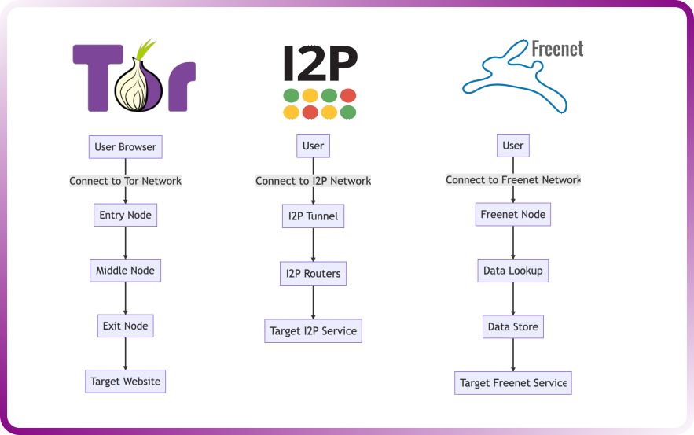

## 1. Surface Web, Deep Web et Dark Web

Le Dark Web désigne une partie du Web accessible via des réseaux spécifiques, généralement conçus pour renforcer l'anonymat et la confidentialité des communications.

Il faut distinguer trois concepts :

|Concept|Définition|Exemples|
|---|---|---|
|Surface Web|Contenus publics généralement indexés par les moteurs de recherche|Sites d'actualités, blogs, pages publiques|
|Deep Web|Contenus non indexés par les moteurs de recherche classiques|Emails privés, intranets, bases de données, espaces authentifiés|
|Dark Web|Contenus accessibles via des réseaux spécifiques tels que Tor ou I2P|Services `.onion`, sites et forums anonymes|

```
Web
├── Surface Web
│   └── Public / Indexed
│
└── Deep Web
    ├── Private / Non-indexed content
    └── Dark Web
        └── Anonymous overlay networks
```


- Deep Web ≠ Dark Web : la majorité du Deep Web est parfaitement légitime et accessible avec un navigateur classique, parfois après authentification.
    - Partie d'Internet qui n'est pas indexée par les moteurs de recherche standard. Il est donc difficile d'accéder à ces contenus sans un lien d'accès direct.
    - Le contenu du web profond est accessible via des liens directs, des requêtes de base de données ou des réseaux privés. Par exemple, les bases de données universitaires, les profils privés de médias sociaux, les boîtes de réception d'e-mails personnels et certaines ressources gouvernementales font partie du web profond.
    
- Darknet : infrastructure réseau spécifique (Tor, I2P, etc.).
    
- Dark Web : services et contenus web accessibles à travers ces réseaux.
    

Le Dark Web permet notamment :

- des communications préservant la confidentialité ;
    
- le contournement de la censure ;
    
- le journalisme et l'activisme ;
    
- l'hébergement de services anonymes ;
    
- certaines activités cybercriminelles.
    

⚠️ Anonymat renforcé ≠ anonymat garanti : erreurs d'OPSEC, compromission de l'endpoint ou corrélation de trafic peuvent compromettre l'identité d'un utilisateur.

## 2. Importance du Dark Web en CTI

Le Dark Web constitue une source potentielle de Cyber Threat Intelligence (CTI), car certains Threat Actors y échangent des données, des outils, des accès compromis et des informations sur leurs opérations.

### Threat Intelligence

La surveillance de forums et communautés clandestines peut permettre de découvrir :

- des campagnes en préparation ;
    
- des organisations ou secteurs ciblés ;
    
- des vulnérabilités exploitées ;
    
- de nouveaux outils et TTPs ;
    
- des discussions sur des infrastructures compromises.
    

Exemple :

```
Threat Actor
→ Claims exploitation of Application X
→ Organization uses Application X
→ Verify Exposure / Vulnerability
→ Hunting + Mitigation
```


Une information trouvée sur un forum constitue une piste de renseignement, pas automatiquement une menace confirmée.

### Leaked Data / Compromised Credentials

Certaines plateformes hébergent ou commercialisent :

- credentials volés ;
    
- bases de données exfiltrées ;
    
- informations personnelles ;
    
- données internes d'organisations ;
    
- accès VPN/RDP compromis ;
    
- infostealer logs contenant des cookies, sessions ou credentials récupérés sur des endpoints.
    

L'objectif défensif est de déterminer si ces informations concernent directement ou indirectement l'organisation.

#### Risques liés aux tiers

```
Employee / Partner Compromise
          ↓
Credentials / Sensitive Data Leaked
          ↓
Credential Reuse / Unauthorized Access
          ↓
Organization Compromise
```


Scénarios importants :

- Un employé réutilise son password personnel sur un compte professionnel.
    
- Un partenaire perd des credentials donnant accès à une plateforme partagée.
    
- Des tokens ou session cookies compromis permettent un accès non autorisé.
    

La CTI doit donc couvrir également la Third-Party / Supply Chain Exposure.

> Une fuite observée sur le Dark Web ne prouve pas à elle seule une compromission récente : les données peuvent être anciennes, recyclées ou frauduleuses.

### Zero-Day Vulnerabilities et Exploits

Certains marchés et forums proposent :

- informations sur des vulnérabilités non publiques ;
    
- exploits ;
    
- outils offensifs ;
    
- accès à des systèmes déjà compromis.
    

Distinctions :

- Zero-Day Vulnerability : vulnérabilité encore inconnue du fournisseur ou sans correctif disponible au moment considéré, selon le contexte.
    
- Exploit : code ou technique permettant de tirer parti d'une vulnérabilité.
    
- N-Day : vulnérabilité déjà divulguée, potentiellement toujours exploitable sur des systèmes non corrigés.
    

Intérêt CTI :

```
Vulnerability Intelligence
+
Affected Products
+
Asset Inventory
+
Observed Exploitation
→ Prioritized Mitigation
```


⚠️ Une annonce affirmant vendre un zero-day n'en garantit ni l'authenticité ni l'exploitabilité.

### X-as-a-Service — Cybercrime Services

Le Dark Web peut servir de marché pour des modèles de cybercriminalité commercialisés comme services.

Exemples :

- RaaS — Ransomware-as-a-Service : modèle dans lequel des opérateurs fournissent une infrastructure ransomware à des affiliés.
    
- DDoS-as-a-Service : prestation d'attaques par déni de service.
    
- Access Brokers : vente d'accès initiaux à des environnements compromis.
    
- Vente d'outils, d'infrastructures ou de données volées.
    

Ces modèles peuvent abaisser la barrière technique nécessaire pour conduire certaines attaques.

### Hacktivism et Threat Actor Communities

Certains groupes utilisent ces réseaux pour :

- communiquer ;
    
- publier des revendications ;
    
- organiser des campagnes ;
    
- diffuser des informations techniques.
    

Une organisation peut être ciblée en fonction de :

- son secteur ;
    
- sa localisation ;
    
- ses partenaires ;
    
- son activité ;
    
- son exposition médiatique ou politique.
    

Les informations recueillies peuvent contribuer à anticiper des campagnes telles que des attaques DDoS ou des opérations de divulgation de données.

## 3. Technologies du Dark Web


### Tor — The Onion Router

Tor est un réseau utilisant l'Onion Routing pour acheminer le trafic à travers plusieurs relais, avec un chiffrement par couches.

Pour un accès à Internet classique :

```
User
  ↓
Guard / Entry Node
  ↓
Middle Relay
  ↓
Exit Node
  ↓
Destination
```


- Guard Node : connaît l'IP de l'utilisateur, mais pas nécessairement sa destination finale.
    
- Middle Relay : transmet le trafic entre les relais.
    
- Exit Node : communique avec la destination Internet, mais ne connaît normalement pas l'IP réelle du client.
    

Chaque relais ne possède qu'une partie des informations nécessaires au routage.

⚠️ Le trafic entre l'Exit Node et un site Internet classique n'est pas automatiquement chiffré de bout en bout par Tor : HTTPS reste important.

#### Onion Services

Les services Tor utilisent des adresses :

```
example...onion
```


- Accessibles via Tor.
    
- Permettent de masquer l'IP du serveur.
    
- Ne nécessitent pas d'Exit Node pour rejoindre un service `.onion`.
    

Tor n'est pas limité à la navigation web : d'autres applications peuvent également utiliser son réseau.

### I2P — Invisible Internet Project

Réseau anonyme conçu principalement pour les communications internes au réseau I2P.
Contrairement à Tor, il est conçu spécifiquement pour la communication de pair à pair (peer-to-peer).

Caractéristiques :

- routage chiffré entre plusieurs participants ;
    
- tunnels entrants et sortants ;
    
- architecture décentralisée ;
    
- services internes accessibles via des adresses `.i2p` ;
    
- mécanismes de découverte distribués, notamment netDb.
-  Cependant, contrairement à Tor, I2P utilise une table de hachage distribuée (DHT) pour le routage du trafic plutôt qu'un répertoire central.
    - Cette caractéristique rend la censure ou le blocage du trafic I2P plus difficile car aucune structure centrale n'est utilisée comme dans Tor.
    

I2P utilise notamment le Garlic Routing, qui permet de regrouper plusieurs messages dans une structure chiffrée.

```
User
→ I2P Tunnels
→ Internal I2P Service
```


Contrairement à Tor, souvent utilisé pour accéder également au Web classique, I2P privilégie les services hébergés à l'intérieur de son propre réseau.

### Freenet

Freenet est un projet de réseau décentralisé orienté vers la publication et le partage de contenus résistant à la censure.

Principes :

- stockage distribué ;
    
- contenus répartis entre plusieurs nœuds ;
    
- chiffrement ;
    
- publication de contenus sans serveur web central classique.
    

Utilisations possibles :

- partage de fichiers ;
    
- publication anonyme ;
    
- forums et contenus distribués.
    

### Comparaison

|Technologie|Fonction principale|Particularité|
|---|---|---|
|Tor|Communications anonymisées et accès aux Onion Services|Onion Routing|
|I2P|Communications et services internes anonymes|Garlic Routing|
|Freenet|Stockage et publication distribués|Distributed Content Storage|

Texte collé.txt

## 4. Dark Web Monitoring en CTI

L'objectif n'est pas simplement de consulter des plateformes clandestines, mais d'en extraire des informations pertinentes, fiables et exploitables.

### Informations à surveiller

- mentions du nom de l'organisation et de ses marques ;
    
- domaines et adresses email d'entreprise ;
    
- credentials et données compromises ;
    
- revendications de ransomware ;
    
- annonces de vente d'accès ;
    
- vulnérabilités touchant les technologies utilisées ;
    
- campagnes visant le secteur ou les partenaires.
    

### Workflow CTI

```
Dark Web Monitoring
        ↓
Identify Relevant Information
        ↓
Verify Source / Credibility
        ↓
Assess Organizational Exposure
        ↓
Enrich with Technical Intelligence
        ↓
Detection / Threat Hunting / Mitigation
```


Exemple :

```
Leaked Corporate Credentials
        ↓
Verify Exposure
        ↓
Investigate Authentication Logs
        ↓
Check Suspicious Sessions / MFA Activity
        ↓
Revoke Sessions + Rotate Credentials
        ↓
Monitor for Further Abuse
```


### Précautions opérationnelles

La surveillance de ces environnements nécessite :

- un environnement de recherche isolé et maîtrisé ;
    
- une OPSEC adaptée ;
    
- l'absence d'utilisation de comptes personnels ou de credentials professionnels ;
    
- des procédures encadrant le téléchargement et le traitement d'éventuels malwares ou données sensibles ;
    
- le respect des obligations légales et de confidentialité.
    

Dark Web Monitoring ≠ preuve de compromission : une revendication ou une publication doit être validée avant de déclencher des conclusions d'incident ou une attribution.

L'intérêt principal pour la CTI est de transformer des signaux externes en actions défensives : identification d'expositions, priorisation des risques, investigation des accès et amélioration des détections.
