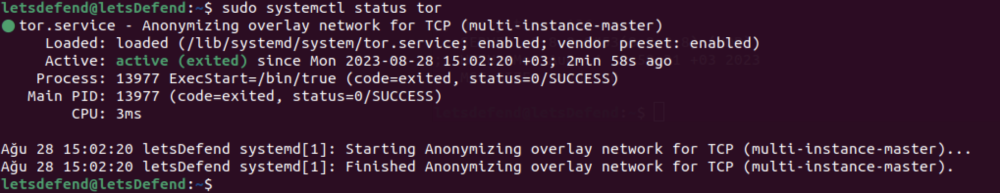
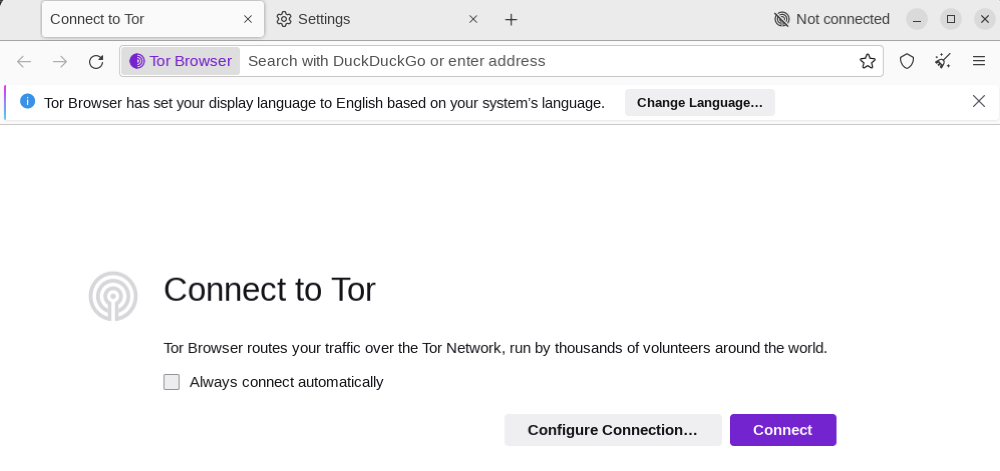
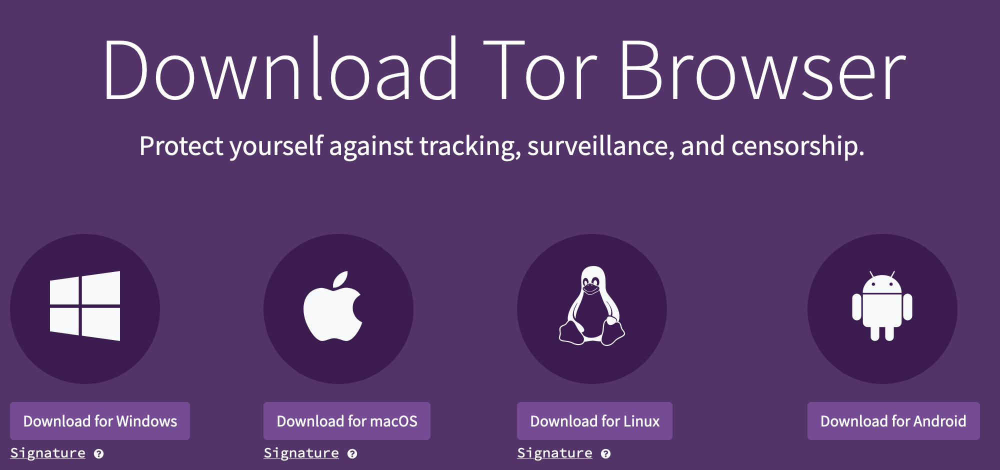
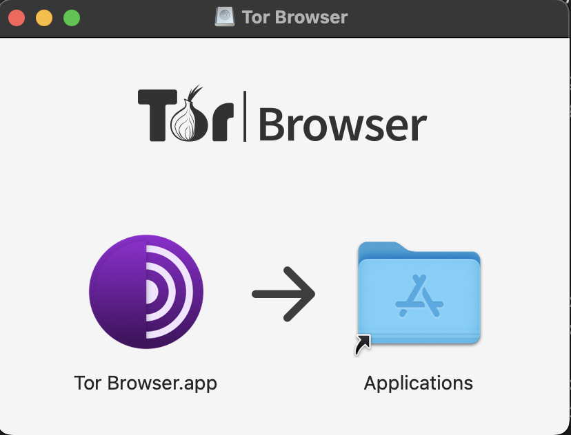
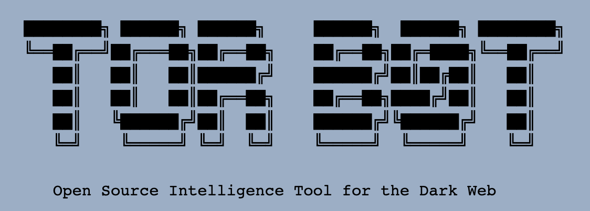
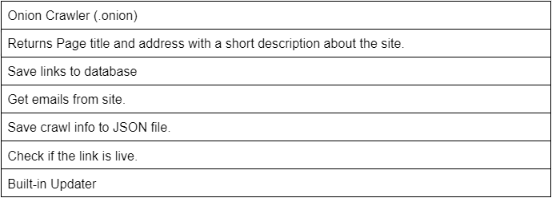
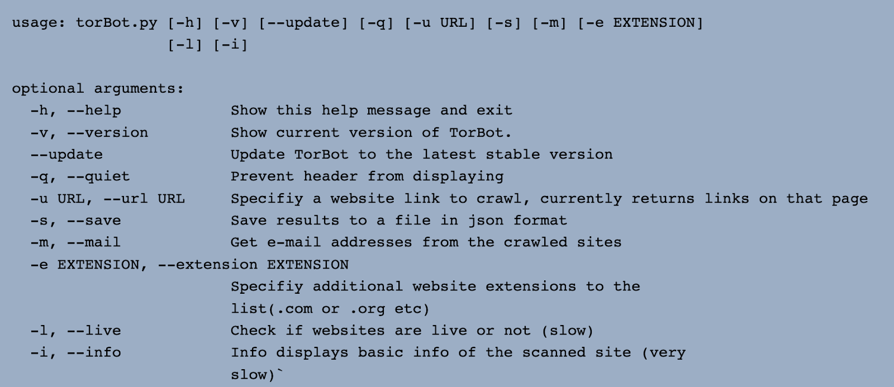
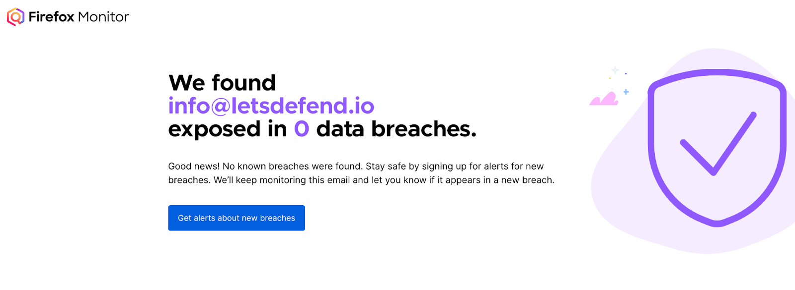

La surveillance du Dark Web permet de collecter des informations sur les Threat Actors, les campagnes d'attaque, les données compromises et les menaces susceptibles de cibler une organisation.

Le Dark Web Monitoring constitue une activité de CTI visant à identifier des signaux précoces et à les transformer en actions défensives.

- Surveillance manuelle : chronophage, couverture limitée.
- Surveillance automatisée : collecte régulière, recherche d'indicateurs et détection de nouvelles mentions.
- Limite : aucun outil ne garantit une visibilité complète du Dark Web (services privés, forums fermés, sites éphémères, accès restreints).

```
Dark Web Sources
       ↓
Automated Collection
       ↓
Text Analysis / Enrichment
       ↓
Threat Intelligence
       ↓
Alerting / Threat Hunting / Mitigation
```


## 1. Méthodes de surveillance

### Web Crawlers

Un Web Crawler est un programme qui visite automatiquement des pages et collecte leurs contenus.

Dans le contexte du Dark Web :

- exploration de sites et services `.onion` ;
- découverte de liens vers d'autres services ;
- extraction de textes, domaines, emails ou autres artefacts ;
- indexation des informations ;
- collecte périodique pour identifier les changements.

```
Onion Service
     ↓
Crawler
     ↓
Extract Content / Links
     ↓
Index / Store
     ↓
Search & Analysis
```


Les crawlers ne peuvent pas explorer automatiquement tous les services Tor : certains nécessitent une authentification, ne sont pas publiquement référencés ou deviennent rapidement indisponibles.

### Language & Text Analysis — NLP

Le Natural Language Processing (NLP) permet d'analyser automatiquement les contenus collectés.

Applications :

- Keyword Matching : recherche de noms d'entreprises, domaines, produits, etc.
- Entity Extraction : identification de personnes, organisations, IP, domaines.
- Topic Classification : classement des discussions par thème.
- Trend Analysis : identification d'une hausse des mentions ou de nouveaux sujets.
- Deduplication : réduction des résultats identiques ou repostés.

Exemple :

```
Forum Post
→ "Selling VPN access to Company X"
        ↓
NLP / Keyword Matching
        ↓
Company X identified
        ↓
CTI Alert
```


L'analyste doit ensuite vérifier :

- la fiabilité de la source ;
- la crédibilité de la revendication ;
- la pertinence pour l'organisation ;
- l'ancienneté de l'information.

Mention détectée ≠ compromission confirmée.

### Threat Intelligence Platforms — TIP

Les plateformes spécialisées regroupent des informations provenant de plusieurs sources :

- Dark Web ;
- OSINT ;
- rapports de recherche ;
- malware intelligence ;
- données sur les vulnérabilités ;
- feeds d'IOCs.

Solutions citées :

- Recorded Future ;
- CrowdStrike ;
- Insight ;
- FE Intelligence.

Selon leurs fonctionnalités, ces services peuvent proposer :

- Dark Web Monitoring ;
- Compromised Credentials Monitoring ;
- Brand / Domain Monitoring ;
- Third-Party Risk Monitoring ;
- alertes et rapports personnalisés.

```
Dark Web + OSINT + Technical Intelligence
                    ↓
          Threat Intelligence Platform
                    ↓
       Correlation / Enrichment / Alerting
                    ↓
                 SOC / CTI
```


L'intérêt principal est de réduire les efforts de collecte et d'analyse manuelles.

## 2. Connexion au réseau Tor

### Linux — Ubuntu

Installation de Tor Core, puis de Tor Browser.

Il faut distinguer :

| Composant             | Utilisation                                                              |
| --------------------- | ------------------------------------------------------------------------ |
| Tor Core / Tor Daemon | Service permettant à des applications d'utiliser le réseau Tor           |
| Tor Browser           | Navigateur configuré pour accéder au réseau Tor et aux services `.onion` |

Tor Browser n'exige pas l'installation préalable d'un service Tor système : il dispose de ses propres composants de connexion.

#### Vérification de l'architecture

```
dpkg --print-architecture
```


Exemple :

```
amd64
```


Cette information est notamment utilisée pour sélectionner les packages compatibles.

#### Installation de Tor Core

Sur Ubuntu, Tor peut être installé à partir des dépôts disponibles. Les dépôts officiels du Tor Project sont recommandés afin d'obtenir une version adaptée.

Commandes de gestion du service :

```
sudo apt update
sudo apt install tor
sudo systemctl start tor
sudo systemctl status tor
```




Selon le packaging Debian/Ubuntu, le service effectif peut être l'instance `tor@default` :

```
sudo systemctl status tor@default
```


Vérifier que le daemon est réellement actif, et pas uniquement qu'une unité de gestion est démarrée.

#### Configuration des dépôts — attention

Plusieurs éléments de cette procédure sont datés :

- `focal` correspond spécifiquement à Ubuntu 20.04, pas à toutes les versions Ubuntu.
- `apt-transport-https` n'est généralement plus nécessaire sur les versions modernes d'APT.
- Pour les dépôts source, la syntaxe est `deb-src` (et non `deb -src`).
- Les clés de signature et les dépôts doivent être récupérés conformément aux instructions officielles adaptées à la distribution.

Pour une installation actuelle depuis les dépôts du Tor Project, consulter la [documentation officielle Tor APT](https://support.torproject.org/apt/) plutôt que réutiliser directement les commandes contenant `focal`.

### Tor Browser

Sous Linux :

1. Télécharger Tor Browser depuis le [site officiel](https://www.torproject.org/download/).
2. Vérifier l'origine et, idéalement, la signature du téléchargement.
3. Extraire l'archive.
4. Lancer Tor Browser depuis un compte utilisateur standard.
    1. Il est fortement déconseillé d'utiliser un compte root.
5. Cliquer sur Connect pour établir une connexion au réseau Tor.



La version `12.5.2` est ancienne : ne pas conserver son URL de téléchargement comme procédure d'installation permanente.

Ne pas exécuter Tor Browser en root.

Une fois connecté, Tor Browser permet notamment d'accéder aux Onion Services :

```
Tor Browser
→ Tor Network
→ .onion Service
```


### macOS

Installation plus simple :

- télécharger le package macOS depuis le site officiel ;
- ouvrir le fichier `.dmg` ;
- déplacer Tor Browser dans `Applications` ;
- lancer le navigateur et se connecter.





### Précautions OPSEC

Pour une activité professionnelle de Dark Web Monitoring :

- utiliser un environnement de recherche contrôlé et isolé ;
- éviter les comptes personnels et credentials professionnels ;
- ne pas télécharger ou exécuter de fichiers inconnus sans procédure d'analyse ;
- protéger les données collectées, notamment les credentials et données personnelles ;
- respecter les autorisations et obligations légales.

Tor améliore l'anonymat réseau, mais ne garantit pas l'anonymat de l'utilisateur.

## 3. TorBot



TorBot est un outil open source développé en Python (projet OWASP).

Il permet d'automatiser certaines tâches OSINT sur le réseau Tor :

- découverte de services `.onion` ;
- extraction de liens ;
- exploration automatisée de pages ;
- recherche d'informations et de mots-clés selon les fonctionnalités disponibles.



```
Tor Network
     ↓
TorBot
     ↓
Onion Links / Collected Information
     ↓
OSINT / CTI Analysis
```


### Intérêt CTI

Exemple :

```
Organization Domain
→ Search across collected Onion Content
→ Potential Credential Leak / Mention
→ Analyst Validation
```


TorBot peut servir de base à un processus de collecte personnalisé, notamment lorsque l'organisation préfère construire ses propres outils.

Limites :

- couverture incomplète du réseau Tor ;
- résultats dépendant des services accessibles ;
- compatibilité et fonctionnalités variables selon la version ;
- nécessité de maintenir l'outil et de contrôler la qualité des données.



Le cours présente son fonctionnement via des captures, mais ne fournit pas de commandes textuelles suffisamment détaillées pour documenter une procédure d'exécution complète.

## 4. Firefox Monitor / Mozilla Monitor



Firefox Monitor, désormais connu sous le nom de Mozilla Monitor, est un service permettant de vérifier si une adresse email apparaît dans certaines fuites de données connues.

Site : [Mozilla Monitor](https://monitor.mozilla.org/)

Fonctionnalités principales :

- recherche d'adresses email compromises ;
- identification de certaines data breaches ;
- informations sur les données potentiellement exposées ;
- alertes pour les adresses surveillées, selon le service.

### Intérêt SOC / CTI

Exemple :

```
Corporate Email
       ↓
Mozilla Monitor
       ↓
Known Data Breach Match
       ↓
Verify Exposure
       ↓
Credential / Account Investigation
```


Si une adresse professionnelle apparaît dans une fuite :

- vérifier la nature et la date de la compromission ;
- déterminer si les credentials concernés peuvent encore être valides ;
- rechercher d'éventuelles authentifications suspectes ;
- révoquer les sessions ou réinitialiser les credentials si nécessaire ;
- vérifier la présence de MFA.

### Automatisation

Le cours évoque la création d'un script Python pour surveiller les adresses des employés.

Cette démarche doit toutefois s'appuyer sur une méthode d'accès officiellement supportée et autorisée, plutôt que supposer qu'un service web fournit une API publique librement automatisable.

L'organisation doit aussi disposer de l'autorisation nécessaire pour traiter les adresses et informations liées aux employés.

Absence de résultat ≠ absence de fuite : les services de monitoring ne disposent pas d'une base exhaustive de toutes les données compromises.

## 5. Exploitation des résultats en CTI

Les outils de monitoring sont surtout utiles lorsqu'ils alimentent un processus d'investigation.

| Signal détecté                                | Investigation / Action                                    |
| --------------------------------------------- | --------------------------------------------------------- |
| Credentials d'entreprise divulgués            | Vérifier les comptes, sessions et authentifications       |
| Vente supposée d'accès VPN/RDP                | Vérifier les accès distants et les logs VPN               |
| Mention de l'organisation par un Threat Actor | Évaluer la crédibilité, rechercher des traces d'intrusion |
| Nouvelle technique d'attaque                  | Hunting et amélioration des détections                    |
| Vulnérabilité ciblant un produit utilisé      | Vérifier l'exposition et prioriser la remédiation         |
| Données d'un partenaire compromises           | Évaluer le risque Third-Party / Supply Chain              |

Workflow opérationnel :

```
Automated Dark Web Monitoring
            ↓
Relevant Mention / Indicator
            ↓
Source Validation
            ↓
Threat & Exposure Assessment
            ↓
SIEM / EDR / Authentication / Vulnerability Checks
            ↓
Detection / Containment / Remediation
```


L'objectif n'est donc pas de collecter le maximum de données, mais de détecter suffisamment tôt les informations pertinentes pour l'organisation, vérifier leur crédibilité et les convertir en actions de prévention, de détection ou d'Incident Response.

Source des captures : [Hack The Box Academy - Cyber Threat Intelligence for Detection](https://academy.hackthebox.com/app/module/483)
