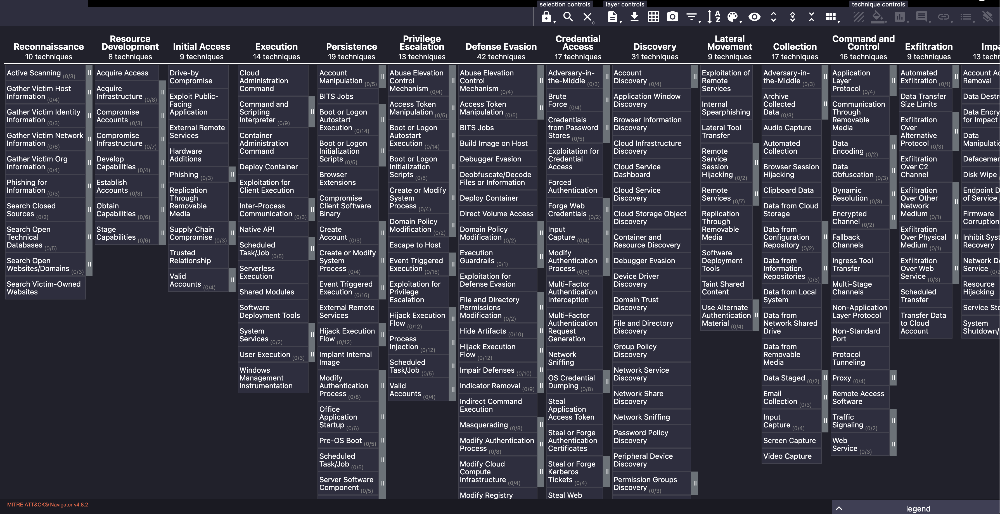

Ces trois concepts sont fondamentaux en Cyber Threat Intelligence (CTI) :

- Malware : logiciel malveillant utilisé pour compromettre un système.
    
- IOC (Indicator of Compromise) : artefact permettant de rechercher des traces d'activité malveillante.
    
- Threat Group : groupe d'acteurs associé à des campagnes, objectifs et TTPs spécifiques.
    

Ils permettent de relier les informations techniques d'une attaque à ses méthodes et, parfois, aux acteurs impliqués.

## 1. Malware

Un Malware (Malicious Software) est un logiciel conçu pour compromettre un système, perturber son fonctionnement, voler des informations ou effectuer des actions non autorisées.

### Principales catégories

|Type|Fonctionnement|
|---|---|
|Virus|Infecte d'autres fichiers/programmes et se propage généralement lors de leur exécution.|
|Worm|Se propage de manière autonome, souvent en exploitant des systèmes accessibles sur le réseau.|
|Trojan|Logiciel présenté comme légitime mais contenant des fonctionnalités malveillantes.|
|Ransomware|Chiffre les données ou bloque l'accès à un système afin d'exiger une rançon.|
|Spyware|Collecte discrètement des informations sur l'utilisateur ou le système.|
|Adware|Affiche des publicités indésirables et peut modifier certains paramètres du navigateur.|
|Keylogger|Enregistre les frappes clavier afin de récupérer des informations, notamment des credentials.|
|Rootkit|Ensemble de composants visant à dissimuler une présence ou des activités malveillantes.|
|Botnet|Réseau d'appareils compromis contrôlés à distance, notamment pour du DDoS, du spam ou d'autres opérations.|

### Distinctions importantes

- Virus vs Worm :
    
    - Virus → dépend généralement d'un fichier/programme hôte.
        
    - Worm → peut se propager sans intervention humaine après son activation initiale.
        
    
- Trojan décrit principalement une méthode de présentation/distribution, pas une fonctionnalité unique.
    
- Botnet désigne un réseau de machines compromises, et non une catégorie de logiciel malveillant à proprement parler.
    
- Rootkit ne signifie pas systématiquement malware kernel-mode : des mécanismes de dissimulation existent également en user-mode.
    
- Adware n'est pas toujours strictement malveillant ; certains cas relèvent plutôt des Potentially Unwanted Applications (PUA).
    
- Les ransomwares modernes peuvent combiner chiffrement + exfiltration de données + extorsion (double extortion).
    

Un même malware peut appartenir à plusieurs catégories :

```
Trojan
  ↓
Installs Backdoor
  ↓
Credential Theft
  ↓
C2 Communication
  ↓
Additional Payload / Ransomware
```


### Vecteurs d'infection

- phishing / malicious attachments ;
    
- téléchargements de fichiers piégés ;
    
- exploitation de vulnérabilités ;
    
- installation par un autre malware ;
    
- logiciels compromis ou modifications malveillantes dans la supply chain.
    

Mesures défensives :

- patch management ;
    
- antivirus / EDR ;
    
- filtrage des emails et téléchargements ;
    
- application control ;
    
- Least Privilege ;
    
- sensibilisation des utilisateurs.
    

## 2. IOC — Indicator of Compromise

Un IOC est un artefact technique observable pouvant indiquer une activité malveillante ou une compromission.

Il est utilisé pour :

- détecter des activités suspectes ;
    
- identifier des systèmes potentiellement compromis ;
    
- retrouver des traces historiques (retro-hunting) ;
    
- enrichir une investigation ;
    
- corréler plusieurs événements ;
    
- alimenter des détections SIEM / EDR / NDR.
    

### Types d'IOCs

|Catégorie|Exemples|
|---|---|
|IP Addresses|IP de C2, infrastructure malveillante|
|Domains / URLs|Domaine de phishing, URL de téléchargement de payload|
|Email Artifacts|Adresse expéditrice, objet, en-têtes, pièces jointes|
|File Hashes|MD5, SHA-1, SHA-256|
|File Paths / Names|Emplacement d'un payload, nom de fichier suspect|
|System Artifacts|Registry Keys, services, scheduled tasks, fichiers créés|

### File Hashes

Un hash représente une empreinte calculée à partir du contenu d'un fichier.

```
Malware.exe
    ↓
SHA-256
    ↓
File Hash
    ↓
Search in EDR / SIEM
```


- MD5 / SHA-1 : souvent présents dans les feeds historiques, mais vulnérables aux collisions cryptographiques.
    
- SHA-256 : généralement privilégié pour identifier des fichiers.
    
- Deux fichiers différents peuvent théoriquement partager un hash : une correspondance n'est pas une preuve mathématique absolue d'identité.
    

Un simple changement dans le contenu d'un malware peut produire un hash complètement différent.

### IOC Hunting

Exemple :

```
CTI Report
→ Malicious Domain Identified
          ↓
Search DNS / Proxy / Firewall Logs
          ↓
Identify Hosts
          ↓
Correlate with EDR
          ↓
Investigate Potential Compromise
```


Les IOCs peuvent être intégrés dans :

- SIEM ;
    
- EDR / XDR ;
    
- IDS / IPS ;
    
- firewalls / proxies ;
    
- Threat Intelligence Platforms (MISP, OTX, etc.).
    

### Limites des IOCs

- Les attaquants peuvent changer rapidement d'IP, de domaine ou de hash.
    
- Certaines infrastructures sont partagées (cloud, CDN, hébergement mutualisé).
    
- Les IOCs peuvent devenir obsolètes.
    
- Une correspondance peut générer un false positive.
    

IOC Match ≠ Compromise Confirmed.

La pertinence dépend du contexte : source, timestamp, réputation, fréquence, processus associé et autres événements.

### IOC vs TTP

|IOC|TTP|
|---|---|
|Artefact observable|Comportement / méthode de l'attaquant|
|IP, domaine, hash, chemin|Credential Dumping, Phishing, Lateral Movement|
|Souvent facile à remplacer|Généralement plus difficile à modifier|
|Utile pour identifier une menace connue|Utile pour détecter des comportements similaires|

La Pyramid of Pain illustre notamment pourquoi les détections basées sur les TTPs sont généralement plus durables que celles reposant uniquement sur des indicateurs facilement remplaçables.

## 3. Threat Groups

Les Threat Groups regroupent des acteurs associés à des objectifs, des campagnes et des TTPs communs.

Leur étude permet de comprendre :

- WHO : quels acteurs pourraient être impliqués ;
    
- WHY : leurs motivations ;
    
- HOW : leurs méthodes ;
    
- WHAT : les systèmes, données et secteurs ciblés.
    

### Catégories de Threat Actors

|Catégorie|Motivations / activités|
|---|---|
|State-Sponsored Groups|Espionnage, opérations stratégiques, sabotage, objectifs géopolitiques|
|Financially Motivated Groups|Ransomware, fraude, vol de données ou d'argent|
|Hacktivists|Motivations politiques, sociales ou idéologiques|
|Terrorist Groups|Objectifs idéologiques, terrorisme et opérations de perturbation|
|Cybercriminals|Fraude, extorsion, revente de données, vente d'accès compromis|

Ces catégories peuvent se chevaucher : un groupe cybercriminel peut être financièrement motivé, tandis qu'un acteur étatique peut également mener des opérations générant des revenus.

### Attribution d'un Threat Group

Les chercheurs tentent d'identifier les groupes à partir de plusieurs éléments :

- malware families ;
    
- TTPs ;
    
- infrastructure C2 ;
    
- vulnérabilités exploitées ;
    
- secteurs et régions ciblés ;
    
- horaires / patterns opérationnels ;
    
- ressemblances avec des campagnes historiques.
    

Exemple :

```
Observed Intrusion
    ↓
Malware + TTPs + C2 Infrastructure
    ↓
Compare with Threat Intelligence
    ↓
Possible Threat Group Attribution
```


Attention : utiliser le même malware ou les mêmes techniques qu'un groupe connu ne prouve pas que celui-ci est responsable.

Les outils peuvent être partagés, revendus ou réutilisés. L'attribution doit être accompagnée d'un niveau de confiance et rester distincte de l'identification technique des activités.

## 4. MITRE ATT&CK

MITRE est une organisation américaine à but non lucratif qui développe notamment des ressources et frameworks de cybersécurité.

MITRE ATT&CK — Adversarial Tactics, Techniques, and Common Knowledge est une base de connaissances documentant les comportements observés chez les adversaires.

Elle permet de :

- classifier les techniques d'attaque ;
    
- comprendre les méthodes employées par les Threat Actors ;
    
- relier des campagnes à leurs TTPs ;
    
- développer des détections ;
    
- orienter le Threat Hunting et l'Incident Response ;
    
- évaluer la couverture de sécurité.
    

### Structure ATT&CK

|Élément|Signification|
|---|---|
|Tactic|WHY — objectif tactique de l'attaquant|
|Technique|HOW — méthode utilisée|
|Sub-technique|Variante plus précise d'une technique|
|Procedure|Implémentation concrète observée dans une attaque|

Exemple :

```
Tactic
→ Credential Access
      ↓
Technique
→ OS Credential Dumping (T1003)
      ↓
Sub-technique
→ LSASS Memory (T1003.001)
      ↓
Procedure
→ Utilisation concrète d'un outil
  pour extraire des secrets de LSASS
```


### ATT&CK Matrix

La matrice ATT&CK présente :

- colonnes : Tactics ;
    
- techniques et sub-techniques : comportements permettant d'atteindre ces objectifs.
    

Exemples de Tactics :

- Initial Access ;
    
- Execution ;
    
- Persistence ;
    
- Privilege Escalation ;
    
- Defense Evasion ;
    
- Credential Access ;
    
- Discovery ;
    
- Lateral Movement ;
    
- Collection ;
    
- Command and Control ;
    
- Exfiltration ;
    
- Impact.
    

Précision : les Tactics représentent des objectifs, pas des étapes obligatoirement chronologiques. Une attaque n'utilise pas nécessairement toutes les Tactics et peut revenir plusieurs fois sur certaines d'entre elles.

### Threat Groups dans ATT&CK

MITRE documente également les groupes observés et leurs comportements :

[MITRE ATT&CK — Groups](https://attack.mitre.org/groups/)

Les fiches permettent de consulter :

- noms et alias du groupe ;
    
- description et activités connues ;
    
- techniques utilisées ;
    
- logiciels associés ;
    
- références aux rapports de recherche.
    

Deux distinctions importantes :

- Group = WHO : acteur ou ensemble d'activités attribuées.
    
- Software = WITH WHAT : malware ou outil utilisé.
    

Un groupe peut employer plusieurs logiciels, et un même logiciel peut être utilisé par plusieurs groupes.

### Applications SOC / CTI

```
Threat Intelligence Report
       ↓
Identify Threat Group / Software / TTPs
       ↓
Map Techniques to MITRE ATT&CK
       ↓
Check Existing Detection Coverage
       ↓
Develop SIEM / EDR Rules
       ↓
Threat Hunting / Validation
```


Exemple :

Un rapport CTI indique qu'un groupe utilise fréquemment :

- `T1059.001` — PowerShell ;
    
- `T1003.001` — LSASS Memory ;
    
- `T1053.005` — Scheduled Task.
    

L'équipe SOC peut alors vérifier si son environnement dispose d'une télémétrie et de détections adaptées :

|Technique|Sources de détection possibles|
|---|---|
|PowerShell|Event ID 4104, 4103, EDR|
|LSASS Memory|EDR, Sysmon et autres télémétries d'accès aux processus selon configuration|
|Scheduled Task|Security 4698, TaskScheduler/Operational|

L'objectif n'est pas uniquement de savoir quel groupe pourrait attaquer, mais surtout de comprendre quelles techniques il utilise et comment les détecter dans son propre environnement.
