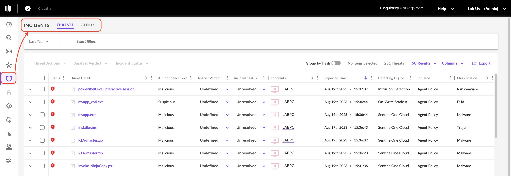
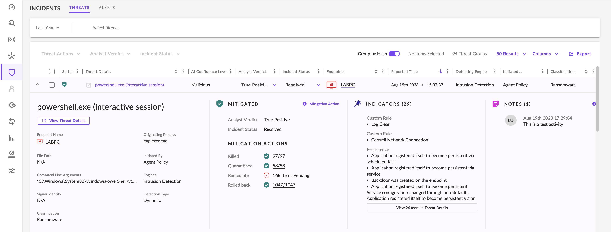
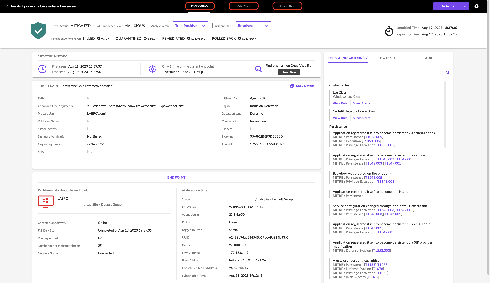

Le Threat Management & Analysis regroupe les activités permettant de détecter, investiguer, traiter et analyser les cybermenaces identifiées par une solution EDR/XDR.

- EDR : surveillance et investigation des activités endpoint (processus, fichiers, connexions réseau, etc.).
    
- XDR : extension de ces capacités grâce à la corrélation de plusieurs sources de sécurité.
    
- Automated / Semi-Automated Response : application automatique de certaines protections ou intervention validée par un analyste.
    

L'objectif est de comprendre ce qui s'est produit, sur quel endpoint, comment la menace a été détectée et quelles mesures ont été appliquées.

## 1. Threat Management & Analysis Process

Six activités complémentaires.

|Étape|Fonction|
|---|---|
|Detection|Surveillance des endpoints et identification d'activités suspectes ou malveillantes|
|Investigation|Analyse de l'origine, du comportement et de l'impact potentiel de la menace|
|Response|Actions de confinement ou de neutralisation : isolation, suppression de malware, etc.|
|Remediation|Réparation des dommages, restauration des systèmes et renforcement des protections|
|Learning|Analyse des causes et des faiblesses exploitées pour améliorer les défenses|
|Threat Hunting|Recherche proactive d'activités malveillantes non encore détectées|

```
Detection → Investigation → Response
                           ↓
                       Remediation
                           ↓
                         Learning
```


Le Threat Hunting peut intervenir indépendamment d'une alerte et alimenter chacune de ces étapes.

### Distinctions importantes

- Detection ≠ Confirmed Compromise : une alerte nécessite une validation.
    
- Response ≠ Remediation : arrêter une activité malveillante ne répare pas nécessairement les modifications qu'elle a causées.
    
- Learning : les conclusions de l'investigation permettent d'améliorer les futures détections.
    

## 2. Threat Management with SentinelOne

SentinelOne centralise les détections et les investigations dans le menu Incidents.

Deux onglets :

|Onglet|Contenu|
|---|---|
|Threats|Menaces détectées par les moteurs natifs de SentinelOne|
|Alerts|Activités déclenchant les règles personnalisées STAR Custom Rules|

Cette distinction permet de séparer les détections des moteurs intégrés et celles provenant de règles développées par les équipes de sécurité.

### Threat Details

Depuis l'onglet Threats, une détection peut être développée pour afficher ses informations détaillées.

|Champ|Signification|
|---|---|
|Endpoint Name|Hostname du système concerné|
|File Path|Chemin du fichier associé à la menace|
|Command Line Arguments|Arguments utilisés lors de l'exécution du processus|
|Signer Identity|Identité du signataire numérique du fichier|
|Classification|Catégorie de menace : ransomware, Trojan, etc.|
|Originating Process|Processus à l'origine de l'activité ou associé à son déclenchement|
|Initiated By|Compte utilisateur ou système associé à l'initiation de l'activité|
|Engines|Moteurs SentinelOne ayant détecté la menace|
|Detection Type|Méthode de détection utilisée|
|Analyst Verdict|Évaluation ou décision enregistrée par l'analyste ou le système|
|Incident Status|État de traitement de l'incident|
|Indicators|Indicateurs et comportements associés à la détection|
|Notes|Commentaires et observations ajoutés pendant l'investigation|

### Comment interpréter ces informations ?

Identification de la menace

- `Classification` : quel type de menace est signalé ?
    
- `Engines` : quels moteurs ont déclenché la détection ?
    
- `Detection Type` : comment l'activité a-t-elle été identifiée ?
    

Contexte d'exécution

- `Endpoint Name` : quelle machine est concernée ?
    
- `File Path` : quel fichier est associé à l'activité ?
    
- `Command Line Arguments` : comment le processus a-t-il été exécuté ?
    
- `Originating Process` : quel processus est à l'origine de l'activité ?
    
- `Initiated By` : quel compte est associé à son initiation ?
    

Suivi de l'investigation

- `Analyst Verdict` : quelle conclusion a été enregistrée ?
    
- `Incident Status` : où en est le traitement ?
    
- `Indicators` et `Notes` : quelles observations soutiennent l'analyse ?
    

### Précisions techniques

- Signer Identity : renseigne sur l'identité liée au certificat de signature, pas nécessairement sur l'auteur réel du malware. Un certificat légitime peut être utilisé abusivement.
    
- Initiated By : identifie un compte associé à l'activité, mais ne prouve pas quelle personne physique a exécuté l'action.
    
- Incident Status : un statut indiquant une quarantaine ou une résolution ne démontre pas, à lui seul, que toutes les conséquences de l'attaque ont été éliminées.
    

## 3. View Threat Details

Le bouton View Threat Details ouvre une interface d'investigation plus approfondie.

Cette interface comprend trois onglets ; Overview et Explore sont décrits ci-dessous.

### Overview

L'onglet Overview reprend les informations principales de la détection et apporte davantage de contexte sur l'endpoint.

Informations supplémentaires mentionnées :

- version du système d'exploitation ;
    
- policy appliquée ;
    
- domaine ;
    
- adresse IP de l'endpoint.
    

Ces informations permettent de situer la menace dans son environnement technique et de mieux comprendre le système concerné.

### Explore

L'onglet Explore permet d'analyser la chaîne d'exécution liée à la menace.

Il présente notamment :

- le processus initial associé à la détection ;
    
- les processus exécutés à sa suite ;
    
- une Timeline des événements ;
    
- un Process Tree ;
    
- les événements regroupés par catégorie ;
    
- les panneaux Event Details et Process Summary.
    

### Process Tree & Timeline

Le Process Tree permet de visualiser les relations entre les processus.

Exemple illustratif :

```
explorer.exe
    └── suspicious.exe
          └── powershell.exe
```


Cette structure aide l'analyste à comprendre la succession des exécutions et à identifier les processus qui nécessitent une investigation.

La Timeline permet d'examiner l'ordre chronologique des événements associés à l'activité suspecte.

### Event Details & Process Summary

Lorsqu'un processus est sélectionné dans le Process Tree :

- Event Details : affiche les informations détaillées de l'événement sélectionné.
    
- Process Summary : présente des informations récapitulatives sur le processus.
    
- Les événements liés aux processus peuvent être consultés par catégorie dans la partie inférieure de l'interface.
    

Ces fonctionnalités servent à reconstituer le déroulement de la menace et à examiner son comportement.

## 4. Workflow d'investigation avec SentinelOne

Application pratique :

```
Incidents → Threats / Alerts
              ↓
       Select Detection
              ↓
       Review Threat Details
              ↓
       Identify Endpoint / User
              ↓
        View Threat Details
              ↓
       Overview → Explore
              ↓
     Process Tree + Timeline
              ↓
       Analyze Related Events
              ↓
       Determine Next Actions
```


### Questions à examiner

1. Quelle menace ? Classification, Detection Type et Engines.
    
2. Sur quel système ? Endpoint Name, IP, OS et policy.
    
3. Comment a-t-elle démarré ? Originating Process, Command Line et Initiated By.
    
4. Que s'est-il passé ensuite ? Process Tree, Timeline et événements associés.
    
5. Quel est l'état du traitement ? Analyst Verdict, Incident Status et Notes.
    

L'intérêt de SentinelOne ne se limite donc pas à signaler un fichier malveillant : ses vues d'investigation permettent de replacer une détection dans une séquence d'exécution, d'examiner les activités liées et de guider les actions de réponse.
