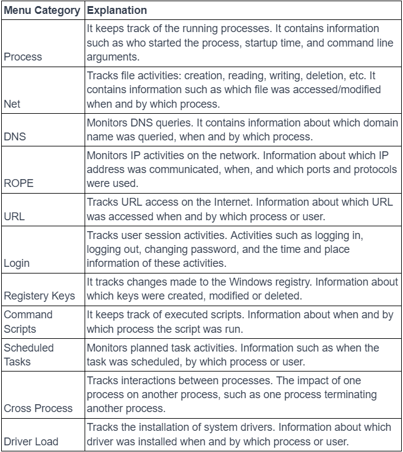
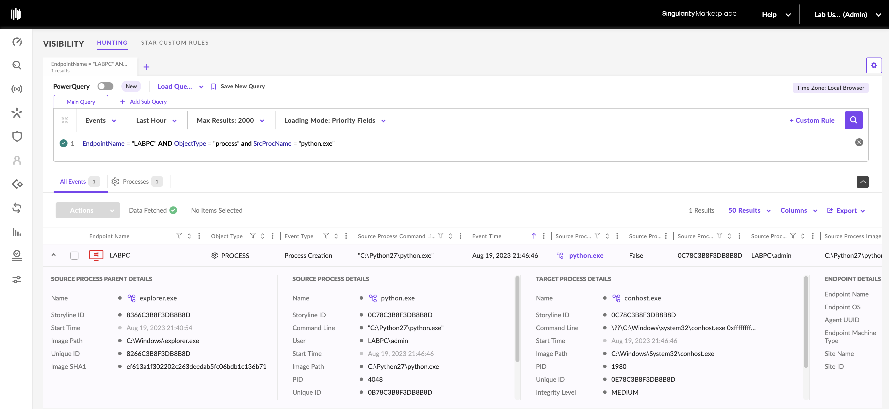
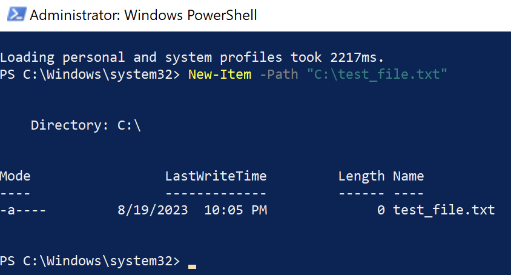
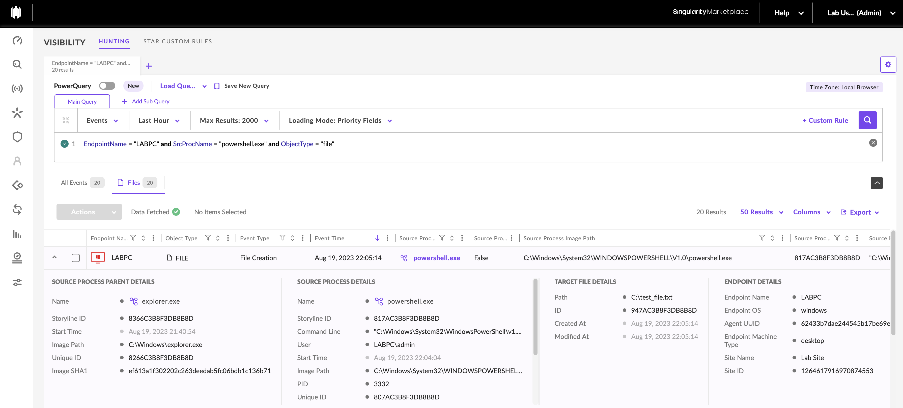
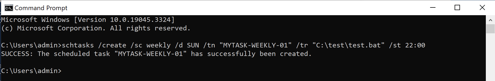
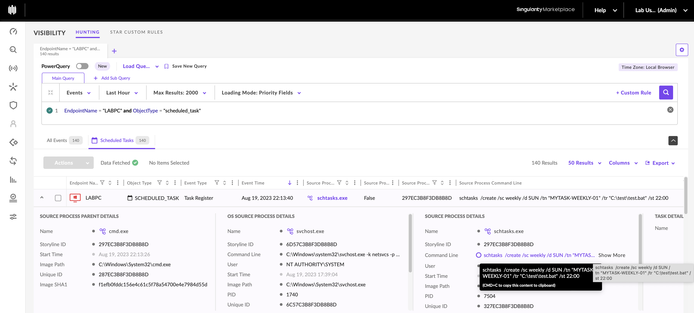
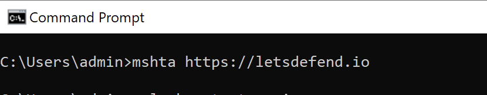
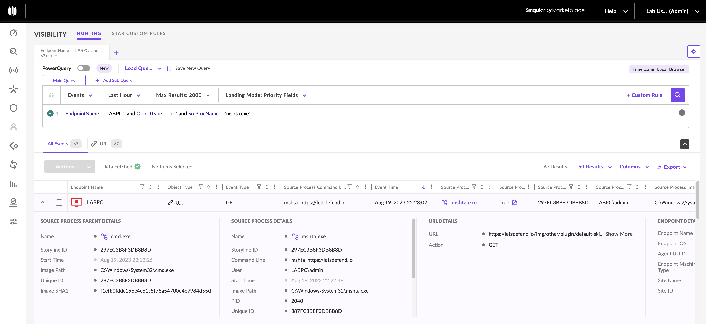

La EDR Telemetry désigne l'ensemble des événements collectés sur les endpoints afin de détecter, comprendre et investiguer les activités potentiellement malveillantes.

Les solutions EDR exploitent cette télémétrie à travers différentes méthodes :

- Behavioral Analysis : identification de comportements suspects.
    
- Heuristic Analysis : recherche de caractéristiques potentiellement malveillantes.
    
- Machine Learning / AI : classification et détection automatisées.
    
- Threat Hunting : recherche proactive d'activités non détectées.
    
- Incident Response : reconstruction des actions de l'attaquant et évaluation de l'impact.
    

La visibilité dépend de l'agent, de la configuration et des événements effectivement collectés.

## 1. EDR Telemetry — Sources de données

|Catégorie|Informations observables|Utilisation|
|---|---|---|
|Process Activity|Exécutions, processus parents, command lines|Détecter des exécutions suspectes|
|File Activity|Création et autres opérations sur les fichiers|Identifier des payloads ou artefacts|
|Scheduled Tasks|Activités liées aux tâches planifiées|Rechercher des mécanismes de Persistence|
|URL Activity|URLs associées aux activités des processus|Investiguer des destinations suspectes|
|Network Activity|Connexions et communications observées|Rechercher des C2 ou transferts suspects|
|System Events|Activités et modifications du système|Repérer des changements de configuration suspects|
|User Activity|Comptes et comportements utilisateurs observables|Relier une activité à un compte|

Les exemples utilisent SentinelOne Deep Visibility, accessible depuis le menu `Visibility`.
{ width="465" }

## 2. SentinelOne — Data Collection & Analysis

SentinelOne permet de rechercher des événements endpoint au moyen de requêtes filtrant les attributs de la télémétrie.

Champs utilisés :

|Champ|Fonction|
|---|---|
|`EndpointName`|Nom de l'endpoint concerné|
|`ObjectType`|Catégorie d'objet ou d'événement recherché|
|`SrcProcName`|Nom du processus source associé à l'événement|

La combinaison de ces champs permet de restreindre une recherche à une machine, un type d'activité et un processus.

### Example 1 — Process Execution

Scénario : lancement de `C:\Python27\python.exe` sur l'endpoint `LABPC`.

Requête SentinelOne :

```
EndpointName = "LABPC" AND ObjectType = "process" and SrcProcName = "python.exe"
```


Cette recherche cible les événements de processus correspondant aux critères indiqués.

Utilisation en Threat Hunting :

- Identifier les activités impliquant un processus spécifique.
    
- Rechercher les exécutions associées à un outil suspect.
    
- Examiner le contexte de lancement et les événements liés.
    

La présence de `python.exe` ne constitue pas une preuve d'activité malveillante : il peut être utilisé légitimement pour l'administration et le développement.

### Example 2 — File Creation

Scénario : un fichier est créé sur `LABPC` à partir de PowerShell, avec la commande `New-Item`.

Requête :

```
EndpointName = "LABPC" and SrcProcName = "powershell.exe" and ObjectType = "file"
```


Cette recherche permet d'identifier les événements fichiers associés à `powershell.exe`.

Utilisation en Threat Hunting :

- Rechercher les fichiers créés par PowerShell.
    
- Identifier des artefacts liés à l'exécution d'un script.
    
- Corréler les opérations fichiers avec l'activité des processus.
    

Précision : `ObjectType = "file"` ne signifie pas nécessairement File Creation uniquement. Il faut examiner le type exact d'opération dans les détails de l'événement.
{ width="448" }



### Example 3 — Scheduled Task

Scénario : une nouvelle tâche planifiée est créée sur `LABPC` depuis `cmd.exe`, en utilisant `schtasks`.

Requête :

```
EndpointName = "LABPC" and ObjectType = "scheduled_task"
```


Cette recherche cible la télémétrie associée aux Scheduled Tasks.

Utilisation en Threat Hunting :

- Identifier des tâches planifiées suspectes.
    
- Rechercher des mécanismes de Persistence.
    
- Vérifier les commandes et comptes associés.
    
- Corréler l'événement avec le processus ayant créé la tâche.
    

Référence utile : MITRE ATT&CK T1053.005 — Scheduled Task.

Une tâche planifiée n'est pas automatiquement malveillante. Son contexte, sa commande et son origine doivent être analysés.

{ width="442" }

{ width="587" }
### Example 4 — URL Activity

Scénario : une tentative d'accès à `https://letsdefend.io` est effectuée depuis `LABPC` à l'aide de `mshta.exe`, lancé via CMD.

Requête :

```
EndpointName = "LABPC" and ObjectType = "url" and SrcProcName = "mshta.exe"
```


Cette recherche cible les événements URL associés à `mshta.exe`.

Utilisation en Threat Hunting :

- Identifier des URLs associées à un processus particulier.
    
- Rechercher des activités de téléchargement ou d'exécution distante suspectes.
    
- Corréler les événements URL avec les processus et connexions réseau.
    

`mshta.exe` est un composant Windows légitime qui peut être détourné par des attaquants (Living-off-the-Land).

Référence : MITRE ATT&CK T1218.005 — Mshta.

Attention : un événement URL ne prouve pas nécessairement que le contenu distant a été récupéré ou exécuté avec succès. Il faut vérifier les événements complémentaires.

{ width="368" }
{ width="614" }

## 3. Applications de la télémétrie EDR

### Threat Hunting

Recherche proactive d'activités suspectes à partir des événements collectés.

Exemples :

- exécutions inhabituelles ;
    
- créations de fichiers suspectes ;
    
- scheduled tasks inattendues ;
    
- connexions réseau anormales.
    

### Incident Response

Lorsqu'un incident est détecté, la télémétrie aide à déterminer :

- comment l'attaque a commencé ;
    
- quelles actions ont été exécutées ;
    
- quels fichiers ou systèmes sont concernés ;
    
- comment la menace a pu progresser.
    

### Digital Forensics

La télémétrie EDR peut aider à reconstruire une Timeline des événements et à identifier des artefacts numériques pertinents.

Elle ne remplace cependant pas systématiquement une acquisition forensic complète : sa couverture et sa rétention peuvent être limitées.

### Risk & Compliance Assessment

Les données endpoint peuvent contribuer à évaluer :

- l'état de sécurité des machines ;
    
- certains écarts de configuration ;
    
- les privilèges et activités des utilisateurs ;
    
- la conformité à certaines politiques internes.
    

Ces évaluations nécessitent parfois des sources complémentaires, notamment pour l'inventaire des vulnérabilités et des correctifs.

### Behavioral Analysis

L'analyse comportementale consiste à comparer les activités observées à des comportements attendus ou à des modèles de détection.

Elle peut aider à identifier des techniques inconnues des bases de signatures.

### Network Monitoring & Analysis

La télémétrie endpoint peut apporter du contexte sur les connexions réseau :

- processus associé ;
    
- endpoint source ;
    
- destination ;
    
- comportement observé.
    

Toutefois, un EDR ne remplace pas automatiquement une capture réseau complète ni les capacités d'un NDR.

## 4. Méthode d'investigation avec Deep Visibility

```
Hunting Hypothesis
        ↓
Select Endpoint / Event Type
        ↓
Execute Visibility Query
        ↓
Review Matching Events
        ↓
Correlate Process / File / URL / Task
        ↓
Evaluate Suspicious Behavior
        ↓
Investigation / Detection Improvement
```


Exemple : une tâche planifiée inconnue apparaît sur un endpoint.

L'analyste peut rechercher l'événement `scheduled_task`, identifier son contexte de création, examiner les processus associés, puis vérifier les éventuelles activités fichiers ou réseau survenues ensuite.

### Points de vigilance

- Telemetry Event ≠ Malicious Activity : un événement indique une activité observée, pas nécessairement une attaque.
    
- No Results ≠ No Compromise : une recherche vide peut résulter d'une collecte incomplète, d'un mauvais filtre ou d'une rétention insuffisante.
    
- Les recherches doivent respecter le schéma de champs et la syntaxe de la version SentinelOne utilisée.
    
- La corrélation des événements est essentielle pour passer d'une observation isolée à une conclusion défendable.
    

L'intérêt principal de SentinelOne Deep Visibility est de permettre au Threat Hunter de rechercher des événements précis, puis de les corréler pour comprendre les activités réalisées sur un endpoint, reconstituer une séquence suspecte et alimenter l'Incident Response ou la création de nouvelles règles de détection.
