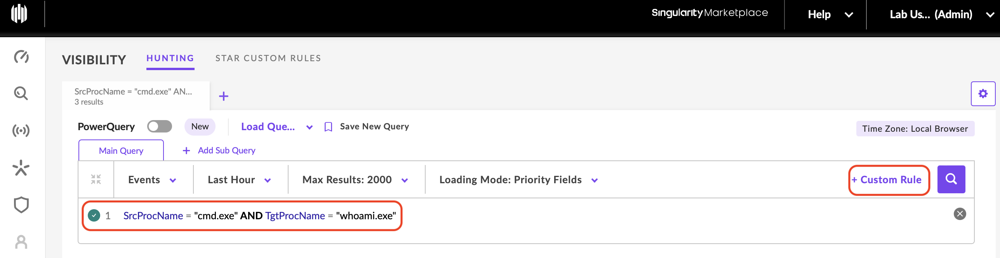
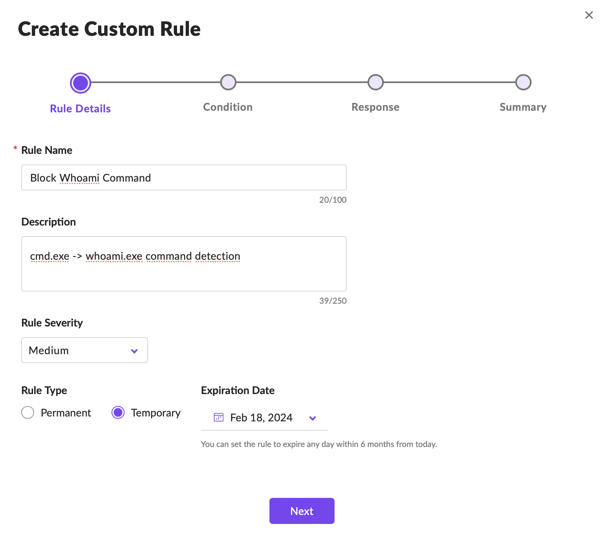
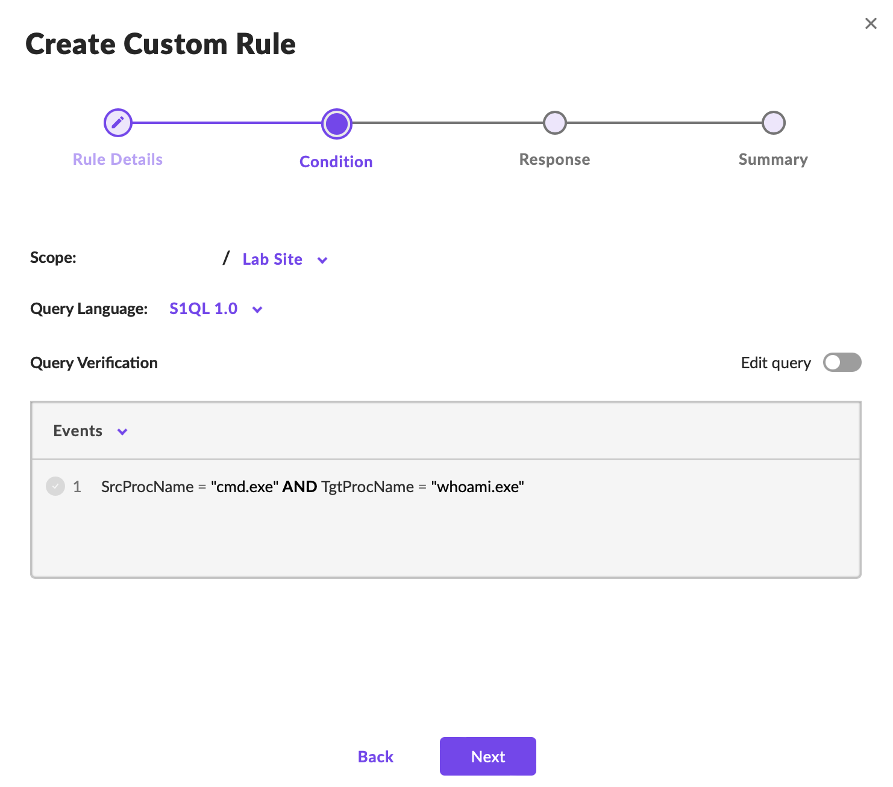
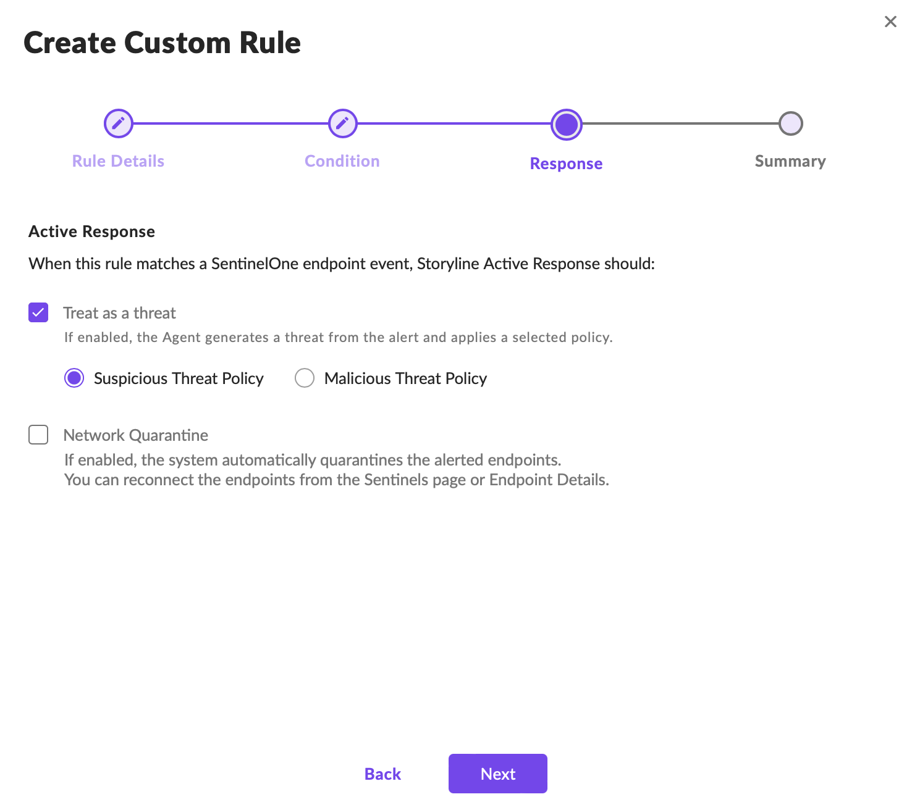
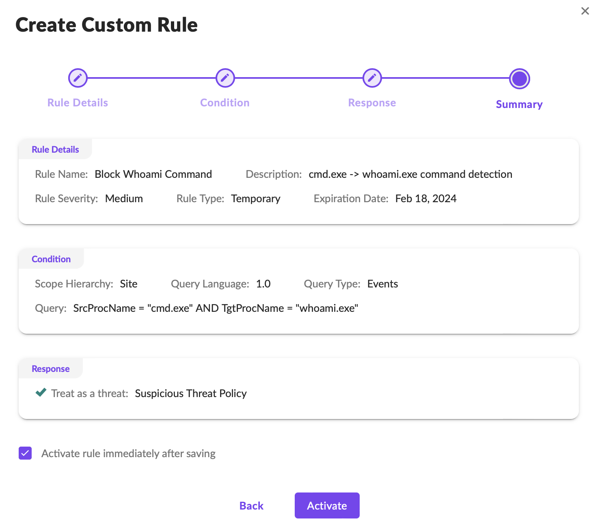
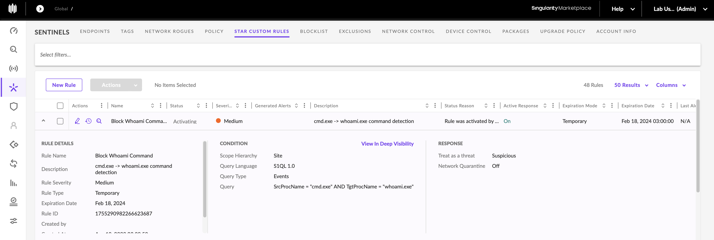
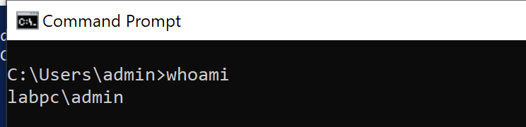
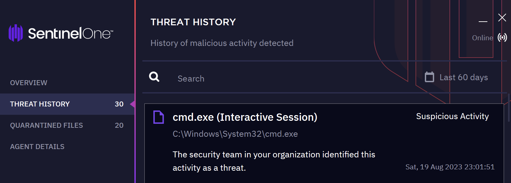
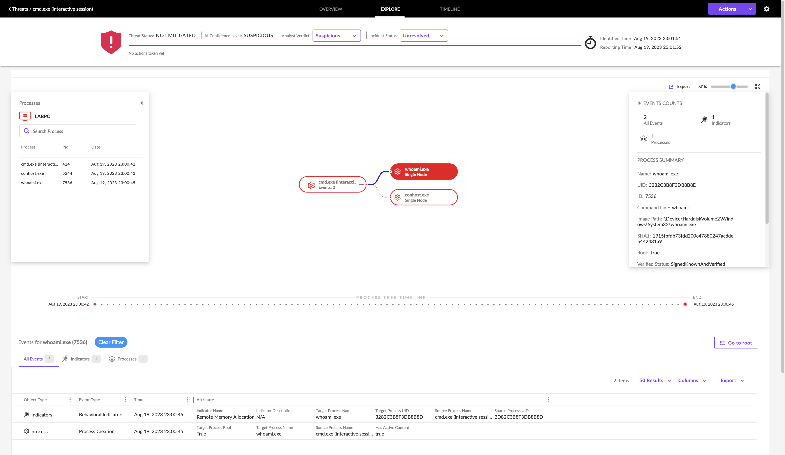

Les Custom EDR Rules permettent de créer des règles de détection adaptées aux applications, à l'infrastructure et aux menaces propres à une organisation.

Contrairement aux règles natives d'un EDR, conçues pour couvrir un large éventail de menaces, elles ciblent des comportements ou scénarios spécifiques.

## 1. Pourquoi développer des Custom Rules ?

Les règles personnalisées permettent notamment de :

- Environment-Specific Detection : surveiller des applications, processus ou comportements particuliers.
    
- Emerging Threat Detection : rechercher de nouvelles techniques identifiées par la CTI.
    
- Insider Threat Detection : identifier des activités internes potentiellement malveillantes.
    
- Detection Tuning : adapter les détections pour réduire les False Positives.
    
- Proactive Protection : transformer les résultats du Threat Hunting en alertes ou actions de protection.
    

Exemple : rechercher l'exécution d'une commande de reconnaissance à partir d'un processus particulier.

## 2. Custom Rule Development Life Cycle

|Étape|Objectif|
|---|---|
|Needs Analysis|Identifier le scénario ou comportement à détecter|
|Rule Design|Définir les conditions de déclenchement|
|Testing & Implementation|Vérifier le fonctionnement et les False Positives / False Negatives|
|Monitoring & Improvement|Surveiller les résultats et ajuster la règle|

### Points de vigilance

- False Positives : une règle trop large peut signaler des activités légitimes.
    
- False Negatives : une règle trop restrictive peut manquer des variantes de l'attaque.
    
- Performance : des règles nombreuses ou coûteuses peuvent augmenter la charge de traitement.
    
- Maintenance : les règles doivent évoluer avec l'environnement et les TTPs adverses.
    

Une règle efficace doit être suffisamment précise pour détecter le comportement recherché, sans générer un volume excessif d'alertes.

## 3. Custom Rules avec SentinelOne

SentinelOne permet de transformer une recherche effectuée dans Deep Visibility / Hunting en règle personnalisée.

Deux méthodes :

- `Visibility → Hunting → + Custom Rule`
    
- `Visibility → STAR Custom Rules → New Rule`
    

### Scénario du lab

Objectif : détecter l'exécution de `whoami.exe` par `cmd.exe` sur l'endpoint `LABPC`.

```
cmd.exe
   └── whoami.exe
```


`whoami.exe` permet d'identifier le contexte utilisateur et peut être associé à la technique MITRE ATT&CK T1033 — System Owner/User Discovery.

Cependant, cette commande est également utilisée légitimement par les administrateurs et les utilisateurs.

Exécution de `whoami.exe` ≠ compromission confirmée.

### Étape 1 — Rule Query

Dans `Visibility → Hunting` :

1. Construire une requête permettant d'identifier l'activité `cmd.exe → whoami.exe`.
    
2. Vérifier qu'elle retourne les événements attendus.
    
3. Cliquer sur + Custom Rule.
    



### Étape 2 — Rule Information

Définir les métadonnées de la règle :

|Paramètre|Fonction|
|---|---|
|Rule Name|Nom de la règle|
|Description|Comportement recherché|
|Rule Severity|Niveau de sévérité attribué|
|Rule Type|Règle temporaire ou permanente|

La sévérité représente la priorité définie pour la règle ; elle ne prouve pas la gravité réelle d'un incident.

### Étape 3 — Rule Scope

Sélectionner les Sites ou Groups sur lesquels la règle doit s'appliquer.

L'option Edit Query permet de modifier la recherche avant de poursuivre.

Le scope est important pour éviter d'activer inutilement une règle sur tous les endpoints.

### Étape 4 — Rule Actions

Définir le comportement de SentinelOne lorsqu'un événement correspond à la requête.

Options :

|Action|Effet|
|---|---|
|Alert Only|Générer une alerte|
|Threat — Detect|Identifier l'activité comme une menace sans blocage automatique|
|Threat — Block|Appliquer une action de protection|
|Network Quarantine|Isoler l'endpoint concerné du réseau|

⚠️ Une règle déclenchant une alerte ne signifie pas nécessairement que l'activité a été bloquée.

Pour le scénario `cmd.exe → whoami.exe`, une action de blocage ou d'isolation automatique peut être disproportionnée, car cette séquence est courante dans un contexte légitime.

Une phase initiale en Alert Only / Detect permet d'évaluer son comportement réel.

### Étape 5 — Review & Activation

La dernière étape présente un récapitulatif de la règle.

- Vérifier la query, le scope et les actions.
    
- Sélectionner Activate rule immediately after saving si une activation immédiate est souhaitée.
    
- Cliquer sur Activate.
    

Le statut de la règle peut être vérifié dans :

`Sentinels → STAR Custom Rules`

Les emplacements exacts des menus dépendent de la version de SentinelOne.



## 4. Validation de la règle — LABPC

Test de la règle : ouvrir `cmd.exe` sur `LABPC`, puis exécuter :

```
whoami.exe
```


### Résultat attendu

1. SentinelOne observe l'activité `cmd.exe → whoami.exe`.
    
2. La Custom Rule correspondante se déclenche.
    
3. Une alerte Suspicious Threat apparaît sur l'agent.
    
4. La console SentinelOne permet d'examiner les détails de la détection.
    

```
LABPC
  ↓
cmd.exe → whoami.exe
  ↓
STAR Custom Rule Match
  ↓
Suspicious Threat Alert
  ↓
Analyst Investigation
```


Cela confirme que la règle détecte le scénario testé, pas que l'exécution est malveillante.



## 5. Amélioration d'une Custom Rule

Après validation du déclenchement, le travail de Detection Engineering consiste à améliorer la qualité des alertes.

Pour `cmd.exe → whoami.exe`, l'analyste peut examiner :

- Parent Process : quel programme a lancé `cmd.exe` ?
    
- User Context : quel compte exécute la commande ?
    
- Endpoint : poste utilisateur, serveur critique ou machine d'administration ?
    
- Timeline : quelles activités précèdent et suivent l'exécution ?
    
- Related Events : d'autres commandes de reconnaissance ou comportements suspects sont-ils présents ?
    

Exemple :

Une exécution isolée de `whoami.exe` sur un poste administrateur peut être parfaitement légitime. La même commande exécutée après un lancement inhabituel de script, puis suivie d'activités de reconnaissance, mérite davantage d'attention.

Complément pratique : enrichir une détection avec des relations parent/enfant, des conditions contextuelles et des exclusions justifiées peut réduire les False Positives, à condition que la télémétrie et le moteur de règles prennent en charge ces critères.

## 6. Du Threat Hunting à la Detection Engineering

```
Threat Hunting
      ↓
Suspicious Behavior Identified
      ↓
Build Visibility Query
      ↓
Create STAR Custom Rule
      ↓
Define Scope & Response
      ↓
Test / Validate
      ↓
Monitor & Tune
```


Le principal intérêt des Custom EDR Rules est de transformer une recherche ponctuelle en détection réutilisable.

Une règle doit être évaluée selon trois aspects : précision de détection, impact opérationnel et qualité de la réponse configurée. Une correspondance technique valide ne suffit pas, à elle seule, à justifier une action automatique de confinement.
