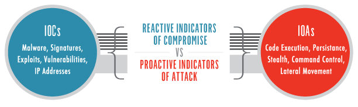

Le Threat Hunting (chasse aux menaces) est un processus proactif de recherche de menaces ou d'activités malveillantes non détectées dans les systèmes et réseaux d'une organisation.

Contrairement à une investigation déclenchée par une alerte, le Threat Hunting repose sur une recherche volontaire de comportements suspects, même en l'absence d'alerte préalable.

Objectifs :

- Identifier des attaquants déjà présents dans l'environnement.
    
- Détecter des attaques sophistiquées échappant aux contrôles existants.
    
- Rechercher des comportements anormaux et des TTPs malveillantes.
    
- Réduire le Dwell Time : durée pendant laquelle un attaquant reste présent avant sa détection.
    
- Améliorer les capacités de détection et la posture de sécurité.
    

```
Threat Intelligence / Hypothesis
              ↓
       Threat Hunting
              ↓
   Collect & Analyze Data
              ↓
     Suspicious Activity?
              ↓
   Investigation / Validation
              ↓
 Detection Improvement / IR
```


Le Threat Hunting est complémentaire aux activités du SOC, de la CTI et de l'Incident Response.

## 1. Limites des mesures de sécurité réactives

Les mécanismes de sécurité traditionnels reposent notamment sur :

- Antivirus / EDR : détection de malwares et comportements suspects sur les endpoints.
    
- Firewall : contrôle des communications réseau.
    
- IDS/IPS : détection ou prévention d'attaques réseau.
    
- SIEM : centralisation, corrélation des logs et génération d'alertes.
    

Ces solutions permettent d'identifier de nombreuses menaces, mais peuvent présenter des limites :

- Menaces inconnues ou zero-day.
    
- Techniques d'évasion et obfuscation.
    
- Utilisation d'outils légitimes (Living-off-the-Land).
    
- Activités malveillantes ne déclenchant aucune règle.
    
- Manque de visibilité ou de télémétrie.
    
- False negatives.
    

```
Malicious Activity
       ↓
Security Controls
       ↓
No Detection / No Alert
       ↓
Attacker Remains Undetected
```


Absence d'alerte ≠ absence de compromission.

Les mécanismes traditionnels ne détectent pas uniquement des menaces connues ; les EDR, IDS et autres solutions modernes peuvent également utiliser des détections comportementales. Le Threat Hunting permet surtout de rechercher ce qui a échappé à ces mécanismes.

## 2. Sécurité réactive vs proactive

|Approche réactive|Approche proactive|
|---|---|
|Investigation déclenchée par une alerte ou un incident|Recherche volontaire de menaces cachées|
|Analyse d'une activité déjà signalée|Recherche de comportements non signalés|
|Réponse à une détection existante|Identification de lacunes de détection|
|Principalement alert-driven|Principalement hypothesis-driven|

### Reactive Security

```
Attack
→ Detection Alert
→ SOC Triage
→ Investigation
→ Incident Response
```


L'investigation démarre généralement lorsqu'un outil ou un utilisateur signale une activité suspecte.

### Proactive Threat Hunting

```
Threat Hypothesis
→ Search Telemetry
→ Analyze Behavior
→ Validate Findings
→ Improve Detection
```


Le Threat Hunter peut rechercher une menace avant qu'elle ne déclenche une alerte.

Point important : proactif ne signifie pas nécessairement avant la compromission. Le Threat Hunting cherche souvent des adversaires déjà présents, mais encore non détectés.

## 3. Le paysage des cybermenaces

Les organisations font face à des menaces variées :

- APT — Advanced Persistent Threats : campagnes ciblées et parfois prolongées, généralement dotées de capacités avancées.
    
- Ransomware : chiffrement, exfiltration et extorsion.
    
- Spyware : collecte clandestine d'informations.
    
- Malware : programmes malveillants aux fonctionnalités diverses.
    
- Threat Actors exploitant des vulnérabilités ou abusant d'outils légitimes.
    

Les attaquants peuvent contourner certaines détections en modifiant leurs outils, infrastructures ou procédures.

Le Threat Hunting cherche donc à identifier des comportements suspects, et pas uniquement des IOCs connus.

### IOC vs IOA

Deux concepts utiles pour comprendre cette approche :

- IOC — Indicator of Compromise : artefact associé à une compromission, comme un domaine C2 ou un hash malveillant.
    
- IOA — Indicator of Attack : comportement ou enchaînement d'actions pouvant révéler une attaque en cours.
    


Exemple :

```
IOC:
→ Connection to known malicious IP

IOA:
→ Unusual PowerShell execution
→ Credential Access behavior
→ Unexpected outbound connection
```


Les IOCs permettent notamment de retrouver des menaces connues, tandis que les IOAs et TTPs favorisent la recherche de comportements plus durables.

## 4. Rôle du Threat Hunter

Le Threat Hunter analyse les données de sécurité pour identifier des activités qui n'ont pas été détectées automatiquement.

Activités principales :

- Data Collection : collecter les logs et autres télémétries disponibles.
    
- Behavioral Analysis : rechercher des comportements inhabituels.
    
- Threat Intelligence : utiliser des renseignements sur les techniques adverses.
    
- Investigation : examiner les événements suspects et rechercher des preuves complémentaires.
    
- Detection Improvement : transformer les résultats en nouvelles règles et capacités de détection.
    

Sources possibles :

|Source|Visibilité|
|---|---|
|EDR / Sysmon|Processus, fichiers, registre, connexions endpoint|
|Windows Event Logs|Authentification, comptes, PowerShell, services, tâches planifiées|
|DNS / Proxy|Domaines et URLs contactés|
|Firewall / NetFlow|Communications, ports et volumes réseau|
|IDS/IPS|Signatures d'attaques réseau|
|SIEM|Centralisation et corrélation des événements|
|CTI|IOCs, TTPs, campagnes et Threat Actors|

### Exemple de Threat Hunting

Hypothèse :

Un attaquant pourrait utiliser PowerShell pour effectuer de la reconnaissance après avoir obtenu un accès initial.

Recherche :

```
Windows Event ID 4104
→ PowerShell Script Block Logging
        ↓
whoami / Get-LocalUser / Get-LocalGroup
        ↓
Correlate with Logon Events
        ↓
Unexpected User / Time / Host?
        ↓
Investigate
```


Ces commandes sont légitimes dans de nombreux contextes. Leur présence devient intéressante lorsqu'elles sont associées à un comportement inhabituel ou à d'autres indices de compromission.

## 5. Bénéfices du Threat Hunting

- Early Detection : identifier plus rapidement des activités malveillantes non signalées.
    
- Reduced Dwell Time : diminuer la durée de présence non détectée d'un adversaire.
    
- Improved Incident Response : fournir des informations exploitables pour une investigation.
    
- Detection Engineering : améliorer les règles de détection existantes.
    
- Security Posture Improvement : identifier les lacunes de visibilité et renforcer les capacités défensives.
    

```
Threat Hunting
     ↓
Undetected Threat / Detection Gap
     ↓
Investigation
     ↓
New Detection Rules
     ↓
Better SOC Visibility
```


Une chasse peut être utile même sans découverte d'incident : elle peut mettre en évidence un manque de logs, une hypothèse non vérifiable ou une technique insuffisamment couverte.

Le Threat Hunting ne remplace pas la surveillance continue ni l'Incident Response. Il complète ces activités en recherchant volontairement les menaces cachées et en améliorant progressivement les capacités de détection de l'organisation.
