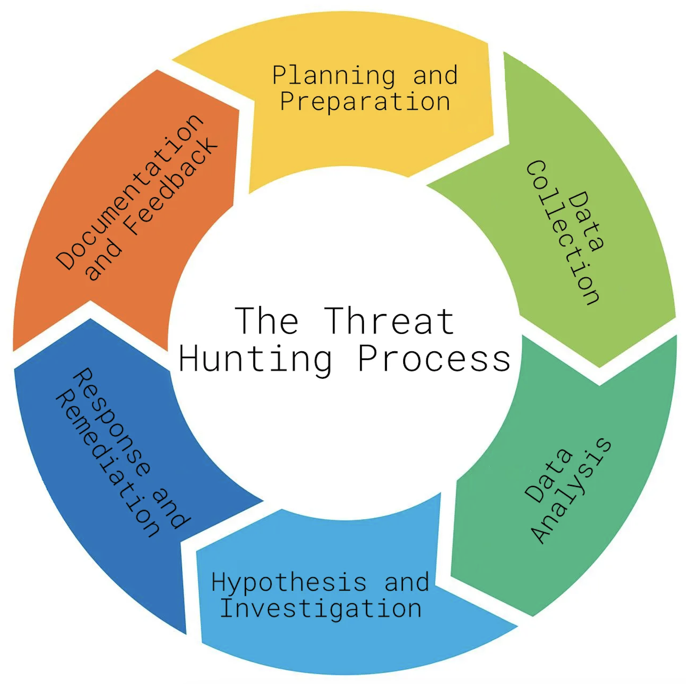

Le Threat Hunting Life Cycle est un processus structuré et itératif permettant de rechercher des menaces non détectées, d'analyser les résultats et d'améliorer les capacités défensives de l'organisation.

Il se compose de 5 phases principales :

```
Preparation & Planning
        ↓
Data Collection & Analysis
        ↓
Active Threat Hunting
        ↓
Findings & Reporting
        ↓
Remediation & Optimization
        ↺ Continuous Improvement
```


## 1. Preparation & Planning

### Identifying Resources & Objectives

Définir le périmètre et les objectifs du hunt avant de commencer les investigations.

- Scope : systèmes, réseaux, utilisateurs ou départements concernés.
    
- Objectives : menaces ou comportements recherchés.
    
- Resources : analystes, temps, outils et données disponibles.
    

Exemple :

```
Scope      → Finance Department
Objective  → Detect suspicious lateral movement
Data       → Authentication + Network Logs
```


Un périmètre bien défini permet de concentrer les recherches et d'éviter une consommation inutile des ressources.

### Selecting Tools & Methods

Sélectionner les outils et méthodes adaptés aux objectifs.

- SIEM : centralisation, recherche et corrélation des événements.
    
- Network Monitoring : analyse des communications réseau.
    
- Analytical Tools : analyse statistique, détection d'anomalies.
    

Le choix dépend notamment des données disponibles et du comportement recherché.

## 2. Data Collection & Analysis

### Identify & Integrate Data Sources

Identifier et collecter les sources de données nécessaires au hunt.

|Source|Informations exploitables|
|---|---|
|System Logs|Événements OS, authentifications, processus|
|Network Traffic|Communications, destinations, volumes|
|User Activity|Activités et comportements des utilisateurs|
|Threat Intelligence|IOCs, TTPs, informations sur les menaces|

Les données sont ensuite intégrées dans un format adapté à leur analyse.

```
System Logs + Network Logs + User Activity + CTI
                       ↓
              Data Integration
                       ↓
              Threat Analysis
```


### Data Analysis

Analyser les données collectées pour identifier :

- comportements inhabituels ;
    
- connexions suspectes ;
    
- changements inattendus ;
    
- anomalies pouvant correspondre à une attaque.
    

À retenir notamment :

- Machine Learning ;
    
- Analytical Models ;
    
- analyse de grands volumes de données.
    

L'objectif est d'extraire des informations significatives à partir de la télémétrie disponible.

## 3. Threat Hunting Process

### Active Threat Hunting Techniques

Phase de recherche active visant à identifier la présence éventuelle d'un attaquant.

Techniques mentionnées :

- Anomaly Detection : recherche d'écarts par rapport au comportement habituel.
    
- Lateral Movement Analysis : identification de déplacements suspects entre systèmes.
    
- User Behavior Analytics (UBA) : recherche de comportements utilisateurs inhabituels.
    

Exemple :

```
Unusual RDP Connections
        ↓
Analyze Source / Destination
        ↓
Check Authentication Events
        ↓
Investigate Possible Lateral Movement
```


Une anomalie constitue une piste d'investigation, pas nécessairement une preuve de compromission.

### Continuous Monitoring & Analytical Methods

Les outils comme les SIEM et EDR assurent une surveillance continue de l'environnement.

Ils permettent notamment :

- d'identifier de nouvelles activités suspectes ;
    
- de corréler les événements ;
    
- de détecter rapidement des comportements malveillants ;
    
- d'alimenter les investigations.
    

Précision : le Continuous Monitoring et le Threat Hunting sont complémentaires, mais distincts :

- Monitoring → surveillance continue et génération d'alertes.
    
- Threat Hunting → investigation proactive et ciblée, même en l'absence d'alerte.
    

## 4. Findings & Reporting

### Documentation of Findings

Documenter les observations et résultats du hunt afin de faciliter les investigations futures.

Informations importantes :

- objectif et périmètre de recherche ;
    
- sources analysées ;
    
- période étudiée ;
    
- événements suspects ;
    
- preuves et résultats ;
    
- conclusions.
    

```
Hunt
→ Findings
→ Evidence
→ Analysis
→ Conclusion
```


La documentation permet de conserver une trace exploitable et de faciliter le partage des connaissances.

### Reporting to Stakeholders

Communiquer les résultats aux parties concernées :

- SOC / Security Teams ;
    
- Incident Response ;
    
- équipes IT ;
    
- management ;
    
- partenaires externes si nécessaire.
    

Le niveau de détail doit être adapté au destinataire :

- Technical Report : événements, logs, indicateurs, résultats d'analyse.
    
- Management Report : risques identifiés, impacts et actions recommandées.
    

## 5. Remediation & Optimization

### Taking Action Against Identified Threats

Lorsqu'une menace est identifiée, des mesures correctives peuvent être nécessaires :

- patching des vulnérabilités ;
    
- nettoyage des systèmes compromis ;
    
- renforcement des contrôles de sécurité ;
    
- traitement des faiblesses découvertes.
    

```
Threat Identified
       ↓
Incident Response / Remediation
       ↓
Security Controls Improved
```


Précision : lorsqu'un hunt révèle un incident actif, les opérations de containment, eradication et recovery relèvent du processus d'Incident Response, en coordination avec les Threat Hunters.

### Continuous Improvement

Les résultats des hunts servent également à améliorer les futurs processus de recherche.

- Évaluer l'efficacité des méthodologies.
    
- Collecter les retours des analystes.
    
- Identifier les limites des outils et des données disponibles.
    
- Adapter les stratégies aux nouvelles menaces.
    
- Améliorer les capacités de détection.
    

Complément pratique : un hunt sans compromission identifiée peut également être utile s'il révèle un manque de télémétrie ou une lacune de détection.

```
Hunt Results
     ↓
Threat Found / Detection Gap Identified
     ↓
Improve Detection & Visibility
     ↓
New Hunting Objectives
     ↺
```


## Vue d'ensemble

|Phase|Objectif principal|
|---|---|
|Preparation & Planning|Définir le périmètre, les objectifs et les outils|
|Data Collection & Analysis|Collecter et analyser la télémétrie|
|Threat Hunting Process|Rechercher activement des comportements malveillants|
|Findings & Reporting|Documenter et communiquer les résultats|
|Remediation & Optimization|Traiter les menaces et améliorer les capacités défensives|

Le Threat Hunting ne se termine pas simplement par la découverte ou l'absence de menace : les résultats doivent alimenter l'amélioration continue de la visibilité, des détections et des méthodologies de recherche.
