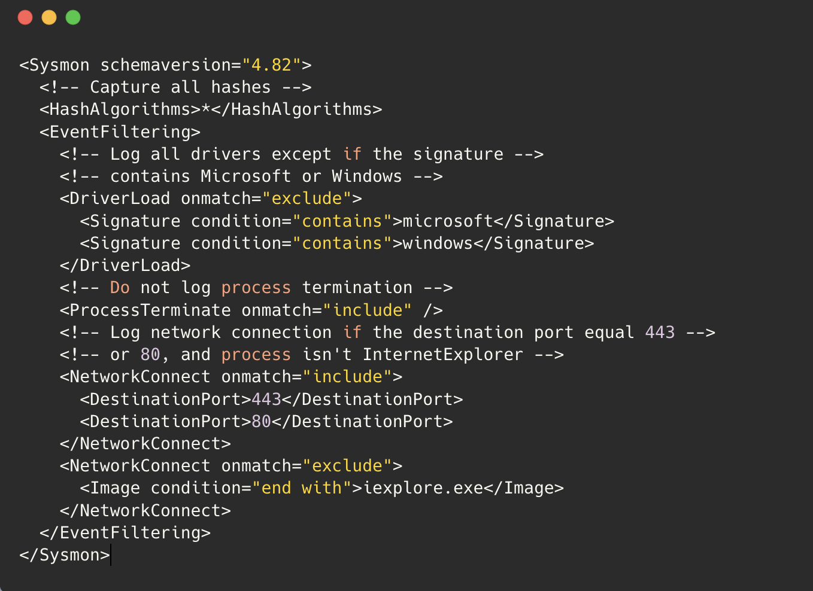
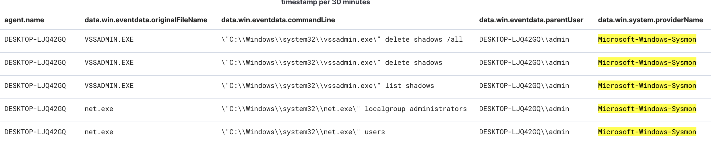

Le DFIR (Digital Forensics & Incident Response) regroupe les méthodes, outils et procédures utilisés pour investiguer un incident de sécurité et y répondre.

Les solutions EDR jouent un rôle central dans ce processus :

- Threat Detection : identification des activités suspectes.
    
- Threat Investigation : analyse des comportements malveillants.
    
- Endpoint Isolation : confinement des systèmes affectés.
    
- Root Cause Analysis : recherche de l'origine de la compromission.
    
- Threat Hunting : recherche proactive de menaces à partir de la télémétrie.
    

L'efficacité d'un EDR dépend notamment de sa configuration, des événements collectés, des règles de détection et des intégrations avec les autres outils de sécurité.

## 1. Monitoring & Recording — Collecte de la télémétrie

La première étape consiste à déterminer quels événements doivent être surveillés et enregistrés.

Dans SentinelOne, les EDR Policies permettent de configurer certaines capacités de surveillance et de protection des endpoints.

L'objectif est de disposer des événements nécessaires pour détecter les menaces et reconstruire les activités pendant une investigation DFIR.

### Sysmon — Windows Event Monitoring

Sysmon (System Monitor) est un outil de Microsoft Sysinternals permettant d'enregistrer des événements détaillés sur les activités Windows.

Il peut compléter un EDR ou alimenter un SIEM.

Sysmon est un outil de collecte de télémétrie, pas une plateforme EDR complète : il n'offre pas de fonctions générales d'investigation et de réponse.

### Principaux Sysmon Event IDs

| Event ID | Événement                    | Intérêt DFIR                                                             |
| -------- | ---------------------------- | ------------------------------------------------------------------------ |
| 1        | Process Creation             | Identifier les processus exécutés et leur contexte                       |
| 2        | File Creation Time Changed   | Détecter les modifications des timestamps de fichiers                    |
| 3        | Network Connection           | Examiner les connexions réseau associées aux processus                   |
| 4        | Sysmon Service State Changed | Surveiller les changements d'état du service Sysmon                      |
| 5        | Process Terminated           | Identifier les fins d'exécution de processus                             |
| 6        | Driver Loaded                | Détecter les chargements de drivers suspects                             |
| 7        | Image Loaded                 | Examiner les DLL et modules chargés par les processus                    |
| 8        | CreateRemoteThread           | Rechercher certaines techniques de Process Injection                     |
| 9        | RawAccessRead                | Identifier les accès directs à des volumes ou disques                    |
| 10       | ProcessAccess                | Surveiller les accès d'un processus à un autre                           |
| 11       | File Create                  | Détecter les créations de fichiers                                       |
| 12       | Registry Event               | Observer les créations et suppressions d'objets Registry, clé/valeur     |
| 13       | Registry Value Set           | Identifier les modifications de valeurs d'une entrée Registry            |
| 14       | Registry Object Renamed      | Détecter les renommages d'objets Registry clé/valeur                     |
| 15       | File Create Stream Hash      | Surveiller les flux de fichiers, notamment les Alternate Data Streams    |
| 16       | Sysmon Configuration Change  | Identifier les changements de configuration Sysmon                       |
| 17       | Pipe Created                 | Détecter la création de Named Pipes                                      |
| 18       | Pipe Connected               | Observer les connexions à des Named Pipes                                |
| 19       | WMI Event Filter             | Détecter des activités liées aux filtres WMI                             |
| 20       | WMI Event Consumer           | Identifier des consommateurs d'événements WMI                            |
| 21       | WMI Consumer-to-Filter       | Examiner les associations entre filtres et consommateurs WMI             |
| 22       | DNS Query                    | Identifier les requêtes DNS effectuées                                   |
| 23       | FileDelete                   | Surveiller les suppressions de fichiers avec archivage lorsque configuré |
| 24       | Clipboard Change             | Détecter certaines modifications du presse-papiers                       |
| 25       | Process Tampering            | Identifier certaines altérations de processus                            |
| 26       | FileDeleteDetected           | Enregistrer les suppressions de fichiers sans archivage                  |
| 27       | FileBlockExecutable          | Bloquer certaines créations de fichiers exécutables PE                   |
| 28       | FileBlockShredding           | Bloquer certaines opérations de destruction sécurisée de fichiers        |
| 29       | FileExecutableDetected       | Détecter la création de nouveaux fichiers exécutables PE                 |

Ces événements peuvent soutenir plusieurs analyses :

- Process Analysis : Event IDs `1`, `5`, `7`, `8`, `10`, `25`.
    
- Network Analysis : Event IDs `3`, `22`.
    
- File Analysis : Event IDs `2`, `11`, `15`, `23`, `26`, `27`, `28`, `29`.
    
- Persistence Hunting : Event IDs `12–14`, `17–21`.
    
- Monitoring Integrity : Event IDs `4`, `16`.
    

Attention : Sysmon n'enregistre pas nécessairement tous ces événements par défaut. Leur disponibilité dépend de la version, de la plateforme et de la configuration appliquée.

## 2. Threat Detection Rules — Règles de détection

Les Custom Detection Rules permettent de rechercher des activités spécifiques aux menaces investiguées.

Elles peuvent cibler :

- Malware Signatures : artefacts associés à des malwares connus.
    
- Anomalous Behavior : comportements suspects ou inhabituels.
    
- Unauthorized Changes : modifications système non autorisées.
    
- IOCs (Indicators of Compromise) : hashes, IPs, domaines ou fichiers suspects.
    
- IOAs (Indicators of Attack) : comportements ou séquences compatibles avec une attaque.
    
- MITRE ATT&CK Techniques : techniques adverses utilisées pour structurer les détections.
    

### Retroactive Threat Hunting

Lorsqu'une nouvelle vulnérabilité ou campagne malveillante est découverte, les IOCs et IOAs associés peuvent être recherchés dans la télémétrie historique.

```
New Threat Intelligence
          ↓
Identify IOC / IOA
          ↓
Build Detection Query
          ↓
Search Historical EDR Data
          ↓
Identify Potentially Affected Endpoints
          ↓
Expand DFIR Investigation
```


Cette démarche permet d'étendre le périmètre d'investigation et d'identifier d'autres systèmes potentiellement concernés.

Une Custom Rule peut ensuite être utilisée pour détecter de futurs événements correspondant aux critères définis.

La recherche historique et la détection des nouveaux événements sont deux capacités distinctes : l'activation d'une règle ne garantit pas automatiquement l'analyse rétroactive de toutes les données conservées.

## 3. Custom Rules avec SentinelOne

Exemple : une règle personnalisée qui détecte la suppression des journaux Windows.

### Scénario — Log Clearing via wevtutil.exe

`wevtutil.exe` est un utilitaire Windows légitime permettant notamment de gérer les Event Logs.

Son utilisation pour effacer des journaux peut être associée à MITRE ATT&CK T1070.001 — Clear Windows Event Logs.

### Point d'investigation

Une exécution de `wevtutil.exe` n'est pas automatiquement malveillante.

L'analyste doit vérifier notamment la Command Line, le compte utilisateur et le contexte d'exécution afin de confirmer qu'une suppression de logs a effectivement été demandée.

De même, une détection configurée comme menace ne garantit pas qu'un blocage ou une isolation ait été appliqué.

## 4. Custom Logging Rules avec Sysmon

Sysmon permet de personnaliser la collecte d'événements à l'aide d'un fichier de configuration XML.

Ce fichier définit les catégories d'événements surveillées ainsi que les conditions d'inclusion et d'exclusion.

### XML Configuration Elements

|Élément|Fonction|
|---|---|
|`<Sysmon schemaversion="4.82">`|Définit la version du schéma de configuration dans l'exemple|
|`<HashAlgorithms>*</HashAlgorithms>`|Demande le calcul des algorithmes de hash pris en charge|
|`<DriverLoad onmatch="exclude">`|Définit les exclusions de journalisation pour certains chargements de drivers|
|`<ProcessTerminate onmatch="include">`|Définit les événements de terminaison de processus à inclure|
|`<NetworkConnect onmatch="include">`|Définit les connexions réseau à enregistrer|
|`<NetworkConnect onmatch="exclude">`|Définit les connexions réseau à exclure|


### Exemples de filtrage

DriverLoad

Exclure certains drivers signés par Microsoft ou Windows afin de réduire le volume d'événements.

ProcessTerminate

Inclure les événements de terminaison de processus correspondant aux conditions définies.

NetworkConnect — Include

Enregistrer les connexions vers les ports `80` et `443`, généralement associés à HTTP et HTTPS.

NetworkConnect — Exclude

Exclure les connexions provenant du processus `iexplore.exe` afin de réduire le bruit.

Les critères doivent être renseignés dans les règles XML : le seul attribut `onmatch` ne définit pas, à lui seul, les valeurs à filtrer.

### Rule Operators

Opérateurs et conditions utilisables pour filtrer les événements :

|Opérateur ou critère présenté|Fonction|
|---|---|
|`contains`|Vérifie la présence d'une chaîne|
|`equals`|Recherche une valeur exacte|
|`startsWith`|Vérifie le début d'une chaîne|
|`endsWith`|Vérifie la fin d'une chaîne|
|`is`|Vérifie une condition ou une valeur|
|`greaterThan`|Comparaison numérique supérieure|
|`lessThan`|Comparaison numérique inférieure|
|`image`|Critère lié au chemin ou au nom d'un exécutable|

L'orthographe et la disponibilité exactes de ces opérateurs dépendent du schéma Sysmon utilisé. `Image` est un champ d'événement, pas un opérateur de comparaison.

### Optimisation de la collecte

Les règles Sysmon permettent de réduire les événements non pertinents et de cibler les activités utiles aux investigations.

Cependant, des exclusions trop larges peuvent supprimer des traces importantes.

Le choix des événements à conserver doit donc équilibrer visibilité, volume de logs et besoins DFIR.

## 5. Alert Management

L'Alert Management consiste à organiser et prioriser les alertes afin de permettre aux analystes de se concentrer sur les menaces les plus importantes.

### False Positive Reduction

Une règle de détection trop large peut produire de nombreuses alertes sur des activités légitimes.

La réduction des False Positives repose notamment sur :

- l'analyse des événements ayant déclenché les alertes ;
    
- l'amélioration des conditions de détection ;
    
- l'ajout de contexte et de Threat Intelligence ;
    
- l'ajustement continu des règles.
    

### Alert Prioritization

Chaque alerte doit être évaluée selon son niveau de risque.

La priorisation peut prendre en compte :

- la sévérité de la détection ;
    
- la criticité du système affecté ;
    
- le contexte de la menace ;
    
- les informations disponibles sur l'activité suspecte.
    

Cette approche permet de traiter plus rapidement les alertes présentant les risques les plus élevés.

### Gestion des alertes selon la solution

|Solution|Gestion des événements et alertes|
|---|---|
|SentinelOne|Consultation et gestion des incidents depuis la console, notamment le menu `Incidents`|
|Sysmon|Production d'événements locaux sans console native centralisée de gestion d'alertes|
|SIEM|Centralisation, corrélation et génération d'alertes à partir de la télémétrie collectée|

Sysmon peut ainsi être intégré à un SIEM pour exploiter ses événements à l'échelle de plusieurs endpoints.

## 6. Integration & Automation — SIEM / SOAR

L'intégration de l'EDR avec d'autres solutions permet de centraliser les informations de sécurité et d'automatiser certaines opérations d'Incident Response.

### SIEM Integration

Un SIEM (Security Information and Event Management) permet de collecter, centraliser et corréler des événements provenant de plusieurs sources.

Exemple : Sysmon + Wazuh.

```
Windows Endpoint
       ↓
  Sysmon Events
       ↓
 Log Collection
       ↓
      Wazuh
       ↓
Search / Correlation / Alerts
       ↓
  DFIR Investigation
```


Les événements Sysmon peuvent être consultés et analysés depuis Wazuh une fois l'intégration configurée.

### SOAR Integration

Un SOAR (Security Orchestration, Automation and Response) permet d'orchestrer des actions entre plusieurs outils de sécurité.

Quatre bénéfices principaux :

|Fonctionnalité|Objectif|
|---|---|
|API Integration|Faciliter les échanges de données entre outils|
|Automated Incident Response|Déclencher des actions prédéfinies en réponse aux détections|
|Threat Intelligence Sharing|Partager les informations sur les menaces entre solutions|
|Security Incident Overview|Centraliser les informations afin d'obtenir une vision globale de l'incident|

### Automated Response — Exemple

```
Suspicious File Detected
          ↓
     EDR Alert
          ↓
   SOAR Playbook
          ↓
Enrichment / Validation
          ↓
   Response Action
          ↓
Quarantine if Appropriate
```


Une action automatique peut consister à mettre un fichier en quarantaine, selon les possibilités de l'EDR et la politique de sécurité.

Point de vigilance : automatiser une action intrusive sur la base d'un False Positive peut perturber un système légitime. Les actions de confinement doivent être adaptées au niveau de confiance de la détection.

## 7. Synthèse — EDR Configuration for DFIR

|Composant|Rôle dans le DFIR|
|---|---|
|Monitoring & Recording|Conserver les événements nécessaires aux investigations|
|Sysmon Telemetry|Obtenir une visibilité détaillée sur les activités Windows|
|Custom Detection Rules|Détecter des IOCs, IOAs et comportements spécifiques|
|Retroactive Hunting|Rechercher les traces historiques d'une menace|
|Alert Management|Réduire le bruit et prioriser les investigations|
|SIEM Integration|Centraliser et corréler les événements|
|SOAR Automation|Coordonner et automatiser certaines actions de réponse|

Le principe central est qu'une configuration EDR efficace pour le DFIR ne repose pas uniquement sur la détection automatique.

Elle nécessite une télémétrie adaptée, des règles précises, une gestion rigoureuse des alertes et une intégration cohérente avec les autres outils de sécurité.

Chaîne opérationnelle :

`Telemetry Collection → Detection & Correlation → Investigation → Prioritization → Response`

Cette approche permet d'améliorer la visibilité sur les incidents, d'étendre les investigations à plusieurs endpoints et de réduire le temps nécessaire pour identifier et traiter une menace.
