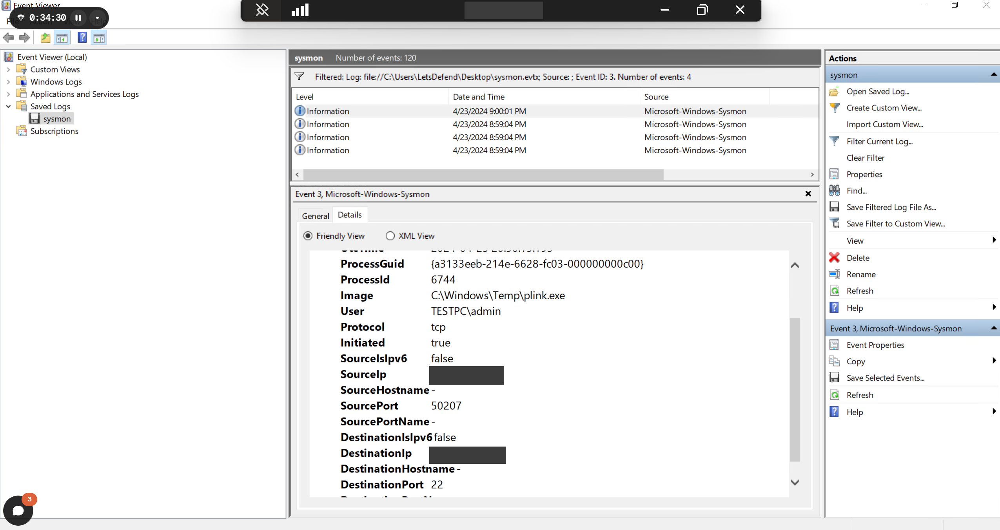
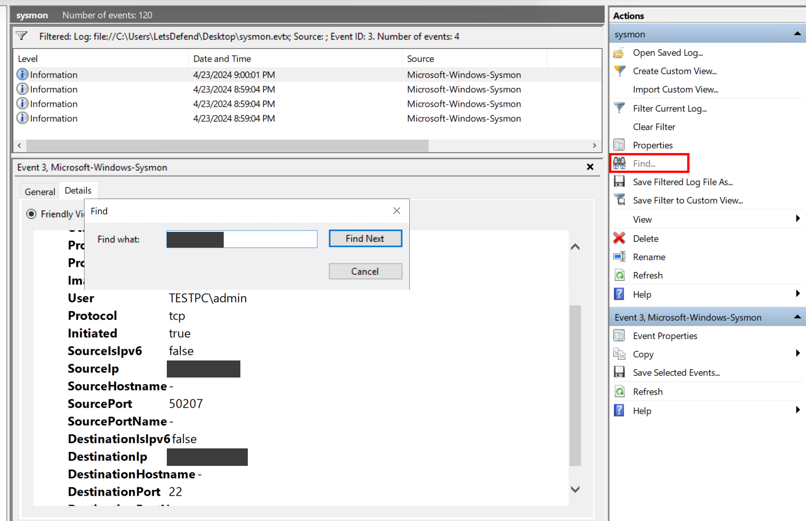
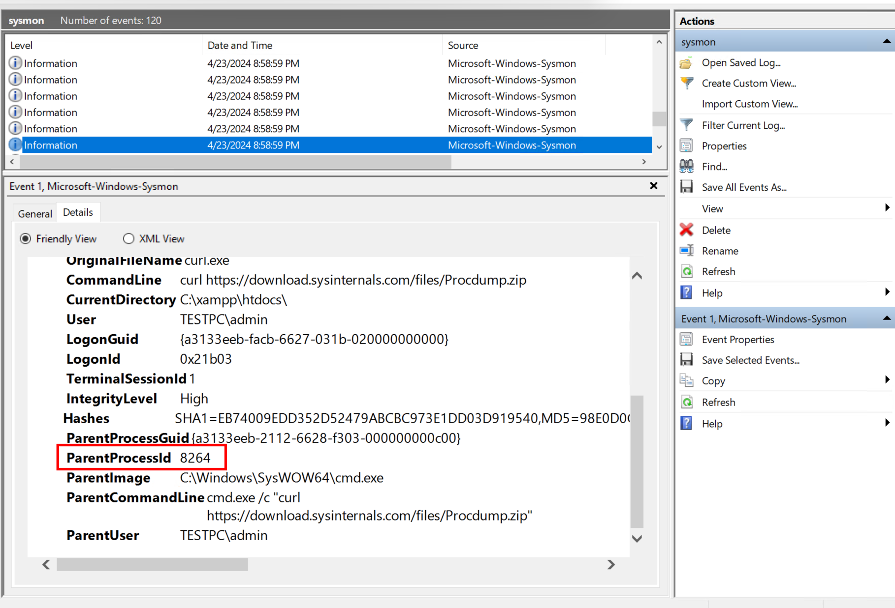
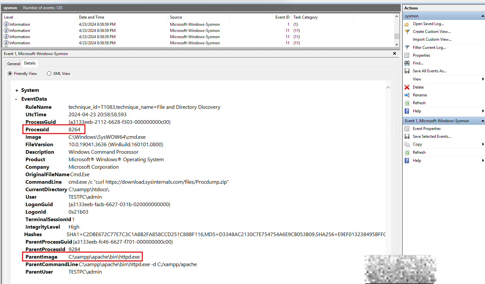
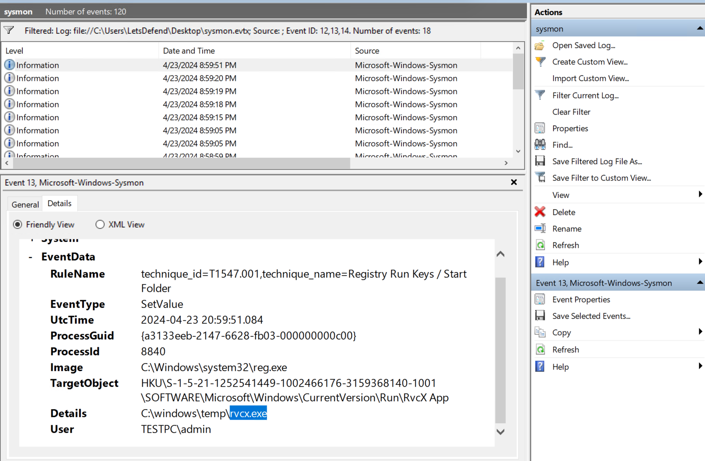

Un journal Sysmon exporté (`sysmon.evtx`, 120 événements) à analyser hors de la machine : ouvert dans l'Observateur d'événements (**Saved Logs**, via *Open Saved Log…*) ou lu avec `Get-WinEvent -Path`. Chaque question se résout avec un Event ID Sysmon et un champ.

- Filtrer par Event ID : *Filter Current Log…* → Event IDs (`3`, `11`, `12,13,14`…).
- Trouver une valeur : *Find…* (`CTRL + F`).
- Onglet **Details** → *Friendly View* pour lire les champs (`Image`, `ProcessId`, `ParentProcessId`…).

## Question 1 — Le processus qui communique avec l'IP signalée par la CTI

- What is the name of the process communicating with the IP address "<IP signalée par la CTI>" reported by the CTI source? Answer Format: C:\Windows\putty.exe ?
    - Chercher Event ID 3 dans Event Viewer
    - Pour trouver directement IP, utiliser Find. (Ou CTRL +F)
    - 
    - 

```
Get-WinEvent -Path "C:\Users\LetsDefend\Desktop\sysmon.evtx" -FilterXPath "*[System[EventID=3] and EventData[Data[@Name='DestinationIp']='<IP>']]" | ForEach-Object {
    $xml = [xml]$_.ToXml()
    $xml.Event.EventData.Data |
        Where-Object { $_.Name -eq 'Image' } |
        Select-Object -ExpandProperty '#text'
}
```


- Le **Sysmon 3** relie l'IP au processus (`Image`), à l'utilisateur et au port de destination.
- Ici le port de destination est **22** (SSH) et le programme est un client SSH en ligne de commande lancé depuis `C:\Windows\Temp` : un tunnel SSH vers l'extérieur (T1572), pour garder un accès ou faire sortir des données.

<details markdown="1">
<summary>Réponse</summary>

`C:\Windows\Temp\plink.exe`

</details>

## Question 2 — Le processus qui dépose un script dans le dossier Démarrage

- What is the process ID of the process that creates the file "C:\Users\admin\AppData\Roaming\Microsoft\Windows\Start Menu\Programs\Startup\ncat.ps1"?
    - Event ID sysmon 11

```
Get-WinEvent -Path "C:\Users\LetsDefend\Desktop\sysmon.evtx" -FilterXPath "*[System[EventID=11] and EventData[Data[@Name='TargetFilename']='C:\Users\admin\AppData\Roaming\Microsoft\Windows\Start Menu\Programs\Startup\ncat.ps1']]" |
    Select-Object -ExpandProperty Message
```


- Le **Sysmon 11** (FileCreate) donne le fichier créé (`TargetFilename`) et le processus qui l'a créé (`ProcessId`, `Image`).
- Un script déposé dans le dossier **Startup** s'exécute à chaque ouverture de session : persistance (T1547.001). `ncat` est un outil réseau souvent utilisé pour ouvrir un shell à distance.

<details markdown="1">
<summary>Réponse</summary>

- Process ID : 4632

</details>

## Question 3 — L'outil qui a téléchargé procdump.zip

- What tool was used to transfer the file "procdump.zip"? Answer Format: toolname.extension
    - Event ID sysmon 1

```
Get-WinEvent -Path "C:\Users\LetsDefend\Desktop\sysmon.evtx" |
Where-Object {
    $_.Id -eq 1 -and $_.Message -like "*procdump.zip*"
} |
Select-Object -ExpandProperty Message
```


- Le **Sysmon 1** du téléchargement montre la ligne de commande (`CommandLine`) et le nom interne du binaire (`OriginalFileName`).
- ProcDump est un outil Sysinternals légitime, souvent détourné pour vider la mémoire de LSASS et en extraire des identifiants (T1003.001) : son téléchargement est un signal fort.

<details markdown="1">
<summary>Réponse</summary>

`curl.exe`

</details>

## Question 4 — Le parent du cmd.exe qui a lancé le téléchargement

- What is the parent process of the 'cmd.exe' process that executes the command used to download the 'procdump.zip' file? Answer Format: C:\Windows\putty.exe
    - Commencer par trouver le process qui a permis le DL de procdump.zip, chercher l'ID du parent process puis rechercher ce dernier.
    - 
    - 

```
Get-WinEvent -Path "C:\Users\LetsDefend\Desktop\sysmon.evtx" -FilterXPath "*[System[EventID=1] and EventData[Data[@Name='ProcessId']='<ParentProcessId>']]" |
    Select-Object -ExpandProperty Message
```


- Remonter la chaîne : `ParentProcessId` du téléchargement → Sysmon 1 de ce processus (`cmd.exe`) → son propre `ParentImage`.
- Un **serveur web** (Apache de XAMPP) qui lance `cmd.exe` : l'application web a permis d'exécuter des commandes sur le serveur (web shell ou faille), comme dans [Example 2 — Certutil.exe & Apache Web Server](03-techniques-d-analyse-avancees-avec-l-edr.md#example-2-certutilexe-apache-web-server).

<details markdown="1">
<summary>Réponse</summary>

`C:\xampp\apache\bin\httpd.exe`

</details>

## Question 5 — Le programme lancé à chaque démarrage (clé Run)

- According to the registry log created under "HKCU\SOFTWARE\Microsoft\Windows\CurrentVersion\Run", what is the name of the application that is run every time the system starts? Answer Format: filename.extension :
    - Chercher dans les events ID 13 sysmon (en lien avec registre)
    - 
- Le **Sysmon 13** (SetValue) donne la clé modifiée (`TargetObject`), la valeur écrite (`Details`, le programme lancé) et l'outil qui l'a écrite (`Image`, ici `reg.exe`).
- Sous HKCU, la clé apparaît avec le SID de l'utilisateur (`HKU\S-1-5-21-…\SOFTWARE\Microsoft\Windows\CurrentVersion\Run`) ; le champ `RuleName` de la configuration Sysmon la rattache déjà à T1547.001.

<details markdown="1">
<summary>Réponse</summary>

`rvcx.exe`

</details>

## Ce que le lab apprend

| Question | Event ID Sysmon | Champ clé | Ce qu'il révèle |
|---|---|---|---|
| 1 | 3 — Network Connection | `DestinationIp` → `Image` | Tunnel SSH sortant depuis `C:\Windows\Temp` |
| 2 | 11 — File Create | `TargetFilename` → `ProcessId` | Script de persistance dans le dossier Startup |
| 3 | 1 — Process Creation | `CommandLine`, `OriginalFileName` | Téléchargement d'un outil de dump mémoire |
| 4 | 1 — Process Creation | `ParentProcessId` → `ParentImage` | Commandes lancées par le serveur web |
| 5 | 13 — Registry Value Set | `TargetObject`, `Details` | Programme ajouté à la clé Run |

Les mêmes recherches sont reprises en cas concrets dans la cheat sheet [Sysmon et requêtes SIEM](/cheatsheets/windows/fondamentaux/logs/sysmon/).
