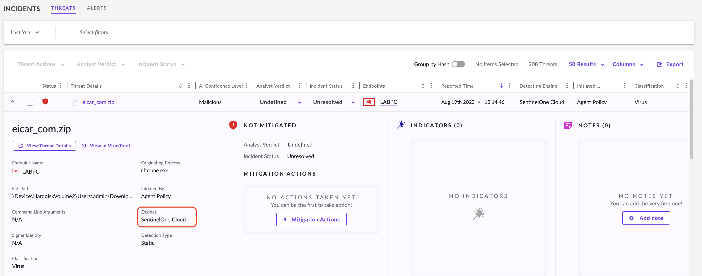
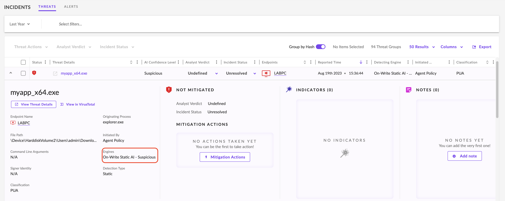
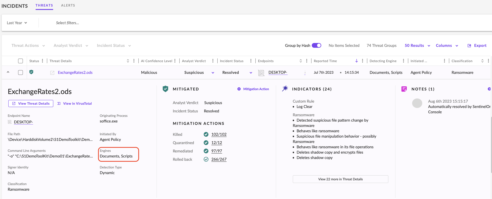

Les solutions EDR/XDR utilisent plusieurs moteurs de détection pour identifier, analyser et classifier les cybermenaces, y compris celles qui échappent aux antivirus traditionnels basés sur les signatures.

Deux fonctions principales :

- Threat Detection : déterminer si un fichier, un processus ou une activité présente des caractéristiques malveillantes.
    
- Threat Classification : catégoriser la menace afin de faciliter son analyse et de prioriser la réponse.
    

L'EDR analyse principalement les activités endpoint, tandis que le XDR peut corréler ces détections avec des événements réseau, cloud et d'autres sources.

## 1. Endpoint Threat Detection

Les solutions EDR/XDR combinent différentes méthodes de détection.

|Méthode|Fonctionnement|
|---|---|
|Machine Learning / AI|Utilise des modèles entraînés sur de grandes quantités de données pour reconnaître des caractéristiques suspectes|
|Behavioral Analysis|Recherche des comportements inhabituels ou malveillants|
|Heuristic Analysis|Identifie des caractéristiques suspectes sans nécessiter une signature exacte|
|Signature-Based Detection|Recherche des signatures associées à des menaces connues|
|Fileless Threat Detection|Identifie des activités malveillantes exploitant notamment la mémoire, les scripts ou les outils système|
|Sandboxing|Exécute des fichiers suspects dans un environnement isolé pour observer leur comportement|
|Network Traffic Analysis|Analyse des communications réseau pour rechercher des activités suspectes|
|Threat Intelligence Integration|Utilise des IOCs et renseignements externes pour enrichir les détections|

### Static Analysis vs Behavioral Analysis

- Static Analysis : examine un fichier sans l'exécuter (structure, code, caractéristiques, signatures).
    
- Behavioral Analysis : observe les actions réalisées par un processus ou une activité en cours d'exécution.
    

Exemple :

```
Suspicious Executable
        ├── Static Analysis → File Characteristics
        ├── Reputation      → Known Threat Intelligence
        └── Behavioral AI   → Actions During Execution
                                      ↓
                              Detection / Response
```


Ces méthodes sont complémentaires : une menace inconnue des bases de signatures peut présenter des caractéristiques statiques ou des comportements identifiables.

Points de vigilance :

- Une détection IA/ML peut produire des False Positives et des False Negatives.
    
- Fileless ne signifie pas nécessairement qu'aucun fichier n'intervient dans l'attaque.
    
- Le sandboxing est une capacité présente dans certaines solutions ou intégrations, pas systématiquement dans chaque agent EDR.
    

## 2. Threat Classification

La classification permet d'organiser les menaces selon différents critères.

|Critère|Question|Exemples|
|---|---|---|
|Threat Type|Quelle activité ou menace ?|Malware, ransomware, exploit, phishing, lateral movement|
|Threat Source|Qui est à l'origine ?|APT, insider threat, hacktivist|
|Target|Quels actifs sont ciblés ?|SCADA, infrastructure financière, données personnelles|
|Attack Purpose|Quel objectif ?|Exfiltration, DoS, espionnage|
|Threat Complexity|Quel niveau de sophistication ?|Low, Medium, High|

Ces classifications peuvent se compléter : une même attaque peut être décrite par son type, son objectif et les actifs concernés.

Classification ≠ Attribution. Un EDR peut détecter des comportements caractéristiques d'une attaque sans pouvoir identifier avec certitude le Threat Actor responsable.

## 3. Threat Categories — SentinelOne

Plusieurs catégories servent à caractériser les détections dans SentinelOne ou d'autres produits EDR/XDR.

| Catégorie   | Description                                                                                                                                                               |
| ----------- | ------------------------------------------------------------------------------------------------------------------------------------------------------------------------- |
| Malware     | Logiciel conçu pour réaliser des actions malveillantes                                                                                                                    |
| Ransomware  | Malware visant à bloquer l'accès aux données, souvent par chiffrement, afin d'exiger une rançon                                                                           |
| Virus       | Malware capable de se répliquer en infectant des fichiers ou programmes hôtes, il fonctionne comme partie intégrante d'un programme informatique ou d'un fragment de code |
| Hacktool    | Outil permettant certaines opérations offensives ou de contournement de sécurité                                                                                          |
| Infostealer | Malware spécialisé dans le vol de données sensibles et de credentials                                                                                                     |
| PUA         | Potentially Unwanted Application : logiciel potentiellement indésirable                                                                                                   |
| Trojan      | Programme se présentant comme légitime alors qu'il contient des fonctionnalités malveillantes                                                                             |
| Packing     | Compression ou transformation d'un exécutable, pouvant notamment masquer son contenu                                                                                      |
| Rootkit     | Ensemble de composants visant à dissimuler une présence ou des activités malveillantes                                                                                    |

### Distinctions importantes

- Trojan ≠ Backdoor obligatoire : un Trojan peut installer une backdoor, mais ce n'est pas une caractéristique systématique.
    
- Hacktool ≠ nécessairement malware : des outils offensifs peuvent aussi être utilisés légitimement lors de pentests ou d'investigations.
    
- Packing ≠ type de malware : des logiciels légitimes peuvent également être packés.
    
- PUA ≠ forcément malveillant : la classification peut dépendre du contexte et de la politique de sécurité.
    
- Rootkit : les mécanismes de dissimulation peuvent fonctionner en user-mode ou kernel-mode.
    

Ces nuances sont essentielles pour éviter de classifier automatiquement toute activité inhabituelle comme une compromission.

## 4. SentinelOne Detection Engines

SentinelOne combine plusieurs moteurs de détection destinés à identifier des menaces connues, inconnues ou comportementales.

Les noms exacts des moteurs et leur fonctionnement peuvent varier selon les versions.

### Reputation Engine

Le Reputation Engine vérifie la réputation d'objets comme les fichiers et processus à partir de renseignements sur les menaces connues.

Il exploite notamment des informations associées à :

- malware hashes ;
    
- fichiers malveillants ;
    
- domaines et IP suspects ;
    
- autres indicateurs de Threat Intelligence.
    

Avantage : identification rapide de menaces connues.

Limite : une menace nouvelle ou modifiée peut ne disposer d'aucune réputation exploitable.

Exemple : `mimikatz.exe`, détecté par le moteur SentinelOne Cloud, avec possibilité d'appliquer une action Kill & Quarantine lorsque la policy le prévoit.

⚠️ Le nom d'un fichier ou une réputation ne démontre pas systématiquement un usage malveillant. L'action exacte et le moment du blocage dépendent du moteur et de la configuration.

### Static AI

Le moteur Static AI analyse les caractéristiques d'un fichier sans l'exécuter.

- Utilise des modèles d'analyse statique.
    
- Peut identifier des malwares connus ou inconnus.
    
- Cherche des caractéristiques associées à des fichiers malveillants.
    
- Peut permettre une détection avant l'exécution.
    

Il ne nécessite pas nécessairement une correspondance exacte avec une signature connue.

### Static AI — Suspicious

Variante servant à signaler des fichiers dont les caractéristiques sont potentiellement malveillantes, sans classification suffisamment certaine.

- Analyse statique sans exécution.
    
- Classification Suspicious plutôt que Malicious.
    
- Nécessite une évaluation complémentaire selon le contexte.
    

Suspicious ≠ Confirmed Malware.

L'analyste doit examiner les éléments ayant motivé la classification avant de décider d'une remédiation.

### Behavioral AI — Executables

Le Behavioral AI recherche des activités malveillantes à partir du comportement des processus.

Exemples :

- modifications suspectes de fichiers système ;
    
- attaques en mémoire ;
    
- interactions inhabituelles entre processus ;
    
- comportements associés à des techniques d'attaque.
    

Contrairement à une détection basée uniquement sur un hash, cette méthode peut identifier une activité malveillante même lorsque le binaire est inconnu.

Limite : certains logiciels légitimes peuvent effectuer des opérations similaires et générer des False Positives.

### Documents, Scripts

Ce moteur vise les menaces utilisant des documents et scripts, notamment :

- Office Documents ;
    
- PowerShell ;
    
- VBScript ;
    
- JavaScript.
    

Les documents ou scripts peuvent contenir des instructions utilisées pour télécharger, lancer ou exécuter des composants malveillants.

L'analyse permet de détecter des caractéristiques ou comportements suspects associés à ces contenus.

### Lateral Movement

Le moteur Lateral Movement vise les activités susceptibles d'indiquer qu'un attaquant tente de se déplacer entre plusieurs systèmes.

Exemple :

```
Compromised Endpoint
        ↓
Access to Another Internal Host
        ↓
Additional System Compromise
        ↓
Potential Lateral Movement
```


Cette détection permet de suivre la progression d'un attaquant après une compromission initiale.

En investigation, les détections peuvent être corrélées avec les authentifications, les outils d'administration distante et la télémétrie réseau.

### Anti-Exploitation / Fileless Engine

Le moteur Anti-Exploitation / Fileless vise les attaques exploitant :

- des vulnérabilités logicielles ;
    
- des techniques d'exécution en mémoire ;
    
- des scripts ou mécanismes système ;
    
- des comportements ne reposant pas uniquement sur un exécutable malveillant classique.
    

Il complète les moteurs de réputation et d'analyse statique, particulièrement face aux attaques utilisant des composants légitimes du système.

### Potentially Unwanted Applications — PUA

Le moteur PUA recherche des logiciels potentiellement indésirables.

Exemples :

- Adware ;
    
- Browser Hijackers ;
    
- Toolbars indésirables ;
    
- applications installées de manière trompeuse.
    

Ces logiciels ne sont pas nécessairement considérés comme des malwares, mais peuvent présenter des problèmes de confidentialité, de sécurité ou de performance.

## 5. Comparaison des moteurs SentinelOne

| Moteur                       | Approche principale                                                                      |
| ---------------------------- | ---------------------------------------------------------------------------------------- |
| Reputation Engine            | Renseignements sur les menaces connues                                                   |
| Static AI                    | Analyse statique des fichiers                                                            |
| Static AI — Suspicious       | Détection statique avec classification suspecte                                          |
| Behavioral AI — Executables  | Analyse comportementale des processus                                                    |
| Documents, Scripts           | Détection de menaces dans les documents et scripts                                       |
| Lateral Movement             | Identification de déplacements suspects entre systèmes                                   |
| Anti-Exploitation / Fileless | Détection de techniques d'exploitation et d'exécution sans fichier malveillant classique |
| PUA                          | Détection d'applications potentiellement indésirables                                    |

## 6. Exploitation des détections en SOC

Lorsqu'un EDR/XDR génère une détection, l'analyste doit distinguer :

- Detection Engine : quel moteur a détecté l'activité ?
    
- Threat Classification : comment la menace est-elle catégorisée ?
    
- Evidence : quels fichiers, processus, comportements ou événements justifient l'alerte ?
    
- Response Action : quelle mesure a été appliquée — Detect, Kill, Quarantine ou autre ?
    
- Incident Scope : quels systèmes et utilisateurs sont potentiellement concernés ?
    

Exemple d'investigation :

```
EDR Detection
      ↓
Identify Detection Engine
      ↓
Review Threat Classification
      ↓
Analyze Process / File / Network Evidence
      ↓
Correlate with Other Events
      ↓
Confirm / Reject Suspicious Activity
      ↓
Response if Necessary
```


Un événement détecté par Reputation Engine peut nécessiter une investigation différente d'une détection Behavioral AI, car les éléments ayant déclenché l'alerte ne sont pas les mêmes.

Le point central de cette section est la complémentarité des moteurs EDR/XDR : réputation, analyse statique, comportement, scripts, exploitation et mouvements latéraux couvrent des aspects différents des attaques. Leur efficacité dépend de la configuration, de la qualité de la télémétrie et de la validation des détections.
