## Analyse des journaux d’événements Windows
Trois outils natifs permettent principalement de consulter et analyser les **Windows Event Logs** :

```text
Event Viewer
→ GUI

wevtutil
→ CLI

Get-WinEvent
→ PowerShell
```

## Event Viewer — Observateur d’événements

- Interface graphique native de Windows pour :
    - consulter les Event Logs ;
    - examiner le détail d’un événement ;
    - filtrer les événements ;
    - exporter les résultats.

Lancement :

```text
eventvwr.msc
```


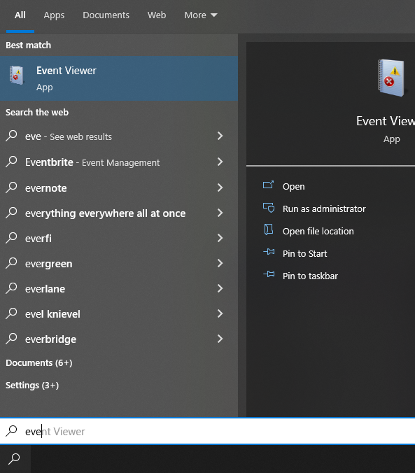

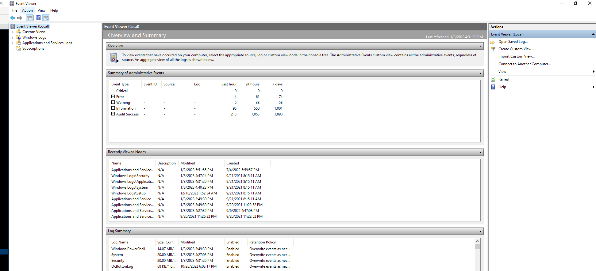

### Organisation
Dans `Windows Logs`, on retrouve notamment :

```text
Application
Security
System
Setup
Forwarded Events
```

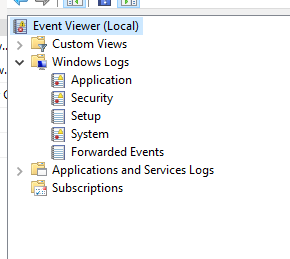

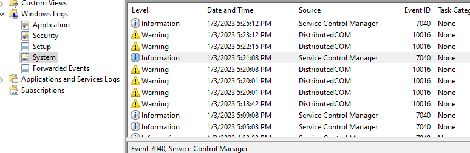
Lorsqu’un journal est sélectionné, le panneau central affiche notamment :

- `Level` ;
- `Date and Time` ;
- `Source / Provider` ;
- `Event ID` ;
- `Task Category`.

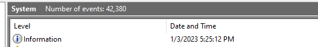
## Détails d’un événement

En ouvrant un événement, on peut retrouver :

```text
Event ID
Level
Provider / Source
Logged Time
Computer
User
Task Category
Message
Event Data
```

Deux vues principales sont disponibles :

### General
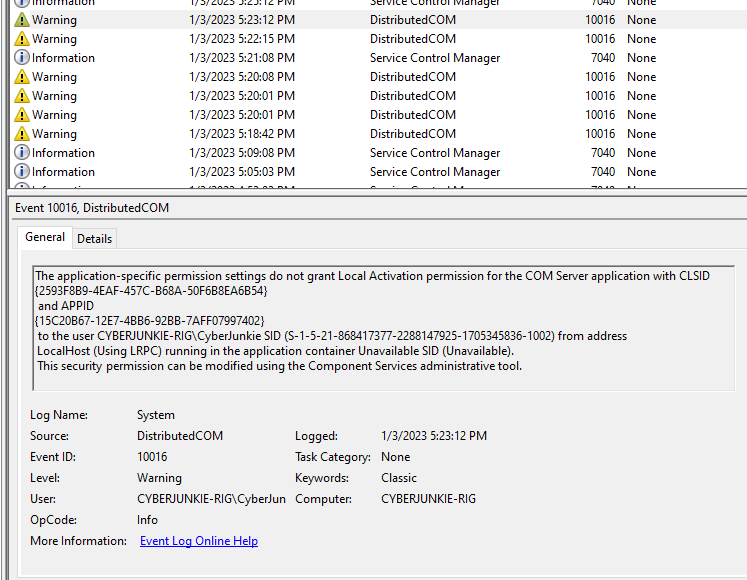

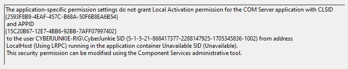

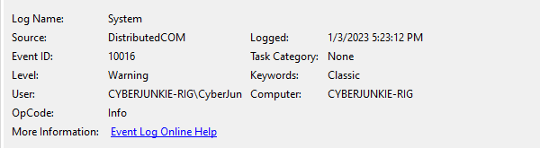

- Vue lisible présentant le message et les principaux attributs.

### Details
Permet d’afficher :

```text
Friendly View
ou
XML View
```

La vue XML est particulièrement intéressante pour l’analyse technique car elle expose directement les champs structurés de l’événement.

```xml
<Event>
  <System>...</System>
  <EventData>...</EventData>
</Event>
```


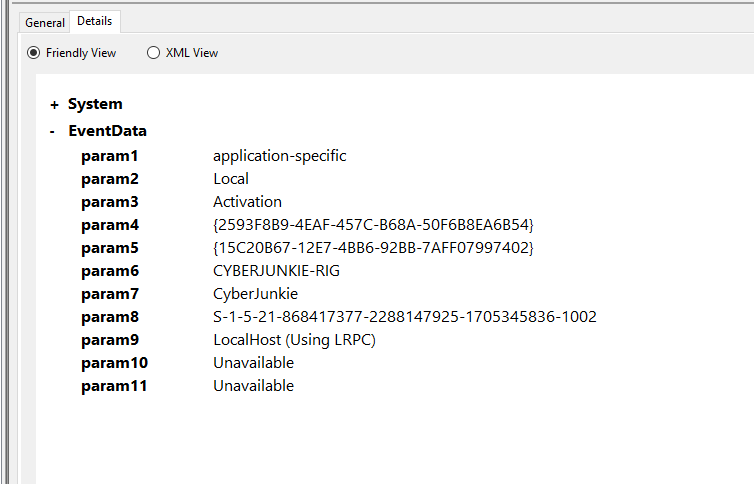
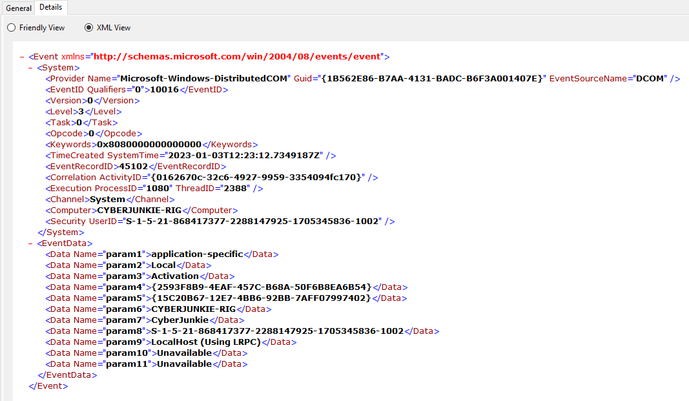

### Exemple : Application → SideBySide → Event ID 35

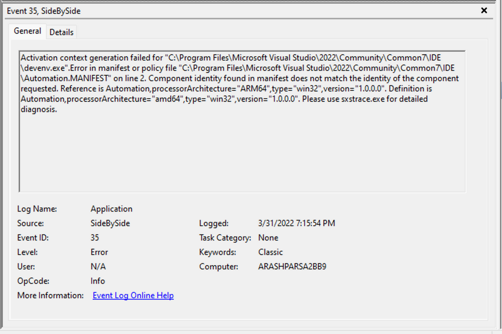

- Cet événement décrit une erreur de génération du contexte d'activation d'une application, liée ici à une incompatibilité d'architecture.
- L'onglet `Details` donne les données structurées de l'en-tête (`System`), notamment :
    - `SystemTime` : timestamp ;
    - `EventRecordID` : numéro de l'enregistrement ;
    - `ProcessID` : identifiant du processus associé ;
    - `ThreadID` : identifiant du thread ;
    - `Computer` : machine source.

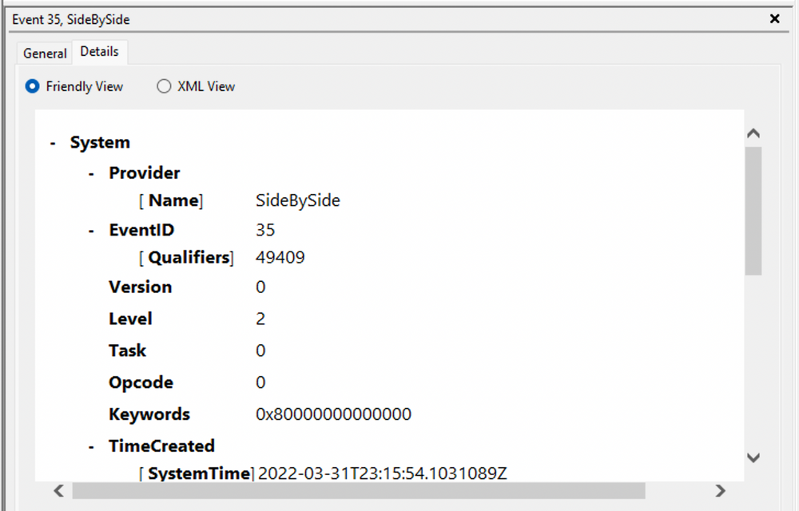


## Filtrage dans Event Viewer

### Filter Current Log
Permet de filtrer selon plusieurs critères :

- Event ID ;
- niveau ;
- source ;
- date / heure ;
- utilisateur ;
- autres attributs.

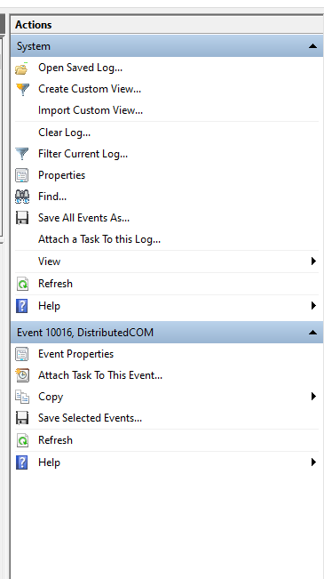

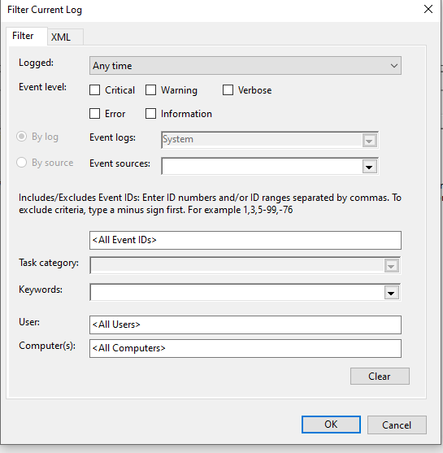
#### Filtrer par Event ID
Exemple :

```text
7040
```


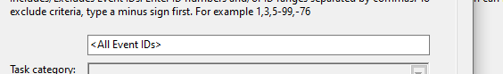

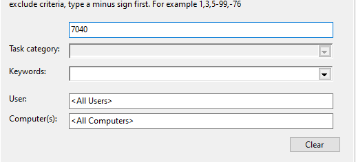

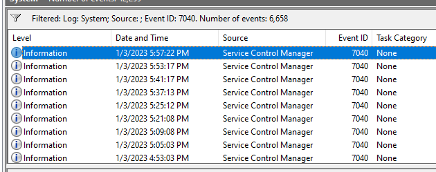

→ affiche uniquement les événements portant cet ID.

Plusieurs Event IDs peuvent être fournis :

```text
7040,10016
```


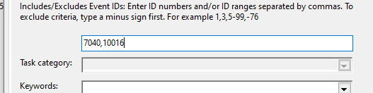
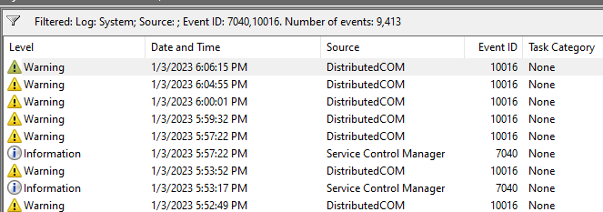
### Filtrage temporel
Les filtres peuvent être combinés avec une période.
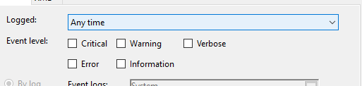

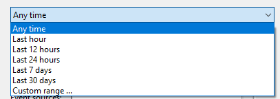

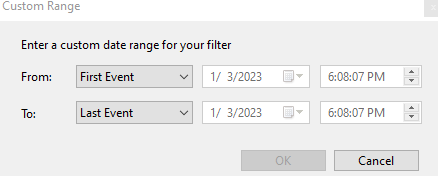

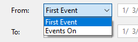

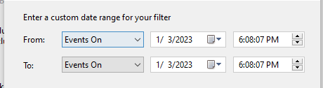

Exemple :
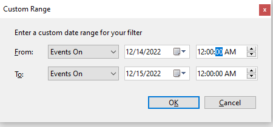

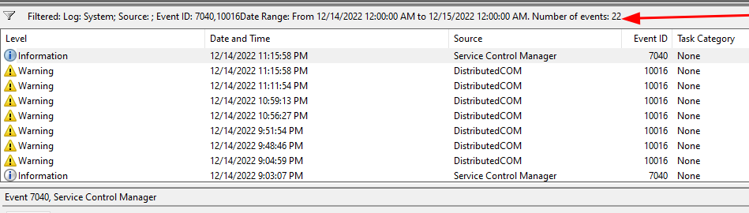
Très utile en Incident Response lorsqu’une fenêtre temporelle de compromission est déjà connue.
## Requêtes XML personnalisées

Event Viewer permet de créer des filtres XML pour effectuer des recherches plus précises.

Chemin :

`Event Viewer → Filter Current Log → XML → Edit Query Manually`

### Objectif

Dans cet exemple, la recherche porte sur :

`SubjectLogonId = 0x3E7`

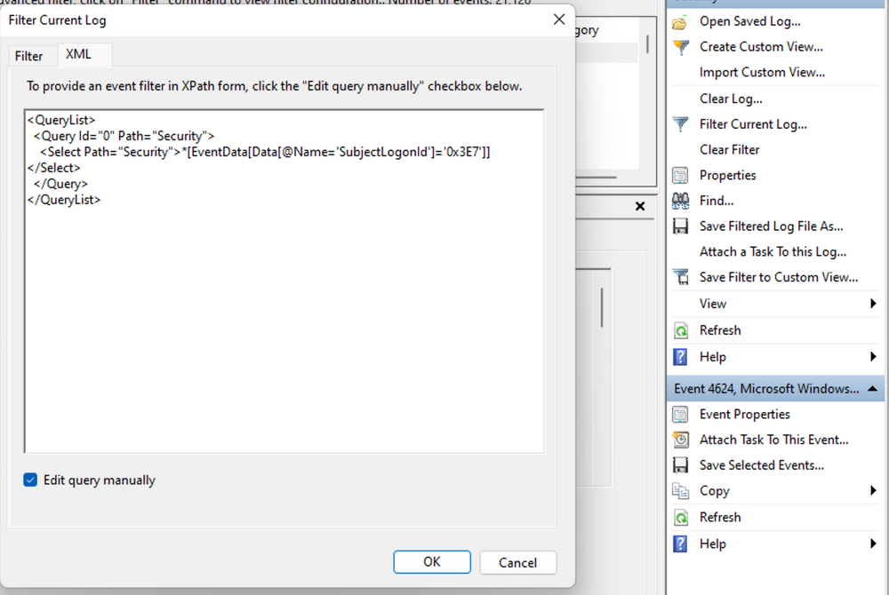

L'objectif est de retrouver des événements associés à ce contexte de session afin de reconstruire une séquence d'activités.

Exemple de filtre XML :

```
<QueryList>
  <Query Id="0" Path="Security">
    <Select Path="Security">
      *[EventData[Data[@Name='SubjectLogonId']='0x3e7']]
    </Select>
  </Query>
</QueryList>
```


Ce filtre sélectionne les événements du journal `Security` possédant le champ `SubjectLogonId` avec la valeur indiquée.

Il ne récupère pas automatiquement tous les événements de la session si ceux-ci utilisent d'autres champs, notamment `TargetLogonId`.

### Intérêt DFIR

- Réduire le volume d'événements à examiner.
- Rechercher les opérations associées à un contexte utilisateur.
- Corréler authentifications, changements de privilèges et modifications système.
- Reconstituer une Event Timeline.

Il est également possible de créer des filtres dans l'interface graphique et d'en examiner ensuite la représentation XML.

Gabarits prêts à l'emploi (Event ID, période, champ, plusieurs champs, session, exclusion) : cheat sheet [Requêtes XML de l'Observateur](/cheatsheets/windows/fondamentaux/logs/requetes-xml/).

### Exemple d'investigation : 4907, 4624 et 4672

Analyse progressive de plusieurs événements Windows liés à un même contexte.

#### Event ID 4907 — paramètres d'audit modifiés sur un objet

L'Event ID 4907 est généré lorsque les paramètres d'audit d'un objet Windows sont modifiés, notamment sa SACL (System Access Control List).


La SACL définit quelles tentatives d'accès à un objet doivent être journalisées.

Elle est constituée d'ACE (Access Control Entries) pouvant spécifier :

- les comptes ou groupes concernés ;
- les opérations à auditer ;
- les accès réussis, échoués ou les deux.

Distinction : la SACL contrôle l'audit des accès, tandis que la DACL contrôle principalement les autorisations d'accès.

#### Analyse

Les détails de l'Event 4907 montrent :

| Champ         | Information                                          |
| ------------- | ---------------------------------------------------- |
| Process Name  | `SetupHost.exe`                                      |
| Object Type   | File                                                 |
| Object Name   | Objet associé au boot manager                        |
| OldSd / NewSd | Descripteurs de sécurité avant et après modification |


Les champs `OldSd` et `NewSd` utilisent le format SDDL (Security Descriptor Definition Language).

Ils permettent d'examiner les changements apportés au descripteur de sécurité.

`SetupHost.exe` est associé à des opérations de configuration Windows. Son nom est cohérent avec une activité d'installation, mais un nom de processus légitime ne garantit pas qu'une activité soit saine.

#### Event ID 4672 — privilèges spéciaux attribués à une nouvelle session


L'Event ID 4672 indique que des privilèges sensibles ont été attribués au token d'une nouvelle session de connexion.

Exemple :

`SeDebugPrivilege`


Ce privilège peut permettre à un processus disposant des autorisations nécessaires d'interagir avec d'autres processus de manière privilégiée.

#### Corrélation

```
Event 4907
Audit Configuration Modified
          ↓
Event 4624
Successful Logon
          ↓
Event 4672
Special Privileges Assigned
          ↓
Timeline & Contextual Investigation
```


Cette séquence permet d'étudier les modifications d'audit et le contexte de connexion privilégiée.

Un Event 4672 associé à SYSTEM peut être parfaitement normal. De même, la présence successive de ces événements ne suffit pas à confirmer une compromission.

## Effacer un filtre vs effacer un journal
Deux opérations à ne pas confondre :

```text
Clear Filter
→ retire uniquement le filtre d'affichage

Clear Log
→ supprime les événements du journal
```


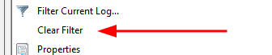

> ⚠️ `Clear Log` peut supprimer une source de preuves importante lors d’une investigation.

Un effacement du journal `Security` peut lui-même laisser une trace, notamment :
## Export des événements
Event Viewer permet d’enregistrer les événements sélectionnés ou affichés.

Si un filtre est appliqué :

```text
Full Log
→ Filter
→ Displayed Events
→ Save
```


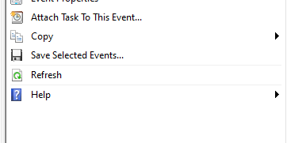
→ seuls les événements correspondant au filtre peuvent être exportés selon l’action choisie.

Format typique :

```text
.evtx
```


Cela permet de conserver les événements pour :

- investigation ;
- forensic analysis ;
- partage ;
- archivage.

## `wevtutil`

`wevtutil.exe` est un outil CLI natif permettant de gérer les Windows Event Logs.

Fonctions principales :

- lister les journaux ;
- lire les événements ;
- exporter les logs ;
- récupérer les informations de configuration ;
- effacer un journal.

### Aide

```cmd
wevtutil.exe /?
```

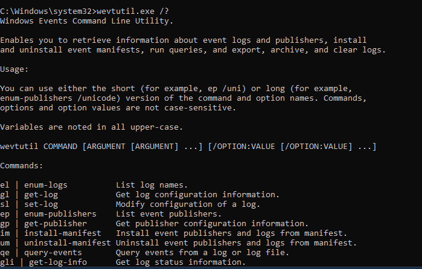
### Lister les journaux

```cmd
wevtutil.exe el
```


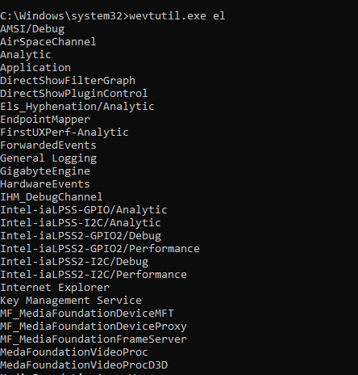

`el` :

```text
enum-logs
→ liste les journaux disponibles
```

### Lire des événements

Exemple :

```cmd
wevtutil.exe qe System /c:3 /rd:true /f:text
```


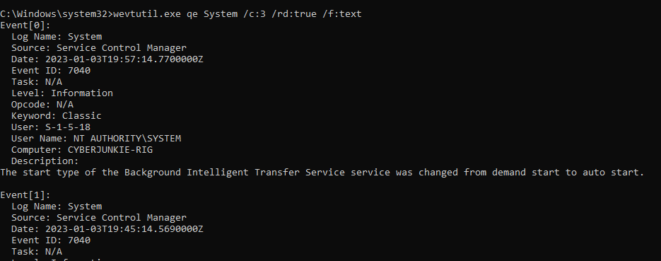

Décomposition :

```text
qe System
→ Query Events du journal System

/c:3
→ retourne 3 événements

/rd:true
→ ordre inverse, les événements récents en premier

/f:text
→ sortie au format texte
```


Conceptuellement :

```text
System Log
→ Query
→ Last 3 Events
→ Text Output
```


---

## `Get-WinEvent`

- Cmdlet PowerShell destiné à consulter les Windows Event Logs, les journaux Sysmon et certains événements issus de l'infrastructure ETW.
- En threat hunting et en DFIR, elle automatise les recherches sur de gros volumes de journaux, de façon reproductible.
- Peut fonctionner sur :
    - machine locale ;
    - machine distante.
- Permet des requêtes beaucoup plus avancées grâce notamment à :
    - `FilterHashtable` ;
    - XPath ;
    - XML queries ;
    - pipeline PowerShell.

Ses principales capacités :

- Log Discovery : identifier les journaux et fournisseurs disponibles.
- Event Retrieval : récupérer des événements locaux, distants ou archivés (`.evtx`).
- Event Filtering : filtrer par Event ID, date, fournisseur ou contenu.
- XML / XPath Analysis : rechercher des champs précis dans les événements.
- Event Correlation : rapprocher plusieurs événements pour reconstruire une activité suspecte.
### Lister les journaux

```powershell
Get-WinEvent -ListLog *
```


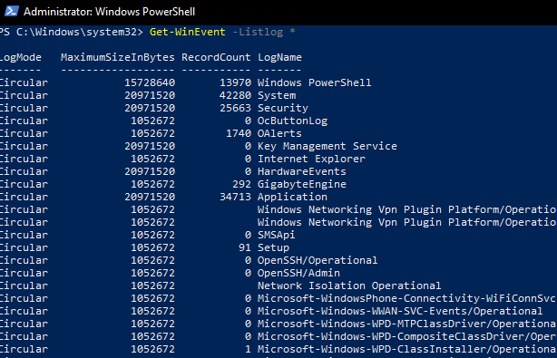

Équivalent conceptuel de :

```cmd
wevtutil el
```


Avec les propriétés utiles :

```powershell
Get-WinEvent -ListLog * |
    Select-Object LogName, RecordCount, IsClassicLog, IsEnabled, LogMode, LogType |
    Format-Table -AutoSize
```


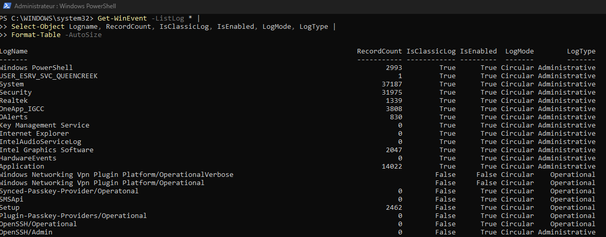

|Propriété|Description|
|---|---|
|`LogName`|Nom du journal|
|`RecordCount`|Nombre d'événements enregistrés|
|`IsClassicLog`|Indique si le journal utilise l'ancienne infrastructure de journalisation|
|`IsEnabled`|Indique si le journal est activé|
|`LogMode`|Mode de conservation des événements|
|`LogType`|Catégorie du journal|

#### Mode de journalisation

- Circular : les événements anciens peuvent être écrasés lorsque la limite de stockage est atteinte.
    
- Retain : les événements existants sont conservés lorsque le journal atteint sa limite.
    
- AutoBackup : archivage automatique lorsque le journal est plein, selon sa configuration.
    

#### Types de journaux

Les journaux peuvent être classés notamment en :

- Administrative : événements destinés à l'administration et à la résolution de problèmes.
    
- Operational : événements détaillant les opérations d'un composant.
    
- Analytic : traces destinées à une analyse approfondie.
    
- Debug : événements particulièrement détaillés, généralement utilisés pour le diagnostic.
    

Les journaux Analytic et Debug ne sont pas nécessairement activés ou accessibles par défaut.

### Lister les fournisseurs

```powershell
Get-WinEvent -ListProvider * | Format-Table -AutoSize
```


Cette commande liste les Providers disponibles et les journaux auxquels ils écrivent (`LogLinks`). Un même fournisseur peut publier des événements dans plusieurs journaux.

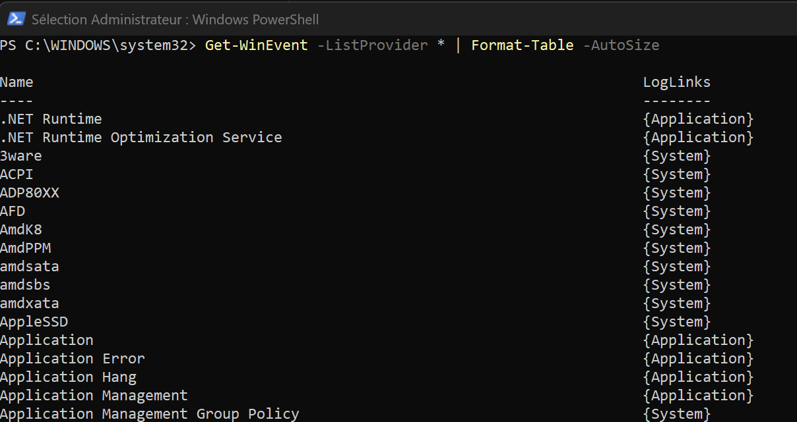
### Lire un journal
Exemple :

```powershell
Get-WinEvent -LogName System
```


→ retourne les événements du journal `System`.

Les 50 plus récents, avec les colonnes utiles :

```powershell
Get-WinEvent -LogName 'System' -MaxEvents 50 |
    Select-Object TimeCreated, ID, ProviderName, LevelDisplayName, Message |
    Format-Table -AutoSize
```


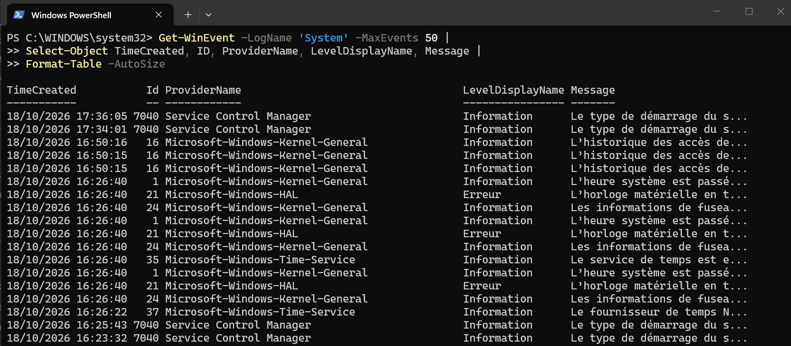

|Propriété|Fonction|
|---|---|
|`TimeCreated`|Date et heure de l'événement|
|`ID`|Event ID|
|`ProviderName`|Fournisseur ayant généré l'événement|
|`LevelDisplayName`|Niveau : Information, Warning, Error, etc.|
|`Message`|Description de l'événement|

#### Découvrir les propriétés d'un événement

Avant de filtrer, regarder à quoi ressemble un événement. Ici sur un fichier exporté, mais `-LogName` fonctionne de la même façon.

Les noms des propriétés (sans leurs valeurs) :

```powershell
Get-WinEvent -Path .\smb_bi_auth_conn_spoolsample.evtx -MaxEvents 1 |
    Get-Member
```


- `Get-Member` liste ce que contient l'objet : propriétés (`Id`, `TimeCreated`, `Message`…) et méthodes (`ToXml()`…).

Les propriétés **et** leurs valeurs, pour observer le contenu réel d'un événement :

```powershell
Get-WinEvent -Path .\smb_bi_auth_conn_spoolsample.evtx -MaxEvents 1 |
    Format-List *
```


- Le `*` signifie « toutes les propriétés ».

Les champs propres à cet événement (ceux de l'onglet **Details**), avec leurs valeurs :

```powershell
$event = Get-WinEvent -Path .\smb_bi_auth_conn_spoolsample.evtx -MaxEvents 1
$xml = [xml]$event.ToXml()

$xml.Event.EventData.Data |
    Select-Object Name, @{Name='Value'; Expression={ $_.'#text' }}
```


- `@{Name='Value'; Expression={ $_.'#text' }}` : crée une colonne `Value` qui affiche la valeur de chaque champ (détail dans [Extraire les champs d'un événement avec .ToXml()](#extraire-les-champs-dun-evenement-avec-toxml)).

#### Le réflexe à adopter en forensic

|Besoin|Commande|
|---|---|
|Découvrir les propriétés d'un objet|`Get-Member`|
|Afficher toutes les propriétés et leurs valeurs|`Format-List *`|
|Choisir quelques propriétés|`Select-Object`|
|Explorer les champs XML propres à l'événement|`.ToXml()`|

#### Lire la commande, brique par brique

Une commande `Get-WinEvent` est une chaîne de briques reliées par `|` (le *pipe*) : chaque brique reçoit les événements de la précédente, les transforme et les passe à la suivante.

```text
Get-WinEvent ...      récupère les événements
   | Where-Object     garde seulement ceux qui respectent une condition
   | Select-Object    choisit les colonnes à afficher
   | Format-Table     met en forme à l'écran (toujours en dernier)
```


|Brique|Rôle|Exemple|
|---|---|---|
|Le pipe (barre verticale)|Passe le résultat à la commande suivante|voir le schéma ci-dessus|
|`$_`|L'événement en cours de traitement, dans un `Where-Object { }` ou un `ForEach-Object { }`|`$_.Id`, `$_.Message`|
|`Where-Object`|Filtre : garde un événement si la condition est vraie|`Where-Object { $_.Id -eq 7045 }`|
|`Select-Object`|Garde certaines propriétés (colonnes)|`Select-Object TimeCreated, Id, Message`|
|`ForEach-Object`|Exécute un bloc de code pour chaque événement|`ForEach-Object { $_.TimeCreated }`|
|`Format-Table` / `Format-List`|Affiche en tableau / en liste détaillée|`Format-List` pour lire un `Message` en entier|
|`` ` `` (accent grave, en fin de ligne)|Continue la commande à la ligne suivante|voir l'exemple 2 de `-FilterXPath`|

Opérateurs de comparaison les plus utiles :

|Opérateur|Sens|Exemple|
|---|---|---|
|`-eq`|égal à|`$_.Id -eq 4625`|
|`-like`|ressemble à (avec `*` comme joker)|`$_.Message -like '*powershell*'`|
|`-match`|contient le motif (expression régulière)|`$_.Message -match 'clr\.dll'`|
|`-in`|fait partie de la liste|`$_.Id -in 1,3`|

Un pipe en fin de ligne permet aussi de couper une longue commande sur plusieurs lignes, sans accent grave.

Le même principe vaut pour un journal d'application, par exemple `Microsoft-Windows-WinRM/Operational` (administration et exécution à distance) :

```powershell
Get-WinEvent -LogName 'Microsoft-Windows-WinRM/Operational' -MaxEvents 30 |
    Select-Object TimeCreated, ID, ProviderName, LevelDisplayName, Message |
    Format-Table -AutoSize
```


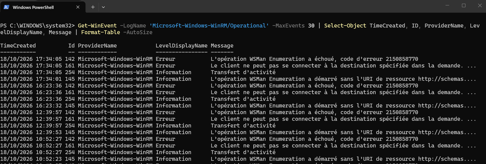

Par défaut, `Get-WinEvent` lit du plus récent au plus ancien. `-Oldest` inverse l'ordre, pour commencer par les premiers événements disponibles :

```powershell
Get-WinEvent -LogName 'Microsoft-Windows-WinRM/Operational' -Oldest -MaxEvents 30 |
    Select-Object TimeCreated, ID, ProviderName, LevelDisplayName, Message |
    Format-Table -AutoSize
```


### Lire un fichier .evtx exporté

```powershell
Get-WinEvent -Path 'C:\Tools\chainsaw\EVTX-ATTACK-SAMPLES\Execution\exec_sysmon_1_lolbin_pcalua.evtx' -MaxEvents 5 |
    Select-Object TimeCreated, ID, ProviderName, LevelDisplayName, Message |
    Format-Table -AutoSize
```


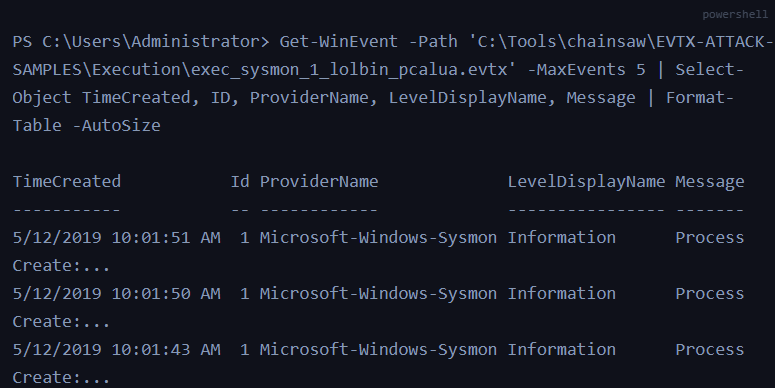

- `-Path` désigne le fichier à analyser : ici des événements Sysmon Event ID 1 (création de processus).
- L'analyse porte directement sur la preuve exportée, hors de la machine d'origine : Sysmon n'a pas besoin d'être encore actif sur le poste analysé.

### Analyser un dossier de fichiers .evtx

Cas typique en forensic : un dossier de journaux exportés, sans savoir à l'avance lequel contient l'événement recherché.

#### Lire tous les fichiers du dossier

Depuis le dossier courant :

```powershell
Get-WinEvent -Path ".\*.evtx"
```


Ou avec le chemin complet du dossier :

```powershell
Get-WinEvent -Path "C:\Tools\chainsaw\EVTX-ATTACK-SAMPLES\Lateral Movement\*.evtx"
```


- `*.evtx` : tous les fichiers dont le nom se termine par `.evtx`.
- Un seul fichier : `Get-WinEvent -Path "CHEMIN_DU_FICHIER.evtx"`.

Avec les colonnes utiles :

```powershell
Get-WinEvent -Path ".\*.evtx" |
    Select-Object TimeCreated, Id, ProviderName, Message |
    Format-Table -AutoSize
```


#### Voir quels Event IDs contient le dossier

Avant de chercher, compter les Event IDs présents :

```powershell
Get-WinEvent -Path ".\*.evtx" |
    Group-Object Id |
    Select-Object Name, Count |
    Sort-Object Count -Descending
```


- `Group-Object Id` : regroupe les événements par Event ID ; `Name` = l'Event ID, `Count` = le nombre d'événements.

Limité à Sysmon :

```powershell
Get-WinEvent -Path ".\*.evtx" |
    Where-Object ProviderName -eq 'Microsoft-Windows-Sysmon' |
    Group-Object Id |
    Select-Object Name, Count
```


Dossier **et** sous-dossiers :

```powershell
Get-ChildItem -Path . -Recurse -Filter "*.evtx" |
    ForEach-Object {
        Get-WinEvent -Path $_.FullName -ErrorAction SilentlyContinue
    } |
    Where-Object ProviderName -eq 'Microsoft-Windows-Sysmon' |
    Group-Object Id |
    Select-Object Name, Count
```


- `Get-ChildItem -Recurse -Filter "*.evtx"` : liste les fichiers `.evtx` du dossier et de tous ses sous-dossiers.
- `$_.FullName` : le chemin complet de chaque fichier trouvé.
- `-ErrorAction SilentlyContinue` : passe au fichier suivant sans s'arrêter si un fichier est vide ou illisible.

#### Filtrer par Event ID

Un seul Event ID, par exemple 5142 (partage réseau ajouté, journal Security) :

```powershell
Get-WinEvent -Path ".\*.evtx" |
    Where-Object { $_.Id -eq 5142 } |
    Select-Object TimeCreated, Id, Message
```


Plusieurs Event IDs :

```powershell
Get-WinEvent -Path ".\*.evtx" |
    Where-Object { $_.Id -in 1,3 } |
    Select-Object TimeCreated, Id, ProviderName, Message |
    Format-Table -AutoSize
```


#### Chercher un mot dans tous les événements

Par exemple, le partage `PRINT` :

```powershell
Get-WinEvent -Path ".\*.evtx" |
    Where-Object { $_.Message -like "*PRINT*" } |
    Format-List TimeCreated, Id, Message
```


- Fonctionne même sans connaître l'Event ID pertinent : la sortie donne la date, l'Event ID et le message de chaque événement trouvé.

Le même mot, dans un Event ID précis :

```powershell
Get-WinEvent -Path ".\*.evtx" |
    Where-Object { $_.Id -eq 5142 -and $_.Message -like "*PRINT*" } |
    Format-List TimeCreated, Id, Message
```


- `-and` : les deux conditions doivent être vraies.

#### Stocker les résultats pour les examiner ensuite

```powershell
$events = Get-WinEvent -Path ".\*.evtx" |
    Where-Object { $_.Id -eq 5142 }
```


Puis, sans relire les fichiers :

```powershell
$events.Count                                      # combien d'événements trouvés
$events | Select-Object TimeCreated, Id, Message   # vue en tableau
$events | Format-List TimeCreated, Id, Message     # message complet
```


- Une fois les événements dans `$events`, chercher dans le message le champ utile (par exemple le nom du partage réseau).
### Filtrer selon le Provider
Exemple :

```powershell
Get-WinEvent -LogName System |
Where-Object {$_.ProviderName -match 'Service Control Manager'}
```


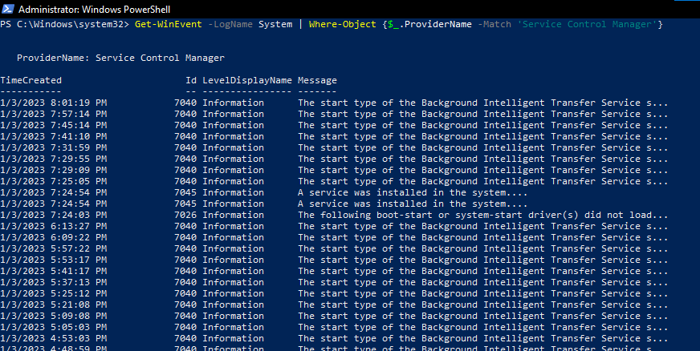

Workflow :

```text
System Events
→ PowerShell Pipeline
→ ProviderName = Service Control Manager
→ Matching Events
```


La capture montre des événements du provider :

```text
Service Control Manager
```


avec notamment :

```text
7040
7045
7026
```

#### ProviderName
Le `ProviderName` représente le composant ayant généré l’événement.

Exemple :

```text
ProviderName:
Service Control Manager
```


Il permet d’ajouter du contexte à l’Event ID :

```text
Event ID
+
Provider
→ Meaning
```


### Service Control Manager
Le **Service Control Manager — SCM** gère les services Windows.

Certains Event IDs visibles dans la capture :

#### Event ID 7040

```text
System
→ Service Control Manager
→ 7040
→ Start type changed
```


- Changement du **Start Type** d’un service.

Exemple :

```text
Background Intelligent Transfer Service

Automatic
→ Manual
```


En investigation, un changement inattendu du mode de démarrage d’un service peut être intéressant.

---

#### Event ID 7045

```text
System
→ Service Control Manager
→ 7045
→ A service was installed in the system
```


→ création / installation d’un nouveau service.

Particulièrement intéressant pour le SOC car les attaquants peuvent créer des services pour :

- persistence ;
- execution ;
- privilege escalation ;
- lateral movement.

```text
New Service
→ Legitimate?
ou
→ Suspicious Persistence / Execution?
```


---

#### Event ID 7026

```text
System
→ Service Control Manager
→ 7026
→ Boot-start / system-start driver(s) failed to load
```


- Signale qu’un ou plusieurs drivers `boot-start` ou `system-start` n’ont pas pu être chargés.

Ce type d’événement relève davantage du troubleshooting, mais peut également fournir du contexte lors d’une investigation.

---

### Filtrer par Event ID avec PowerShell

`Get-WinEvent` permet de filtrer directement à la source, plutôt qu’après coup avec `Where-Object`.

Exemple :

```powershell
Get-WinEvent -FilterHashtable @{
    LogName = 'System'
    Id      = 7045
}
```


```text
FilterHashtable
→ filtering performed during event retrieval
```


Cela est généralement préférable à :

```powershell
Get-WinEvent -LogName System |
Where-Object {$_.Id -eq 7045}
```


car `Where-Object` récupère d’abord les événements avant de les filtrer.

```text
Where-Object
System Log → Retrieve → Filter

FilterHashtable
System Log → Filter → Retrieve
```


→ sur de gros journaux, `FilterHashtable` est généralement beaucoup plus efficace.

#### Exemple : processus et connexions Sysmon (1 et 3)

```powershell
Get-WinEvent -FilterHashtable @{
    LogName = 'Microsoft-Windows-Sysmon/Operational'
    ID = 1,3
} | Select-Object TimeCreated, ID, ProviderName, Message
```


La même commande sur une seule ligne, mise en forme en tableau :

```powershell
Get-WinEvent -FilterHashtable @{LogName='Microsoft-Windows-Sysmon/Operational'; ID=1,3} |
    Select-Object TimeCreated, ID, ProviderName, LevelDisplayName, Message |
    Format-Table -AutoSize
```


Lire la hashtable :

- `@{ ... }` : une hashtable, c'est-à-dire une liste de paires `clé = valeur`.
- Une paire par ligne, ou plusieurs paires sur une seule ligne séparées par `;`.
- Toutes les conditions doivent être vraies en même temps (ET) : journal Sysmon **et** ID 1 ou 3.
- `ID = 1,3` : une liste de valeurs, lue comme « 1 **ou** 3 ».

|Clé|Ce qu'elle filtre|Exemple|
|---|---|---|
|`LogName`|Le journal|`LogName = 'Security'`|
|`Path`|Un fichier `.evtx` exporté (à la place de `LogName`)|`Path = 'C:\Cas\sysmon.evtx'`|
|`ProviderName`|Le fournisseur|`ProviderName = 'Service Control Manager'`|
|`ID`|Un ou plusieurs Event IDs|`ID = 4624,4625`|
|`Level`|Le niveau (2 = Error, 3 = Warning, 4 = Information)|`Level = 2`|
|`StartTime` / `EndTime`|Le début / la fin de la période|`StartTime = (Get-Date).AddHours(-2)`|

Un processus créé (Sysmon 1) qui établit aussitôt une connexion réseau (Sysmon 3) peut signaler un C2, surtout si le processus ou la destination sont inhabituels :

```text
Sysmon Event ID 1
Process Creation
        ↓
Sysmon Event ID 3
Network Connection
        ↓
Investigate Potential C2
```


Event 1 + Event 3 ≠ Confirmed C2 : beaucoup d'applications légitimes font exactement cela.

`FilterHashtable` accepte aussi un fichier exporté, avec la clé `Path` :

```powershell
Get-WinEvent -FilterHashtable @{
    Path = 'C:\Tools\chainsaw\EVTX-ATTACK-SAMPLES\Execution\sysmon_mshta_sharpshooter_stageless_meterpreter.evtx'
    ID = 1,3
}
```


---

### Filtrer par Provider

Exemple équivalent :

```powershell
Get-WinEvent -FilterHashtable @{
    LogName      = 'System'
    ProviderName = 'Service Control Manager'
}
```


---

### Filtrer plusieurs Event IDs

```powershell
Get-WinEvent -FilterHashtable @{
    LogName = 'System'
    Id      = 7040,7045
}
```


---

### Filtrer selon une période

```powershell
Get-WinEvent -FilterHashtable @{
    LogName   = 'System'
    StartTime = (Get-Date).AddDays(-1)
}
```


Conceptuellement :

```text
System
+
Last 24 Hours
+
Relevant Event IDs
→ Focused Investigation
```


Une plage précise, ici du 28 mai au 2 juin 2023 inclus :

```powershell
$startDate = (Get-Date -Year 2023 -Month 5 -Day 28).Date
$endDate   = (Get-Date -Year 2023 -Month 6 -Day 3).Date

Get-WinEvent -FilterHashtable @{
    LogName   = 'Microsoft-Windows-Sysmon/Operational'
    ID        = 1,3
    StartTime = $startDate
    EndTime   = $endDate
}
```


La borne de fin au 3 juin à minuit couvre intégralement la journée du 2 juin. En DFIR : réduire l'analyse à la période où l'activité suspecte a été observée.

---

### Extraire les champs d'un événement avec .ToXml()

- Chaque événement Windows est stocké en XML : c'est ce qu'affiche l'onglet **Details → XML View** de l'Observateur d'événements.
- `Message` est un texte fait pour être lu par un humain ; pour isoler **un** champ (une IP, un chemin, un compte), on passe par le XML.
- `.ToXml()` renvoie le XML de l'événement ; `[xml]` le transforme en objet dans lequel PowerShell sait naviguer.
- Pour comprendre en détail la structure XML d'un événement et d'un fichier EVTX : [documentation libevtx](https://github.com/libyal/libevtx/blob/main/documentation/Windows%20XML%20Event%20Log%20%28EVTX%29.asciidoc).

#### Pas à pas : du XML au champ voulu

**Étape 1 — récupérer un seul événement** (Sysmon 3, connexion réseau) et le ranger dans une variable :

```powershell
$event = Get-WinEvent -FilterHashtable @{LogName='Microsoft-Windows-Sysmon/Operational'; ID=3} -MaxEvents 1
```


**Étape 2 — afficher son XML :**

```powershell
$event.ToXml()
```


Sortie, raccourcie et mise en forme pour la lecture (valeurs d'exemple) :

```xml
<Event xmlns="http://schemas.microsoft.com/win/2004/08/events/event">
  <System>
    <Provider Name="Microsoft-Windows-Sysmon" />
    <EventID>3</EventID>
    <TimeCreated SystemTime="2023-06-03T20:51:08.538Z" />
    <Computer>PC-01</Computer>
  </System>
  <EventData>
    <Data Name="ProcessGuid">{52ff3419-a7bc-647b-1901-000000001000}</Data>
    <Data Name="ProcessId">2480</Data>
    <Data Name="Image">C:\Windows\System32\svchost.exe</Data>
    <Data Name="SourceIp">192.168.1.15</Data>
    <Data Name="DestinationIp">203.0.113.10</Data>
    <Data Name="DestinationPort">443</Data>
  </EventData>
</Event>
```


- `<System>` : l'en-tête commun à tous les événements (Event ID, heure, machine).
- `<EventData>` : les champs propres à cet événement, chacun écrit `<Data Name="NomDuChamp">valeur</Data>`.

**Étape 3 — transformer le texte en objet XML**, puis descendre dans l'arborescence avec des points, comme dans des dossiers :

```powershell
$xml = [xml]$event.ToXml()
$xml.Event.System.EventID       # 3
$xml.Event.EventData.Data       # la liste des champs
```


Sortie de la dernière ligne :

```text
Name            #text
----            -----
ProcessGuid     {52ff3419-a7bc-647b-1901-000000001000}
ProcessId       2480
Image           C:\Windows\System32\svchost.exe
SourceIp        192.168.1.15
DestinationIp   203.0.113.10
DestinationPort 443
```


- `Name` : le nom du champ (l'attribut `Name="…"`).
- `#text` : sa valeur (le texte entre les balises). À cause du `#`, on l'écrit entre guillemets : `.'#text'`.

**Étape 4 — lire un seul champ :**

```powershell
($xml.Event.EventData.Data | Where-Object Name -eq 'DestinationIp').'#text'
```


```text
203.0.113.10
```


**Étape 5 — faire la même chose pour chaque événement**, avec `ForEach-Object` :

```powershell
Get-WinEvent -FilterHashtable @{LogName='Microsoft-Windows-Sysmon/Operational'; ID=3} -MaxEvents 20 |
    ForEach-Object {
        $data = ([xml]$_.ToXml()).Event.EventData.Data
        [PSCustomObject]@{
            Heure         = $_.TimeCreated
            Image         = ($data | Where-Object Name -eq 'Image').'#text'
            DestinationIp = ($data | Where-Object Name -eq 'DestinationIp').'#text'
        }
    }
```


```text
Heure               Image                                   DestinationIp
-----               -----                                   -------------
03/06/2023 22:51:08 C:\Windows\System32\svchost.exe         203.0.113.10
03/06/2023 22:50:44 C:\Program Files\Mozilla Firefox\fir... 198.51.100.7
```


- `$_` : l'événement en cours de traitement.
- `[PSCustomObject]@{ … }` : fabrique une ligne de tableau avec les colonnes qu'on choisit.

#### Exemple : enquêter sur une IP suspecte

Scénario : rechercher les connexions Sysmon vers l'adresse IP :

`203.0.113.10` (adresse d'exemple)

On lit les événements Sysmon ID 3 et on en extrait plusieurs champs XML :

|Champ XML|Description|
|---|---|
|`SourceIp`|Adresse IP source|
|`DestinationIp`|Adresse IP de destination|
|`ProcessGuid`|Identifiant Sysmon du processus|
|`ProcessId`|PID du processus|

Exemple condensé :

```
Get-WinEvent -FilterHashtable @{
    LogName = 'Microsoft-Windows-Sysmon/Operational'
    ID = 3
} | ForEach-Object {
    $event = $_
    $data = ([xml]$event.ToXml()).Event.EventData.Data

    $fields = @{}
    foreach ($item in $data) {
        $fields[$item.Name] = $item.'#text'
    }

    if ($fields['DestinationIp'] -eq '203.0.113.10') {
        [PSCustomObject]@{
            SourceIp      = $fields['SourceIp']
            DestinationIp = $fields['DestinationIp']
            ProcessGuid   = $fields['ProcessGuid']
            ProcessId     = $fields['ProcessId']
        }
    }
}
```


Cette recherche identifie les connexions vers l'IP sélectionnée et permet de retrouver les processus associés.

Le même code, ligne par ligne :

|Ligne|Ce qu'elle fait|
|---|---|
|`Get-WinEvent -FilterHashtable @{ … ID = 3 }`|Récupère toutes les connexions réseau Sysmon|
|`ForEach-Object {`|Traite les événements un par un|
|`$event = $_`|Donne un nom lisible à l'événement en cours|
|`$data = ([xml]$event.ToXml()).Event.EventData.Data`|Récupère la liste des champs (étapes 2 à 4)|
|`$fields = @{}`|Crée une hashtable vide, sorte de petit dictionnaire|
|`foreach ($item in $data) { $fields[$item.Name] = $item.'#text' }`|Range chaque champ sous son nom : `$fields['DestinationIp']` donne alors directement la valeur|
|`if ($fields['DestinationIp'] -eq '203.0.113.10') {`|Ne garde que les connexions vers l'IP recherchée|
|`[PSCustomObject]@{ … }`|Affiche les quatre champs utiles|

#### Autres exemples avec .ToXml()

Les derniers processus lancés (Sysmon 1), avec leur ligne de commande et leur parent :

```powershell
Get-WinEvent -FilterHashtable @{LogName='Microsoft-Windows-Sysmon/Operational'; ID=1} -MaxEvents 10 |
    ForEach-Object {
        $data = ([xml]$_.ToXml()).Event.EventData.Data
        [PSCustomObject]@{
            Heure       = $_.TimeCreated
            Image       = ($data | Where-Object Name -eq 'Image').'#text'
            CommandLine = ($data | Where-Object Name -eq 'CommandLine').'#text'
            ParentImage = ($data | Where-Object Name -eq 'ParentImage').'#text'
        }
    } | Format-List
```


Les comptes visés par des échecs de connexion (Security 4625) sur les dernières 24 heures :

```powershell
Get-WinEvent -FilterHashtable @{LogName='Security'; ID=4625; StartTime=(Get-Date).AddHours(-24)} |
    ForEach-Object {
        $data = ([xml]$_.ToXml()).Event.EventData.Data
        [PSCustomObject]@{
            Compte    = ($data | Where-Object Name -eq 'TargetUserName').'#text'
            LogonType = ($data | Where-Object Name -eq 'LogonType').'#text'
            IpSource  = ($data | Where-Object Name -eq 'IpAddress').'#text'
        }
    } | Group-Object Compte | Sort-Object Count -Descending | Select-Object Count, Name
```


```text
Count Name
----- ----
  198 Administrator
    3 j.martin
```


- `Group-Object Compte` regroupe les lignes par compte et les compte ; `Sort-Object Count -Descending` met les plus touchés en tête.
- Beaucoup d'échecs sur un seul compte : force brute. Quelques échecs sur beaucoup de comptes : password spraying (voir [Brute Force vs Password Spraying](04-authentification-et-ouvertures-de-session.md#brute-force-vs-password-spraying)).
- Même méthode pour n'importe quel événement : relever le nom du champ dans la vue XML, puis `Where-Object Name -eq 'NomDuChamp'`.

#### Pourquoi le ProcessGuid

Le `ProcessGuid` est particulièrement utile pour corréler les événements Sysmon.

Il permet notamment de relier :

```
Sysmon Event ID 3
Network Connection
       ↓
ProcessGuid
       ↓
Sysmon Event ID 1
Process Creation
       ↓
Executable / Command Line / Parent
```


Le `ProcessGuid` est généralement plus fiable qu'un PID seul pour corréler des événements sur une période, puisque les PIDs peuvent être réutilisés.

### Filtrer avec -FilterXml

Le paramètre `-FilterXml` permet d'exécuter une requête XML structurée sur les Windows Event Logs.

#### Exemple : chargement des DLL du runtime .NET

Cas du chargement, inattendu dans certains processus, des DLL du runtime .NET :

- `clr.dll`
    
- `mscoree.dll`
    

Ces bibliothèques sont associées à l'exécution du runtime .NET.

On recherche leurs chargements avec Sysmon Event ID 7 — Image Loaded.

Une requête XML peut sélectionner les événements de cette catégorie :

```
$Query = @'
<QueryList>
  <Query Id="0" Path="Microsoft-Windows-Sysmon/Operational">
    <Select Path="Microsoft-Windows-Sysmon/Operational">
      *[System[(EventID=7)]]
    </Select>
  </Query>
</QueryList>
'@

Get-WinEvent -FilterXml $Query |
    Where-Object {
        $_.Message -match '\\(clr|mscoree)\.dll\b'
    } |
    Select-Object TimeCreated, ID, Message
```


L'exemple conserve uniquement les événements faisant référence aux DLL recherchées.

#### Lire la requête

- `$Query = @'` … `'@` : une *here-string*, qui range un texte de plusieurs lignes dans une variable, tel quel. Le `'@` de fin doit être **seul en début de ligne**, sans espace devant, sinon PowerShell attend la suite.
- `<QueryList>` et `<Query Id="0" Path="…">` : l'enveloppe de la requête et le journal interrogé.
- `<Select Path="…">*[System[(EventID=7)]]</Select>` : la condition, ici « tous les événements dont l'Event ID vaut 7 ». Elle s'écrit en XPath (détaillé dans [Filtrer avec -FilterXPath](#filtrer-avec-filterxpath)).
- `Get-WinEvent -FilterXml $Query` : exécute la requête ; seuls les Sysmon 7 sont renvoyés.
- `Where-Object { $_.Message -match '\\(clr|mscoree)\.dll\b' }` : affine sur le texte du message.
    - `-match` cherche un motif (expression régulière) n'importe où dans le texte.
    - `\\` : une barre oblique inverse `\` (doublée, car `\` a un sens spécial dans un motif).
    - `(clr|mscoree)` : `clr` **ou** `mscoree`.
    - `\.dll` : le texte `.dll` (le point est lui aussi protégé par `\`).
    - `\b` : fin de mot, pour ne pas attraper `clr.dll.mui` par exemple.

#### Mettre les DLL dans la requête

On peut aussi mettre les DLL dans la condition XML elle-même : il faut alors donner le chemin complet enregistré dans `ImageLoaded`, pas seulement le nom du fichier.

```powershell
$Query = @'
<QueryList>
  <Query Id="0" Path="Microsoft-Windows-Sysmon/Operational">
    <Select Path="Microsoft-Windows-Sysmon/Operational">
      *[System[(EventID=7)]
        and EventData[(Data[@Name='ImageLoaded']='C:\Windows\System32\mscoree.dll'
                    or Data[@Name='ImageLoaded']='C:\Windows\Microsoft.NET\Framework64\v4.0.30319\clr.dll')]]
    </Select>
  </Query>
</QueryList>
'@

Get-WinEvent -FilterXml $Query |
    Select-Object TimeCreated, ID, Message
```


- Le tri est fait par le journal lui-même, sans passer par `Where-Object` : plus rapide sur un gros journal.
- L'égalité est **exacte** : chemin complet, tel qu'il apparaît dans la vue XML. Pas de joker `*` ni de « contient » dans une requête XML : pour une recherche partielle, revenir à `Where-Object`, comme dans l'exemple précédent.

#### Réutiliser une requête de l'Observateur d'événements

`-FilterXml` accepte exactement la requête affichée par l'Observateur :

1. Observateur d'événements → clic droit sur le journal → *Filter Current Log…* ; régler le filtre (Event ID, période…).
2. Onglet **XML** : la requête complète s'affiche ; la copier.
3. La coller entre `@'` et `'@`, puis lancer `Get-WinEvent -FilterXml $Query`.

Par exemple, le filtre « Event ID 4625, dernières 24 heures » du journal Security donne :

```powershell
$Query = @'
<QueryList>
  <Query Id="0" Path="Security">
    <Select Path="Security">*[System[(EventID=4625) and TimeCreated[timediff(@SystemTime) &lt;= 86400000]]]</Select>
  </Query>
</QueryList>
'@

Get-WinEvent -FilterXml $Query | Measure-Object
```


- `timediff(@SystemTime) &lt;= 86400000` : « il y a moins de 86 400 000 millisecondes », soit 24 heures.
- `&lt;` est l'écriture XML de `<` (le symbole `<` seul ouvrirait une balise).
- `Measure-Object` compte les événements renvoyés.

#### Investigation

L'analyste peut ainsi identifier :

- le processus ayant chargé la DLL ;
    
- le chemin du module ;
    
- le compte utilisateur ;
    
- le `ProcessGuid` ;
    
- les signatures et hashes, lorsqu'ils sont disponibles.
    

Charger une bibliothèque .NET est normal pour un processus utilisant le CLR. La détection devient pertinente lorsque ce chargement est inattendu dans le contexte du processus.

### Filtrer avec -FilterXPath

Le paramètre `-FilterXPath` permet d'utiliser directement une expression XPath pour sélectionner certains événements.

#### Exemple 1 : acceptation de la licence Sysinternals

Rechercher une exécution de `reg.exe` qui modifie la clé :

`HKCU\Software\Sysinternals`

avec la valeur :

`EulaAccepted`

Cette opération peut correspondre à l'acceptation automatisée de la licence d'un outil Sysinternals.

La requête filtre les événements Sysmon Process Creation sur les champs :

- `Image` : `C:\Windows\System32\reg.exe`
    
- `CommandLine` : commande modifiant la valeur `EulaAccepted`.
    

L'objectif est de rechercher une exécution spécifique de `reg.exe` dans la télémétrie.

Les champs `Image` et `CommandLine` dans la vue XML d'un événement Sysmon 1 :


```powershell
Get-WinEvent -LogName 'Microsoft-Windows-Sysmon/Operational' `
    -FilterXPath "*[System[EventID=1] and EventData[Data[@Name='Image']='C:\Windows\System32\reg.exe']]" |
    Where-Object { $_.Message -like '*EulaAccepted*' } |
    Format-List TimeCreated, Message
```


- `-FilterXPath` : le journal ne renvoie que les lancements de `reg.exe` (égalité exacte sur `Image`).
- `Where-Object` : garde ceux dont le message (qui contient la `CommandLine`) mentionne `EulaAccepted`. XPath ne sait pas chercher un mot **à l'intérieur** d'une valeur : on filtre d'abord large avec XPath, puis on affine avec PowerShell.

L'observation de cette activité peut fournir un indice d'utilisation ou de préparation d'outils Sysinternals, mais ne démontre pas à elle seule une activité malveillante.

#### Exemple 2 : connexions vers une IP

Pour rechercher directement les événements Sysmon ID 3 vers une adresse IP précise :

```
Get-WinEvent `
    -LogName 'Microsoft-Windows-Sysmon/Operational' `
    -FilterXPath "*[System[(EventID=3)] and EventData[Data[@Name='DestinationIp']='203.0.113.10']]"
```


La requête sélectionne les événements respectant simultanément :

- `EventID = 3`
    
- `DestinationIp = 203.0.113.10`
    

Avantage : filtrer directement pendant la lecture des journaux permet d'éviter de récupérer inutilement tous les événements avant de les examiner.

#### Lire une expression XPath

```text
*[ System[EventID=3]  and  EventData[ Data[@Name='DestinationIp'] = '203.0.113.10' ] ]
│  └─ en-tête : Event ID 3         └─ le champ nommé DestinationIp vaut 203.0.113.10
└─ n'importe quel événement…
```


À lire comme une phrase : « tout événement (`*`) dont l'en-tête (`System`) porte l'Event ID 3 **et** dont le champ (`Data`) nommé (`@Name`) `DestinationIp` vaut `203.0.113.10` ».

- `[ … ]` : se lit « dont… » ; c'est une condition.
- `System[ … ]` : conditions sur l'en-tête, pour `EventID`, `TimeCreated`, `Level`, `Provider`, `Computer`.
- `EventData[ … ]` : conditions sur tous les autres champs, ceux de l'onglet **Details**.
- `@Name` : l'attribut `Name` de la balise `<Data Name="…">`.
- `and` / `or` : combiner des conditions ; des parenthèses pour les grouper.
- Guillemets : doubles autour de toute l'expression, simples autour des valeurs.
- Les noms de champs respectent la casse : `DestinationIp`, pas `destinationip`.

#### D'autres exemples, du plus simple au plus précis

|Je cherche…|Journal|Expression XPath|
|---|---|---|
|Les créations de processus|Sysmon|`*[System[EventID=1]]`|
|Les créations de processus ou les connexions réseau|Sysmon|`*[System[(EventID=1 or EventID=3)]]`|
|Les lancements de PowerShell|Sysmon|`*[System[EventID=1] and EventData[Data[@Name='Image']='C:\Windows\System32\WindowsPowerShell\v1.0\powershell.exe']]`|
|Les connexions sortantes en RDP (port 3389)|Sysmon|`*[System[EventID=3] and EventData[Data[@Name='DestinationPort']='3389']]`|
|Les échecs de connexion sur le compte `Administrator`|Security|`*[System[EventID=4625] and EventData[Data[@Name='TargetUserName']='Administrator']]`|
|Les services installés dans les dernières 24 heures|System|`*[System[EventID=7045 and TimeCreated[timediff(@SystemTime) <= 86400000]]]`|

Chaque expression se place après `-FilterXPath`, avec le journal correspondant :

```powershell
Get-WinEvent -LogName 'Security' `
    -FilterXPath "*[System[EventID=4625] and EventData[Data[@Name='TargetUserName']='Administrator']]" `
    -MaxEvents 10
```


- Dans `-FilterXPath`, `<=` s'écrit tel quel. `&lt;=` ne sert que dans une requête XML complète (`-FilterXml`, Observateur d'événements).
- Avec un fichier exporté, remplacer `-LogName '…'` par `-Path 'C:\Cas\sysmon.evtx'`.

#### Relier une connexion à son processus

Une fois le `ProcessGuid` relevé dans un Sysmon 3, on retrouve la création du processus (Sysmon 1) qui porte le même identifiant :

```powershell
$guid = '{52ff3419-a7bc-647b-1901-000000001000}'    # ProcessGuid relevé dans le Sysmon 3

Get-WinEvent -LogName 'Microsoft-Windows-Sysmon/Operational' `
    -FilterXPath "*[System[EventID=1] and EventData[Data[@Name='ProcessGuid']='$guid']]" |
    Format-List TimeCreated, Message
```


- Entre guillemets doubles, PowerShell remplace `$guid` par sa valeur avant d'envoyer l'expression.
- Le `Message` du Sysmon 1 donne alors l'exécutable, sa ligne de commande et son parent (voir [Pourquoi le ProcessGuid](#pourquoi-le-processguid)).

### Filtrer sur les propriétés d'un événement

`Get-WinEvent` retourne des objets PowerShell disposant de nombreuses propriétés exploitables.

#### Afficher toutes les propriétés

```
Get-WinEvent -FilterHashtable @{
    LogName = 'Microsoft-Windows-Sysmon/Operational'
    ID = 1
} -MaxEvents 1 | Select-Object -Property *
```


Cette commande affiche l'ensemble des propriétés de l'objet retourné.

On retrouve notamment :

- `Message`
- `Id`
- `TimeCreated`
- `ProviderName`
- `RecordId`
- `MachineName`
- `Properties`

Pour un événement Sysmon ID 1, le message détaillé peut inclure :

|Champ|Utilisation|
|---|---|
|`Image`|Exécutable lancé|
|`CommandLine`|Arguments du processus|
|`User`|Compte associé|
|`IntegrityLevel`|Niveau d'intégrité|
|`ProcessGuid`|Identifiant unique Sysmon du processus|
|`ParentProcessGuid`|Identifiant Sysmon du processus parent|
|`ParentImage`|Chemin du processus parent|
|`ParentCommandLine`|Ligne de commande du parent|

#### Exemple : PowerShell encodé suspect

Recherche :

```
Get-WinEvent -FilterHashtable @{
    LogName = 'Microsoft-Windows-Sysmon/Operational'
    ID = 1
} | Where-Object {
    $_.Properties[21].Value -like '*-enc*'
} | Format-List
```


#### Lire le pipeline

- `Where-Object` : filtre les événements récupérés.
    
- `$_` : représente l'événement actuellement traité.
    
- `.Properties[21].Value` : correspond à `ParentCommandLine` dans le schéma Sysmon utilisé par le lab.
    
- `-like '*-enc*'` : recherche la chaîne `-enc` n'importe où dans la valeur.
    
- `Format-List` : affiche les événements correspondants sous forme de liste détaillée.
    

Le paramètre PowerShell `-EncodedCommand`, souvent abrégé en `-enc`, permet d'exécuter une commande encodée.

Il peut être utilisé pour obfusquer des scripts malveillants, mais également dans des outils d'automatisation légitimes.

#### Ce que montre le lab

L'exemple montre des processus tels que :

```
powershell.exe
   ├── csc.exe
   └── chcp.com
```


Leurs événements Sysmon comportent une ParentCommandLine contenant `-EncodedCommand`.

Point important : le filtre recherche la ligne de commande du parent, et pas nécessairement celle du processus enfant.

Par ailleurs, l'utilisation de `.Properties[21]` est dépendante de la structure et de la version de l'événement. Dans une investigation réutilisable, il est préférable d'extraire le champ XML nommé `ParentCommandLine`.

#### Trouver le bon numéro de propriété

- `Properties` contient les valeurs de `EventData`, **dans l'ordre** de la vue XML, numérotées à partir de 0.
- Pour connaître le numéro d'un champ, afficher toutes les valeurs d'un événement avec leur numéro :

```powershell
$e = Get-WinEvent -FilterHashtable @{LogName='Microsoft-Windows-Sysmon/Operational'; ID=1} -MaxEvents 1
for ($i = 0; $i -lt $e.Properties.Count; $i++) { "$i : $($e.Properties[$i].Value)" }
```


Sortie (raccourcie, valeurs d'exemple) :

```text
0 : -
1 : 2023-06-03 20:51:08.538
2 : 52ff3419-a7bc-647b-1901-000000001000
3 : 2480
4 : C:\Windows\System32\SecurityHealthHost.exe
...
10 : C:\Windows\System32\SecurityHealthHost.exe {08728914-3F57-4D52-9E31-49DAECA5A80A} -Embedding
11 : C:\Windows\system32\
12 : PC-01\Administrator
...
20 : C:\Windows\System32\svchost.exe
21 : C:\Windows\system32\svchost.exe -k DcomLaunch -p
```


- `for ($i = 0; …; $i++)` : une boucle qui compte de 0 jusqu'au nombre de propriétés.
- `"$i : $($e.Properties[$i].Value)"` : affiche le numéro puis la valeur ; `$( … )` calcule une expression à l'intérieur d'un texte.
- Pour un Sysmon 1 : 4 = `Image`, 10 = `CommandLine`, 12 = `User`, 20 = `ParentImage`, 21 = `ParentCommandLine` (même ordre que dans la vue XML).

Exemple : les processus lancés depuis un dossier `Temp` (`Image` = propriété 4) :

```powershell
Get-WinEvent -FilterHashtable @{LogName='Microsoft-Windows-Sysmon/Operational'; ID=1} |
    Where-Object { $_.Properties[4].Value -like '*\Temp\*' } |
    Select-Object TimeCreated, @{Name='Image'; Expression={ $_.Properties[4].Value }}
```


- `@{Name='Image'; Expression={ … }}` : crée une colonne `Image` dont la valeur est calculée pour chaque événement.

#### La même recherche avec le nom du champ

La recherche `-enc` sans numéro de propriété, en lisant le champ `ParentCommandLine` par son nom (méthode de `.ToXml()`) :

```powershell
Get-WinEvent -FilterHashtable @{LogName='Microsoft-Windows-Sysmon/Operational'; ID=1} |
    Where-Object {
        $data = ([xml]$_.ToXml()).Event.EventData.Data
        ($data | Where-Object Name -eq 'ParentCommandLine').'#text' -like '*-enc*'
    } |
    Format-List TimeCreated, Message
```


- Plus long à écrire, mais le résultat ne dépend plus de la position du champ, qui peut changer d'une version de Sysmon à l'autre.
- `Properties[n]` reste pratique pour une recherche rapide, une fois le numéro vérifié avec la boucle ci-dessus.

### Choisir sa méthode de filtrage

|Méthode|Utilisation|
|---|---|
|`-LogName`|Lire un journal Windows précis|
|`-Path`|Analyser un fichier EVTX exporté|
|`-MaxEvents`|Limiter le nombre d'événements retournés|
|`-Oldest`|Lire les événements des plus anciens vers les plus récents|
|`-FilterHashtable`|Filtrer efficacement par journal, Event ID et dates|
|`-FilterXml`|Utiliser une requête XML structurée|
|`-FilterXPath`|Rechercher des événements selon des champs XML|
|`Where-Object`|Appliquer des conditions supplémentaires aux objets récupérés|
|`.ToXml()`|Extraire les champs détaillés d'un événement|

#### Une même recherche, quatre écritures

Les connexions réseau (Sysmon 3) vers `203.0.113.10` :

```powershell
# 1. Where-Object sur le texte du message
Get-WinEvent -FilterHashtable @{LogName='Microsoft-Windows-Sysmon/Operational'; ID=3} |
    Where-Object { $_.Message -like '*203.0.113.10*' }

# 2. .ToXml() : lecture du champ DestinationIp
Get-WinEvent -FilterHashtable @{LogName='Microsoft-Windows-Sysmon/Operational'; ID=3} |
    Where-Object {
        $data = ([xml]$_.ToXml()).Event.EventData.Data
        ($data | Where-Object Name -eq 'DestinationIp').'#text' -eq '203.0.113.10'
    }

# 3. -FilterXPath : le journal ne renvoie que les bons événements
Get-WinEvent -LogName 'Microsoft-Windows-Sysmon/Operational' `
    -FilterXPath "*[System[EventID=3] and EventData[Data[@Name='DestinationIp']='203.0.113.10']]"

# 4. -FilterXml : la même condition dans une requête complète
$Query = @'
<QueryList>
  <Query Id="0" Path="Microsoft-Windows-Sysmon/Operational">
    <Select Path="Microsoft-Windows-Sysmon/Operational">
      *[System[EventID=3] and EventData[Data[@Name='DestinationIp']='203.0.113.10']]
    </Select>
  </Query>
</QueryList>
'@
Get-WinEvent -FilterXml $Query
```


|Écriture|Avantage|Limite|
|---|---|---|
|1. `Where-Object` sur `Message`|La plus simple ; recherche partielle possible avec `*`|Lente : tous les Sysmon 3 sont lus ; trouve aussi l'IP quand elle est en **source**|
|2. `.ToXml()`|Champ exact ; recherche partielle possible avec `-like`|Lente : tous les Sysmon 3 sont lus puis convertis|
|3. `-FilterXPath`|Rapide ; champ exact ; une seule ligne|Égalité exacte seulement, pas de joker|
|4. `-FilterXml`|Comme 3, et copiable depuis l'Observateur ; plusieurs journaux ou exclusions (`<Suppress>`) possibles|Plus long à écrire|

Règle pratique : filtrer le plus possible côté journal (`-FilterHashtable`, `-FilterXPath`, `-FilterXml`), puis affiner avec `Where-Object`.

### Démarche de threat hunting avec Get-WinEvent

```
Identify Hunting Hypothesis
          ↓
Select Relevant Event Logs
          ↓
Choose Event IDs / Time Range
          ↓
Apply Hashtable / XML / XPath Filters
          ↓
Extract Relevant Event Fields
          ↓
Correlate ProcessGuid / Timestamps
          ↓
Investigate Suspicious Behavior
```


#### Points essentiels

- `Get-WinEvent` permet d'automatiser l'analyse des journaux Windows et Sysmon avec PowerShell.
    
- `FilterHashtable` est particulièrement pratique pour les recherches par Event ID et période.
    
- `FilterXml` et `FilterXPath` permettent d'effectuer des recherches plus précises dans les champs des événements.
    
- `ProcessGuid` facilite la corrélation entre exécutions de processus et connexions réseau.
    
- `ParentCommandLine` peut révéler des scripts ou commandes associés à l'origine d'une activité.
    
- Les résultats doivent être contextualisés : une commande encodée, une connexion réseau ou un chargement de DLL ne constituent pas automatiquement une compromission.
    

L'intérêt de `Get-WinEvent` est de transformer les journaux Windows en données interrogeables et corrélables, ce qui permet de passer d'une recherche manuelle dans Event Viewer à des investigations DFIR et Threat Hunting reproductibles.

---

## Event Viewer vs `wevtutil` vs `Get-WinEvent`

| Outil | Interface | Usage principal |
|---|---|---|
| **Event Viewer** | GUI | Analyse manuelle / exploration |
| **wevtutil** | CMD | Gestion et requêtes CLI |
| **Get-WinEvent** | PowerShell | Analyse, filtrage et automatisation |

```text
Event Viewer
→ rapide pour explorer visuellement

wevtutil
→ administration CLI

Get-WinEvent
→ scripting / hunting / analyse avancée
```


---

## Approche SOC

Pour une investigation, on cherchera rarement simplement :

```text
"Montre-moi tous les logs"
```


mais plutôt :

```text
Relevant Log
+
Event ID
+
Provider
+
Time Window
+
Host
+
User
→ Relevant Events
```


Exemple :

```text
System
+
Service Control Manager
+
7045
+
Incident Time Window
→ Newly Installed Services
```


Puis :

```text
New Service
→ Service Name
→ Executable Path
→ Account
→ Timestamp
→ Correlate with Process / Network / Authentication Logs
```


La puissance de ces outils vient donc moins de la simple lecture d’un `.evtx` que de la capacité à **réduire rapidement des dizaines de milliers d’événements à ceux qui sont pertinents pour l’investigation**.

Source des captures : [Hack The Box Academy - Event Log Analysis](https://academy.hackthebox.com/app/module/387/section/4529)

## Démarche de threat hunting dans les journaux

```
Suspicious Activity
        ↓
Identify Relevant Event IDs
        ↓
Collect Windows Event Logs
        ↓
Filter by Time / User / Host
        ↓
Correlate Logon IDs & Events
        ↓
Reconstruct Event Timeline
        ↓
Investigate Suspicious Behavior
```


### Bonnes pratiques

- Baseline : connaître les comportements normaux des systèmes et utilisateurs.
- Centralized Logging : collecter les événements dans un SIEM ou une infrastructure centralisée.
- Log Correlation : rapprocher plusieurs Event IDs et sources de données.
- Time Synchronization : synchroniser les horloges pour faciliter l'analyse chronologique.
- Audit Configuration : activer les politiques d'audit nécessaires à la production des événements recherchés.
- Alert Tuning : adapter les règles de détection à l'environnement pour limiter les False Positives.
