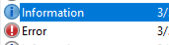
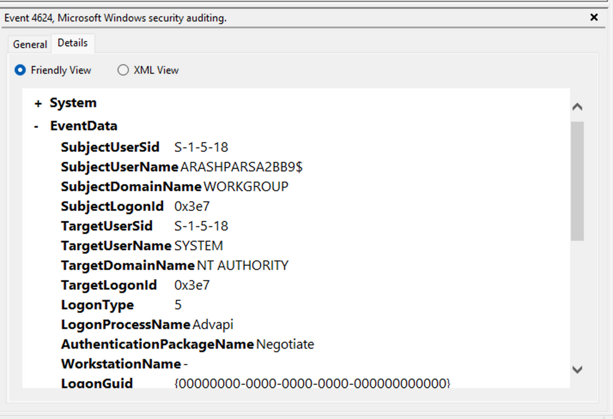
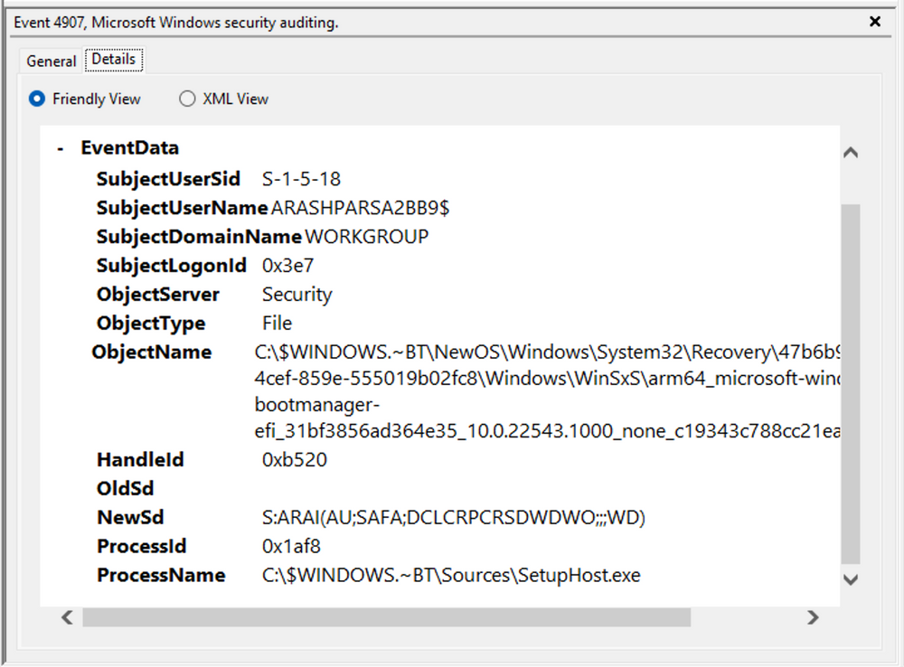
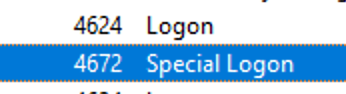
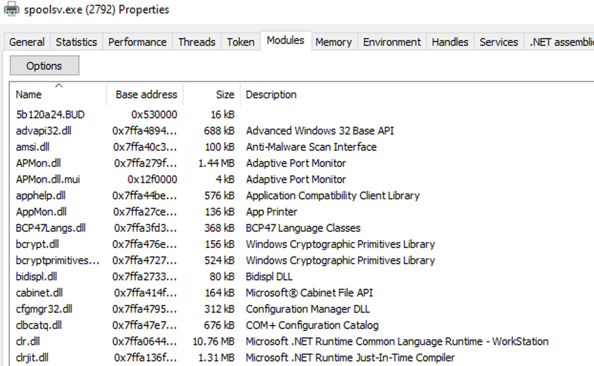

Ce cours apprend à repérer une activité malveillante dans les journaux Windows : anatomie d'un événement, ouvertures de session (4624, Logon Types, Logon ID), requêtes XML dans l'Observateur d'événements et Event IDs utiles ; puis, avec Sysmon, trois détections pas à pas : DLL hijacking, injection de PowerShell non managé et vol d'identifiants dans LSASS.

Les journaux Windows sont détaillés dans [Analyse des journaux d'événements Windows (Event Logs)](analyse-des-journaux-d-evenements-windows-event-logs/index.md) ; les Event IDs Sysmon et les commandes dans la cheat sheet [Sysmon et requêtes SIEM](/cheatsheets/windows/fondamentaux/logs/sysmon/).

## Windows Event Logs & Finding Evil — Windows Event Logs

Les Windows Event Logs sont des journaux natifs de Windows qui enregistrent les événements générés par le système d'exploitation, les applications, les services et certains fournisseurs ETW (Event Tracing for Windows).

Ils constituent une source essentielle pour le SOC, le Threat Hunting et le DFIR, notamment pour analyser les authentifications, modifications système, activités suspectes et tentatives d'effacement de traces.

### 1. Windows Event Logging Basics

Les journaux Windows peuvent être consultés avec Event Viewer (`eventvwr.msc`) ou exploités par programmation avec la Windows Event Log API.


#### Principaux journaux Windows

| Log              | Contenu                                                        |
| ---------------- | -------------------------------------------------------------- |
| Application      | Événements, erreurs et diagnostics des applications            |
| Security         | Authentifications, accès, privilèges et événements d'audit     |
| Setup            | Événements liés à l'installation et à la configuration Windows |
| System           | Événements du système, des services et des composants Windows  |
| Forwarded Events | Événements transmis depuis d'autres machines                   |


Forwarded Events permet de consulter des événements reçus via Windows Event Forwarding (WEF), lorsque cette fonctionnalité est configurée.

Event Viewer peut également ouvrir des fichiers de journaux sauvegardés au format `.evtx`, accessibles dans la section `Saved Logs`.


### 2. Anatomy of a Windows Event

Chaque événement Windows contient des métadonnées permettant de comprendre son origine et son contexte.

| Champ             | Description                                                         |
| ----------------- | ------------------------------------------------------------------- |
| Log Name          | Journal contenant l'événement                                       |
| Source / Provider | Composant ayant généré l'événement                                  |
| Event ID          | Identifiant du type d'événement                                     |
| Task Category     | Catégorie fonctionnelle de l'événement                              |
| Level             | Niveau : Information, Warning, Error, Critical ou Verbose           |
| Keywords          | Indicateurs de classification, comme Audit Success ou Audit Failure |
| User              | Compte associé à l'événement, lorsqu'il est renseigné               |
| OpCode            | Opération spécifique décrite par l'événement                        |
| Logged            | Date et heure de l'enregistrement                                   |
| Computer          | Machine ayant généré l'événement                                    |
| XML Data          | Représentation structurée des champs et données supplémentaires     |



#### Event ID & Provider

Un Event ID identifie un type d'événement dans le contexte de son fournisseur.

Exemple :

`Application → SideBySide → Event ID 35`


Cet événement décrit une erreur de génération du contexte d'activation d'une application, liée dans l'exemple à une incompatibilité d'architecture.

L'onglet `Details` permet d'examiner les données structurées, notamment :

- `SystemTime` : timestamp ;
- `EventRecordID` : numéro de l'enregistrement ;
- `ProcessID` : identifiant du processus associé ;
- `ThreadID` : identifiant du thread ;
- `Computer` : machine source.


Important : un Event ID ne doit pas être interprété indépendamment de son Provider et de son journal.

### 3. Windows Security Event 4624 — Successful Logon

L'Event ID 4624 indique qu'une session de connexion a été créée avec succès sur une machine Windows.

Il fournit notamment :

- Target Account : compte auquel la session est associée ;
- Logon ID : identifiant de session ;
- Logon Type : type d'authentification ;
- Logon Process : mécanisme de connexion utilisé ;
- informations complémentaires selon le type de connexion.


#### Logon Types courants

| Logon Type | Signification                               |
| ---------- | ------------------------------------------- |
| 2          | Interactive — connexion locale              |
| 3          | Network — connexion réseau                  |
| 5          | Service — connexion utilisée par un service |
| 10         | RemoteInteractive — notamment RDP           |

#### Exemple — SYSTEM / Logon Type 5

Ici, l'Event 4624 concerne le compte `SYSTEM` avec un Logon Type 5.

Il indique une session de type Service Logon.



Cela ne prouve pas, à lui seul, qu'un nouveau service a été installé. Pour comprendre l'activité, il faut corréler cet événement avec d'autres logs.

#### Logon ID Correlation

Le Logon ID permet de rapprocher certains événements associés à une même session sur une machine.

Valeur utilisée :

`0x3E7`

Cette valeur correspond couramment à la session Local System.

Attention : il faut distinguer `SubjectLogonId` et `TargetLogonId`, qui représentent des rôles différents selon les événements. Leur utilisation dans une recherche doit être adaptée au schéma du log.

### 4. Custom XML Queries — Event Viewer

Event Viewer permet de créer des filtres XML pour effectuer des recherches plus précises.

Chemin :

`Event Viewer → Filter Current Log → XML → Edit Query Manually`

#### Objectif

Dans cet exemple, la recherche porte sur :

`SubjectLogonId = 0x3E7`


L'objectif est de retrouver des événements associés à ce contexte de session afin de reconstruire une séquence d'activités.

Exemple de filtre XML illustratif :

```
<QueryList>
  <Query Id="0" Path="Security">
    <Select Path="Security">
      *[EventData[Data[@Name='SubjectLogonId']='0x3e7']]
    </Select>
  </Query>
</QueryList>
```


Ce filtre sélectionne les événements du journal `Security` possédant le champ `SubjectLogonId` avec la valeur indiquée.

Il ne récupère pas automatiquement tous les événements de la session si ceux-ci utilisent d'autres champs, notamment `TargetLogonId`.

#### Intérêt DFIR

- Réduire le volume d'événements à examiner.
- Rechercher les opérations associées à un contexte utilisateur.
- Corréler authentifications, changements de privilèges et modifications système.
- Reconstituer une Event Timeline.

Il est également possible de créer des filtres dans l'interface graphique et d'en examiner ensuite la représentation XML.

### 5. Exemple d'investigation — Event IDs 4907, 4624 et 4672

Analyse progressive de plusieurs événements Windows liés à un même contexte.

#### Event ID 4907 — Auditing Settings Changed on Object

L'Event ID 4907 est généré lorsque les paramètres d'audit d'un objet Windows sont modifiés, notamment sa SACL (System Access Control List).


La SACL définit quelles tentatives d'accès à un objet doivent être journalisées.

Elle est constituée d'ACE (Access Control Entries) pouvant spécifier :

- les comptes ou groupes concernés ;
- les opérations à auditer ;
- les accès réussis, échoués ou les deux.

Distinction : la SACL contrôle l'audit des accès, tandis que la DACL contrôle principalement les autorisations d'accès.

#### Analyse

Les détails de l'Event 4907 montrent :

| Champ         | Information                                          |
| ------------- | ---------------------------------------------------- |
| Process Name  | `SetupHost.exe`                                      |
| Object Type   | File                                                 |
| Object Name   | Objet associé au boot manager                        |
| OldSd / NewSd | Descripteurs de sécurité avant et après modification |



Les champs `OldSd` et `NewSd` utilisent le format SDDL (Security Descriptor Definition Language).

Ils permettent d'examiner les changements apportés au descripteur de sécurité.

`SetupHost.exe` est associé à des opérations de configuration Windows. Son nom est cohérent avec une activité d'installation, mais un nom de processus légitime ne garantit pas qu'une activité soit saine.

#### Event ID 4672 — Special Privileges Assigned to New Logon



L'Event ID 4672 indique que des privilèges sensibles ont été attribués au token d'une nouvelle session de connexion.

Exemple :

`SeDebugPrivilege`


Ce privilège peut permettre à un processus disposant des autorisations nécessaires d'interagir avec d'autres processus de manière privilégiée.

#### Corrélation

```
Event 4907
Audit Configuration Modified
          ↓
Event 4624
Successful Logon
          ↓
Event 4672
Special Privileges Assigned
          ↓
Timeline & Contextual Investigation
```


Cette séquence permet d'étudier les modifications d'audit et le contexte de connexion privilégiée.

Un Event 4672 associé à SYSTEM peut être parfaitement normal. De même, la présence successive de ces événements ne suffit pas à confirmer une compromission.

### 6. Useful Windows Event IDs

#### System Logs — Services, Shutdown & Restart

| Event ID | Événement                    | Intérêt                                                     |
| -------- | ---------------------------- | ----------------------------------------------------------- |
| 1074     | Shutdown / Restart initié    | Identifier l'origine d'un arrêt ou redémarrage              |
| 6005     | Event Log Service Started    | Repérer un démarrage du service, souvent lié au boot        |
| 6006     | Event Log Service Stopped    | Repérer un arrêt du service, souvent lié au shutdown        |
| 6013     | System Uptime                | Consulter la durée de fonctionnement du système             |
| 7040     | Service Startup Type Changed | Détecter une modification du type de démarrage d'un service |
| 7045     | Service Installed            | Identifier l'installation d'un nouveau service              |

L'Event 7045 est un événement du journal System, pas du journal Security.

Ces événements permettent notamment d'investiguer des redémarrages inhabituels, l'installation de services suspects et certaines modifications pouvant soutenir la Persistence.

#### Security Logs — Authentication & Privileges

| Event ID | Événement                          | Intérêt                                                   |
| -------- | ---------------------------------- | --------------------------------------------------------- |
| 4624     | Successful Logon                   | Identifier les connexions réussies                        |
| 4625     | Failed Logon                       | Rechercher des tentatives d'authentification échouées     |
| 4648     | Explicit Credentials Used          | Examiner l'utilisation explicite d'identifiants           |
| 4672     | Special Privileges Assigned        | Surveiller les sessions disposant de privilèges sensibles |
| 4771     | Kerberos Pre-Authentication Failed | Rechercher des échecs de préauthentification Kerberos     |
| 4776     | Credential Validation Attempt      | Examiner les validations d'identifiants via NTLM          |

Les Events `4624`, `4625`, `4648`, `4771` et `4776` sont particulièrement utiles pour rechercher des activités suspectes d'authentification et de Lateral Movement.

#### Security Logs — Persistence & Account Changes

| Event ID | Événement               | Intérêt                                            |
| -------- | ----------------------- | -------------------------------------------------- |
| 4698     | Scheduled Task Created  | Détecter la création d'une tâche planifiée         |
| 4700     | Scheduled Task Enabled  | Identifier l'activation d'une tâche                |
| 4701     | Scheduled Task Disabled | Identifier la désactivation d'une tâche            |
| 4702     | Scheduled Task Updated  | Examiner les modifications de tâches planifiées    |
| 4738     | User Account Changed    | Détecter des modifications de comptes utilisateurs |

Les Scheduled Tasks peuvent être utilisées légitimement pour l'administration, mais également comme mécanismes de Persistence.

#### Security Logs — Audit & Object Access

| Event ID | Événement                        | Intérêt                                         |
| -------- | -------------------------------- | ----------------------------------------------- |
| 1102     | Security Audit Log Cleared       | Détecter l'effacement du journal Security       |
| 4656     | Handle to an Object Requested    | Rechercher des demandes d'accès à des objets    |
| 4719     | System Audit Policy Changed      | Identifier des changements de politique d'audit |
| 4907     | Object Auditing Settings Changed | Analyser les modifications de SACL              |

L'Event `4656` signale une demande de handle, pas nécessairement un accès effectivement réalisé.

Les Events `1102`, `4719` et `4907` peuvent révéler des tentatives de modification ou de suppression des traces d'audit, mais doivent être contextualisés.

#### Security Logs — Network Shares & Filtering

| Event ID | Événement                                     | Intérêt                                                                  |
| -------- | --------------------------------------------- | ------------------------------------------------------------------------ |
| 5140     | Network Share Accessed                        | Identifier les accès aux partages réseau                                 |
| 5142     | Network Share Created                         | Détecter la création de partages                                         |
| 5145     | Detailed File Share Access Check              | Examiner les demandes d'accès aux ressources partagées                   |
| 5157     | Windows Filtering Platform Blocked Connection | Identifier les connexions bloquées par la plateforme de filtrage Windows |

Ces événements peuvent soutenir les investigations liées aux accès SMB, aux partages non autorisés et aux communications suspectes.

#### Microsoft Defender Antivirus Logs

Les événements suivants relèvent du journal Microsoft-Windows-Windows Defender/Operational, et non du journal Security :

| Event ID | Événement                     | Intérêt                                               |
| -------- | ----------------------------- | ----------------------------------------------------- |
| 1116     | Malware Detected              | Identifier une détection antivirus                    |
| 1118     | Remediation Started           | Suivre le début d'une action de remédiation           |
| 1119     | Remediation Succeeded         | Identifier une remédiation réussie                    |
| 1120     | Remediation Failed            | Identifier un échec de remédiation                    |
| 5001     | Real-Time Protection Disabled | Détecter la désactivation de la protection temps réel |

La distinction Detection / Remediation Started / Remediation Succeeded / Remediation Failed est essentielle : détecter un malware ne garantit pas qu'il ait été neutralisé.

### 7. Windows Event Logs — Threat Hunting Workflow

```
Suspicious Activity
        ↓
Identify Relevant Event IDs
        ↓
Collect Windows Event Logs
        ↓
Filter by Time / User / Host
        ↓
Correlate Logon IDs & Events
        ↓
Reconstruct Event Timeline
        ↓
Investigate Suspicious Behavior
```


#### Bonnes pratiques

- Baseline : connaître les comportements normaux des systèmes et utilisateurs.
- Centralized Logging : collecter les événements dans un SIEM ou une infrastructure centralisée.
- Log Correlation : rapprocher plusieurs Event IDs et sources de données.
- Time Synchronization : synchroniser les horloges pour faciliter l'analyse chronologique.
- Audit Configuration : activer les politiques d'audit nécessaires à la production des événements recherchés.
- Alert Tuning : adapter les règles de détection à l'environnement pour limiter les False Positives.

### 8. Synthèse

| Objectif d'investigation        | Événements utiles            |
| ------------------------------- | ---------------------------- |
| Authentication Analysis         | 4624, 4625, 4648, 4771, 4776 |
| Privileged Access               | 4672                         |
| Persistence                     | 4698, 4700–4702, 7040, 7045  |
| Account Modification            | 4738                         |
| Log Tampering                   | 1102, 4719, 4907             |
| Network Share Activity          | 5140, 5142, 5145             |
| Blocked Connections             | 5157                         |
| Malware Detection & Remediation | 1116, 1118–1120              |
| Security Protection Disabled    | 5001                         |
| Shutdown / Restart              | 1074, 6005, 6006, 6013       |

Les Windows Event Logs constituent une source centrale pour reconstruire une activité suspecte et identifier des traces d'attaque.

Le point essentiel est de ne pas interpréter un événement isolément : les Event IDs doivent être analysés avec leurs champs détaillés, leur contexte utilisateur, la chronologie des événements et les autres sources de télémétrie disponibles.

Source des captures : [Hack The Box Academy - Windows Event Logs & Finding Evil](https://academy.hackthebox.com/app/module/216)

## Analyser avec Sysmon et les journaux d'événements

Cette section présente l'utilisation de Sysmon et des Windows Event Logs pour détecter et investiguer trois techniques d'attaque :

- DLL Hijacking : détournement du chargement de bibliothèques DLL.
- Unmanaged PowerShell / C# Injection : exécution de code .NET au sein de processus inhabituels.
- Credential Dumping : tentative d'extraction d'identifiants Windows, notamment depuis LSASS.

L'objectif est de transformer des événements système en indicateurs exploitables pour le Threat Hunting et le DFIR.

### 1. Sysmon Basics

Sysmon (System Monitor) est un outil Microsoft Sysinternals qui surveille les activités Windows et les enregistre dans les journaux d'événements.

Il complète les Windows Event Logs natifs en fournissant une télémétrie plus détaillée.

#### Architecture de Sysmon

Sysmon repose sur trois composants :

- Windows Service : assure la surveillance des activités système.
- Device Driver : participe à la collecte des événements.
- Event Log : stocke les événements capturés pour leur analyse.

Le service et son driver restent actifs après un redémarrage lorsque Sysmon est installé et configuré pour fonctionner automatiquement.

#### Native Windows Logs vs Sysmon

| Événement | Source           | Utilisation                             |
| --------- | ---------------- | --------------------------------------- |
| 4624      | Windows Security | Successful Logon                        |
| 4688      | Windows Security | Process Creation                        |
| 1         | Sysmon           | Process Creation avec contexte détaillé |
| 3         | Sysmon           | Network Connection                      |
| 7         | Sysmon           | Image / DLL Loaded                      |
| 10        | Sysmon           | ProcessAccess                           |

Dans cette section, les détections reposent principalement sur Sysmon Event ID 7 et Sysmon Event ID 10.

#### Installation de Sysmon
https://learn.microsoft.com/en-us/sysinternals/downloads/sysmon

Depuis un terminal administrateur :

```
sysmon.exe -i -accepteula -h md5,sha256,imphash -l -n
```


Pour appliquer ensuite un fichier XML de configuration :

```
sysmon.exe -c filename.xml
```


#### Sysmon XML Configuration

Sysmon utilise un fichier XML pour définir quels événements enregistrer ou exclure selon leurs attributs : processus, chemin, adresse IP, type d'événement, etc.

Deux configurations communautaires sont citées :

- [SwiftOnSecurity — Sysmon Config](https://github.com/SwiftOnSecurity/sysmon-config?utm_source=chatgpt.com) : utilisée dans le lab.
- [Sysmon Modular](https://github.com/olafhartong/sysmon-modular?utm_source=chatgpt.com) : approche modulaire.

Précision : Sysmon est un outil de collecte et de surveillance, pas une solution EDR complète avec toutes les fonctionnalités de réponse.

### 2. Detection Example 1 — DLL Hijacking

Le DLL Hijacking consiste à exploiter le mécanisme de recherche et de chargement des DLL de Windows pour faire charger une bibliothèque contrôlée par l'attaquant à la place de celle attendue.

#### Sysmon Event ID 7 — Image Loaded

L'Event ID `7` enregistre les chargements de modules, notamment de DLL.

Les champs utiles comprennent :

| Champ       | Description                                 |
| ----------- | ------------------------------------------- |
| Image       | Chemin du processus qui charge la DLL       |
| ImageLoaded | Chemin de la DLL chargée                    |
| ProcessId   | PID du processus                            |
| Signed      | Indication de signature numérique de la DLL |
| Signature   | Informations sur le signataire              |
| User        | Compte associé au processus                 |

Exemple légitime :

```
Image        : C:\Windows\System32\mmc.exe
ImageLoaded  : C:\Windows\System32\psapi.dll
Signed       : true
```


L'événement indique que `mmc.exe` a chargé `psapi.dll`, signée par Microsoft.

#### Configuration de la collecte

Dans la configuration SwiftOnSecurity, on modifie le comportement de `ImageLoad` pour enregistrer tous les chargements :


```
<ImageLoad onmatch="exclude">
</ImageLoad>
```


Avec aucune condition d'exclusion, ce réglage permet de journaliser tous les événements de cette catégorie.

À l'inverse, `onmatch="include"` sans condition d'inclusion ne sélectionne aucun événement.

Appliquer la configuration :

```
sysmon.exe -c sysmonconfig-export.xml
```


Puis consulter :

`Event Viewer → Applications and Services Logs → Microsoft → Windows → Sysmon → Operational`


Attention : l'Event ID 7 peut générer un volume de logs important. En production, une sélection adaptée des événements est généralement préférable.

#### Lab Scenario — calc.exe / WININET.dll
https://learn.microsoft.com/en-us/sysinternals/downloads/sysmon
Exemple de détournement impliquant :

- `calc.exe`, un exécutable Windows légitime ;
- `WININET.dll`, une bibliothèque normalement fournie par Windows ;
- une DLL de démonstration renommée `WININET.dll`.


Dans le lab, `calc.exe` est copié depuis `System32` vers le bureau, avec la DLL de démonstration.

Lors de l'exécution, la DLL contrôlée par le test est chargée et affiche une MessageBox à la place du comportement attendu de la Calculatrice.


La DLL utilisée provient d'un exemple de Reflective DLL, bien que le DLL Hijacking ne nécessite pas de DLL réfléchissante.

#### Detection & Investigation

L'analyse consiste à filtrer les événements Sysmon sur `Event ID 7`, puis à rechercher `calc.exe`.


| Critère    | Chargement légitime                            | Chargement suspect du lab                   |
| ---------- | ---------------------------------------------- | ------------------------------------------- |
| Executable | `calc.exe` dans un emplacement Windows attendu | `calc.exe` copié dans un dossier modifiable |
| DLL        | `wininet.dll` depuis `System32`                | `WININET.dll` depuis le bureau              |
| Signature  | DLL Microsoft signée                           | DLL non signée                              |

- En faisant un Find, on retrouve notre calc.exe détourné


- En comparaison avec notre calc.exe original, on peut voir des path et des IoC pertinentes à dégager de tout ça.


Trois indicateurs ressortent :

1. Unexpected Executable Path : exécution de `calc.exe` depuis un emplacement utilisateur modifiable. Initialement situé dans System32, ne devrait pas se trouver dans un répertoire accessible en écriture.
2. Unexpected DLL Location : chargement de `WININET.dll` depuis un emplacement inhabituel. initialement situé dans System32, ne devrait pas être chargé en dehors de System32 par calc.exe. Si des instances de chargement de « WININET.dll » se produisent en dehors de System32 avec « calc.exe » comme processus parent, cela indique un détournement de DLL au sein de calc.exe.
3. Unsigned DLL : La « WININET.dll » originale est signée par Microsoft, tandis que notre DLL injectée reste non signée..

```
calc.exe — Unexpected Location
          ↓
Loads WININET.dll — User-Writable Directory
          ↓
Unsigned DLL
          ↓
Potential DLL Hijacking
```


Ces critères peuvent alimenter une règle de détection.

Précisions : `Image` désigne le processus qui charge la DLL, pas nécessairement son processus parent. Une DLL non signée ou située hors de `System32` n'est pas automatiquement malveillante ; les trois indicateurs doivent être interprétés ensemble.

### 3. Detection Example 2 — Unmanaged PowerShell / C# Injection

#### Managed Code & CLR

Le langage C# utilise généralement l'environnement d'exécution .NET, notamment le Common Language Runtime (CLR).

Le code compilé est exécuté à travers cet environnement, avec notamment des mécanismes de compilation Just-In-Time (JIT).

Deux DLL sont particulièrement importantes :

- `clr.dll` : composant du Common Language Runtime.
- `clrjit.dll` : composant associé à la compilation JIT.

Leur présence est normale dans certains processus qui utilisent .NET.

#### Process Hacker — Managed Process Identification

Process Hacker permet d'examiner les processus actifs.

Un processus comme `powershell.exe` peut apparaître comme Managed (.NET).


Depuis :

`Process Hacker → Process Properties → Modules`

L'analyste peut rechercher les modules :

```
clr.dll
clrjit.dll
```


Cette inspection permet d'identifier la présence du runtime .NET dans un processus.

- La présence de « Microsoft .NET Runtime... », `clr.dll` et `clrjit.dll` devrait attirer notre attention. Ces 2 DLL sont utilisées lorsque du code C# est exécuté dans le cadre du runtime pour exécuter le bytecode.
- Si nous observons ces DLL chargées dans des processus qui ne les requièrent généralement pas, cela suggère une potentielle attaque [execute-assembly](https://www.cobaltstrike.com/blog/cobalt-strike-3-11-the-snake-that-eats-its-tail/) ou [d'injection PowerShell non managée](https://www.youtube.com/watch?v=7tvfb9poTKg&ab_channel=RaphaelMudge).

#### Lab Scenario — Injection into spoolsv.exe

Exemple : une injection de code PowerShell dans `spoolsv.exe`, le processus Windows associé au Print Spooler.

L'injection est réalisée avec le projet PSInject, via `Invoke-PSInject`, en ciblant le PID de `spoolsv.exe`.

```
powershell -ep bypass 
Import-Module .\Invoke-PSInject.ps1 
Invoke-PSInject -ProcId [Process ID of spoolsv.exe] -PoshCode "V3JpdGUtSG9zdCAiSGVsbG8sIEd1cnU5OSEi"
```


Avant l'injection, le processus ne présente pas les caractéristiques d'un processus .NET managé.


Après l'injection :

- Process Hacker identifie `spoolsv.exe` comme utilisant .NET.
- Les modules associés au CLR deviennent observables.
- Sysmon Event ID `7` enregistre le chargement de `clr.dll`.





#### Detection Logic

```
spoolsv.exe
    ↓
Unexpected CLR Initialization
    ↓
clr.dll / clrjit.dll Loaded
    ↓
Sysmon Event ID 7
    ↓
Potential Code Injection
```


L'indicateur principal est le chargement inattendu du runtime .NET dans un processus qui ne l'utilise normalement pas.

Cette technique de hunting peut contribuer à détecter :

- des injections de code C# ;
- certains usages d'Unmanaged PowerShell ;
- certaines techniques d'exécution d'assemblages .NET dans un processus tiers.

Limite : un processus natif peut légitimement héberger le CLR. La présence de `clr.dll` doit être corrélée au contexte du processus, aux modules chargés et aux autres événements disponibles.

### 4. Detection Example 3 — Credential Dumping

Le Credential Dumping consiste à extraire des secrets d'authentification depuis un système compromis.

Sous Windows, LSASS (Local Security Authority Subsystem Service) est une cible fréquente puisqu'il intervient dans la gestion des authentifications et des sessions de sécurité.

#### Mimikatz & LSASS

Mimikatz est un outil capable d'examiner certaines informations d'authentification Windows.

Deux commandes sont présentées :

| Commande Mimikatz          | Fonction                                                           |
| -------------------------- | ------------------------------------------------------------------ |
| `privilege::debug`         | Tenter d'activer `SeDebugPrivilege`                                |
| `sekurlsa::logonpasswords` | Examiner certains secrets liés aux sessions de connexion via LSASS |

Selon la configuration et les protections Windows, les résultats peuvent comprendre des hashes ou d'autres informations d'authentification.

Sa sortie montre notamment un compte `Administrator` et des valeurs de hash, tandis que certains champs de mots de passe apparaissent comme `(null)`.

L'accès à LSASS et la réussite de l'extraction dépendent des privilèges et des mécanismes de protection en place.

#### Sysmon Event ID 10 — ProcessAccess

Pour détecter les tentatives d'accès suspectes à LSASS, on utilise Sysmon Event ID 10.

Cet événement permet d'observer les accès entre processus.


Champs pertinents :

| Champ         | Description                                                        |
| ------------- | ------------------------------------------------------------------ |
| SourceImage   | Processus à l'origine de l'accès                                   |
| TargetImage   | Processus ciblé                                                    |
| SourceUser    | Compte associé au processus source                                 |
| TargetUser    | Compte associé au processus cible                                  |
| GrantedAccess | Droits d'accès accordés au processus cible                         |
| CallTrace     | Informations sur la chaîne d'appels, lorsqu'elles sont disponibles |

#### Exemple — AgentEXE.exe → lsass.exe

Exemple : un événement dans lequel un exécutable inhabituel, `AgentEXE.exe`, situé dans un répertoire `Downloads`, tente d'accéder à `lsass.exe`.

```
SourceImage : ...\Downloads\AgentEXE.exe
TargetImage : ...\lsass.exe
SourceUser  : ...\waldo
TargetUser  : NT AUTHORITY\SYSTEM
```


Cette activité est suspecte, car un exécutable peu connu provenant d'un dossier utilisateur accède à un processus sensible.

#### Detection Indicators

- Unexpected Source Process : programme inhabituel accédant à LSASS.
- Suspicious File Location : exécutable provenant d'un dossier comme `Downloads`.
- Sensitive Target Process : accès à `lsass.exe`.
- Privileged Process Access : demande ou obtention de droits sensibles.
- Debug Privilege Usage : éventuelle utilisation de `SeDebugPrivilege`.

```
Unknown Executable
       ↓
Access to lsass.exe
       ↓
Sysmon Event ID 10
       ↓
Investigate Credential Dumping
```


#### Points de vigilance

Des processus légitimes peuvent accéder à LSASS, notamment des composants d'authentification et des solutions Antivirus / EDR.

Par ailleurs :

- `SourceUser` différent de `TargetUser` ne prouve pas une compromission.
- La présence de `SeDebugPrivilege` n'est pas une preuve de Credential Dumping et son utilisation n'est pas systématiquement indispensable à toutes les techniques.
- ProcessAccess ≠ Successful Credential Extraction : l'Event ID 10 signale un accès entre processus, pas nécessairement une extraction réussie.

L'analyse doit intégrer l'identité du processus, son chemin, ses droits d'accès et les événements associés.

### 5. Comparaison des trois détections

| Technique                           | Event ID principal | Indicateur clé                                                     |
| ----------------------------------- | ------------------ | ------------------------------------------------------------------ |
| DLL Hijacking                       | Sysmon 7           | DLL chargée depuis un chemin inhabituel par un exécutable légitime |
| Unmanaged PowerShell / C# Injection | Sysmon 7           | Chargement inattendu de `clr.dll` / `clrjit.dll`                   |
| Credential Dumping                  | Sysmon 10          | Processus suspect accédant à `lsass.exe`                           |

#### Investigation Workflow

```
Sysmon Telemetry
       ↓
Identify Relevant Event ID
       ↓
Inspect Process & Target
       ↓
Examine Paths / Signatures / Access Rights
       ↓
Correlate Related Events
       ↓
Validate Suspicious Behavior
       ↓
Threat Hunting / DFIR Investigation
```


Pour renforcer les investigations, ces événements peuvent être corrélés avec :

- Sysmon Event ID 1 : création de processus ;
- Windows Security Event ID 4688 : création de processus, selon la politique d'audit ;
- Windows Security Event ID 4624 : sessions de connexion ;
- d'autres événements Sysmon, EDR et réseau.

### 6. Points essentiels

La valeur de Sysmon en Threat Hunting réside dans la capacité à observer des comportements techniques précis qui ne seraient pas toujours visibles dans les journaux Windows traditionnels.

Les trois exemples illustrent des méthodes de détection différentes :

- DLL Hijacking : examiner l'origine et les caractéristiques des DLL chargées.
- Code Injection : identifier les composants .NET chargés dans des processus inhabituels.
- Credential Dumping : surveiller les accès suspects à LSASS.

Dans chaque cas, un événement Sysmon constitue une observation à analyser, et non une preuve automatique d'activité malveillante. La détection devient plus fiable lorsque plusieurs éléments sont corrélés : processus, fichiers, chemins, signatures, utilisateurs et chronologie des événements.

Source des captures : [Hack The Box Academy - Windows Event Logs & Finding Evil](https://academy.hackthebox.com/app/module/216)
