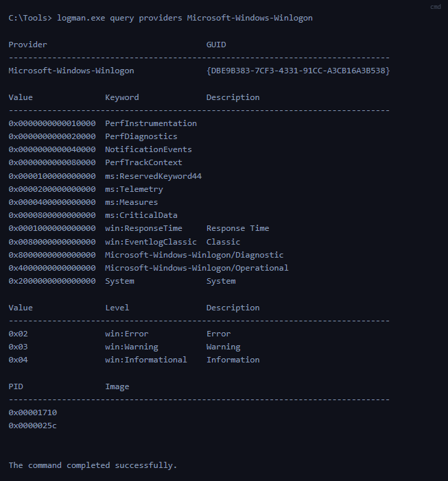

Event Tracing for Windows (ETW) est une infrastructure native de Windows permettant de générer, collecter et analyser des événements système détaillés.

Elle fournit une télémétrie particulièrement utile en Threat Hunting, Threat Detection et Digital Forensics & Incident Response (DFIR).

Contrairement à une analyse limitée aux journaux Windows traditionnels, ETW permet d'exploiter des événements provenant de composants Windows, d'applications et de pilotes, en User Mode comme en Kernel Mode.

## 1. Les fondamentaux d'ETW

ETW est un mécanisme de journalisation et de traçage haute performance intégré au système d'exploitation Windows.

Il repose sur une infrastructure de mise en mémoire tampon (buffering) et de journalisation permettant de collecter des événements avec une surcharge généralement limitée.

### Activités observables

Selon les fournisseurs activés, ETW peut fournir des informations sur :

- Process Activity : création, terminaison et activités des processus.
- File Activity : accès et modifications de fichiers.
- Registry Activity : opérations sur le registre Windows.
- Network Activity : communications et événements réseau.
- System Activity : événements du noyau, services et composants Windows.
- Application Activity : événements générés par les applications et logiciels tiers.

Ces données permettent de détecter des comportements suspects et de reconstruire le déroulement d'un incident.

### ETW ou journaux d'événements Windows

| Technologie        | Rôle                                                                                           |
| ------------------ | ---------------------------------------------------------------------------------------------- |
| ETW                | Infrastructure de génération et de collecte d'événements                                       |
| Windows Event Logs | Système de journalisation et de consultation d'événements Windows                              |
| Sysmon             | Outil de collecte spécialisé enregistrant des événements détaillés dans les Windows Event Logs |

Point essentiel : tous les événements ETW ne sont pas automatiquement visibles dans Event Viewer. Certains sont disponibles uniquement dans des sessions de tracing spécifiques.

## 2. Architecture et composants d'ETW

ETW repose sur un modèle Publish / Subscribe, dans lequel les fournisseurs produisent des événements et les sessions organisent leur collecte.

```
ETW Providers
      ↓
ETW Sessions ← Controllers
      ↓
Event Buffers
      ↓
Consumers / ETL Files
      ↓
Threat Hunting / DFIR Analysis
```


### Contrôleurs (controllers)

Les Controllers gèrent les sessions de tracing.

Ils permettent notamment de :

- créer et démarrer une session ;
- arrêter une session ;
- activer ou désactiver des fournisseurs ;
- configurer les paramètres de collecte.

Exemple : Un contrôleur largement utilisé est l'utilitaire intégré « logman.exe », qui facilite la gestion des activités ETW.

### Fournisseurs (providers)

Les ETW Providers sont les composants qui génèrent les événements.

Ils peuvent provenir du système d'exploitation, d'applications, de pilotes ou de logiciels tiers.

Quatre types :

| Provider Type            | Fonctionnement                                                                                                                                                                                                                                                       |
| ------------------------ | -------------------------------------------------------------------------------------------------------------------------------------------------------------------------------------------------------------------------------------------------------------------- |
| MOF Providers            | Ces fournisseurs sont basés sur le format MOF (Managed Object Format) et sont capables de générer des événements selon des schémas MOF prédéfinis. Ils offrent une approche flexible de la génération d'événements et sont largement utilisés dans divers scénarios. |
| WPP Providers            | Tracing basé sur des macros, souvent utilisé pour le diagnostic de composants bas niveau                                                                                                                                                                             |
| Manifest-Based Providers | Événements décrits à l'aide de manifestes XML                                                                                                                                                                                                                        |
| TraceLogging Providers   | Génération d'événements avec une API de journalisation simplifiée                                                                                                                                                                                                    |

ETW peut également être étendu grâce à des Custom Providers développés pour des besoins spécifiques.

### Sessions ETW

Une ETW Session collecte les événements provenant d'un ou plusieurs fournisseurs activés.

Elle détermine notamment les paramètres de collecte, les filtres et le mode de traitement des événements.

Certaines sessions fonctionnent en temps réel, tandis que d'autres enregistrent des traces destinées à une analyse ultérieure.

### Consommateurs (consumers)

Les Consumers récupèrent les événements collectés pour les analyser ou les traiter.

Deux modes importants :

- Real-Time Consumption : traitement des événements au fur et à mesure de leur génération.
- ETL Analysis : consultation des événements enregistrés dans des fichiers `.etl`.

### Canaux (channels)

Les ETW Channels organisent certains événements selon leur destination ou leur finalité.

Ils facilitent l'exploitation des événements par Windows Event Logging.

Tous les providers ou événements ETW ne disposent cependant pas d'un canal exploitable directement depuis Event Viewer.

### Fichiers ETL

Les fichiers `.etl` (Event Trace Log) permettent d'enregistrer des traces ETW sur disque.

Ils sont utiles pour :

- conserver une capture d'événements ;
- analyser une activité a posteriori ;
- réaliser une investigation forensic ;
- archiver une collecte spécifique.

Précision : une session ETW peut également fonctionner sans créer de fichier ETL, notamment en mode temps réel.

## 3. Interagir avec ETW — Logman

`logman.exe` est un utilitaire Windows permettant de gérer et d'inspecter les sessions ETW.

Il est particulièrement utile pour découvrir les sessions déjà actives et les fournisseurs disponibles pendant une investigation.

### Lister les sessions ETW actives

```
logman.exe query -ets
```


Cette commande affiche les sessions ETW actives.


Sur une machine équipée de Sysmon, plusieurs sessions sont présentes, notamment :

```
Eventlog-Security
EventLog-Application
EventLog-System
EventLog-Microsoft-Windows-Sysmon-Operational
SYSMON TRACE
SysmonDnsEtwSession
```


Ces résultats permettent de découvrir les mécanismes de collecte fonctionnant sur le système.

L'option `-ets` permet de cibler directement les sessions de suivi d'événements actives, plutôt que les seuls ensembles de collecteurs enregistrés.

### Inspecter une session ETW

Pour examiner une session particulière :

```
logman.exe query "EventLog-System" -ets
```


La sortie fournit différentes informations :

| Champ                   | Utilité                                                                                                                             |
| ----------------------- | ----------------------------------------------------------------------------------------------------------------------------------- |
| Name                    | Nom de la session                                                                                                                   |
| Status                  | État de fonctionnement                                                                                                              |
| Root Path               | Emplacement de stockage configuré                                                                                                   |
| Buffer Size             | Taille des buffers                                                                                                                  |
| Buffers Lost            | Nombre de buffers perdus                                                                                                            |
| Buffers Written         | Nombre de buffers écrits                                                                                                            |
| Clock Type              | Source temporelle utilisée                                                                                                          |
| File Mode               | Mode de collecte, par exemple Real-Time                                                                                             |
| Provider : Name / GUID  | Identifiant exclusif du fournisseurs associés à la session                                                                          |
| Provideur : Level       | Décrit niveau de l'événement, indiquant s'il filtre le événements d'avertissement, d'information, critiques ou tous les événements. |
| Provider : Keywords Any | Mots-clés créent un filtre basé sur le type d'événement généré par le fournisseur                                                   |

### Filtrage des providers

Pour chaque provider associé, la configuration peut préciser :

- Level : niveaux d'événements activés.
- KeywordsAny : catégories d'événements dont au moins un mot-clé doit correspondre.
- KeywordsAll : mots-clés devant tous correspondre.
- Provider GUID : identifiant du fournisseur.

La session `EventLog-System` contient notamment des fournisseurs tels que :

`Microsoft-Windows-Kernel-General`, `Microsoft-Windows-FilterManager` et `Microsoft-Windows-Subsys-SMSS`.

Intérêt DFIR : identifier une session pertinente peut permettre de découvrir une source de télémétrie utile à une investigation.

## 4. Découvrir les providers ETW

### Lister les providers disponibles

```
logman.exe query providers
```


Cette commande affiche les fournisseurs ETW disponibles sur le système, accompagnés de leurs GUIDs.

Windows dispose d'un très grand nombre de fournisseurs. Windows 10 en intègre plus d'un millier.


Pour filtrer les résultats :

```
logman.exe query providers | findstr "Winlogon"
```


Exemple de fournisseurs identifiés :


### Inspecter les métadonnées des providers

```
logman.exe query providers Microsoft-Windows-Winlogon
```


Cette commande permet d'examiner les métadonnées du fournisseur.


Métadonnées affichées :

| Métadonnée     | Exemple                                                                 |
| -------------- | ----------------------------------------------------------------------- |
| Provider GUID  | Identifiant de `Microsoft-Windows-Winlogon`                             |
| Keywords       | `NotificationEvents`, `PerfDiagnostics`, `ms:Telemetry`                 |
| Event Channels | `Microsoft-Windows-Winlogon/Diagnostic`, `/Operational`                 |
| Levels         | Error, Warning, Informational                                           |
| PID            | Identifiants de processus affichés dans les informations du fournisseur |

- Les Keywords et Levels peuvent être utilisés pour sélectionner les catégories d'événements pertinentes lors d'une collecte.
- Les mots-clés `Microsoft-Windows-Winlogon/Diagnostic` et `Microsoft-Windows-Winlogon/Operational` font référence aux journaux d'événements générés par ce fournisseur.

## 5. Interfaces graphiques pour l'analyse ETW

Outre Logman, plusieurs outils permettent d'examiner les sessions et fournisseurs ETW.

### Analyseur de performances (Performance Monitor)

L'outil Windows Performance Monitor (`perfmon`), Analyseur de performances, permet de consulter les sessions de tracing.


Il est possible de :

- visualiser les sessions existantes ;
- aperçu détaillé d'une trace spécifique est accessible simplement en double-cliquant dessus ;
- examiner leurs paramètres ;
- identifier les fournisseurs activés ;
- modifier certaines configurations ;
- créer des sessions personnalisées via les ensembles de collecteurs définis par l'utilisateur, en optant pour la catégorie « Défini par l'utilisateur ».


### ETW Explorer

EtwExplorer permet d'examiner les métadonnées des fournisseurs ETW, notamment leurs noms et GUIDs.

Projet : [EtwExplorer — GitHub](https://github.com/zodiacon/EtwExplorer).


### Autres outils

- PowerShell `Get-WinEvent` : lecture et filtrage des journaux Windows, ainsi que de certains journaux ETW exposés par Windows Event Logging.
- Microsoft Message Analyzer : outil historique d'analyse de traces, aujourd'hui abandonné.

Ces outils n'offrent pas tous les mêmes fonctionnalités : l'exploration des fournisseurs, la gestion des sessions et la consommation des événements sont des opérations distinctes.

## 6. Providers ETW utiles pour le threat hunting

ETW permet d'exploiter des fournisseurs spécialisés selon les activités recherchées.

### Surveillance des processus, fichiers et registre

| Provider                          | Utilisation                                                                                                                                                                                                                                                                                                |
| --------------------------------- | ---------------------------------------------------------------------------------------------------------------------------------------------------------------------------------------------------------------------------------------------------------------------------------------------------------- |
| Microsoft-Windows-Kernel-Process  | Analyser les activités de processus et rechercher des indices de Process Injection ou Process Hollowing, utile pour surveiller l'activité liée aux processus dans le noyau Windows                                                                                                                         |
| Microsoft-Windows-Kernel-File     | Examiner les opérations fichiers suspectes, notamment détection impliquant un accès non autorisé à des fichiers, des modifications de fichiers système critiques ou dans les scénarios Ransomware                                                                                                          |
| Microsoft-Windows-Kernel-Registry | Rechercher des modifications du registre liées à la Persistence ou utile pour les scénarios de détection liés aux modifications des clés de registre, souvent associées à des mécanismes de persistance, à l'installation de logiciels malveillants ou à des modifications de la configuration du système. |
| Microsoft-Windows-DotNETRuntime   | Examiner les activités du runtime .NET, identifier les anomalies dans l'exécution des applications .NET, l'exploitation potentielle de vulnérabilités .NET ou le chargement malveillant d'assemblys .NET.                                                                                                  |

### Surveillance du réseau et des accès distants

| Provider                                               | Utilisation                                                                      |
| ------------------------------------------------------ | -------------------------------------------------------------------------------- |
| Microsoft-Windows-Kernel-Network                       | Analyser certaines activités réseau et communications suspectes                  |
| Microsoft-Windows-SMBClient / SMBServer                | Rechercher des comportements SMB inhabituels, notamment liés au Lateral Movement |
| Microsoft-Windows-DNS-Client                           | Examiner les requêtes DNS suspectes, C2 ou DNS Tunneling potentiel               |
| Microsoft-Windows-VPN-Client                           | Surveiller certaines activités de connexion VPN                                  |
| OpenSSH                                                | Analyser les activités SSH et tentatives d'authentification                      |
| WinRM                                                  | Rechercher des activités de gestion ou d'exécution à distance suspectes          |
| Microsoft-Windows-TerminalServices-LocalSessionManager | Investiguer les sessions Remote Desktop et Terminal Services                     |

### Surveillance de l'exécution et de la sécurité

| Provider                               | Utilisation                                                                         |
| -------------------------------------- | ----------------------------------------------------------------------------------- |
| Microsoft-Windows-PowerShell           | Examiner les activités PowerShell, notamment les événements de Script Block Logging |
| Microsoft-Windows-CodeIntegrity        | Identifier des anomalies dans les contrôles d'intégrité du code et des pilotes      |
| Microsoft-Windows-Security-Mitigations | Examiner les événements associés aux protections et mesures d'atténuation Windows   |
| Microsoft-Antimalware-Service          | Surveiller certaines activités et modifications concernant l'antimalware            |
| Microsoft-Antimalware-Protection       | Examiner les mécanismes de protection antimalware                                   |

Ces fournisseurs peuvent améliorer la visibilité sur les techniques d'attaque, mais leur simple activation ne garantit pas la détection des comportements cités.

La télémétrie effectivement disponible dépend des événements émis, des filtres, des permissions, de la version Windows et des capacités du consommateur.

## 7. Providers ETW restreints

Certains fournisseurs ETW sont Restricted Providers.

Ils donnent accès à des données sensibles et nécessitent des autorisations particulières.

### Microsoft-Windows-Threat-Intelligence

`Microsoft-Windows-Threat-Intelligence` est un fournisseur restreint particulièrement intéressant pour les opérations de sécurité.

Cependant, pour accéder à ce fournisseur, les processus doivent être privilégiés avec un droit spécifique, connu sous le nom de Protected Process Light (PPL).

Il peut offrir une télémétrie détaillée sur certaines activités système associées aux menaces.

Cette visibilité est pertinente pour :

- Advanced Threat Detection ;
- Threat Hunting ;
- Malware Analysis ;
- Digital Forensics ;
- Incident Response.

### Protected Process Light — PPL

L'accès à ce fournisseur est soumis à des restrictions de sécurité liées notamment au modèle Protected Process Light (PPL).

Les processus PPL disposent de protections Windows particulières, utilisées notamment par certains composants de sécurité.

Pour les solutions antimalware, la mise en place d'un service protégé peut impliquer :

- des exigences de validation et de signature par Microsoft ;
- l'utilisation d'un pilote ELAM (Early Launch Anti-Malware) ;
- des mécanismes de signature spécifiques ;
- l'exécution du service antimalware avec le niveau de protection approprié.

L'accès au fournisseur `Microsoft-Windows-Threat-Intelligence` n'est donc pas équivalent à l'activation d'une session ETW classique depuis un terminal administrateur.

Le support mentionne également l'existence de recherches sur les mécanismes permettant de contourner certaines restrictions d'accès.

Intérêt défensif : ce fournisseur illustre que certaines données de sécurité avancées sont accessibles uniquement à des composants disposant des privilèges et protections nécessaires.

## 8. ETW pour le DFIR — démarche d'investigation

```
Identify Hunting Hypothesis
           ↓
Find Relevant ETW Providers
           ↓
Inspect Existing ETW Sessions
           ↓
Configure Event Collection
           ↓
Capture / Consume ETW Events
           ↓
Filter & Correlate Telemetry
           ↓
Validate Suspicious Behavior
           ↓
DFIR Investigation
```


### Points de vigilance

- Collection Scope : seuls les événements générés et effectivement collectés sont exploitables.
- Performance : certains providers peuvent générer un volume très important de données.
- Buffer Loss : des pertes de buffers peuvent entraîner une télémétrie incomplète.
- Visibility : tous les événements ETW ne sont pas présents dans les Windows Event Logs.
- Provider Configuration : les mots-clés, niveaux et filtres déterminent la couverture.
- Restricted Access : certains fournisseurs nécessitent des autorisations spécifiques.

## 9. Synthèse — ETW ou Sysmon

| Critère       | ETW                                                                   | Sysmon                                                    |
| ------------- | --------------------------------------------------------------------- | --------------------------------------------------------- |
| Nature        | Infrastructure native de tracing Windows                              | Outil de surveillance Microsoft Sysinternals              |
| Sources       | Très nombreux fournisseurs système et applicatifs                     | Catégories d'événements prises en charge par Sysmon       |
| Collecte      | Sessions ETW configurables                                            | Règles de configuration Sysmon                            |
| Stockage      | ETL, consommation temps réel ou événements publiés dans des journaux  | Windows Event Logs, principalement Sysmon/Operational     |
| Investigation | Accès à une télémétrie spécialisée et potentiellement très granulaire | Recherche d'activités système courantes en Threat Hunting |
| Limites       | Complexité, volume, restrictions d'accès                              | Visibilité limitée aux événements surveillés par Sysmon   |

L'idée centrale de cette section : ETW constitue une infrastructure de télémétrie Windows beaucoup plus vaste que les seuls événements affichés dans Event Viewer ou enregistrés par Sysmon.

En comprenant les Providers, Controllers, Sessions et Consumers, un analyste peut rechercher de nouvelles sources d'événements, configurer une collecte adaptée et améliorer ses capacités de détection face aux attaques que la télémétrie Sysmon seule pourrait ne pas mettre en évidence.

Source des captures : [Hack The Box Academy - Windows Event Logs & Finding Evil](https://academy.hackthebox.com/app/module/216)
