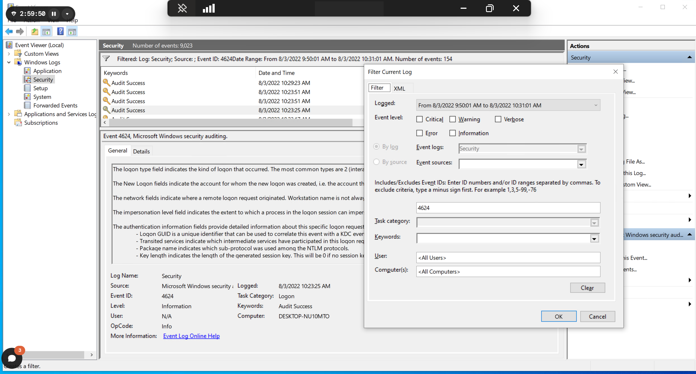
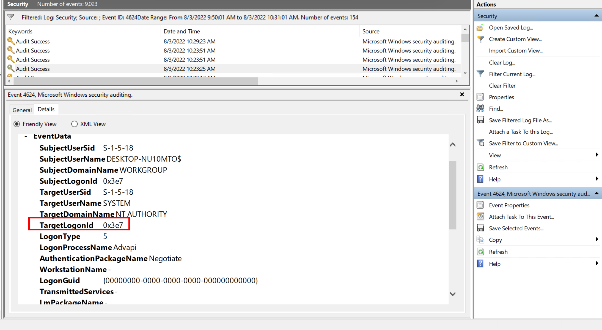
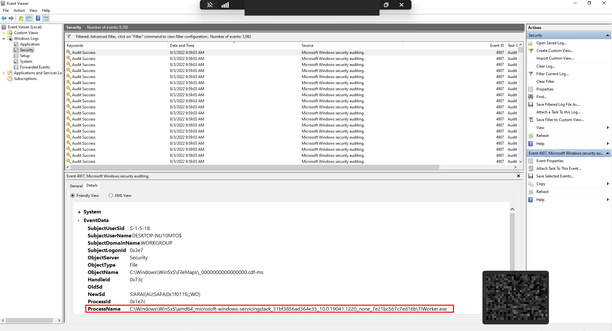
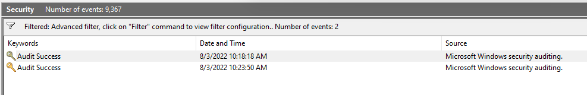

Analyse du journal Security d'une machine HTB dans l'Observateur d'événements : partir d'un 4624, relever le Logon ID de la session, puis retrouver ses autres événements avec des requêtes XML. Les gabarits de requêtes sont dans la cheat sheet [Requêtes XML de l'Observateur](/cheatsheets/windows/fondamentaux/logs/requetes-xml/).

## Question 1 — Le processus qui a modifié les paramètres d'audit

- Analyze the event with ID 4624, that took place on 8/3/2022 at 10:23:25. Conduct a similar investigation as outlined in this section and provide the name of the executable responsible for the modification of the auditing settings as your answer. Answer format: T_W_____.exe

1. Filtrer 
2. Récup TargetLogonID
3. Créer règle XML pour ressortir les events associés à cet ID en lien avec l'event security ID 4907

```
<QueryList>
  <Query Id="0" Path="Security">
    <Select Path="Security">
      *[
        System[
          (EventID=4907)
          and TimeCreated[
            @SystemTime&gt;='2022-08-03T17:00:00.000Z'
            and @SystemTime&lt;='2022-08-03T17:30:00.999Z'
          ]
        ]
        and EventData[
          Data[@Name='SubjectLogonId']='0x3e7'
        ]
      ]
    </Select>
  </Query>
</QueryList>
```


4. Chercher ProcessName dans Event

```
Get-WinEvent -FilterHashtable @{LogName='Security'; Id=4907} |
ForEach-Object {
    $xml = [xml]$_.ToXml()
    $xml.Event.EventData.Data |
    Where-Object { $_.Name -eq 'ProcessName' } |
    ForEach-Object { $_.'#text' }
} |
Sort-Object -Unique
```


## Question 2 — L'audit d'une DLL précise a-t-il été modifié ?

- Build an XML query to determine if the previously mentioned executable modified the auditing settings of C:\Windows\Microsoft.NET\Framework64\v4.0.30319\WPF\wpfgfx_v0400.dll. Enter the time of the identified event in the format HH:MM:SS as your answer.
1. Chercher dans Find la DLL puis corréler avec le précédent .exe


- Utiliser requête XML 

```
<QueryList>
  <Query Id="0" Path="Security">
    <Select Path="Security">
      *[
        System[EventID=4907]
        and
        EventData[
          Data[@Name='ObjectName']='C:\Windows\Microsoft.NET\Framework64\v4.0.30319\WPF\wpfgfx_v0400.dll'
        ]
      ]
    </Select>
  </Query>
</QueryList>
```



