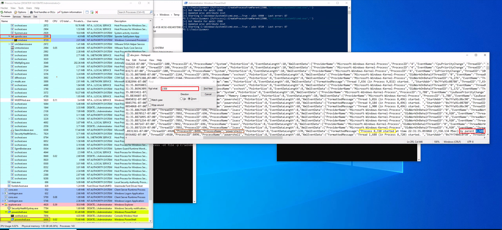
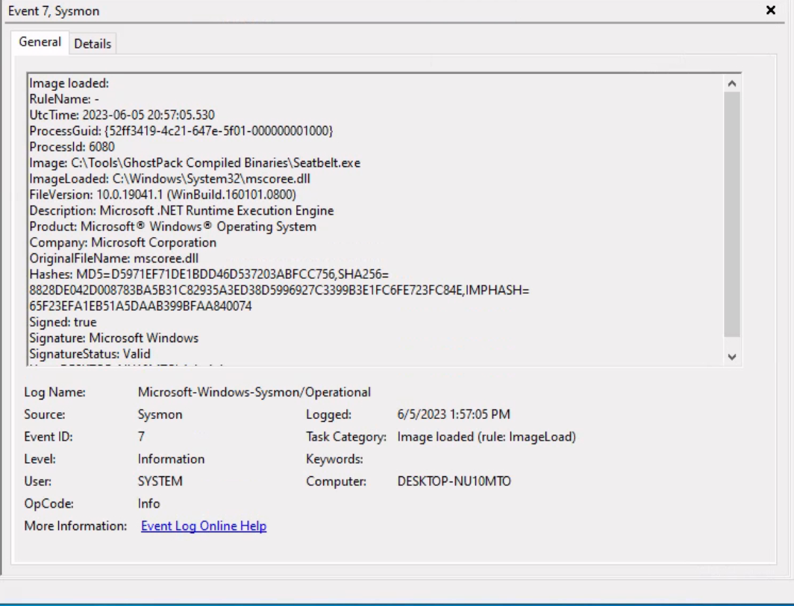

Event Tracing for Windows (ETW) permet d'obtenir une télémétrie plus détaillée que certains événements Sysmon afin d'investiguer des techniques d'attaque avancées.

Cette section présente deux scénarios de Threat Hunting :

- Détecter les relations parent-enfant étranges : détecter des relations anormales entre processus et le Parent PID Spoofing.
    
- Malicious .NET Assembly Loading : identifier le chargement et l'exécution d'assemblages .NET suspects.
    

L'objectif est de compléter les observations de Sysmon avec des informations provenant de fournisseurs ETW spécialisés.

## 1. Détecter les relations parent-enfant étranges

### Analyser les relations parent-enfant

Sous Windows, les processus présentent généralement des relations parent/enfant cohérentes avec leur fonction.

Une relation inhabituelle peut révéler une activité malveillante.

Exemples du cours :

```
calc.exe
   └── cmd.exe
```


```
spoolsv.exe
   └── whoami.exe
```


Ces relations sont suspectes, car une calculatrice ou un service d'impression n'a normalement pas vocation à lancer de telles commandes dans les scénarios présentés.


- Samir Bousseaden a partagé une carte mentale (mind map) pertinente présentant les relations parent-enfant courantes, qui peut être consultée [ici](https://twitter.com/SBousseaden/status/1195373669930983424).
### Process Hacker

Process Hacker permet de visualiser les processus actifs sous forme d'arborescence.


L'analyste peut notamment examiner :

- Parent Process : processus parent apparent.
- Child Process : processus enfant.
- Process ID (PID) : identifiant du processus.
- Process Hierarchy : organisation des processus.
- Command Line : arguments d'exécution, lorsqu'ils sont disponibles.

L'analyse doit tenir compte des comportements habituels de l'environnement.

## 2. Usurpation du processus parent (PPID spoofing)

Le Parent PID Spoofing est une technique permettant de faire apparaître un processus sous un parent différent de celui qui a réellement initié sa création.

Elle peut être utilisée pour tromper certaines analyses fondées sur les relations parent/enfant.

### Scénario du lab — PowerShell / spoolsv.exe / cmd.exe

Le cours utilise l'outil psgetsystem pour simuler une création de processus avec un parent apparent falsifié. https://github.com/decoder-it/psgetsystem

Le scénario consiste à lancer `cmd.exe` depuis PowerShell, tout en lui attribuant `spoolsv.exe` comme parent apparent.

La commande de démonstration utilise notamment :

```
powershell -ep bypass
Import-Module .\psgetsys.ps1
[MyProcess]::CreateProcessFromParent(
    [Process ID of spoolsv.exe],
    "C:\Windows\System32\cmd.exe",
    ""
)
```


### Sysmon Event ID 1 — création de processus

Dans le lab, Sysmon enregistre la relation suivante :

```
spoolsv.exe
     └── cmd.exe
```


Cependant, le processus ayant réellement initié la création est `powershell.exe`.

L'Event ID 1 peut donc présenter une relation parent/enfant trompeuse lorsque le PPID a été manipulé.

Sysmon et les journaux d'événements fournissent une télémétrie précieuse pour la chasse aux menaces (threat hunting) et la création de règles d'alerte, ils ne sont pas les seules sources d'information.

### Investigation avec ETW

Pour approfondir l'analyse, le cours utilise le fournisseur :

`Microsoft-Windows-Kernel-Process`

Ce provider peut fournir des informations supplémentaires sur la création des processus.

La collecte s'effectue avec [SilkETW](https://github.com/mandiant/SilkETW), outil permettant de consommer les événements ETW et de les exporter.

```
SilkETW.exe -t user -pn Microsoft-Windows-Kernel-Process -ot file -p C:\Windows\Temp\etw.json
```


| Paramètre  | Fonction                                |
| ---------- | --------------------------------------- |
| `-t user`  | Type de session ETW utilisé par SilkETW |
| `-pn`      | Nom du fournisseur ETW                  |
| `-ot file` | Écriture dans un fichier                |
| `-p`       | Chemin du fichier de sortie             |


Après une nouvelle simulation, le fichier `etw.json` (qui inclut les données du fournisseur `Microsoft-Windows-Kernel-Process`) permet de retrouver des informations indiquant que `powershell.exe` est à l'origine de la création de `cmd.exe`.



```
              Process Creation
                      ↓
         ┌────────────┴────────────┐
         ↓                         ↓
 Sysmon Event ID 1             ETW Telemetry
         ↓                         ↓
spoolsv.exe → cmd.exe       powershell.exe initiates
                            cmd.exe creation
         └────────────┬────────────┘
                      ↓
           Potential PPID Spoofing
```


Point important : les champs indiquant le parent apparent et le processus créateur ne représentent pas nécessairement la même information.

Dans cet exemple, ETW fournit un contexte supplémentaire permettant de mettre en évidence cette différence. Cela ne garantit pas que toutes les formes de PPID Spoofing seront détectées automatiquement.

Le cours précise également que les événements collectés par SilkETW peuvent être intégrés aux Windows Event Logs via SilkService.

## 3. Détecter le chargement d'assemblages .NET malveillants

Cette seconde technique consiste à analyser les chargements de composants .NET afin d'identifier des exécutions suspectes, notamment celles réalisées directement en mémoire.

### Living off the Land — LotL

Le Living off the Land (LotL) consiste à utiliser des outils légitimes déjà présents sur le système pour effectuer des activités malveillantes.

Exemples :

- PowerShell ;
- outils natifs Windows ;
- composants d'administration.

Cette approche peut compliquer la détection, puisque les exécutables utilisés appartiennent à l'environnement légitime.

Cependant des contre-mesures face à cette stratégie ont été mises en place, ce qui complique son usage, les attaquants ont développé de nouvelles approches que Mandiant qualifie de BYOL.

### Bring Your Own Land — BYOL

Le cours présente l'approche Bring Your Own Land (BYOL), notamment décrite par Mandiant.

Plutôt que de s'appuyer exclusivement sur les outils natifs, les attaquants peuvent introduire leurs propres outils, par exemple des assemblages .NET développés en C#.

Ces assemblages peuvent être chargés et exécutés directement en mémoire.

### Pourquoi .NET ?

Le cours met en avant plusieurs caractéristiques :

| Caractéristique               | Intérêt                                                                                                                                                                                                                                  |
| ----------------------------- | ---------------------------------------------------------------------------------------------------------------------------------------------------------------------------------------------------------------------------------------- |
| Common Language Runtime (CLR) | Permet l'exécution de code managé                                                                                                                                                                                                        |
| Memory Management             | Fournit notamment le Garbage Collection                                                                                                                                                                                                  |
| In-Memory Assembly Loading    | Permet de charger des assemblages sans nécessairement écrire leur fichier sur disque                                                                                                                                                     |
| .NET Libraries                | Fournissent des fonctionnalités HTTP, cryptographiques et IPC. Ces outils pré-construits rationalisent le processus de développement, réduisent la probabilité d'erreurs et facilitent la création d'applications robustes et efficaces. |
| Windows Integration           | Les composants .NET sont présents dans de nombreux environnements Windows. Chaque système Windows est équipé par défaut d'une certaine version de .NET pré-installée.                                                                    |

L'exécution en mémoire peut réduire certains artefacts sur disque et compliquer les détections reposant exclusivement sur l'analyse des fichiers.

Elle ne rend cependant pas le code invisible aux outils de sécurité.

### Exemple — Cobalt Strike execute-assembly

Le cours cite la commande ["execute-assembly"](https://www.cobaltstrike.com/blog/cobalt-strike-3-11-the-snake-that-eats-its-tail/) de Cobalt Strike.

Elle permet d'exécuter des assemblages .NET en mémoire, une capacité utilisée notamment dans les opérations Red Team et dans certaines attaques.

Ceci est réalisé en examinant de près l'activité liée au chargement des [DLL associées à .NET](https://redhead0ntherun.medium.com/detecting-net-c-injection-execute-assembly-1894dbb04ff7), en particulier `clr.dll` et `mscoree.dll`.

## 4. Détection avec Sysmon Event ID 7

Le premier niveau de détection consiste à surveiller le chargement de DLL associées à l'environnement .NET.

Ce type de comportement de chargement de DLL peut souvent être détecté en exploitant l'ID d'événement 7 de Sysmon, qui correspond aux événements "Image Loaded" (Image chargée).

### DLL importantes

- `clr.dll` : composant du Common Language Runtime.
- `clrjit.dll` : composant de compilation Just-In-Time.
- `mscoree.dll` : composant associé à l'initialisation et à l'hébergement du runtime .NET Framework.

Sysmon Event ID 7 — Image Loaded permet d'identifier le chargement de ces DLL lorsqu'il est configuré pour les enregistrer.

### Scénario du lab — Seatbelt

Le cours utilise  [Seatbelt](https://github.com/GhostPack/Seatbelt), un outil .NET du projet GhostPack permettant d'énumérer diverses informations du système.

Commande de démonstration :

```
.\Seatbelt.exe TokenPrivileges
```


Cette commande affiche les privilèges du token associé au processus, notamment :

`SeDebugPrivilege`, `SeImpersonatePrivilege`, `SeBackupPrivilege`, etc., accompagnés de leur état.


Dans le lab, l'exécution de `Seatbelt.exe` entraîne le chargement de bibliothèques .NET observables via Sysmon Event ID 7.

En supposant que Sysmon est configuré de manière appropriée pour journaliser les événements de chargement d'image (ID d'événement 7), l'exécution de 'Seatbelt.exe' déclencherait le chargement de DLL clés liées à .NET telles que 'clr.dll' et 'mscoree.dll'.




### Limites de Sysmon

Sysmon permet de savoir quelles DLL ont été chargées et par quel processus, mais deux limites sont soulignées :

1. High Event Volume : l'Event ID 7 peut générer de très nombreux événements.
2. Limited Assembly Visibility : le chargement de `clr.dll` ne révèle pas directement les détails de l'assemblage .NET exécuté.

Par ailleurs, l'exemple Seatbelt est exécuté depuis le disque, même si la technique étudiée peut également concerner des assemblages chargés uniquement en mémoire.

## 5. Détection avancée avec Microsoft-Windows-DotNETRuntime

Pour obtenir des informations plus précises, le cours utilise le fournisseur ETW :

`Microsoft-Windows-DotNETRuntime`

Ce provider permet d'observer différentes activités du runtime .NET, notamment le chargement des assemblages et certaines opérations de compilation.

### Collecte avec SilkETW

Utilisons SilkETW pour collecter des données auprès du fournisseur `Microsoft-Windows-DotNETRuntime`.

```
SilkETW.exe -t user -pn Microsoft-Windows-DotNETRuntime -uk 0x2038 -ot file -p C:\Windows\Temp\etw.json
```


Cette commande collecte un sous-ensemble d'événements du fournisseur .NET et les écrit dans `etw.json`.

Le paramètre :

`-uk 0x2038`

sélectionne les catégories d'événements correspondant aux ETW Keywords suivants.

### Mots-clés ETW (keywords)

| Keyword        | Fonction                                                                    | Intérêt Threat Hunting                                                                                                         |
| -------------- | --------------------------------------------------------------------------- | ------------------------------------------------------------------------------------------------------------------------------ |
| JitKeyword     | Événements liés à la compilation Just-In-Time                               | Examiner certaines méthodes compilées pendant l'exécution, utile pour comprendre le flux d'exécution de l'assemblage .NET.     |
| InteropKeyword | Interactions entre code managé et non managé                                | Pourraient fournir des informations sur les interactions potentielles avec des API natives ou d'autres composants non managés. |
| LoaderKeyword  | Détails sur le processus de chargement d'assemblage au sein du runtime .NET | Identifier les assemblages chargés et potentiellement exécutés.                                                                |
| NGenKeyword    | Activités liées aux images natives précompilées                             | Examiner l'utilisation de composants .NET précompilés                                                                          |

Le filtrage par keywords permet de cibler les événements pertinents sans collecter systématiquement l'intégralité de la télémétrie du provider.

Cet [article de blog](https://medium.com/threat-hunters-forge/threat-hunting-with-etw-events-and-helk-part-1-installing-silketw-6eb74815e4a0) offre des perspectives précieuses sur SilkETW ainsi que sur l'identification de logiciels malveillants basés sur .NET.

### Résultat du lab

Ensuite, nous pouvons procéder à une nouvelle simulation de l'attaque pour évaluer si ETW peut nous fournir des renseignements plus détaillés et exploitables concernant le chargement et l'exécution de l'assemblage .NET 'Seatbelt'.

Après avoir exécuté Seatbelt et collecté les événements ETW, le fichier `etw.json` (qui inclut les données du fournisseur `Microsoft-Windows-DotNETRuntime`) contient davantage d'informations sur l'assemblage chargé, notamment des noms de méthodes.


Cette visibilité est plus détaillée qu'un simple événement Sysmon signalant le chargement de `clr.dll`.

```
Seatbelt.exe Execution
          ↓
.NET Runtime Initialization
          ↓
Sysmon Event ID 7
 → CLR DLL Loading
          ↓
Microsoft-Windows-DotNETRuntime
 → Assembly Loading
 → JIT / Method Information
          ↓
Detailed .NET Investigation
```


Précision : les informations disponibles dépendent des keywords activés, des événements effectivement émis et du comportement de compilation du runtime. Tous les appels de méthodes ne sont pas nécessairement enregistrés.

## 6. Sysmon ou ETW — comparaison des détections

| Scénario                | Sysmon                                                          | ETW                                                                          |
| ----------------------- | --------------------------------------------------------------- | ---------------------------------------------------------------------------- |
| PPID Spoofing           | Event ID 1 : relation parent/enfant apparente                   | `Kernel-Process` : informations supplémentaires sur la création du processus |
| .NET Assembly Execution | Event ID 7 : chargement de DLL comme `clr.dll`                  | `DotNETRuntime` : détails sur les assemblages, chargements et méthodes       |
| Type de visibilité      | Événements prédéfinis                                           | Télémétrie spécialisée selon le provider                                     |
| Limite principale       | Certaines informations peuvent être insuffisantes ou trompeuses | Nécessite une collecte et des filtres adaptés                                |

## 7. Démarche de threat hunting avec ETW

```
Suspicious Activity
        ↓
Identify Sysmon Evidence
        ↓
Determine Telemetry Limitations
        ↓
Select Relevant ETW Provider
        ↓
Collect Events with SilkETW
        ↓
Analyze JSON Output
        ↓
Correlate Sysmon & ETW
        ↓
Validate Hunting Hypothesis
```


Les deux scénarios montrent que Sysmon et ETW sont complémentaires.

Sysmon constitue une excellente source pour rechercher rapidement des événements comme les créations de processus ou les chargements de DLL. ETW permet ensuite d'approfondir l'investigation avec des informations plus spécialisées.

La leçon centrale est de ne pas limiter une investigation aux événements Sysmon lorsqu'ils ne suffisent pas à expliquer le comportement observé : une collecte ETW ciblée peut révéler des détails déterminants sur l'origine réelle d'un processus ou l'exécution d'un assemblage .NET.

Source des captures : [Hack The Box Academy - Windows Event Logs & Finding Evil](https://academy.hackthebox.com/app/module/216)
