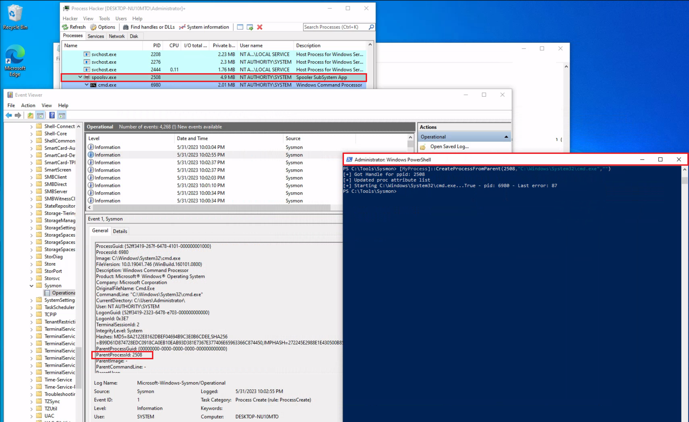

L'attaquant crée un processus en lui attribuant un autre parent que celui qui l'a réellement lancé, pour tromper l'analyse des filiations. Cette fiche montre pourquoi Sysmon `1` s'y laisse prendre et comment le provider ETW `Microsoft-Windows-Kernel-Process` révèle le vrai créateur.

Repérer d'abord une filiation anormale : [Repérer une relation parent-enfant anormale](reperer-une-relation-parent-enfant-anormale.md). Sysmon et ETW (providers, SilkETW) : [Sysmon et ETW](sysmon-et-etw/index.md).

## En bref

| | |
|---|---|
| Technique | Usurpation du processus parent (Parent PID Spoofing) |
| MITRE ATT&CK | [T1134.004 — Access Token Manipulation : Parent PID Spoofing](https://attack.mitre.org/techniques/T1134/004/) |
| Journaux | `Microsoft-Windows-Sysmon/Operational` ; trace ETW `Microsoft-Windows-Kernel-Process` (SilkETW) |
| Événements | Sysmon `1` (parent apparent) ; ETW Kernel-Process (processus créateur réel) |
| Indice clé | Le parent affiché par Sysmon (`spoolsv.exe`) n'est pas le processus qui a créé l'enfant (`powershell.exe`) |

## Comprendre l'attaque

Le Parent PID Spoofing fait apparaître un processus sous un parent différent de celui qui a réellement initié sa création. Il trompe les analyses fondées sur les relations parent/enfant.

### Scénario du lab — PowerShell / spoolsv.exe / cmd.exe

L'outil [psgetsystem](https://github.com/decoder-it/psgetsystem) simule une création de processus avec un parent apparent falsifié : `cmd.exe` est lancé depuis PowerShell, avec `spoolsv.exe` comme parent apparent.

```
powershell -ep bypass
Import-Module .\psgetsys.ps1
[MyProcess]::CreateProcessFromParent(
    [Process ID of spoolsv.exe],
    "C:\Windows\System32\cmd.exe",
    ""
)
```


## Les traces

### Sysmon Event ID 1 — le parent apparent

Sysmon enregistre la relation suivante :

```
spoolsv.exe
     └── cmd.exe
```




Le processus qui a réellement créé `cmd.exe` est pourtant `powershell.exe` : l'Event ID 1 présente une relation trompeuse lorsque le PPID a été manipulé. Sysmon et les journaux d'événements restent précieux pour le threat hunting et les règles d'alerte, mais ne sont pas les seules sources d'information.

### ETW — le provider Microsoft-Windows-Kernel-Process

Le provider `Microsoft-Windows-Kernel-Process` apporte des informations supplémentaires sur la création des processus. [SilkETW](https://github.com/mandiant/SilkETW) consomme ses événements et les exporte :

```
SilkETW.exe -t user -pn Microsoft-Windows-Kernel-Process -ot file -p C:\Windows\Temp\etw.json
```


| Paramètre  | Fonction                                |
| ---------- | --------------------------------------- |
| `-t user`  | Type de session ETW utilisé par SilkETW |
| `-pn`      | Nom du fournisseur ETW                  |
| `-ot file` | Écriture dans un fichier                |
| `-p`       | Chemin du fichier de sortie             |


Après une nouvelle simulation, `etw.json` montre que `powershell.exe` est à l'origine de la création de `cmd.exe`.


Les événements collectés par SilkETW peuvent aussi être versés dans les journaux Windows via SilkService.

## Les requêtes

Les deux sources à confronter, dans l'ordre du lab :

1. Dans `Microsoft-Windows-Sysmon/Operational`, l'Event ID `1` de `cmd.exe` : relever son `ProcessId`, son parent apparent (`ParentImage`, ici `spoolsv.exe`) et l'heure.
2. Dans `etw.json`, collecté par SilkETW avec `Microsoft-Windows-Kernel-Process` (commande dans [Les traces](#les-traces)), rechercher ce PID : l'événement de création indique le processus réellement à l'origine (`powershell.exe`).

- Si le processus créateur diffère du parent annoncé par Sysmon, le parent affiché a été falsifié.
- Un PID est réutilisé par Windows après la fin d'un processus : vérifier aussi l'heure.

Commandes ETW : cheat sheet [ETW](/cheatsheets/windows/fondamentaux/logs/etw/).

## Les indicateurs

```
              Process Creation
                      ↓
         ┌────────────┴────────────┐
         ↓                         ↓
 Sysmon Event ID 1             ETW Telemetry
         ↓                         ↓
spoolsv.exe → cmd.exe       powershell.exe initiates
                            cmd.exe creation
         └────────────┬────────────┘
                      ↓
           Potential PPID Spoofing
```


- Le parent apparent et le processus créateur ne représentent pas la même information : un écart entre les deux est l'indicateur central.
- Une filiation anormale (voir [Repérer une relation parent-enfant anormale](reperer-une-relation-parent-enfant-anormale.md)) dont le parent annoncé est un service système.

## Les faux positifs

- Windows change lui-même le parent dans certains cas légitimes : lors d'une élévation UAC, le processus élevé est créé par le service d'élévation mais rattaché au programme qui l'a demandée.
- ETW apporte un contexte supplémentaire, sans garantir que toutes les formes de PPID spoofing soient détectées.

## Pour s'entraîner

- Le module HTB n'a pas de question de lab dédiée : le scénario ci-dessus suffit à le rejouer sur une machine de test équipée de Sysmon et de SilkETW.
- Event IDs Sysmon et requêtes SIEM : cheat sheet [Sysmon](/cheatsheets/windows/fondamentaux/logs/sysmon/).

Source des captures : [Hack The Box Academy - Windows Event Logs & Finding Evil](https://academy.hackthebox.com/app/module/216)
