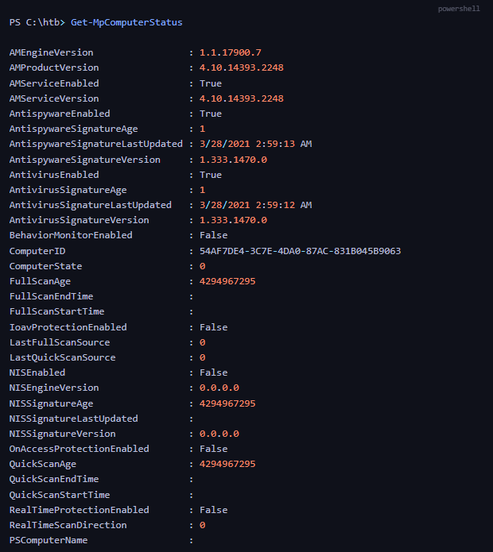
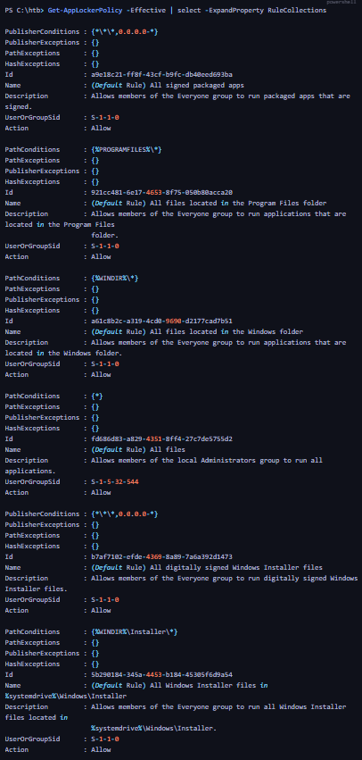
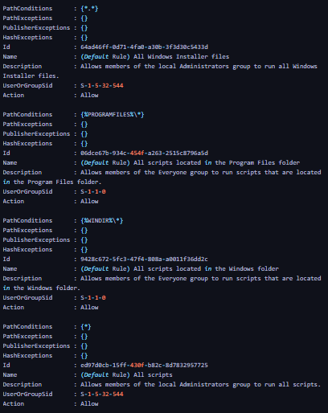
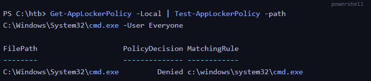

La Situational Awareness (conscience situationnelle) consiste à comprendre précisément l'environnement Windows auquel nous avons accès avant de commencer une tentative de Privilege Escalation.

Après un Initial Foothold, l'objectif est de déterminer :

- Network Context : sur quels réseaux la machine se trouve et quelles ressources sont accessibles.
    
- System Environment : quelles interfaces, routes et configurations sont présentes.
    
- Security Controls : quelles protections AV, EDR et restrictions d'exécution sont appliquées.
    
- Attack Opportunities : quels chemins d'énumération, d'élévation de privilèges ou de mouvement latéral sont envisageables.
    

Cette phase permet d'éviter de tester des techniques inadaptées et d'orienter les prochaines étapes de manière méthodique.

## 1. Network Enumeration

L'énumération réseau permet de comprendre la position de la machine dans l'infrastructure.

Elle peut notamment révéler :

- plusieurs interfaces réseau ;
    
- des sous-réseaux internes supplémentaires ;
    
- des passerelles et routes disponibles ;
    
- des systèmes avec lesquels la machine a communiqué ;
    
- des informations DNS ou relatives à un domaine Active Directory.
    

### Dual-Homed Hosts

Un hôte Dual-Homed est connecté à au moins deux réseaux, généralement par plusieurs interfaces physiques ou virtuelles.

Exemple :

```
      Network A                    Network B
    10.1.0.0/16              192.168.20.0/24
          |                           |
          +----------+   +------------+
                     |   |
               Windows Server
                Dual-Homed
```


Cela peut présenter un intérêt pour le Lateral Movement, car une machine compromise peut disposer d'un accès à un réseau qui n'était pas directement accessible depuis le point d'entrée initial.

Prérequis important : le fait qu'une machine possède deux interfaces ne signifie pas qu'elle route automatiquement le trafic entre ses réseaux. Il faut distinguer sa capacité à communiquer elle-même avec plusieurs réseaux de sa capacité à transférer le trafic d'autres machines.

## 2. IP Configuration — ipconfig

### Commande

```
ipconfig /all
```


Cette commande fournit les paramètres IP et DNS de chaque interface.
<details markdown="1">
<summary>Sortie du cours — interfaces réseau (adresses anonymisées)</summary>

```text
Host Name                 : WINLPE-SRV01
Primary DNS Suffix        :
Node Type                 : Hybrid
IP Routing Enabled       : No
WINS Proxy Enabled       : No
DNS Suffix Search List   : .htb

Ethernet adapter Ethernet1:
  Connection-specific DNS Suffix :
  Description                   : vmxnet3 Ethernet Adapter
  Physical Address              : 00-50-56-B9-C5-48
  DHCP Enabled                  : No
  Autoconfiguration Enabled     : Yes
  Link-local IPv6 Address       : fe80::e585:fefd:b1b:9919%9 (Preferred)
  IPv4 Address                  : 192.168.20.56 (Preferred)
  Subnet Mask                   : 255.255.255.0
  Default Gateway               : 192.168.20.1
  DHCPv6 IAID                   : 151015689
  DHCPv6 Client DUID            : 00-01-00-01-27-D8-E5-91-00-50-56-B9-9A-94
  DNS Servers                   : 8.8.8.8
  NetBIOS over Tcpip            : Enabled

Ethernet adapter Ethernet0:
  Connection-specific DNS Suffix : .htb
  Description                   : Intel(R) 82574L Gigabit Network Connection
  Physical Address              : 00-50-56-B9-9A-94
  DHCP Enabled                  : Yes
  Autoconfiguration Enabled     : Yes
  IPv6 Address                  : 2001:db8::8 (Preferred, anonymisée)
  Link-local IPv6 Address       : fe80::e4db:5ea3:2775:84d4%4 (Preferred)
  IPv4 Address                  : 10.1.43.8 (Preferred)
  Subnet Mask                   : 255.255.0.0
  Lease Obtained                : Thursday, March 25, 2021 9:24:45 AM
  Lease Expires                 : Monday, March 29, 2021 1:28:44 PM
  Default Gateway               : fe80::250:56ff:feb9:4ddf%4
                                  10.1.0.1
  DHCP Server                   : 10.1.0.1
  DHCPv6 IAID                   : 50332114
  DHCPv6 Client DUID            : 00-01-00-01-27-D8-E5-91-00-50-56-B9-9A-94
  DNS Servers                   : 1.1.1.1
                                  8.8.8.8
  NetBIOS over Tcpip            : Enabled

Tunnel adapters isatap.htb, isatap.{GUID}:
  Media State                   : Media disconnected
  Description                   : Microsoft ISATAP Adapter / Adapter #2
  Physical Address              : 00-00-00-00-00-00-00-E0
  DHCP Enabled                  : No
  Autoconfiguration Enabled     : Yes

Tunnel adapter Teredo Tunneling Pseudo-Interface:
  Media State                   : Media disconnected
  Connection-specific DNS Suffix :
  Description                   : Microsoft Teredo Tunneling Adapter
  Physical Address              : 00-00-00-00-00-00-00-E0
  DHCP Enabled                  : No
  Autoconfiguration Enabled     : Yes
```


</details>
### Principales informations

|Champ|Signification|
|---|---|
|Host Name|Nom de la machine|
|IPv4 / IPv6 Address|Adresses attribuées|
|Subnet Mask|Délimitation du réseau|
|Default Gateway|Passerelle utilisée pour joindre d'autres réseaux|
|DNS Servers|Serveurs de résolution DNS|
|DNS Suffix|Suffixe DNS configuré|
|DHCP Enabled|Indique si la configuration IPv4 est obtenue via DHCP|
|Physical Address|Adresse MAC de l'interface|
|IP Routing Enabled|Indique si le routage IP est activé|

### Exemple HTB — WINLPE-SRV01

Dans le cours, `WINLPE-SRV01` possède deux interfaces :

|              | Ethernet0            | Ethernet1         |
| ------------ | -------------------- | ----------------- |
| IPv4         | `10.1.43.8`        | `192.168.20.56`   |
| Subnet Mask  | `255.255.0.0`        | `255.255.255.0`   |
| Réseau       | `10.1.0.0/16`      | `192.168.20.0/24` |
| Gateway IPv4 | `10.1.0.1`         | `192.168.20.1`    |
| DHCP         | Enabled              | Disabled          |
| DNS          | `1.1.1.1`, `8.8.8.8` | `8.8.8.8`         |

L'hôte possède donc une connectivité sur deux sous-réseaux distincts.

Le résultat indique également :

`IP Routing Enabled: No`

Cela confirme qu'il ne faut pas supposer que la machine route automatiquement les communications entre ses interfaces.

### DNS & Active Directory

Dans un environnement Active Directory, les informations DNS peuvent aider à identifier le domaine et les Domain Controllers (DC).

Les contrôleurs de domaine fournissent généralement des services DNS dans les environnements AD intégrés, permettant notamment de localiser les services du domaine.

Attention : un suffixe DNS comme `.htb` ne prouve pas à lui seul qu'une machine est jointe à un domaine Active Directory. Les adresses DNS affichées dans cet exemple ne permettent pas non plus d'identifier directement un Domain Controller.

## 3. ARP Cache Enumeration

### Commande

```
arp -a
```


La commande permet de consulter le cache ARP (Address Resolution Protocol).
<details markdown="1">
<summary>Sortie du cours — cache ARP (adresses anonymisées)</summary>

```text
Interface: 10.1.43.8 --- 0x4
  Internet Address      Physical Address      Type
  10.1.0.1              00-50-56-b9-4d-df     dynamic
  10.1.43.12            00-50-56-b9-da-ad     dynamic
  10.1.43.13            00-50-56-b9-5b-9f     dynamic
  10.1.255.255          ff-ff-ff-ff-ff-ff     static
  224.0.0.22            01-00-5e-00-00-16     static
  224.0.0.252           01-00-5e-00-00-fc     static
  224.0.0.253           01-00-5e-00-00-fd     static
  239.255.255.250       01-00-5e-7f-ff-fa     static
  255.255.255.255       ff-ff-ff-ff-ff-ff     static

Interface: 192.168.20.56 --- 0x9
  Internet Address      Physical Address      Type
  192.168.20.255        ff-ff-ff-ff-ff-ff     static
  224.0.0.22            01-00-5e-00-00-16     static
  224.0.0.252           01-00-5e-00-00-fc     static
  239.255.255.250       01-00-5e-7f-ff-fa     static
  255.255.255.255       ff-ff-ff-ff-ff-ff     static
```


</details>
### Prérequis — ARP

ARP permet de résoudre une adresse IPv4 en adresse MAC sur un réseau local.

Par exemple :

```
IPv4: 10.1.43.12
          ↓ ARP
MAC: 00-50-56-B9-DA-AD
```


Le cache ARP contient certaines correspondances IP/MAC connues de la machine.

### Exemple du cours

Sur l'interface `10.1.43.8`, le cache comprend notamment :

|Adresse IP|Type|
|---|---|
|`10.1.0.1`|Dynamic|
|`10.1.43.12`|Dynamic|
|`10.1.43.13`|Dynamic|

La présence de ces adresses suggère que le système a récemment appris des correspondances pour ces voisins ou sa passerelle.

### Intérêt en Pentest

Le cache peut aider à :

- identifier des équipements présents sur le même segment réseau ;
    
- découvrir des adresses internes qui méritent une investigation ;
    
- orienter de futures recherches de mouvement latéral.
    

Limite : une entrée ARP ne signifie pas nécessairement qu'une session RDP ou WinRM a eu lieu. Elle ne fournit pas la nature des communications et ne constitue pas un historique complet des connexions.

## 4. Routing Table Enumeration

### Commande

```
route print
```


La table de routage détermine comment Windows choisit l'interface et la passerelle pour joindre une destination.

### Champs importants

|Champ|Description|
|---|---|
|Network Destination|Réseau ou adresse de destination|
|Netmask|Masque de la route|
|Gateway|Passerelle à utiliser|
|Interface|Interface par laquelle le trafic sort|
|Metric|Coût utilisé dans la sélection des routes|

### Exemple — Routes IPv4

Le cours présente notamment :

```
Destination       Netmask           Gateway          Interface        Metric
0.0.0.0           0.0.0.0           10.1.0.1       10.1.43.8     25
0.0.0.0           0.0.0.0           192.168.20.1     192.168.20.56   271
10.1.0.0        255.255.0.0       On-link          10.1.43.8     281
192.168.20.0      255.255.255.0     On-link          192.168.20.56   271
```


### Comprendre la sortie

Default Route — `0.0.0.0/0`

Route utilisée lorsqu'aucune route plus spécifique ne correspond à la destination.

Dans l'exemple, deux routes par défaut existent. Celle passant par `10.1.0.1` possède la métrique la plus faible (`25`).

Elle sera donc préférée pour les destinations couvertes uniquement par les routes par défaut, sous réserve que ces routes soient utilisables.

On-link

Signifie que le réseau de destination est directement accessible par l'interface indiquée, sans passerelle intermédiaire.

Metric

Lorsqu'il existe plusieurs routes de même spécificité, la route de métrique la plus faible est généralement privilégiée.

Une route plus spécifique reste prioritaire sur une route moins spécifique, même si sa métrique est supérieure.

### Persistent Routes

Le cours affiche également une route persistante via :

`192.168.20.1`

Les Persistent Routes sont des routes configurées pour être conservées après redémarrage.

### Routes IPv6

La commande affiche aussi les routes IPv6 :

- `::/0` : route IPv6 par défaut.
    
- `::1/128` : adresse de loopback.
    
- `fe80::/64` : adresses IPv6 Link-Local.
    
- `ff00::/8` : multicast IPv6.
    

### Intérêt pour le Lateral Movement

La table de routage peut révéler :

- des sous-réseaux directement accessibles ;
    
- des réseaux joignables via une passerelle ;
    
- plusieurs chemins de communication ;
    
- des interfaces permettant d'examiner différentes parties de l'infrastructure.
    

Point essentiel : une route indique un chemin réseau configuré, mais ne garantit pas qu'un pare-feu ou un contrôle d'accès autorisera effectivement la communication.

## 5. Enumération des protections

Après l'énumération réseau, il faut identifier les protections appliquées au système.

Le cours mentionne principalement :

- Antivirus (AV) : détection de fichiers et comportements malveillants.
    
- Endpoint Detection & Response (EDR) : surveillance et réponse aux activités suspectes.
    
- Application Whitelisting / Application Control : restriction des programmes et scripts autorisés à s'exécuter.
    

Ces protections peuvent empêcher l'exécution d'outils d'énumération ou d'exploitation, ou simplement générer des alertes.

L'objectif est de comprendre les contraintes du système avant toute opération.

## 6. Windows Defender Enumeration

### Commande PowerShell

```
Get-MpComputerStatus
```


Cette cmdlet permet de consulter l'état de différents composants de Microsoft Defender Antivirus.

### Propriétés importantes

|Propriété|Fonction|
|---|---|
|`AMServiceEnabled`|État du service antimalware|
|`AntivirusEnabled`|État général de la fonctionnalité antivirus|
|`RealTimeProtectionEnabled`|État de la protection temps réel|
|`BehaviorMonitorEnabled`|État de la surveillance comportementale|
|`OnAccessProtectionEnabled`|État de l'analyse à l'accès|
|`IoavProtectionEnabled`|État de certaines vérifications de fichiers téléchargés ou joints|
|`NISEnabled`|État du Network Inspection System|
|`AntivirusSignatureLastUpdated`|Dernière mise à jour des signatures|
|`AntivirusSignatureVersion`|Version des signatures|
|`AntivirusSignatureAge`|Âge des signatures|

### Résultats dans le lab

Le cours affiche notamment :

```
AMServiceEnabled          : True
AntivirusEnabled          : True
RealTimeProtectionEnabled : False
BehaviorMonitorEnabled    : False
OnAccessProtectionEnabled : False
IoavProtectionEnabled     : False
NISEnabled                : False
```


### Interprétation

Le service antivirus est présent et actif, mais plusieurs mécanismes de protection sont désactivés.

Il faut donc distinguer :

Antivirus Installed / Enabled ≠ All Protection Features Enabled

Le statut général du service ne suffit pas à déterminer le niveau de protection effectif d'une machine.

Ce résultat explique également pourquoi certains outils ou simulations peuvent fonctionner dans le laboratoire sans être bloqués.

La sortie présentée provient de l'environnement HTB et ne représente pas les paramètres par défaut de toutes les versions de Windows.

## 7. AppLocker — Application Control

AppLocker est une fonctionnalité Windows permettant de contrôler les applications et scripts autorisés à s'exécuter selon des politiques définies.

Par exemple, une organisation peut vouloir empêcher certains utilisateurs d'exécuter :

- `cmd.exe` ;
    
- `powershell.exe` ;
    
- des exécutables non approuvés ;
    
- certains scripts ou fichiers d'installation.
    

### Prérequis — AppLocker Rules

Les règles AppLocker peuvent notamment reposer sur :

|Rule Type|Fonctionnement|
|---|---|
|Publisher|Identification par signature numérique, éditeur et attributs associés|
|Path|Autorisation ou blocage selon l'emplacement du fichier|
|File Hash|Identification d'un fichier par son empreinte cryptographique|

Les règles peuvent s'appliquer à différents utilisateurs ou groupes.

AppLocker distingue également plusieurs catégories, notamment les exécutables, scripts, installations Windows et applications packagées.

## 8. Enumerating AppLocker Policies

### Commande

```
Get-AppLockerPolicy -Effective |
    Select-Object -ExpandProperty RuleCollections
```


Cette commande permet de consulter les collections de règles de la politique AppLocker effective.


### Local vs Effective Policy

- `-Local` : politique AppLocker définie localement.
    
- `-Effective` : politique résultant des paramètres applicables, notamment après prise en compte des stratégies de groupe pertinentes.
    

Cette distinction est particulièrement importante sur une machine intégrée à un domaine Active Directory.

### Exemple — Default Rules

Le cours montre plusieurs règles par défaut.

|Règle|Autorisation|
|---|---|
|Signed Packaged Apps|Autorise les applications packagées signées|
|Program Files|Autorise les applications dans `%PROGRAMFILES%\*` pour Everyone|
|Windows Directory|Autorise les applications dans `%WINDIR%\*` pour Everyone|
|Administrators — All Files|Autorise tous les exécutables pour le groupe Administrators|
|Signed Windows Installer|Autorise certains fichiers d'installation signés|
|Windows Installer Directory|Autorise les installations depuis le dossier prévu|
|Scripts in Program Files / Windows|Autorise les scripts dans ces emplacements|
|Administrators — All Scripts|Autorise tous les scripts pour les administrateurs|

### Champs d'une règle

|Champ|Signification|
|---|---|
|`Name`|Nom de la règle|
|`Description`|Description|
|`Action`|Allow ou Deny|
|`UserOrGroupSid`|Utilisateur ou groupe ciblé|
|`PathConditions`|Conditions sur les chemins|
|`PublisherConditions`|Conditions sur les signatures/éditeurs|
|`HashConditions`|Conditions sur les hashes|
|`Exceptions`|Exceptions associées à la règle|

Deux SIDs apparaissent dans l'exemple :

- `S-1-1-0` : Everyone.
    
- `S-1-5-32-544` : BUILTIN\Administrators.
    

### Point de sécurité

Autoriser tous les fichiers depuis un répertoire donné revient à accorder une confiance importante à cet emplacement.

Si des utilisateurs non privilégiés peuvent y déposer ou modifier des exécutables, cela peut créer une faiblesse dans la politique de contrôle des applications.

## 9. Testing AppLocker Policies

Le cours présente également une commande permettant de tester la décision d'une politique AppLocker sur un exécutable précis.

```
Get-AppLockerPolicy -Local |
    Test-AppLockerPolicy -Path C:\Windows\System32\cmd.exe -User Everyone
```



Le test indique que la politique locale évaluée dans cet exemple produit une décision `Denied` pour `cmd.exe` avec l'identité sélectionnée.

### Interprétation

Il faut distinguer :

- Policy Enumeration : consulter les règles configurées.
    
- Policy Testing : évaluer le résultat des règles pour un fichier et un utilisateur précis.
    
- Actual Enforcement : déterminer si les règles sont réellement appliquées en mode blocage.
    

Précision importante : la commande de test utilise ici `-Local`, alors que l'énumération précédente utilisait `-Effective`. Les résultats ne portent donc pas nécessairement sur la même politique.

Une décision `Denied` dans ce test ne suffit pas, à elle seule, à prouver que l'utilisateur courant sera effectivement bloqué dans toutes les conditions d'exécution. Le contexte utilisateur et le mode d'application de la collection doivent aussi être vérifiés.

## 10. Situational Awareness — Enumeration Workflow

```
Initial Foothold
       ↓
Network Enumeration
       ├── ipconfig /all
       ├── arp -a
       └── route print
       ↓
Identify Reachable Networks
       ↓
Security Controls Enumeration
       ├── Get-MpComputerStatus
       └── Get-AppLockerPolicy
       ↓
Understand Execution Restrictions
       ↓
Select Enumeration Techniques
       ↓
Investigate Privilege Escalation Paths
```


## 11. Command Reference

|Commande|Objectif|
|---|---|
|`ipconfig /all`|Afficher les interfaces, adresses IP, DNS et passerelles|
|`arp -a`|Examiner les correspondances IP/MAC connues|
|`route print`|Consulter les tables de routage IPv4 et IPv6|
|`Get-MpComputerStatus`|Examiner l'état de Microsoft Defender Antivirus|
|`Get-AppLockerPolicy -Effective`|Consulter la politique AppLocker effective|
|`Get-AppLockerPolicy -Local`|Consulter la politique AppLocker locale|
|`Test-AppLockerPolicy`|Tester la décision d'une politique pour un fichier et une identité|

## 12. Key Takeaways

La Situational Awareness constitue une phase essentielle de la Privilege Escalation Windows.

Elle permet de comprendre deux dimensions complémentaires :

1. Network Visibility

Identifier les interfaces, sous-réseaux, passerelles et équipements pouvant présenter un intérêt pour les prochaines étapes.

2. Security Controls Visibility

Déterminer les protections qui influencent les outils, scripts et techniques pouvant être utilisés sur le système.

Les notions essentielles à retenir sont :

- Un Dual-Homed Host peut fournir une visibilité sur plusieurs réseaux.
    
- Le cache ARP identifie certaines correspondances IP/MAC, mais ne constitue pas un historique des communications.
    
- La Routing Table décrit les chemins réseau configurés, sans garantir leur accessibilité effective.
    
- Microsoft Defender peut être présent et actif alors que certaines fonctions de protection sont désactivées.
    
- AppLocker peut imposer des restrictions différentes selon les fichiers, les emplacements et les utilisateurs.
    
- La politique locale et la politique effective doivent être distinguées.
    

Principe central : avant de chercher comment élever ses privilèges, il faut comprendre les réseaux auxquels la machine appartient, les protections qui lui sont appliquées et les possibilités réelles offertes par son environnement.
