L'Initial Enumeration consiste à collecter les informations essentielles d'une machine Windows après l'obtention d'un premier accès (Initial Foothold), généralement avec des privilèges limités.

Son objectif est d'identifier les vecteurs potentiels de Privilege Escalation à partir de la configuration du système, des logiciels installés, des processus actifs, des privilèges et des comptes utilisateurs.

L'énumération manuelle est indispensable : certains environnements empêchent l'utilisation de scripts comme `winPEAS`, `Seatbelt` ou `PowerUp`, mais permettent toujours d'utiliser des commandes Windows natives.

## Comprendre les cibles de l'élévation

L'élévation de privilèges ne vise pas nécessairement le compte `SYSTEM`. Plusieurs contextes peuvent permettre d'atteindre l'objectif d'un Pentest.

| Compte ou contexte                  | Description                                                                                                                                                |
| ----------------------------------- | ---------------------------------------------------------------------------------------------------------------------------------------------------------- |
| NT AUTHORITY\SYSTEM                 | Compte à privilèges élevés avec plus de privilèges qu'un compte administrateur local et qui est utilisé pour exécuter la plupart des services Windows.     |
| Built-in Administrator              | Compte administrateur local intégré à Windows                                                                                                              |
| Local Administrators                | Un autre compte local membre du groupe `Administrators` local. Tout compte dans ce groupe aura les mêmes privilèges que le compte `administrator` intégré. |
| Domain User with Local Admin Rights | Un utilisateur de domaine standard (non privilégié) qui fait partie du groupe `Administrators` local.                                                      |
| Domain Administrator                | Compte privilégié dans Active Directory, pouvant également administrer des machines locales selon la configuration                                         |

### Notion importante — Local Admin vs SYSTEM

Un compte membre de `Administrators` dispose de capacités administratives sur l'hôte, mais cela ne signifie pas que tous ses processus s'exécutent automatiquement avec des privilèges élevés.

Le mécanisme UAC (User Account Control) peut limiter le token utilisé par défaut.

À l'inverse, `NT AUTHORITY\SYSTEM` est un compte de service local disposant de privilèges système particulièrement élevés.

À retenir : une élévation locale peut permettre d'accéder à des ressources sensibles, à des identifiants ou à des services utiles pour poursuivre l'attaque. Elle n'accorde cependant pas automatiquement les droits de Domain Admin.

## Cibles de l'énumération

Trois catégories doivent être examinées dès les premières étapes.

| Information                  | Objectif                                                                                                                                                                                                                                                                                                                                                                                                                                              |
| ---------------------------- | ----------------------------------------------------------------------------------------------------------------------------------------------------------------------------------------------------------------------------------------------------------------------------------------------------------------------------------------------------------------------------------------------------------------------------------------------------- |
| OS Name                      | Identifier le type d'OS (Windows Workstation ou Windows Server) et la génération du système (Windows 7 ou 10, Server 2008, 2012, 2016, 2019, etc.)nous donnera une idée des types d'outils qui peuvent être disponibles (comme la version de `PowerShell`), ou de leur absence sur les systèmes hérités. Cela permettrait également d'identifier la version du système d'exploitation pour laquelle des exploits publics pourraient être disponibles. |
| OS Version / Build           | Déterminer les versions et correctifs susceptibles d'être concernés par des exploits publics qui ciblent une vulnérabilité dans une version spécifique de Windows.                                                                                                                                                                                                                                                                                    |
| Running Processes & Services | Identifier les applications et services présents, notamment ceux fonctionnant dans un contexte privilégié                                                                                                                                                                                                                                                                                                                                             |

Ces informations permettent de sélectionner les contrôles d'énumération pertinents.

### System Version & Patch Level

Certaines vulnérabilités Windows ne concernent que des versions ou builds spécifiques.

Cependant, les exploits du noyau (Kernel Exploits) peuvent provoquer une instabilité importante, voire un crash complet du système.

Il faut donc distinguer :

- Potentially Vulnerable : une configuration semble correspondre à une vulnérabilité connue.

- Confirmed Vulnerable : les conditions techniques de la vulnérabilité sont effectivement réunies.

- Exploitable : la vulnérabilité peut être exploitée dans le contexte disponible.

Une simple correspondance de version ou un correctif apparemment manquant ne suffit pas à confirmer l'exploitabilité.

## Informations système

### Processus et services — tasklist

```bat title="Commande (CMD)"
tasklist /svc
```


Cette commande affiche les processus actifs et les services Windows qui leur sont associés.

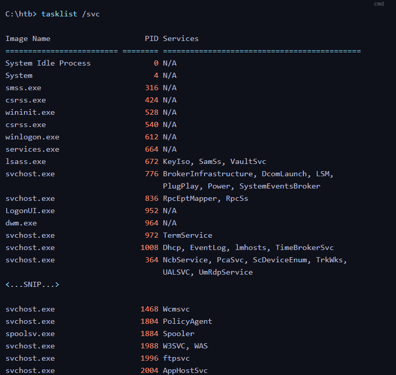{ width="760" }

#### Windows Core Processes

Il est essentiel de reconnaître les processus légitimes courants.

|Processus|Fonction|
|---|---|
|`smss.exe`|Session Manager Subsystem|
|`csrss.exe`|Client/Server Runtime Subsystem|
|`winlogon.exe`|Gestion de certains mécanismes de connexion Windows|
|`lsass.exe`|Fonctions de sécurité et d'authentification|
|`services.exe`|Service Control Manager|
|`svchost.exe`|Hébergement de nombreux services Windows|
|`spoolsv.exe`|Service d'impression|
|`MsMpEng.exe`|Microsoft Defender Antivirus|

La reconnaissance de ces processus permet d'identifier plus rapidement les composants non standards.

#### Example — FileZilla Server

Dans le lab, `FileZilla Server.exe` présente un intérêt particulier.

L'énumération doit chercher à déterminer :

- sa version ;

- la configuration du service FTP ;

- les permissions des fichiers et répertoires ;

- l'existence de vulnérabilités connues ;

- les possibilités d'accès non autorisé ou d'exposition de fichiers.

Le cours évoque notamment une éventuelle configuration FTP autorisant l'accès anonyme.

Important : un logiciel inhabituel ou ancien n'est pas automatiquement vulnérable. Il constitue avant tout une piste d'investigation.

### Variables d'environnement — set

```bat title="Commande (CMD)"
set
```


Cette commande affiche les variables d'environnement de la session courante.

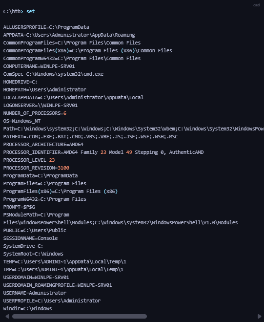{ width="760" }

Elles fournissent des informations sur les chemins système, les profils utilisateurs et certains emplacements configurés.

|Variable|Utilité|
|---|---|
|`PATH`|Liste des répertoires utilisés notamment pour rechercher des exécutables|
|`PATHEXT`|Extensions exécutables reconnues par le shell Windows|
|`USERPROFILE`|Répertoire de profil de l'utilisateur|
|`APPDATA`|Répertoire de données applicatives itinérantes|
|`LOCALAPPDATA`|Répertoire de données applicatives locales|
|`HOMEDRIVE` / `HOMEPATH`|Informations relatives au répertoire personnel|
|`LOGONSERVER`|Serveur de connexion indiqué par la session|
|`USERNAME` / `USERDOMAIN`|Identité et contexte utilisateur|
|`TEMP` / `TMP`|Répertoires temporaires|

#### PATH Enumeration

Exemple du cours :

```text
Path=C:\Windows\system32;
     C:\Windows;
     C:\Windows\System32\Wbem;
     C:\Windows\System32\WindowsPowerShell\v1.0\;
     C:\Users\Administrator\AppData\Local\Microsoft\WindowsApps;
```


La variable `PATH` contient des répertoires parcourus dans un ordre défini lorsqu'un programme est recherché par son nom, selon le mécanisme d'exécution utilisé.

Un répertoire inhabituel et modifiable par un utilisateur non privilégié peut être dangereux, notamment lorsqu'une application ou un service privilégié effectue une recherche non sécurisée d'un exécutable ou d'une DLL.

Prérequis — Search Order Hijacking :

Cette famille de techniques consiste à exploiter un ordre de recherche pour faire charger ou exécuter un fichier différent de celui attendu.

Il faut toutefois distinguer :

- Executable Search Order Hijacking : détournement de la recherche d'un exécutable.

- DLL Search Order Hijacking : détournement du mécanisme de résolution des DLL.

L'ordre de recherche varie selon les API et les paramètres Windows. La présence d'un dossier modifiable dans `PATH` ne prouve donc pas, à elle seule, qu'une exploitation est possible.

#### Home Directories & Roaming Profiles

Certaines organisations utilisent des répertoires personnels hébergés sur des partages réseau.

Ces emplacements peuvent contenir :

- des scripts ;

- des fichiers de configuration ;

- des documents internes ;

- des informations d'inventaire ;

- parfois des identifiants stockés de manière non sécurisée.

Le cours mentionne aussi les Roaming Profiles, qui permettent à certaines données utilisateur de suivre un compte entre plusieurs machines.

Exemple d'emplacement de démarrage automatique :

```text
%APPDATA%\Microsoft\Windows\Start Menu\Programs\Startup
```


Les éléments de ce dossier peuvent s'exécuter lors de l'ouverture de session utilisateur.

Cela constitue un mécanisme de Persistence potentiel, sous réserve que le profil et les fichiers concernés soient effectivement présents sur la machine.

### Vue détaillée du système — systeminfo

```bat title="Commande (CMD)"
systeminfo
```


Cette commande fournit une vue détaillée du système d'exploitation et de la configuration matérielle.

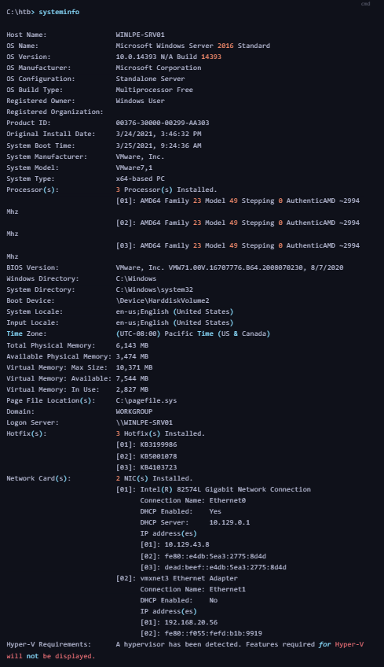{ width="760" }

#### Informations importantes

|Champ|Intérêt|
|---|---|
|`OS Name`|Édition de Windows|
|`OS Version`|Version et build|
|`OS Configuration`|Configuration du système|
|`System Boot Time`|Dernier démarrage|
|`System Manufacturer`|Fabricant ou plateforme virtuelle|
|`System Type`|Architecture x86/x64|
|`Domain`|Domaine ou groupe de travail|
|`Hotfix(s)`|Correctifs visibles|
|`Network Card(s)`|Interfaces et adresses réseau|

#### Example — WINLPE-SRV01

Dans le lab :

```text
OS Name:             Microsoft Windows Server 2016 Standard
OS Version:          10.0.14393 Build 14393
System Manufacturer: VMware, Inc.
System Type:         x64-based PC
Domain:              WORKGROUP
Hotfix(s):           3 Hotfix(s) Installed
Network Card(s):     2 NIC(s) Installed
```


Les correctifs listés comprennent :

`KB3199986`, `KB5001078`, `KB4103723`.

#### Interprétation

Ce résultat permet d'identifier :

- un serveur Windows Server 2016 ;

- une architecture 64 bits ;

- une machine virtuelle VMware ;

- une configuration en WORKGROUP, et non une appartenance au domaine AD ;

- plusieurs interfaces réseau ;

- des informations sur le niveau de mise à jour.

Précision : un redémarrage ancien peut suggérer une maintenance insuffisante, mais ne démontre pas l'absence de correctifs. Certaines mises à jour ne nécessitent pas de redémarrage, et les inventaires de correctifs ne présentent pas toujours l'intégralité des mises à jour installées.

### Correctifs installés

Le cours présente plusieurs méthodes pour examiner les correctifs.

Avec CMD :

```bat title="Commande (CMD)"
wmic qfe
```


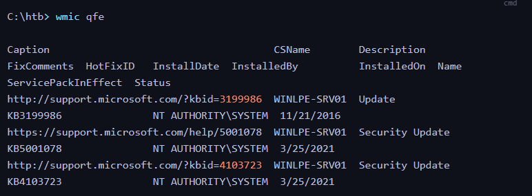{ width="760" }

Avec PowerShell :

```powershell title="Commande (PowerShell)"
Get-HotFix | Format-Table -AutoSize
```


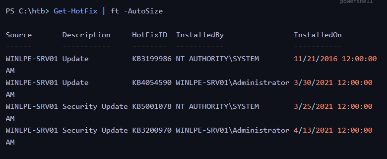{ width="760" }

Ces commandes retournent notamment :

- `HotFixID` : identifiant KB ;

- `Description` : type de mise à jour ;

- `InstalledBy` : compte associé à l'installation ;

- `InstalledOn` : date d'installation.

Limites : `Get-HotFix` et `wmic qfe` ne constituent pas un inventaire exhaustif de toutes les mises à jour Windows. En outre, `wmic.exe` est un utilitaire historique déprécié, absent de certaines versions récentes de Windows.

#### Prérequis — KB & CVE

- KB (Knowledge Base) : identifiant d'un article ou correctif Microsoft.

- CVE (Common Vulnerabilities and Exposures) : identifiant public d'une vulnérabilité.

- Patch Level : ensemble des mises à jour appliquées à un système.

L'analyste peut comparer la version Windows et les correctifs présents aux informations disponibles sur une CVE.

### Programmes installés

Les applications installées constituent une autre surface d'attaque importante.

Le cours utilise :

```bat title="Commande (CMD)"
wmic product get name
```


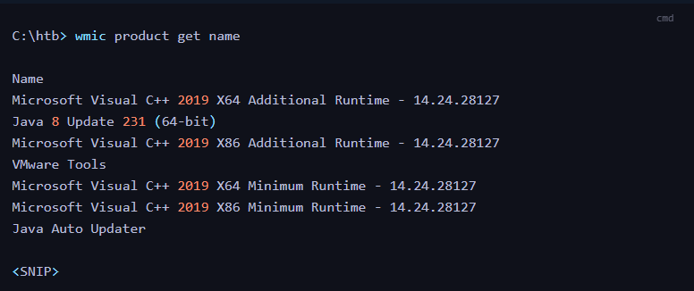{ width="760" }

Et :

- Commande Windows PowerShell 5.1 (absente de PowerShell 7) ; voir la réserve sur `Win32_Product` plus bas.

```powershell title="Commande (PowerShell)"
Get-WmiObject -Class Win32_Product |
    Select-Object Name, Version
```


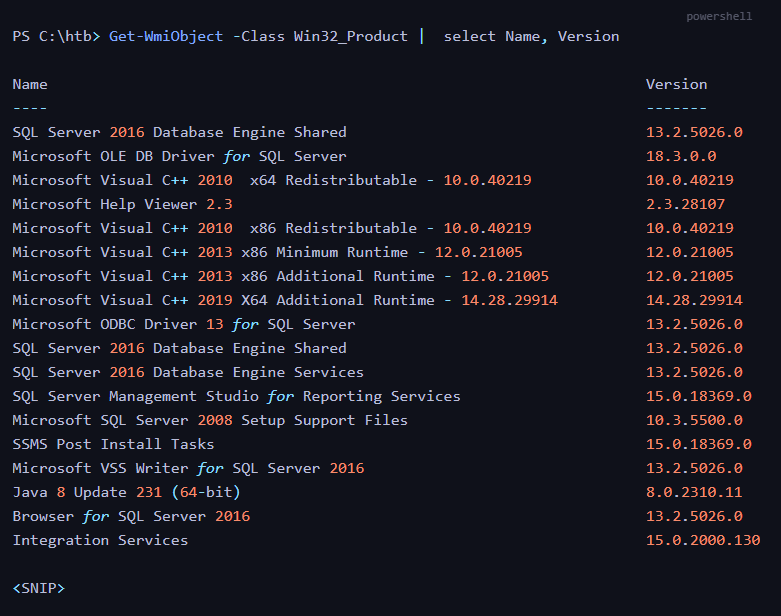{ width="760" }

Dans le lab, les résultats incluent notamment :

- Java 8 Update 231

- VMware Tools

- Microsoft SQL Server 2016

- Microsoft ODBC / OLE DB Drivers

- SQL Server Management Studio

- différents packages Microsoft Visual C++.

#### Pourquoi énumérer les logiciels ?

Les versions installées peuvent révéler :

- des logiciels anciens ou vulnérables ;

- des services associés à des comptes privilégiés ;

- des fichiers de configuration sensibles ;

- des possibilités de Credential Hunting ;

- des erreurs de permissions.

Exemple du cours : la présence d'outils comme PuTTY ou FileZilla peut justifier l'examen des informations de session enregistrées, notamment avec les outils présentés dans la section précédente.

#### Précision importante — Win32_Product

L'interrogation de `Win32_Product` peut déclencher des vérifications de cohérence ou des opérations de réparation MSI, ce qui présente un risque opérationnel sur une machine en production. Elle ne recense pas non plus tous les logiciels installés.

Une alternative moins intrusive consiste à consulter les clés de désinstallation Windows :

```powershell title="Commande (PowerShell)"
Get-ItemProperty `
  'HKLM:\SOFTWARE\Microsoft\Windows\CurrentVersion\Uninstall\*',
  'HKLM:\SOFTWARE\WOW6432Node\Microsoft\Windows\CurrentVersion\Uninstall\*' `
  -ErrorAction SilentlyContinue |
  Select-Object DisplayName, DisplayVersion, Publisher
```


Cette méthode complète l'inventaire, sans garantir une liste exhaustive.

## Connexions réseau et services en écoute

- La commande [netstat](https://docs.microsoft.com/en-us/windows-server/administration/windows-commands/netstat) affichera les connexions TCP et UDP actives, ce qui nous donnera une meilleure idée des services en écoute sur quel(s) port(s), à la fois localement et accessibles de l'extérieur.
- Nous pourrions trouver un service vulnérable accessible uniquement à l'hôte local (lorsqu'on est connecté à l'hôte) que nous pouvons exploiter pour élever nos privilèges.

### Netstat

```bat title="Commande (CMD)"
netstat -ano
```


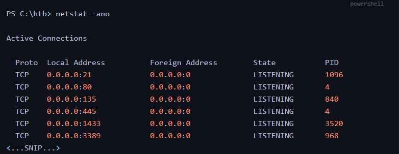{ width="760" }

Cette commande affiche les connexions et endpoints TCP/UDP avec les PIDs associés.

|Option|Fonction|
|---|---|
|`-a`|Afficher les connexions et ports en écoute|
|`-n`|Utiliser des adresses et numéros de ports numériques|
|`-o`|Afficher le PID associé|

### Example — Open Ports

Le cours montre notamment :

```text
Local Address     State       PID
----------------------------------
0.0.0.0:21        LISTENING   1096
0.0.0.0:80        LISTENING   4
0.0.0.0:135       LISTENING   840
0.0.0.0:445       LISTENING   4
0.0.0.0:1433      LISTENING   3520
0.0.0.0:3389      LISTENING   968
```


|Port|Service généralement associé|
|---|---|
|21|FTP|
|80|HTTP|
|135|Microsoft RPC Endpoint Mapper|
|445|SMB|
|1433|Microsoft SQL Server|
|3389|RDP|

Ces associations restent indicatives : il faut confirmer le programme réellement responsable de chaque endpoint.

### 127.0.0.1 vs 0.0.0.0

- `127.0.0.1` : service lié à l'interface loopback IPv4, normalement accessible localement.

- `0.0.0.0` : service lié à toutes les interfaces IPv4 disponibles.

Un service en écoute sur `0.0.0.0` n'est pas nécessairement accessible depuis l'extérieur : un pare-feu peut toujours bloquer les connexions.

### Intérêt en Privilege Escalation

Un service peut être inaccessible depuis le réseau mais accessible depuis une session locale.

Il peut constituer une piste s'il présente une vulnérabilité ou des permissions faibles.

Pour retrouver le processus correspondant à un PID :

```bat title="Commande (CMD)"
tasklist /FI "PID eq 3520"
```


Cette corrélation permet de rapprocher port → PID → processus → service.

## Utilisateurs, groupes et privilèges

L'analyse des utilisateurs, groupes et privilèges permet de comprendre le Security Context disponible et de repérer d'éventuels chemins vers un compte plus privilégié.

### Sessions ouvertes — query user

```bat title="Commande (CMD)"
query user
```


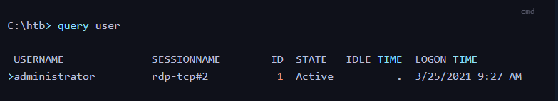{ width="760" }

La commande affiche les sessions utilisateur connues, leur état et leur heure de connexion.

Elle permet notamment d'identifier :

- les utilisateurs connectés ;

- les sessions RDP ;

- les sessions actives ou déconnectées ;

- les périodes d'inactivité.

La présence d'une session administrateur peut avoir un intérêt dans une investigation, mais elle n'accorde aucun droit supplémentaire au compte courant.

### Compte courant

```bat title="Commande (CMD)"
echo %USERNAME%
```


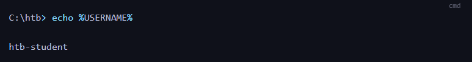{ width="760" }

Pour obtenir plus d'informations sur l'identité et le token :

```bat title="Commande (CMD)"
whoami /all
```


Cette dernière commande constitue un complément utile, puisqu'elle regroupe notamment les groupes et privilèges du contexte courant.

### Privilèges du token — whoami /priv

```bat title="Commande (CMD)"
whoami /priv
```


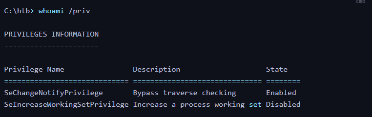{ width="760" }

#### Prérequis — Windows Privileges

Les Windows Privileges sont des droits particuliers présents dans un Access Token.

Ils ne correspondent pas exactement aux permissions sur les fichiers ou aux appartenances aux groupes.

Exemples :

- `SeChangeNotifyPrivilege` : notamment lié au contournement des contrôles de traversée de répertoires.

- `SeDebugPrivilege` : accès privilégié à certains processus.

- `SeImpersonatePrivilege` : permet certaines opérations d'impersonation.

- `SeBackupPrivilege` : permet certaines opérations de sauvegarde privilégiées.

Important : un privilège affiché comme `Disabled` peut parfois être activé si le token le contient et si les conditions le permettent. En revanche, un privilège absent du token n'est pas obtenu simplement en l'activant.

Le cours évoque notamment `SeImpersonatePrivilege` et les techniques d'élévation associées, comme Juicy Potato, qui seront approfondies ultérieurement.

### Groupes du token — whoami /groups

```bat title="Commande (CMD)"
whoami /groups
```


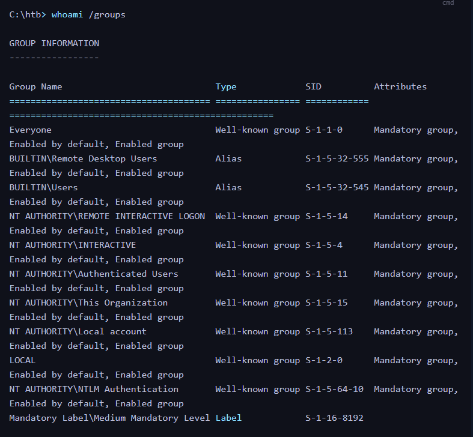{ width="760" }

Cette commande affiche les groupes et identifiants de sécurité (SIDs) présents dans le token de l'utilisateur.

Dans le lab, `htb-student` appartient notamment à :

|Groupe|Signification|
|---|---|
|`Everyone`|Groupe général|
|`BUILTIN\Users`|Utilisateurs locaux|
|`BUILTIN\Remote Desktop Users`|Utilisateurs disposant de droits RDP selon la configuration|
|`NT AUTHORITY\Authenticated Users`|Utilisateurs authentifiés|
|`NT AUTHORITY\INTERACTIVE`|Contexte de connexion interactive|

Le cours affiche également :

```text
Mandatory Label\Medium Mandatory Level
```


#### Integrity Levels

Windows utilise des Integrity Levels pour contribuer à contrôler les interactions entre processus et objets.

Quelques niveaux courants :

- Low

- Medium

- High

- System

Un utilisateur standard fonctionne généralement avec un token de niveau Medium, tandis qu'un processus administrateur élevé utilise souvent le niveau High.

Le niveau d'intégrité ne représente toutefois pas, à lui seul, l'ensemble des permissions du processus.

### Comptes locaux — net user

```bat title="Commande (CMD)"
net user
```


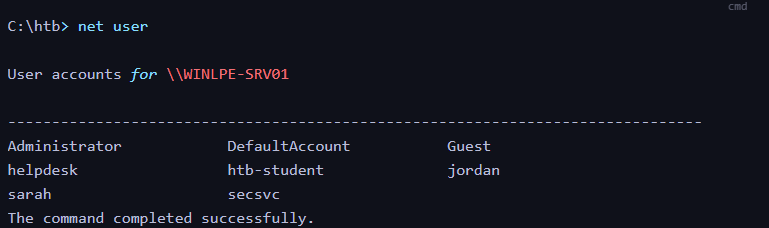{ width="760" }

Cette commande affiche les comptes locaux connus du système.

Dans le lab :

```text
Administrator
DefaultAccount
Guest
helpdesk
htb-student
jordan
sarah
secsvc
```


L'intérêt est de repérer :

- les comptes administratifs ;

- les comptes de service ;

- les comptes inhabituels ;

- les profils potentiellement associés à des fichiers sensibles.

Le cours donne l'exemple de comptes comme `bob` et `bob_adm`, où une mauvaise gestion ou une réutilisation d'identifiants pourrait créer un risque.

### Groupes locaux — net localgroup

- Connaître les groupes non standards présents sur l'hôte peut nous aider à déterminer à quoi sert l'hôte, à quel point il est utilisé, ou peut même nous amener à découvrir une mauvaise configuration, comme tous les Utilisateurs du domaine dans les groupes Bureau à distance ou administrateurs locaux.

```bat title="Commande (CMD)"
net localgroup
```


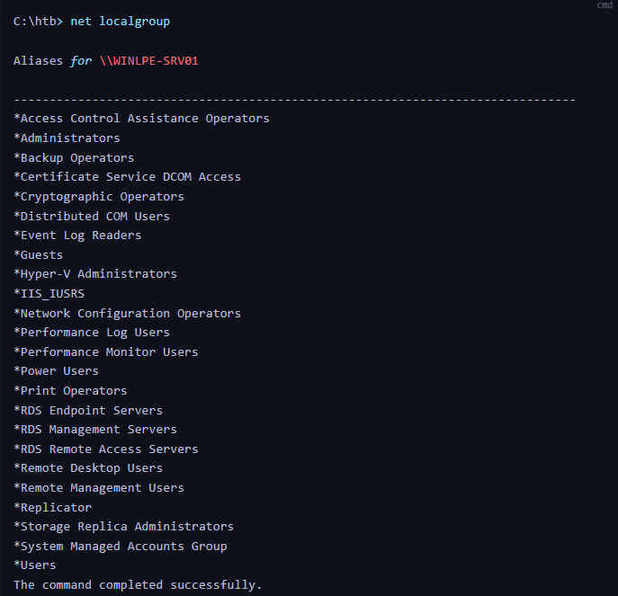{ width="760" }

Cette commande affiche les groupes locaux de la machine.

Parmi ceux présentés dans le cours :

|Groupe|Intérêt|
|---|---|
|Administrators|Droits administratifs locaux|
|Backup Operators|Droits spécifiques de sauvegarde et restauration|
|Remote Desktop Users|Autorisation de connexion RDP selon les autres politiques|
|Remote Management Users|Certains droits associés à la gestion distante|
|Event Log Readers|Lecture de certains journaux Windows|
|Hyper-V Administrators|Administration de composants Hyper-V|
|Print Operators|Privilèges liés à certaines opérations d'impression|
|IIS_IUSRS|Groupe associé à IIS|
|Users|Groupe standard des utilisateurs locaux|

L'appartenance à un groupe ne signifie pas nécessairement que toutes ses capacités sont utilisables sans conditions supplémentaires. Les permissions effectives dépendent du token, des politiques de sécurité et de la configuration du système.

#### Détails sur un Groupe

```bat title="Commande (CMD)"
net localgroup administrators
```


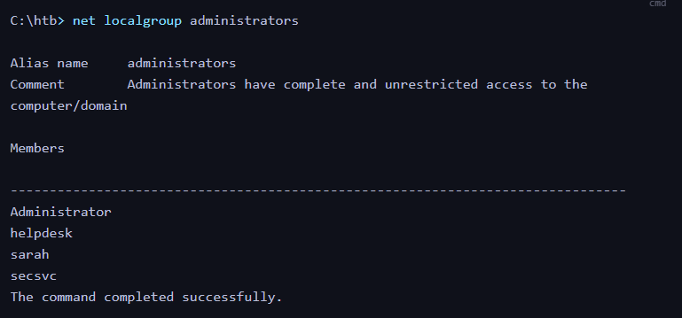{ width="760" }

Dans le lab :

```text
Members
----------------
Administrator
helpdesk
sarah
secsvc
```


Cette information permet de découvrir que plusieurs comptes supplémentaires possèdent des droits administratifs locaux.

Piste d'énumération : rechercher les éventuels liens entre ces comptes privilégiés, les services installés et les fichiers de configuration accessibles.

Le cours mentionne également la possibilité, parfois rare, de trouver des informations sensibles dans les descriptions de groupes.

## Politique de mot de passe et de verrouillage

### Commande

```bat title="Commande (CMD)"
net accounts
```


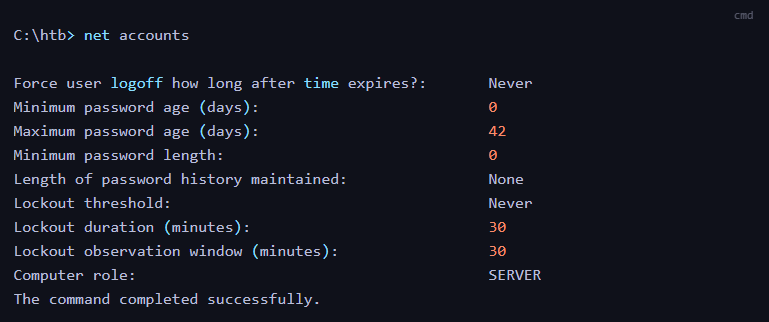{ width="760" }

Elle permet d'obtenir les principaux paramètres de la politique de mot de passe applicable dans le contexte interrogé.

### Résultats du lab

|Paramètre|Valeur|
|---|---|
|Minimum Password Age|0 jour|
|Maximum Password Age|42 jours|
|Minimum Password Length|0 caractère|
|Password History|None|
|Account Lockout Threshold|Never|
|Lockout Duration|30 minutes|
|Lockout Observation Window|30 minutes|

### Interprétation

Deux réglages sont particulièrement faibles :

Minimum Password Length: 0

La longueur minimale imposée par cette politique est nulle.

Lockout Threshold: Never

Aucun seuil de verrouillage n'est imposé par cette politique après des échecs d'authentification.

Ces paramètres peuvent augmenter le risque lié aux mots de passe faibles et aux tentatives d'authentification répétées.

Précision : les paramètres observés ne prouvent pas que les comptes utilisent effectivement des mots de passe vides ou faibles. Les politiques locales et de domaine doivent également être distinguées.

## Récapitulatif des commandes

| Commande                        | Objectif                                             |
| ------------------------------- | ---------------------------------------------------- |
| `tasklist /svc`                 | Afficher les processus et services associés          |
| `set`                           | Afficher les variables d'environnement               |
| `systeminfo`                    | Examiner le système, son build et ses correctifs     |
| `wmic qfe`                      | Interroger les correctifs via l'outil WMI historique |
| `Get-HotFix`                    | Consulter les correctifs répertoriés par PowerShell  |
| `wmic product get name`         | Lister certains logiciels installés via MSI          |
| `netstat -ano`                  | Afficher les connexions et ports avec leurs PIDs     |
| `query user`                    | Identifier les sessions utilisateurs                 |
| `echo %USERNAME%`               | Afficher le nom du compte courant                    |
| `whoami /priv`                  | Examiner les privilèges du token courant             |
| `whoami /groups`                | Examiner les groupes du token courant                |
| `whoami /all`                   | Obtenir une vue complète du contexte de sécurité     |
| `net user`                      | Énumérer les utilisateurs locaux                     |
| `net localgroup`                | Énumérer les groupes locaux                          |
| `net localgroup administrators` | Identifier les administrateurs locaux                |
| `net accounts`                  | Examiner les paramètres de politique de mot de passe |

## Parcours d'énumération initiale

```text
Initial Foothold
       ↓
Identify Current User & Privileges
       ↓
Enumerate OS Version & Patch Level
       ↓
Inspect Processes & Services
       ↓
Analyze Installed Applications
       ↓
Review Environment Variables
       ↓
Enumerate Local Network Services
       ↓
Inspect Users, Groups & Password Policy
       ↓
Identify Privilege Escalation Candidates
       ↓
Validate Findings Manually
```


### Principes essentiels

L'énumération Windows ne consiste pas simplement à exécuter une liste de commandes. Elle vise à construire une compréhension technique du système afin de repérer les relations entre différents éléments.

Par exemple :

- un service inhabituel peut justifier une analyse de ses permissions et de sa version ;

- une application ancienne peut nécessiter une vérification des correctifs et vulnérabilités applicables ;

- un répertoire modifiable dans un chemin de recherche peut présenter un risque selon le mécanisme utilisé ;

- un compte possédant un privilège sensible peut ouvrir des possibilités d'élévation spécifiques ;

- des comptes administrateurs supplémentaires peuvent orienter la recherche de configurations et de secrets exposés.

Idée centrale : une bonne énumération permet de passer d'une liste d'informations système à une série d'hypothèses d'élévation de privilèges concrètes, qu'il faudra ensuite vérifier.
