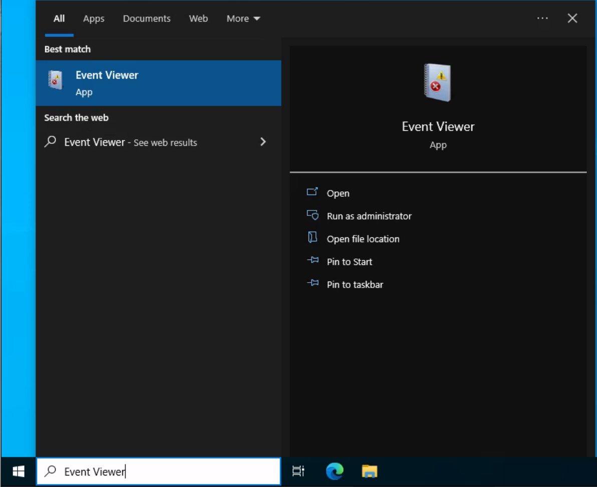
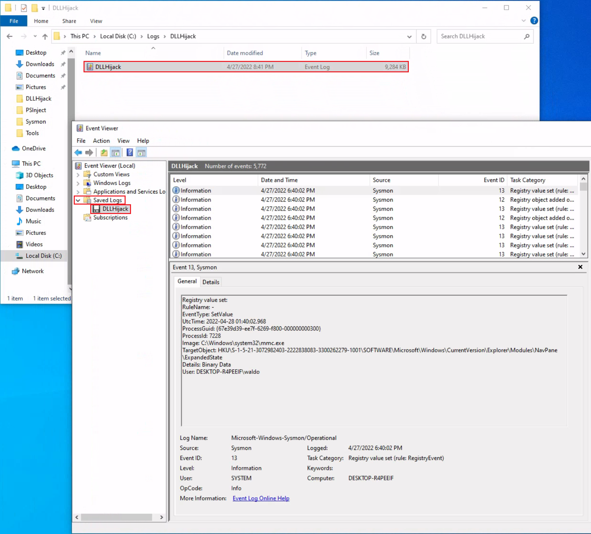
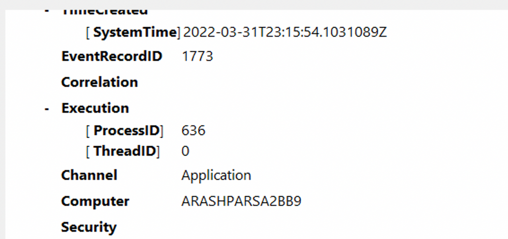

## 1. Les bases de la journalisation Windows

Les journaux Windows peuvent être consultés avec Event Viewer (`eventvwr.msc`) ou exploités par programmation avec la Windows Event Log API.

### Principaux journaux Windows

| Log              | Contenu                                                        |
| ---------------- | -------------------------------------------------------------- |
| Application      | Événements, erreurs et diagnostics des applications            |
| Security         | Authentifications, accès, privilèges et événements d'audit     |
| Setup            | Événements liés à l'installation et à la configuration Windows |
| System           | Événements du système, des services et des composants Windows  |
| Forwarded Events | Événements transmis depuis d'autres machines                   |

Forwarded Events permet de consulter des événements reçus via Windows Event Forwarding (WEF), lorsque cette fonctionnalité est configurée.

Event Viewer peut également ouvrir des fichiers de journaux sauvegardés au format `.evtx`, accessibles dans la section `Saved Logs`.

## 2. Anatomie d'un événement Windows

Chaque événement Windows contient des métadonnées permettant de comprendre son origine et son contexte.

| Champ             | Description                                                         |
| ----------------- | ------------------------------------------------------------------- |
| Log Name          | Journal contenant l'événement                                       |
| Source / Provider | Composant ayant généré l'événement                                  |
| Event ID          | Identifiant du type d'événement                                     |
| Task Category     | Catégorie fonctionnelle de l'événement                              |
| Level             | Niveau : Information, Warning, Error, Critical ou Verbose           |
| Keywords          | Indicateurs de classification, comme Audit Success ou Audit Failure |
| User              | Compte associé à l'événement, lorsqu'il est renseigné               |
| OpCode            | Opération spécifique décrite par l'événement                        |
| Logged            | Date et heure de l'enregistrement                                   |
| Computer          | Machine ayant généré l'événement                                    |
| XML Data          | Représentation structurée des champs et données supplémentaires     |

### Event ID et fournisseur (provider)

Un Event ID identifie un type d'événement dans le contexte de son fournisseur.

Exemple :

`Application → SideBySide → Event ID 35`

Cet événement décrit une erreur de génération du contexte d'activation d'une application, liée dans l'exemple à une incompatibilité d'architecture.

L'onglet `Details` permet d'examiner les données structurées, notamment :

- `SystemTime` : timestamp ;
- `EventRecordID` : numéro de l'enregistrement ;
- `ProcessID` : identifiant du processus associé ;
- `ThreadID` : identifiant du thread ;
- `Computer` : machine source.

Important : un Event ID ne doit pas être interprété indépendamment de son Provider et de son journal.
