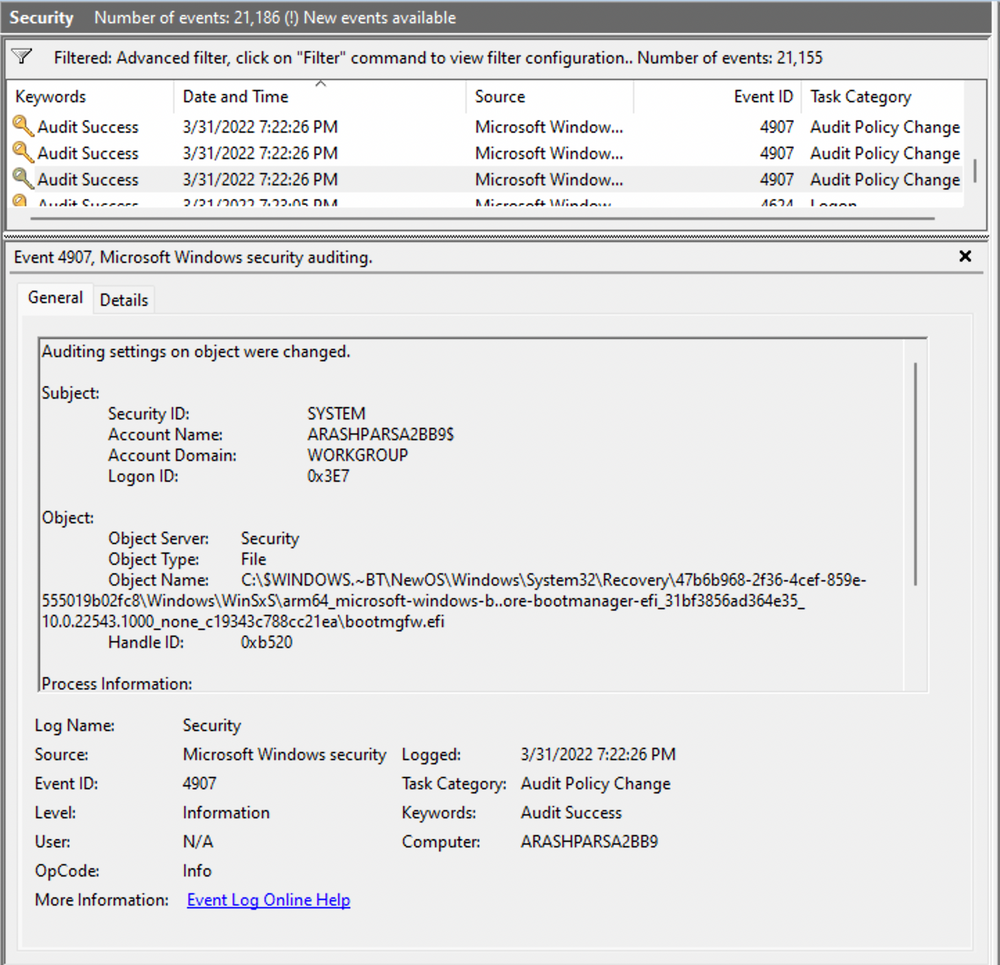
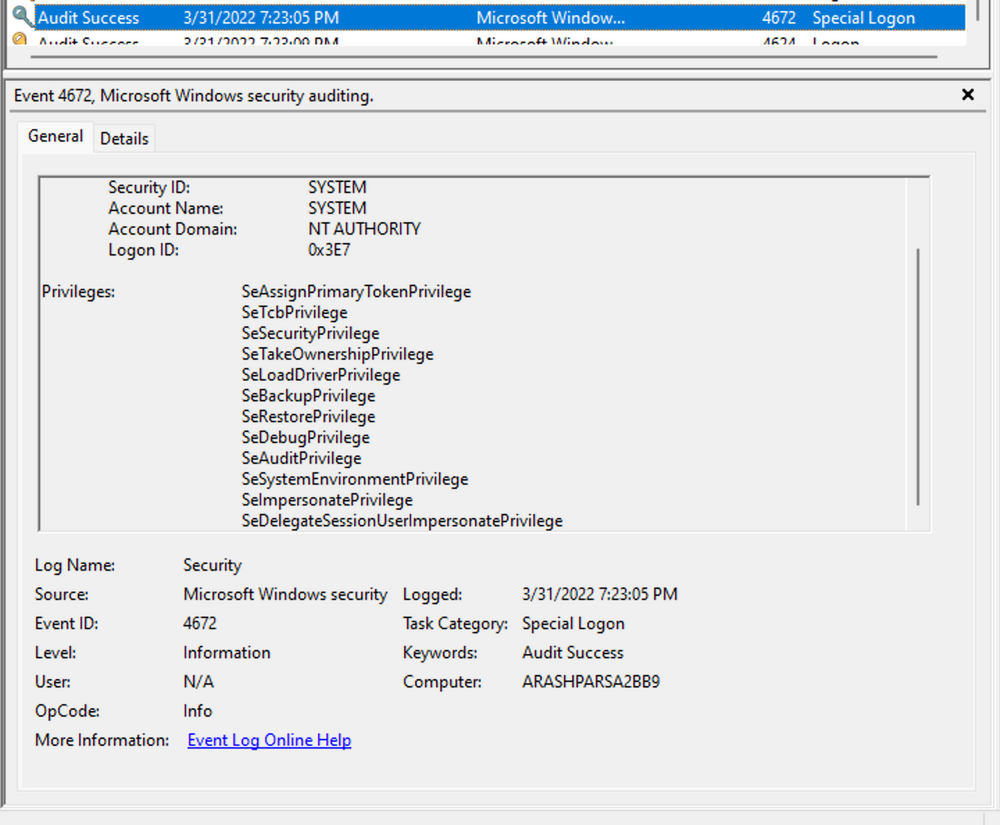

## 4. Requêtes XML personnalisées dans l'Observateur d'événements

Event Viewer permet de créer des filtres XML pour effectuer des recherches plus précises.

Chemin :

`Event Viewer → Filter Current Log → XML → Edit Query Manually`

### Objectif

Dans cet exemple, la recherche porte sur :

`SubjectLogonId = 0x3E7`


L'objectif est de retrouver des événements associés à ce contexte de session afin de reconstruire une séquence d'activités.

Exemple de filtre XML illustratif :

```
<QueryList>
  <Query Id="0" Path="Security">
    <Select Path="Security">
      *[EventData[Data[@Name='SubjectLogonId']='0x3e7']]
    </Select>
  </Query>
</QueryList>
```


Ce filtre sélectionne les événements du journal `Security` possédant le champ `SubjectLogonId` avec la valeur indiquée.

Il ne récupère pas automatiquement tous les événements de la session si ceux-ci utilisent d'autres champs, notamment `TargetLogonId`.

### Intérêt DFIR

- Réduire le volume d'événements à examiner.
- Rechercher les opérations associées à un contexte utilisateur.
- Corréler authentifications, changements de privilèges et modifications système.
- Reconstituer une Event Timeline.

Il est également possible de créer des filtres dans l'interface graphique et d'en examiner ensuite la représentation XML.

## 5. Exemple d'investigation — Event IDs 4907, 4624 et 4672

Analyse progressive de plusieurs événements Windows liés à un même contexte.

### Event ID 4907 — paramètres d'audit modifiés sur un objet

L'Event ID 4907 est généré lorsque les paramètres d'audit d'un objet Windows sont modifiés, notamment sa SACL (System Access Control List).



La SACL définit quelles tentatives d'accès à un objet doivent être journalisées.

Elle est constituée d'ACE (Access Control Entries) pouvant spécifier :

- les comptes ou groupes concernés ;
- les opérations à auditer ;
- les accès réussis, échoués ou les deux.

Distinction : la SACL contrôle l'audit des accès, tandis que la DACL contrôle principalement les autorisations d'accès.

### Analyse

Les détails de l'Event 4907 montrent :

| Champ         | Information                                          |
| ------------- | ---------------------------------------------------- |
| Process Name  | `SetupHost.exe`                                      |
| Object Type   | File                                                 |
| Object Name   | Objet associé au boot manager                        |
| OldSd / NewSd | Descripteurs de sécurité avant et après modification |


Les champs `OldSd` et `NewSd` utilisent le format SDDL (Security Descriptor Definition Language).

Ils permettent d'examiner les changements apportés au descripteur de sécurité.

`SetupHost.exe` est associé à des opérations de configuration Windows. Son nom est cohérent avec une activité d'installation, mais un nom de processus légitime ne garantit pas qu'une activité soit saine.

### Event ID 4672 — privilèges spéciaux attribués à une nouvelle session


L'Event ID 4672 indique que des privilèges sensibles ont été attribués au token d'une nouvelle session de connexion.

Exemple :

`SeDebugPrivilege`



Ce privilège peut permettre à un processus disposant des autorisations nécessaires d'interagir avec d'autres processus de manière privilégiée.

### Corrélation

```
Event 4907
Audit Configuration Modified
          ↓
Event 4624
Successful Logon
          ↓
Event 4672
Special Privileges Assigned
          ↓
Timeline & Contextual Investigation
```


Cette séquence permet d'étudier les modifications d'audit et le contexte de connexion privilégiée.

Un Event 4672 associé à SYSTEM peut être parfaitement normal. De même, la présence successive de ces événements ne suffit pas à confirmer une compromission.
