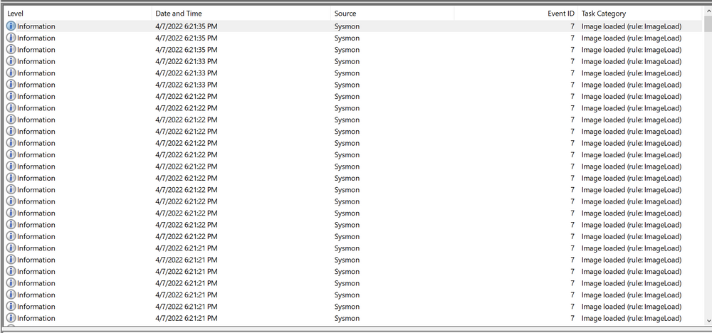
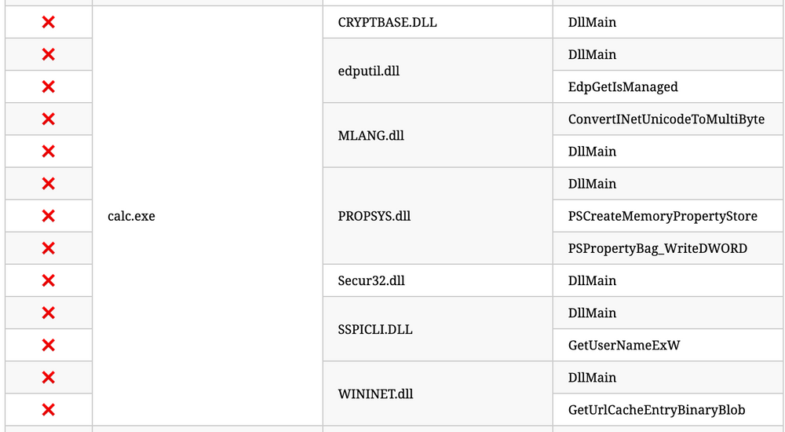
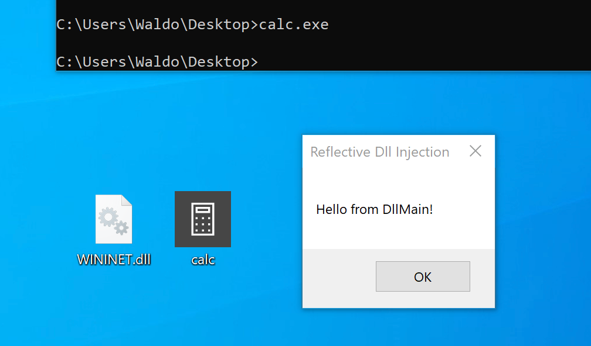
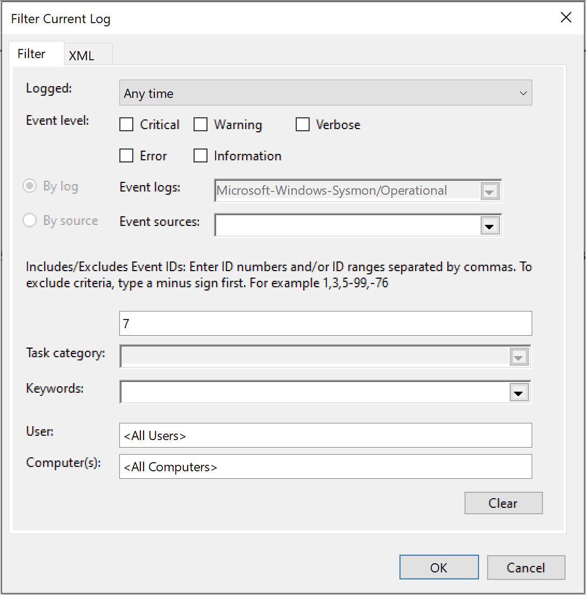

## 2. Détection n° 1 — DLL hijacking

Le DLL Hijacking consiste à exploiter le mécanisme de recherche et de chargement des DLL de Windows pour faire charger une bibliothèque contrôlée par l'attaquant à la place de celle attendue.

### Sysmon Event ID 7 — chargement d'image (Image Loaded)

L'Event ID `7` enregistre les chargements de modules, notamment de DLL.

Les champs utiles comprennent :

| Champ       | Description                                 |
| ----------- | ------------------------------------------- |
| Image       | Chemin du processus qui charge la DLL       |
| ImageLoaded | Chemin de la DLL chargée                    |
| ProcessId   | PID du processus                            |
| Signed      | Indication de signature numérique de la DLL |
| Signature   | Informations sur le signataire              |
| User        | Compte associé au processus                 |

Exemple légitime :

```
Image        : C:\Windows\System32\mmc.exe
ImageLoaded  : C:\Windows\System32\psapi.dll
Signed       : true
```


L'événement indique que `mmc.exe` a chargé `psapi.dll`, signée par Microsoft.

### Configuration de la collecte

Dans la configuration SwiftOnSecurity, on modifie le comportement de `ImageLoad` pour enregistrer tous les chargements :


```
<ImageLoad onmatch="exclude">
</ImageLoad>
```


Avec aucune condition d'exclusion, ce réglage permet de journaliser tous les événements de cette catégorie.

À l'inverse, `onmatch="include"` sans condition d'inclusion ne sélectionne aucun événement.

Appliquer la configuration :

```
sysmon.exe -c sysmonconfig-export.xml
```


Puis consulter :

`Event Viewer → Applications and Services Logs → Microsoft → Windows → Sysmon → Operational`



Attention : l'Event ID 7 peut générer un volume de logs important. En production, une sélection adaptée des événements est généralement préférable.

### Scénario du lab — calc.exe / WININET.dll
https://learn.microsoft.com/en-us/sysinternals/downloads/sysmon
https://hijacklibs.net/#calc.exe
Exemple de détournement impliquant :

- `calc.exe`, un exécutable Windows légitime ;
- `WININET.dll`, une bibliothèque normalement fournie par Windows ;
- une DLL de démonstration renommée `WININET.dll`.

https://github.com/stephenfewer/ReflectiveDLLInjection/tree/master/bin
En suivant les étapes requises, qui impliquent de renommer `reflective_dll.x64.dll` en `WININET.dll`, de déplacer `calc.exe` de `C:\Windows\System32` avec `WININET.dll` vers un répertoire accessible en écriture (comme le dossier `Desktop`), et d'exécuter `calc.exe`, nous réussissons. Au lieu de l'application Calculatrice, une [MessageBox](https://learn.microsoft.com/en-us/windows/win32/api/winuser/nf-winuser-messageboxa) s'affiche.



Dans le lab, `calc.exe` est copié depuis `System32` vers le bureau, avec la DLL de démonstration.

Lors de l'exécution, la DLL contrôlée par le test est chargée et affiche une MessageBox à la place du comportement attendu de la Calculatrice.



La DLL utilisée provient d'un exemple de Reflective DLL, bien que le DLL Hijacking ne nécessite pas de DLL réfléchissante.

### Détection et investigation

L'analyse consiste à filtrer les événements Sysmon sur `Event ID 7`, puis à rechercher `calc.exe`.



| Critère    | Chargement légitime                            | Chargement suspect du lab                   |
| ---------- | ---------------------------------------------- | ------------------------------------------- |
| Executable | `calc.exe` dans un emplacement Windows attendu | `calc.exe` copié dans un dossier modifiable |
| DLL        | `wininet.dll` depuis `System32`                | `WININET.dll` depuis le bureau              |
| Signature  | DLL Microsoft signée                           | DLL non signée                              |

- En faisant un Find, on retrouve notre calc.exe détourné


- En comparaison avec notre calc.exe original, on peut voir des path et des IoC pertinentes à dégager de tout ça.


Trois indicateurs ressortent :

1. Unexpected Executable Path : exécution de `calc.exe` depuis un emplacement utilisateur modifiable. Initialement situé dans System32, ne devrait pas se trouver dans un répertoire accessible en écriture.
2. Unexpected DLL Location : chargement de `WININET.dll` depuis un emplacement inhabituel. initialement situé dans System32, ne devrait pas être chargé en dehors de System32 par calc.exe. Si des instances de chargement de « WININET.dll » se produisent en dehors de System32 avec « calc.exe » comme processus parent, cela indique un détournement de DLL au sein de calc.exe.
3. Unsigned DLL : La « WININET.dll » originale est signée par Microsoft, tandis que notre DLL injectée reste non signée..

```
calc.exe — Unexpected Location
          ↓
Loads WININET.dll — User-Writable Directory
          ↓
Unsigned DLL
          ↓
Potential DLL Hijacking
```


Ces critères peuvent alimenter une règle de détection.

Précisions : `Image` désigne le processus qui charge la DLL, pas nécessairement son processus parent. Une DLL non signée ou située hors de `System32` n'est pas automatiquement malveillante ; les trois indicateurs doivent être interprétés ensemble.
