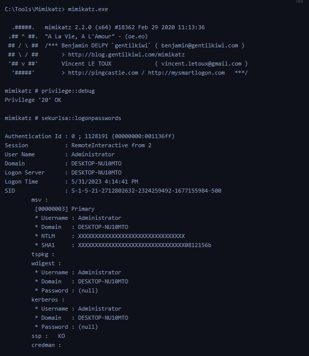
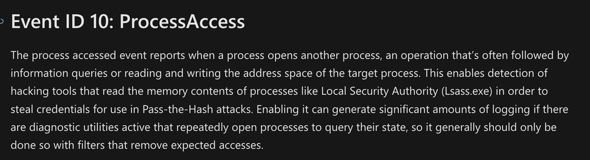

## 4. Détection n° 3 — vol d'identifiants (credential dumping)

Le Credential Dumping consiste à extraire des secrets d'authentification depuis un système compromis.

Sous Windows, LSASS (Local Security Authority Subsystem Service) est une cible fréquente puisqu'il intervient dans la gestion des authentifications et des sessions de sécurité.

### Mimikatz & LSASS

Mimikatz est un outil capable d'examiner certaines informations d'authentification Windows.

Deux commandes sont présentées :

| Commande Mimikatz          | Fonction                                                           |
| -------------------------- | ------------------------------------------------------------------ |
| `privilege::debug`         | Tenter d'activer `SeDebugPrivilege`                                |
| `sekurlsa::logonpasswords` | Examiner certains secrets liés aux sessions de connexion via LSASS |

Selon la configuration et les protections Windows, les résultats peuvent comprendre des hashes ou d'autres informations d'authentification.

Sa sortie montre notamment un compte `Administrator` et des valeurs de hash, tandis que certains champs de mots de passe apparaissent comme `(null)`.



L'accès à LSASS et la réussite de l'extraction dépendent des privilèges et des mécanismes de protection en place.

### Sysmon Event ID 10 — accès à un processus (ProcessAccess)

Pour détecter les tentatives d'accès suspectes à LSASS, on utilise Sysmon Event ID 10.

Cet événement permet d'observer les accès entre processus.



Champs pertinents :

| Champ         | Description                                                        |
| ------------- | ------------------------------------------------------------------ |
| SourceImage   | Processus à l'origine de l'accès                                   |
| TargetImage   | Processus ciblé                                                    |
| SourceUser    | Compte associé au processus source                                 |
| TargetUser    | Compte associé au processus cible                                  |
| GrantedAccess | Droits d'accès accordés au processus cible                         |
| CallTrace     | Informations sur la chaîne d'appels, lorsqu'elles sont disponibles |

### Exemple — AgentEXE.exe → lsass.exe

Exemple : un événement dans lequel un exécutable inhabituel, `AgentEXE.exe`, situé dans un répertoire `Downloads`, tente d'accéder à `lsass.exe`.

```
SourceImage : ...\Downloads\AgentEXE.exe
TargetImage : ...\lsass.exe
SourceUser  : ...\waldo
TargetUser  : NT AUTHORITY\SYSTEM
```


Cette activité est suspecte, car un exécutable peu connu provenant d'un dossier utilisateur accède à un processus sensible.

### Indicateurs de détection

- Unexpected Source Process : programme inhabituel accédant à LSASS.
- Suspicious File Location : exécutable provenant d'un dossier comme `Downloads`.
- Sensitive Target Process : accès à `lsass.exe`.
- Privileged Process Access : demande ou obtention de droits sensibles.
- Debug Privilege Usage : éventuelle utilisation de `SeDebugPrivilege`.

```
Unknown Executable
       ↓
Access to lsass.exe
       ↓
Sysmon Event ID 10
       ↓
Investigate Credential Dumping
```


### Points de vigilance

Des processus légitimes peuvent accéder à LSASS, notamment des composants d'authentification et des solutions Antivirus / EDR.

Par ailleurs :

- `SourceUser` différent de `TargetUser` ne prouve pas une compromission.
- La présence de `SeDebugPrivilege` n'est pas une preuve de Credential Dumping et son utilisation n'est pas systématiquement indispensable à toutes les techniques.
- ProcessAccess ≠ Successful Credential Extraction : l'Event ID 10 signale un accès entre processus, pas nécessairement une extraction réussie.

L'analyse doit intégrer l'identité du processus, son chemin, ses droits d'accès et les événements associés.

## 5. Comparaison des trois détections

| Technique                           | Event ID principal | Indicateur clé                                                     |
| ----------------------------------- | ------------------ | ------------------------------------------------------------------ |
| DLL Hijacking                       | Sysmon 7           | DLL chargée depuis un chemin inhabituel par un exécutable légitime |
| Unmanaged PowerShell / C# Injection | Sysmon 7           | Chargement inattendu de `clr.dll` / `clrjit.dll`                   |
| Credential Dumping                  | Sysmon 10          | Processus suspect accédant à `lsass.exe`                           |

### Démarche d'investigation

```
Sysmon Telemetry
       ↓
Identify Relevant Event ID
       ↓
Inspect Process & Target
       ↓
Examine Paths / Signatures / Access Rights
       ↓
Correlate Related Events
       ↓
Validate Suspicious Behavior
       ↓
Threat Hunting / DFIR Investigation
```


Pour renforcer les investigations, ces événements peuvent être corrélés avec :

- Sysmon Event ID 1 : création de processus ;
- Windows Security Event ID 4688 : création de processus, selon la politique d'audit ;
- Windows Security Event ID 4624 : sessions de connexion ;
- d'autres événements Sysmon, EDR et réseau.

## 6. Points essentiels

La valeur de Sysmon en Threat Hunting réside dans la capacité à observer des comportements techniques précis qui ne seraient pas toujours visibles dans les journaux Windows traditionnels.

Les trois exemples illustrent des méthodes de détection différentes :

- DLL Hijacking : examiner l'origine et les caractéristiques des DLL chargées.
- Code Injection : identifier les composants .NET chargés dans des processus inhabituels.
- Credential Dumping : surveiller les accès suspects à LSASS.

Dans chaque cas, un événement Sysmon constitue une observation à analyser, et non une preuve automatique d'activité malveillante. La détection devient plus fiable lorsque plusieurs éléments sont corrélés : processus, fichiers, chemins, signatures, utilisateurs et chronologie des événements.

Source des captures : [Hack The Box Academy - Windows Event Logs & Finding Evil](https://academy.hackthebox.com/app/module/216)
