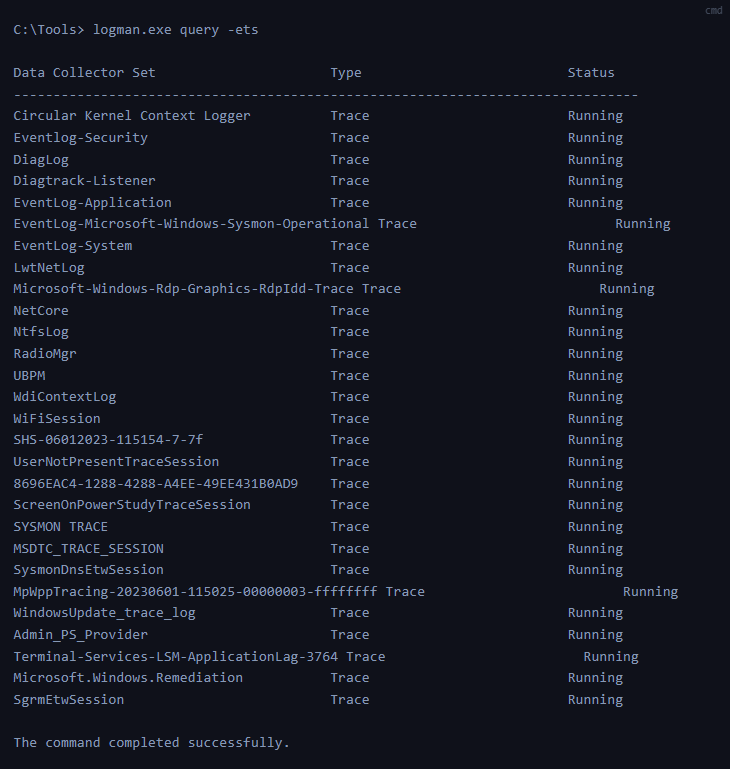
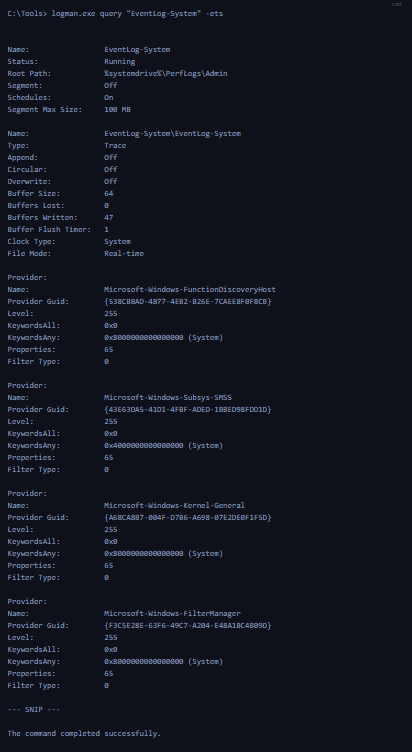
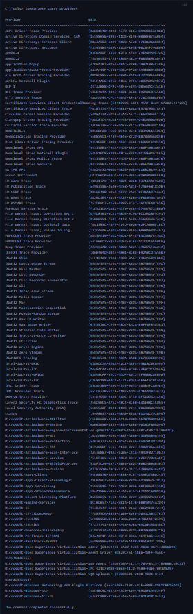
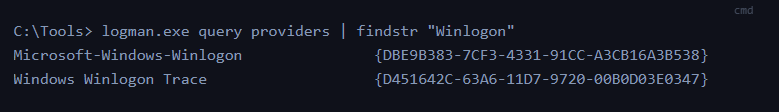
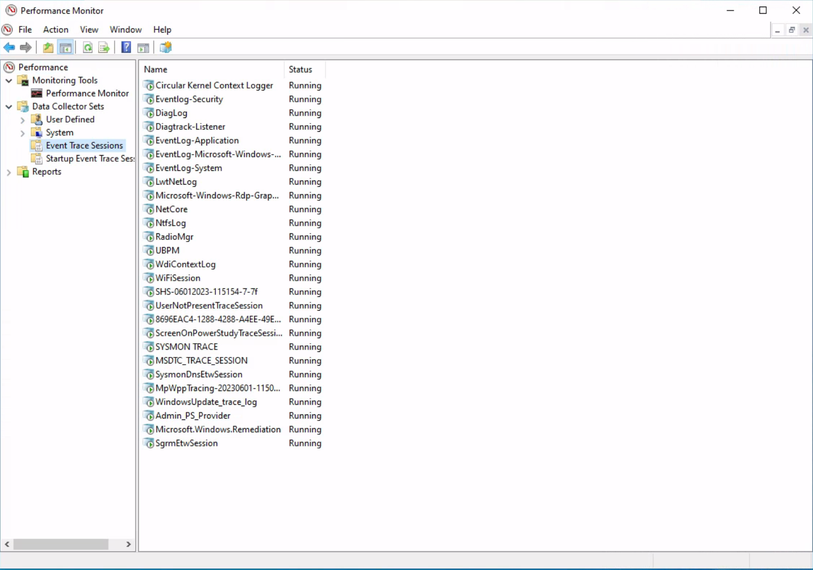

## 3. Interagir avec ETW — Logman

`logman.exe` est un utilitaire Windows permettant de gérer et d'inspecter les sessions ETW.

Il est particulièrement utile pour découvrir les sessions déjà actives et les fournisseurs disponibles pendant une investigation.

### Lister les sessions ETW actives

```
logman.exe query -ets
```


Cette commande affiche les sessions ETW actives.



Sur une machine équipée de Sysmon, plusieurs sessions sont présentes, notamment :

```
Eventlog-Security
EventLog-Application
EventLog-System
EventLog-Microsoft-Windows-Sysmon-Operational
SYSMON TRACE
SysmonDnsEtwSession
```


Ces résultats permettent de découvrir les mécanismes de collecte fonctionnant sur le système.

L'option `-ets` permet de cibler directement les sessions de suivi d'événements actives, plutôt que les seuls ensembles de collecteurs enregistrés.

### Inspecter une session ETW

Pour examiner une session particulière :

```
logman.exe query "EventLog-System" -ets
```




La sortie fournit différentes informations :

| Champ                   | Utilité                                                                                                                             |
| ----------------------- | ----------------------------------------------------------------------------------------------------------------------------------- |
| Name                    | Nom de la session                                                                                                                   |
| Status                  | État de fonctionnement                                                                                                              |
| Root Path               | Emplacement de stockage configuré                                                                                                   |
| Buffer Size             | Taille des buffers                                                                                                                  |
| Buffers Lost            | Nombre de buffers perdus                                                                                                            |
| Buffers Written         | Nombre de buffers écrits                                                                                                            |
| Clock Type              | Source temporelle utilisée                                                                                                          |
| File Mode               | Mode de collecte, par exemple Real-Time                                                                                             |
| Provider : Name / GUID  | Identifiant exclusif du fournisseurs associés à la session                                                                          |
| Provideur : Level       | Décrit niveau de l'événement, indiquant s'il filtre le événements d'avertissement, d'information, critiques ou tous les événements. |
| Provider : Keywords Any | Mots-clés créent un filtre basé sur le type d'événement généré par le fournisseur                                                   |

### Filtrage des providers

Pour chaque provider associé, la configuration peut préciser :

- Level : niveaux d'événements activés.
- KeywordsAny : catégories d'événements dont au moins un mot-clé doit correspondre.
- KeywordsAll : mots-clés devant tous correspondre.
- Provider GUID : identifiant du fournisseur.

La session `EventLog-System` contient notamment des fournisseurs tels que :

`Microsoft-Windows-Kernel-General`, `Microsoft-Windows-FilterManager` et `Microsoft-Windows-Subsys-SMSS`.

Intérêt DFIR : identifier une session pertinente peut permettre de découvrir une source de télémétrie utile à une investigation.

## 4. Découvrir les providers ETW

### Lister les providers disponibles

```
logman.exe query providers
```


Cette commande affiche les fournisseurs ETW disponibles sur le système, accompagnés de leurs GUIDs.

Windows dispose d'un très grand nombre de fournisseurs. Windows 10 en intègre plus d'un millier.



Pour filtrer les résultats :

```
logman.exe query providers | findstr "Winlogon"
```


Exemple de fournisseurs identifiés :


### Inspecter les métadonnées des providers

```
logman.exe query providers Microsoft-Windows-Winlogon
```


Cette commande permet d'examiner les métadonnées du fournisseur.


Métadonnées affichées :

| Métadonnée     | Exemple                                                                 |
| -------------- | ----------------------------------------------------------------------- |
| Provider GUID  | Identifiant de `Microsoft-Windows-Winlogon`                             |
| Keywords       | `NotificationEvents`, `PerfDiagnostics`, `ms:Telemetry`                 |
| Event Channels | `Microsoft-Windows-Winlogon/Diagnostic`, `/Operational`                 |
| Levels         | Error, Warning, Informational                                           |
| PID            | Identifiants de processus affichés dans les informations du fournisseur |

- Les Keywords et Levels peuvent être utilisés pour sélectionner les catégories d'événements pertinentes lors d'une collecte.
- Les mots-clés `Microsoft-Windows-Winlogon/Diagnostic` et `Microsoft-Windows-Winlogon/Operational` font référence aux journaux d'événements générés par ce fournisseur.

## 5. Interfaces graphiques pour l'analyse ETW

Outre Logman, plusieurs outils permettent d'examiner les sessions et fournisseurs ETW.

### Analyseur de performances (Performance Monitor)

L'outil Windows Performance Monitor (`perfmon`), Analyseur de performances, permet de consulter les sessions de tracing.


Il est possible de :

- visualiser les sessions existantes ;
- aperçu détaillé d'une trace spécifique est accessible simplement en double-cliquant dessus ;
- examiner leurs paramètres ;
- identifier les fournisseurs activés ;
- modifier certaines configurations ;
- créer des sessions personnalisées via les ensembles de collecteurs définis par l'utilisateur, en optant pour la catégorie « Défini par l'utilisateur ».



### ETW Explorer

EtwExplorer permet d'examiner les métadonnées des fournisseurs ETW, notamment leurs noms et GUIDs.

Projet : [EtwExplorer — GitHub](https://github.com/zodiacon/EtwExplorer).


### Autres outils

- PowerShell `Get-WinEvent` : lecture et filtrage des journaux Windows, ainsi que de certains journaux ETW exposés par Windows Event Logging.
- Microsoft Message Analyzer : outil historique d'analyse de traces, aujourd'hui abandonné.

Ces outils n'offrent pas tous les mêmes fonctionnalités : l'exploration des fournisseurs, la gestion des sessions et la consommation des événements sont des opérations distinctes.
