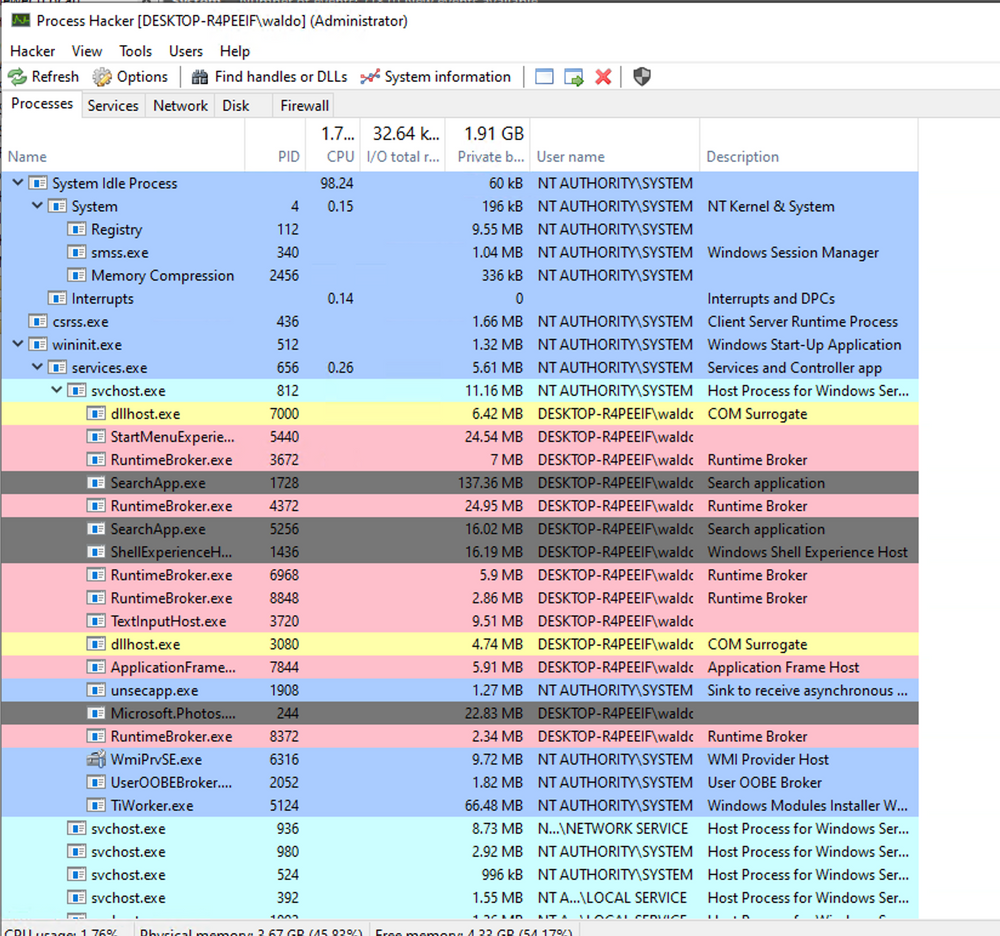

## 1. Détecter les relations parent-enfant étranges

### Analyser les relations parent-enfant

Sous Windows, les processus présentent généralement des relations parent/enfant cohérentes avec leur fonction.

Une relation inhabituelle peut révéler une activité malveillante.

Exemples du cours :

```
calc.exe
   └── cmd.exe
```


```
spoolsv.exe
   └── whoami.exe
```


Ces relations sont suspectes, car une calculatrice ou un service d'impression n'a normalement pas vocation à lancer de telles commandes dans les scénarios présentés.


- Samir Bousseaden a partagé une carte mentale (mind map) pertinente présentant les relations parent-enfant courantes, qui peut être consultée [ici](https://twitter.com/SBousseaden/status/1195373669930983424).


*Carte : Samir Bousseaden ([@SBousseaden](https://twitter.com/SBousseaden/status/1195373669930983424)).*

### Process Hacker

Process Hacker permet de visualiser les processus actifs sous forme d'arborescence.



L'analyste peut notamment examiner :

- Parent Process : processus parent apparent.
- Child Process : processus enfant.
- Process ID (PID) : identifiant du processus.
- Process Hierarchy : organisation des processus.
- Command Line : arguments d'exécution, lorsqu'ils sont disponibles.

L'analyse doit tenir compte des comportements habituels de l'environnement.
