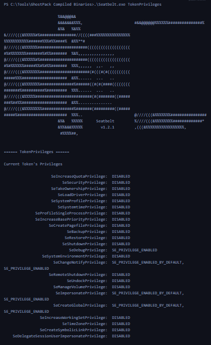

## 3. Détecter le chargement d'assemblages .NET malveillants

Cette seconde technique consiste à analyser les chargements de composants .NET afin d'identifier des exécutions suspectes, notamment celles réalisées directement en mémoire.

### Living off the Land — LotL

Le Living off the Land (LotL) consiste à utiliser des outils légitimes déjà présents sur le système pour effectuer des activités malveillantes.

Exemples :

- PowerShell ;
- outils natifs Windows ;
- composants d'administration.

Cette approche peut compliquer la détection, puisque les exécutables utilisés appartiennent à l'environnement légitime.

Cependant des contre-mesures face à cette stratégie ont été mises en place, ce qui complique son usage, les attaquants ont développé de nouvelles approches que Mandiant qualifie de BYOL.

### Bring Your Own Land — BYOL

Le cours présente l'approche Bring Your Own Land (BYOL), notamment décrite par Mandiant.

Plutôt que de s'appuyer exclusivement sur les outils natifs, les attaquants peuvent introduire leurs propres outils, par exemple des assemblages .NET développés en C#.

Ces assemblages peuvent être chargés et exécutés directement en mémoire.

### Pourquoi .NET ?

Le cours met en avant plusieurs caractéristiques :

| Caractéristique               | Intérêt                                                                                                                                                                                                                                  |
| ----------------------------- | ---------------------------------------------------------------------------------------------------------------------------------------------------------------------------------------------------------------------------------------- |
| Common Language Runtime (CLR) | Permet l'exécution de code managé                                                                                                                                                                                                        |
| Memory Management             | Fournit notamment le Garbage Collection                                                                                                                                                                                                  |
| In-Memory Assembly Loading    | Permet de charger des assemblages sans nécessairement écrire leur fichier sur disque                                                                                                                                                     |
| .NET Libraries                | Fournissent des fonctionnalités HTTP, cryptographiques et IPC. Ces outils pré-construits rationalisent le processus de développement, réduisent la probabilité d'erreurs et facilitent la création d'applications robustes et efficaces. |
| Windows Integration           | Les composants .NET sont présents dans de nombreux environnements Windows. Chaque système Windows est équipé par défaut d'une certaine version de .NET pré-installée.                                                                    |

L'exécution en mémoire peut réduire certains artefacts sur disque et compliquer les détections reposant exclusivement sur l'analyse des fichiers.

Elle ne rend cependant pas le code invisible aux outils de sécurité.

### Exemple — Cobalt Strike execute-assembly

Le cours cite la commande ["execute-assembly"](https://www.cobaltstrike.com/blog/cobalt-strike-3-11-the-snake-that-eats-its-tail/) de Cobalt Strike.

Elle permet d'exécuter des assemblages .NET en mémoire, une capacité utilisée notamment dans les opérations Red Team et dans certaines attaques.

Ceci est réalisé en examinant de près l'activité liée au chargement des [DLL associées à .NET](https://redhead0ntherun.medium.com/detecting-net-c-injection-execute-assembly-1894dbb04ff7), en particulier `clr.dll` et `mscoree.dll`.

## 4. Détection avec Sysmon Event ID 7

Le premier niveau de détection consiste à surveiller le chargement de DLL associées à l'environnement .NET.

Ce type de comportement de chargement de DLL peut souvent être détecté en exploitant l'ID d'événement 7 de Sysmon, qui correspond aux événements "Image Loaded" (Image chargée).

### DLL importantes

- `clr.dll` : composant du Common Language Runtime.
- `clrjit.dll` : composant de compilation Just-In-Time.
- `mscoree.dll` : composant associé à l'initialisation et à l'hébergement du runtime .NET Framework.

Sysmon Event ID 7 — Image Loaded permet d'identifier le chargement de ces DLL lorsqu'il est configuré pour les enregistrer.

### Scénario du lab — Seatbelt

Le cours utilise  [Seatbelt](https://github.com/GhostPack/Seatbelt), un outil .NET du projet GhostPack permettant d'énumérer diverses informations du système.

Commande de démonstration :

```
.\Seatbelt.exe TokenPrivileges
```


Cette commande affiche les privilèges du token associé au processus, notamment :

`SeDebugPrivilege`, `SeImpersonatePrivilege`, `SeBackupPrivilege`, etc., accompagnés de leur état.



Dans le lab, l'exécution de `Seatbelt.exe` entraîne le chargement de bibliothèques .NET observables via Sysmon Event ID 7.

En supposant que Sysmon est configuré de manière appropriée pour journaliser les événements de chargement d'image (ID d'événement 7), l'exécution de 'Seatbelt.exe' déclencherait le chargement de DLL clés liées à .NET telles que 'clr.dll' et 'mscoree.dll'.


### Limites de Sysmon

Sysmon permet de savoir quelles DLL ont été chargées et par quel processus, mais deux limites sont soulignées :

1. High Event Volume : l'Event ID 7 peut générer de très nombreux événements.
2. Limited Assembly Visibility : le chargement de `clr.dll` ne révèle pas directement les détails de l'assemblage .NET exécuté.

Par ailleurs, l'exemple Seatbelt est exécuté depuis le disque, même si la technique étudiée peut également concerner des assemblages chargés uniquement en mémoire.
