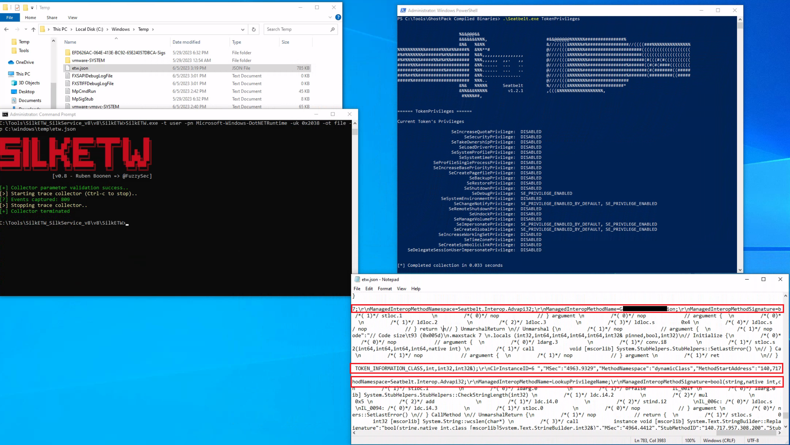

## 5. Détection avancée avec Microsoft-Windows-DotNETRuntime

Pour obtenir des informations plus précises, le cours utilise le fournisseur ETW :

`Microsoft-Windows-DotNETRuntime`

Ce provider permet d'observer différentes activités du runtime .NET, notamment le chargement des assemblages et certaines opérations de compilation.

### Collecte avec SilkETW

Utilisons SilkETW pour collecter des données auprès du fournisseur `Microsoft-Windows-DotNETRuntime`.

```
SilkETW.exe -t user -pn Microsoft-Windows-DotNETRuntime -uk 0x2038 -ot file -p C:\Windows\Temp\etw.json
```


Cette commande collecte un sous-ensemble d'événements du fournisseur .NET et les écrit dans `etw.json`.

Le paramètre :

`-uk 0x2038`

sélectionne les catégories d'événements correspondant aux ETW Keywords suivants.

### Mots-clés ETW (keywords)

| Keyword        | Fonction                                                                    | Intérêt Threat Hunting                                                                                                         |
| -------------- | --------------------------------------------------------------------------- | ------------------------------------------------------------------------------------------------------------------------------ |
| JitKeyword     | Événements liés à la compilation Just-In-Time                               | Examiner certaines méthodes compilées pendant l'exécution, utile pour comprendre le flux d'exécution de l'assemblage .NET.     |
| InteropKeyword | Interactions entre code managé et non managé                                | Pourraient fournir des informations sur les interactions potentielles avec des API natives ou d'autres composants non managés. |
| LoaderKeyword  | Détails sur le processus de chargement d'assemblage au sein du runtime .NET | Identifier les assemblages chargés et potentiellement exécutés.                                                                |
| NGenKeyword    | Activités liées aux images natives précompilées                             | Examiner l'utilisation de composants .NET précompilés                                                                          |

Le filtrage par keywords permet de cibler les événements pertinents sans collecter systématiquement l'intégralité de la télémétrie du provider.

Cet [article de blog](https://medium.com/threat-hunters-forge/threat-hunting-with-etw-events-and-helk-part-1-installing-silketw-6eb74815e4a0) offre des perspectives précieuses sur SilkETW ainsi que sur l'identification de logiciels malveillants basés sur .NET.

### Résultat du lab

Ensuite, nous pouvons procéder à une nouvelle simulation de l'attaque pour évaluer si ETW peut nous fournir des renseignements plus détaillés et exploitables concernant le chargement et l'exécution de l'assemblage .NET 'Seatbelt'.

Après avoir exécuté Seatbelt et collecté les événements ETW, le fichier `etw.json` (qui inclut les données du fournisseur `Microsoft-Windows-DotNETRuntime`) contient davantage d'informations sur l'assemblage chargé, notamment des noms de méthodes.



Cette visibilité est plus détaillée qu'un simple événement Sysmon signalant le chargement de `clr.dll`.

```
Seatbelt.exe Execution
          ↓
.NET Runtime Initialization
          ↓
Sysmon Event ID 7
 → CLR DLL Loading
          ↓
Microsoft-Windows-DotNETRuntime
 → Assembly Loading
 → JIT / Method Information
          ↓
Detailed .NET Investigation
```


Précision : les informations disponibles dépendent des keywords activés, des événements effectivement émis et du comportement de compilation du runtime. Tous les appels de méthodes ne sont pas nécessairement enregistrés.

## 6. Sysmon ou ETW — comparaison des détections

| Scénario                | Sysmon                                                          | ETW                                                                          |
| ----------------------- | --------------------------------------------------------------- | ---------------------------------------------------------------------------- |
| PPID Spoofing           | Event ID 1 : relation parent/enfant apparente                   | `Kernel-Process` : informations supplémentaires sur la création du processus |
| .NET Assembly Execution | Event ID 7 : chargement de DLL comme `clr.dll`                  | `DotNETRuntime` : détails sur les assemblages, chargements et méthodes       |
| Type de visibilité      | Événements prédéfinis                                           | Télémétrie spécialisée selon le provider                                     |
| Limite principale       | Certaines informations peuvent être insuffisantes ou trompeuses | Nécessite une collecte et des filtres adaptés                                |

## 7. Démarche de threat hunting avec ETW

```
Suspicious Activity
        ↓
Identify Sysmon Evidence
        ↓
Determine Telemetry Limitations
        ↓
Select Relevant ETW Provider
        ↓
Collect Events with SilkETW
        ↓
Analyze JSON Output
        ↓
Correlate Sysmon & ETW
        ↓
Validate Hunting Hypothesis
```


Les deux scénarios montrent que Sysmon et ETW sont complémentaires.

Sysmon constitue une excellente source pour rechercher rapidement des événements comme les créations de processus ou les chargements de DLL. ETW permet ensuite d'approfondir l'investigation avec des informations plus spécialisées.

La leçon centrale est de ne pas limiter une investigation aux événements Sysmon lorsqu'ils ne suffisent pas à expliquer le comportement observé : une collecte ETW ciblée peut révéler des détails déterminants sur l'origine réelle d'un processus ou l'exécution d'un assemblage .NET.

Source des captures : [Hack The Box Academy - Windows Event Logs & Finding Evil](https://academy.hackthebox.com/app/module/216)
