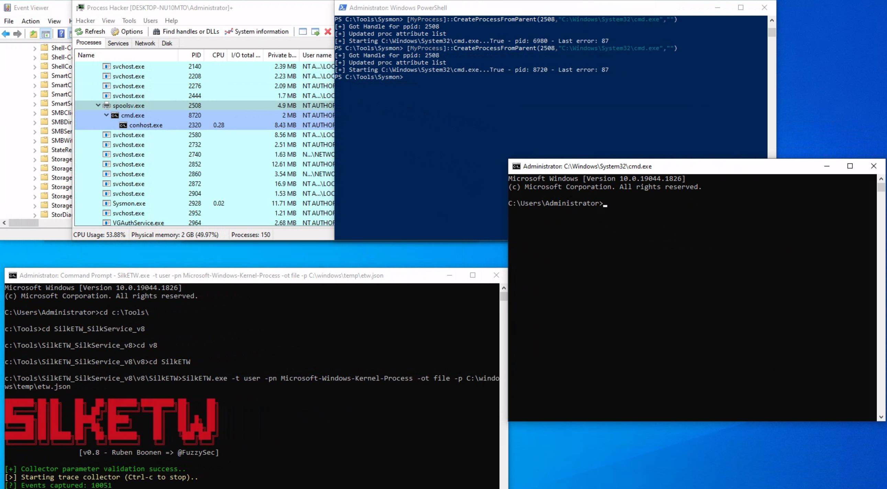

## 2. Usurpation du processus parent (PPID spoofing)

Le Parent PID Spoofing est une technique permettant de faire apparaître un processus sous un parent différent de celui qui a réellement initié sa création.

Elle peut être utilisée pour tromper certaines analyses fondées sur les relations parent/enfant.

### Scénario du lab — PowerShell / spoolsv.exe / cmd.exe

Le cours utilise l'outil psgetsystem pour simuler une création de processus avec un parent apparent falsifié. https://github.com/decoder-it/psgetsystem

Le scénario consiste à lancer `cmd.exe` depuis PowerShell, tout en lui attribuant `spoolsv.exe` comme parent apparent.

La commande de démonstration utilise notamment :

```
powershell -ep bypass
Import-Module .\psgetsys.ps1
[MyProcess]::CreateProcessFromParent(
    [Process ID of spoolsv.exe],
    "C:\Windows\System32\cmd.exe",
    ""
)
```


### Sysmon Event ID 1 — création de processus

Dans le lab, Sysmon enregistre la relation suivante :

```
spoolsv.exe
     └── cmd.exe
```


Cependant, le processus ayant réellement initié la création est `powershell.exe`.

L'Event ID 1 peut donc présenter une relation parent/enfant trompeuse lorsque le PPID a été manipulé.

Sysmon et les journaux d'événements fournissent une télémétrie précieuse pour la chasse aux menaces (threat hunting) et la création de règles d'alerte, ils ne sont pas les seules sources d'information.

### Investigation avec ETW

Pour approfondir l'analyse, le cours utilise le fournisseur :

`Microsoft-Windows-Kernel-Process`

Ce provider peut fournir des informations supplémentaires sur la création des processus.

La collecte s'effectue avec [SilkETW](https://github.com/mandiant/SilkETW), outil permettant de consommer les événements ETW et de les exporter.

```
SilkETW.exe -t user -pn Microsoft-Windows-Kernel-Process -ot file -p C:\Windows\Temp\etw.json
```


| Paramètre  | Fonction                                |
| ---------- | --------------------------------------- |
| `-t user`  | Type de session ETW utilisé par SilkETW |
| `-pn`      | Nom du fournisseur ETW                  |
| `-ot file` | Écriture dans un fichier                |
| `-p`       | Chemin du fichier de sortie             |



Après une nouvelle simulation, le fichier `etw.json` (qui inclut les données du fournisseur `Microsoft-Windows-Kernel-Process`) permet de retrouver des informations indiquant que `powershell.exe` est à l'origine de la création de `cmd.exe`.


```
              Process Creation
                      ↓
         ┌────────────┴────────────┐
         ↓                         ↓
 Sysmon Event ID 1             ETW Telemetry
         ↓                         ↓
spoolsv.exe → cmd.exe       powershell.exe initiates
                            cmd.exe creation
         └────────────┬────────────┘
                      ↓
           Potential PPID Spoofing
```


Point important : les champs indiquant le parent apparent et le processus créateur ne représentent pas nécessairement la même information.

Dans cet exemple, ETW fournit un contexte supplémentaire permettant de mettre en évidence cette différence. Cela ne garantit pas que toutes les formes de PPID Spoofing seront détectées automatiquement.

Le cours précise également que les événements collectés par SilkETW peuvent être intégrés aux Windows Event Logs via SilkService.
