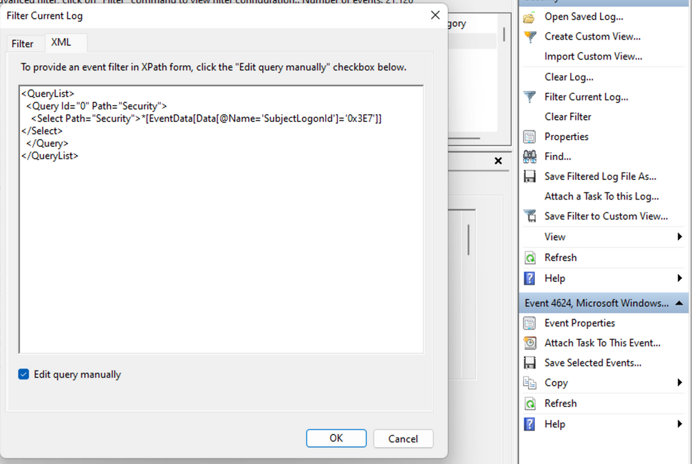
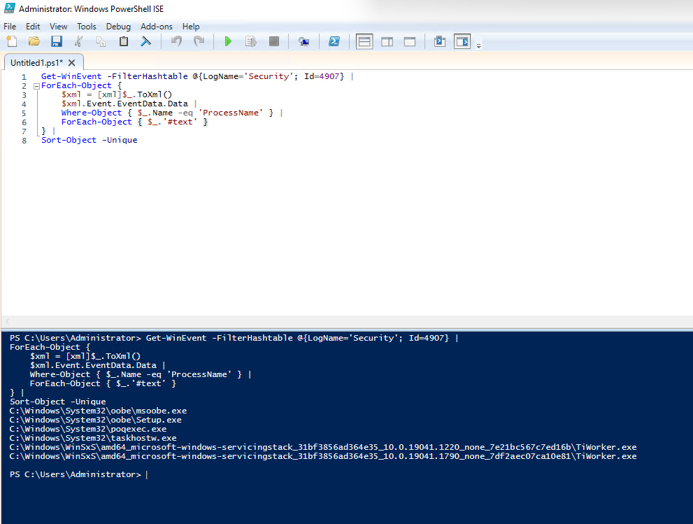
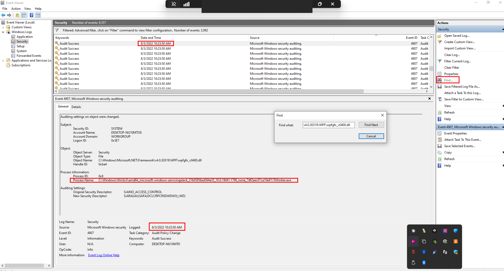

Analyse du journal Security d'une machine HTB dans l'Observateur d'événements : partir d'un 4624, relever le Logon ID de la session, puis retrouver ses autres événements avec des requêtes XML. Les gabarits de requêtes sont dans la cheat sheet [Requêtes XML de l'Observateur](/cheatsheets/windows/fondamentaux/logs/requetes-xml/).

## Question 1 — Le processus qui a modifié les paramètres d'audit

**Énoncé HTB Academy.** À partir de l'événement 4624 du 3 août 2022 à 10:23:25, retrouver l'exécutable qui a modifié les paramètres d'audit (format de réponse : `T_W_____.exe`).

1. Dans le journal `Security`, filtrer sur l'Event ID `4624` et retrouver l'événement à l'heure indiquée.

    

2. Dans ses détails, relever le `TargetLogonId` : ici `0x3e7`.

    

3. Filtrer les événements `4907` de cette session dans une fenêtre de 30 minutes avec une requête XML :

```xml
<QueryList>
  <Query Id="0" Path="Security">
    <Select Path="Security">
      *[
        System[
          (EventID=4907)
          and TimeCreated[
            @SystemTime&gt;='2022-08-03T17:00:00.000Z'
            and @SystemTime&lt;='2022-08-03T17:30:00.999Z'
          ]
        ]
        and EventData[
          Data[@Name='SubjectLogonId']='0x3e7'
        ]
      ]
    </Select>
  </Query>
</QueryList>
```


`Path` choisit le journal `Security` ; `System` limite l'Event ID et l'heure (en UTC) ; `EventData` compare le `SubjectLogonId` au `TargetLogonId` relevé dans le 4624.



4. Lire le champ `ProcessName` dans l'événement `4907` retenu.

    

En complément, cette commande liste les `ProcessName` de tous les événements `4907` ; elle ne reprend ni la fenêtre horaire ni le Logon ID du filtre XML.

```powershell
Get-WinEvent -FilterHashtable @{LogName='Security'; Id=4907} |
ForEach-Object {
    $xml = [xml]$_.ToXml()
    $xml.Event.EventData.Data |
    Where-Object { $_.Name -eq 'ProcessName' } |
    ForEach-Object { $_.'#text' }
} |
Sort-Object -Unique
```




## Question 2 — L'audit d'une DLL précise a-t-il été modifié ?

**Énoncé HTB Academy.** Vérifier si l'exécutable précédent a modifié l'audit de `C:\Windows\Microsoft.NET\Framework64\v4.0.30319\WPF\wpfgfx_v0400.dll`, puis relever l'heure de l'événement au format `HH:MM:SS`.

1. Utiliser **Find** pour repérer la DLL, puis comparer le `ProcessName` à celui trouvé dans la question 1.



2. Filtrer directement les événements `4907` sur le chemin exact de la DLL :

```xml
<QueryList>
  <Query Id="0" Path="Security">
    <Select Path="Security">
      *[
        System[EventID=4907]
        and
        EventData[
          Data[@Name='ObjectName']='C:\Windows\Microsoft.NET\Framework64\v4.0.30319\WPF\wpfgfx_v0400.dll'
        ]
      ]
    </Select>
  </Query>
</QueryList>
```


`System` sélectionne l'Event ID `4907` ; `EventData` limite les résultats à `ObjectName`, le chemin de la DLL. Dans l'événement trouvé, vérifier `ProcessName` et lire l'heure affichée.


