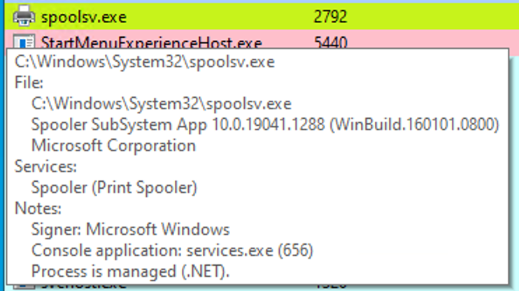

Du code PowerShell ou C# est injecté dans un processus qui n'utilise normalement pas .NET : le runtime .NET (CLR) s'y charge alors de façon inattendue. Cette fiche montre comment le repérer avec Process Hacker et les événements Sysmon `7`.

Installer et configurer Sysmon : [Sysmon et ETW](sysmon-et-etw/index.md). Détection voisine, un outil .NET lancé directement : [Repérer le chargement d'assemblies .NET](reperer-le-chargement-d-assemblies-net.md).

## En bref

| | |
|---|---|
| Technique | PowerShell non managé (Unmanaged PowerShell) / injection de code C# dans un processus |
| MITRE ATT&CK | [T1055 — Process Injection](https://attack.mitre.org/techniques/T1055/), [T1059.001 — PowerShell](https://attack.mitre.org/techniques/T1059/001/) |
| Journal | `Microsoft-Windows-Sysmon/Operational` |
| Événement | Sysmon `7` — chargement d'image (Image Loaded) |
| Indice clé | `clr.dll` / `clrjit.dll` chargées par un processus natif qui n'utilise pas .NET (ici `spoolsv.exe`) |

## Comprendre l'attaque

### Code managé et CLR

Le langage C# utilise généralement l'environnement d'exécution .NET, notamment le Common Language Runtime (CLR). Le code compilé est exécuté à travers cet environnement, avec des mécanismes de compilation Just-In-Time (JIT).

Deux DLL sont particulièrement importantes :

- `clr.dll` : composant du Common Language Runtime ;
- `clrjit.dll` : composant associé à la compilation JIT.

Leur présence est normale dans les processus qui utilisent .NET. Observées dans un processus qui n'en a normalement pas besoin, elles suggèrent une attaque [execute-assembly](https://www.cobaltstrike.com/blog/cobalt-strike-3-11-the-snake-that-eats-its-tail/) ou une [injection de PowerShell non managé](https://www.youtube.com/watch?v=7tvfb9poTKg&ab_channel=RaphaelMudge).

### Scénario du lab — injection dans spoolsv.exe

Une injection de code PowerShell dans `spoolsv.exe`, le processus Windows du Print Spooler, avec le projet PSInject (`Invoke-PSInject`), en ciblant le PID de `spoolsv.exe`.

```
powershell -ep bypass 
Set-Location "C:\Tools\PSInject"
Import-Module .\Invoke-PSInject.ps1
Invoke-PSInject -ProcId (Get-Process spoolsv).Id -PoshCode "V3JpdGUtSG9zdCAiSGVsbG8sIEd1cnU5OSEi"
```


## Les traces

### Process Hacker — repérer un processus managé

Process Hacker affiche les processus actifs ; un processus comme `powershell.exe` y apparaît comme Managed (.NET).


Dans `Process Hacker → Process Properties → Modules`, rechercher les modules :

```
clr.dll
clrjit.dll
```


La présence de « Microsoft .NET Runtime… », `clr.dll` et `clrjit.dll` signale le runtime .NET dans le processus : ces deux DLL servent à exécuter le bytecode du code C#.

### Avant et après l'injection

Avant l'injection, `spoolsv.exe` ne présente pas les caractéristiques d'un processus .NET managé.


Après l'injection :

- Process Hacker identifie `spoolsv.exe` comme utilisant .NET ;
- les modules associés au CLR deviennent observables ;
- Sysmon Event ID `7` enregistre le chargement de `clr.dll`.




## Les requêtes

**Un processus précis charge-t-il le CLR ?** La requête du lab : `spoolsv.exe` et `clr.dll`.

```xml
<QueryList>
  <Query Id="0" Path="Microsoft-Windows-Sysmon/Operational">
    <Select Path="Microsoft-Windows-Sysmon/Operational">
      *[
        System[EventID=7]
        and EventData[
          Data[@Name='Image']='C:\Windows\System32\spoolsv.exe'
          and Data[@Name='ImageLoaded']='C:\Windows\Microsoft.NET\Framework64\v4.0.30319\clr.dll'
        ]
      ]
    </Select>
  </Query>
</QueryList>
```


- `Image` : le processus ; `ImageLoaded` : la DLL chargée. Les deux conditions doivent être vraies ensemble (`and`).
- Pour `clrjit.dll`, remplacer la fin du chemin : `…\v4.0.30319\clrjit.dll`.
- `Hashes` de l'événement : l'empreinte `SHA256=…` de la DLL chargée.

Gabarits et pièges : cheat sheet [Requêtes XML de l'Observateur](/cheatsheets/windows/fondamentaux/logs/requetes-xml/).

## Les indicateurs

L'indicateur principal est le chargement inattendu du runtime .NET dans un processus qui ne l'utilise normalement pas.

```
spoolsv.exe
    ↓
Unexpected CLR Initialization
    ↓
clr.dll / clrjit.dll Loaded
    ↓
Sysmon Event ID 7
    ↓
Potential Code Injection
```


Cette piste de hunting peut révéler :

- des injections de code C# ;
- certains usages de PowerShell non managé ;
- certaines techniques d'exécution d'assemblages .NET dans un processus tiers.

## Les faux positifs

- Un processus natif peut légitimement héberger le CLR (consoles MMC, certains services et modules complémentaires).
- La présence de `clr.dll` se corrèle au contexte du processus, aux modules chargés et aux autres événements disponibles avant de conclure.
- Connaître les processus qui chargent habituellement le CLR sur le parc permet de repérer ceux qui s'en écartent.

## Pour s'entraîner

- Lab pas à pas : [Sysmon et ETW › Labs › Question 2 — PowerShell non managé : spoolsv.exe](sysmon-et-etw/04-labs/01-lab-2-analyser-avec-sysmon.md#question-2-powershell-non-manage-spoolsvexe).
- Event IDs Sysmon et requêtes SIEM : cheat sheet [Sysmon](/cheatsheets/windows/fondamentaux/logs/sysmon/).

Source des captures : [Hack The Box Academy - Windows Event Logs & Finding Evil](https://academy.hackthebox.com/app/module/216)
