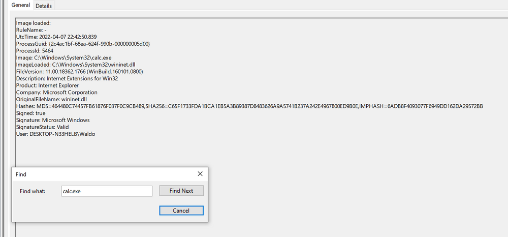

Un exécutable légitime charge une DLL placée à côté de lui à la place de celle de Windows. Les étapes ci-dessous vont du plus large au plus précis : chacune se teste, puis s'affine.

## En bref

| | |
|---|---|
| Technique | Détournement de l'ordre de recherche des DLL (DLL hijacking) |
| MITRE ATT&CK | [T1574.001 — Hijack Execution Flow : DLL](https://attack.mitre.org/techniques/T1574/001/) |
| Journal | `Microsoft-Windows-Sysmon/Operational` |
| Événement | Sysmon `7` — chargement d'image (Image Loaded) |
| Indice clé | DLL système chargée hors de `System32`, non signée, par un exécutable lui aussi hors de sa place |

## Le principe

- Un exécutable cherche d'abord ses DLL dans son propre dossier : une DLL du même nom posée à côté de lui passe avant celle de `System32`.
- Chaque chargement de DLL laisse un Sysmon `7`, si la collecte `ImageLoad` est activée ([Configurer la collecte (ImageLoad)](sysmon-et-etw/01-detecter-avec-sysmon/01-installer-et-configurer-sysmon.md#configurer-la-collecte-imageload)).

| Champ | Ce qu'il donne |
|---|---|
| `Image` | Le processus qui charge la DLL |
| `ImageLoaded` | Le chemin de la DLL chargée |
| `Signed` | `true` / `false` : DLL signée ou non |
| `Hashes` | L'empreinte de la DLL (`SHA256=…`) |

## Chercher, étape par étape

Sur un journal exporté : `Path = '<fichier>.evtx'`. Sur la machine elle-même : `LogName = 'Microsoft-Windows-Sysmon/Operational'` à la place de `Path`.

### 1. Garder les chargements de DLL

Observateur : *Filter Current Log…* → Event ID `7`.

```powershell
Get-WinEvent -FilterHashtable @{
    Path = '<fichier>.evtx'
    Id   = 7
} -MaxEvents 10 |
    Format-List TimeCreated, Message
```


### 2. Chercher une DLL précise

Observateur : *Find* sur le nom de la DLL.

```powershell
Get-WinEvent -FilterHashtable @{
    Path = '<fichier>.evtx'
    Id   = 7
} |
    Where-Object { $_.Message -like "*NOM_DLL.dll*" } |
    Format-List TimeCreated, Message
```


### 3. Réduire le bruit

Les DLL chargées depuis un dossier (ici `Temp`) :

```powershell
Get-WinEvent -FilterHashtable @{
    Path = '<fichier>.evtx'
    Id   = 7
} |
    Where-Object { $_.Message -like '*ImageLoaded:*Temp\*' } |
    Format-List TimeCreated, Message
```


Les DLL non signées, 20 premières :

```powershell
Get-WinEvent -FilterHashtable @{
    Path = '<fichier>.evtx'
    Id   = 7
} |
Where-Object { $_.Message -match 'Signed: false' } |
Select-Object -First 20 |
Format-List TimeCreated, Message
```


### 4. Compter les couples processus / DLL

```powershell
$events = Get-WinEvent -FilterHashtable @{
    Path = '<fichier>.evtx'
    Id   = 7
} | ForEach-Object {
    $data = ([xml]$_.ToXml()).Event.EventData.Data

    [pscustomobject]@{
        Image       = ($data | Where-Object Name -eq 'Image').'#text'
        ImageLoaded = ($data | Where-Object Name -eq 'ImageLoaded').'#text'
    }
}

$events |
    Group-Object Image, ImageLoaded |
    Sort-Object Count -Descending |
    Select-Object Count, Name
```


Le détail (processus distincts, DLL distinctes, `Group-Object`) : [Analyser un fichier .evtx : l'exemple du DLL hijacking](analyse-des-journaux-d-evenements-windows-event-logs/03-lire-et-filtrer-les-journaux.md#analyser-un-fichier-evtx-lexemple-du-dll-hijacking).

### 5. Cibler une DLL avec une requête XML

Observateur : *Filter Current Log…* → onglet **XML** → *Edit query manually*.

```xml
<QueryList>
  <Query Id="0" Path="Microsoft-Windows-Sysmon/Operational">
    <Select Path="Microsoft-Windows-Sysmon/Operational">
      *[
        System[EventID=7]
        and EventData[
          Data[@Name='ImageLoaded']='<chemin complet de la DLL>'
        ]
      ]
    </Select>
  </Query>
</QueryList>
```


Chemin exact, copié depuis la vue XML d'un événement : l'égalité est stricte. Gabarits : cheat sheet [Requêtes XML de l'Observateur](/cheatsheets/windows/fondamentaux/logs/requetes-xml/).

## Ce qui doit alerter

- Un exécutable système qui tourne hors de `System32`, depuis un dossier modifiable.
- Une DLL au nom de DLL Windows chargée hors de `System32`.
- Une DLL non signée là où l'originale est signée par Microsoft.

## À ne pas confondre

- `Image` est le processus qui charge la DLL, pas son parent.
- Logiciels tiers et applications portables chargent souvent leurs propres DLL non signées : un indice seul ne suffit pas, les trois ensemble oui.
- En production, Sysmon `7` est souvent restreint : le chargement cherché peut ne pas avoir été journalisé.

## Cas concret

<details markdown="1">
<summary>Lab HTB : calc.exe copié sur le bureau charge une fausse WININET.dll</summary>

`calc.exe` est copié de `System32` vers le bureau, avec une DLL de démonstration renommée `WININET.dll`. Au lancement, la fausse DLL est chargée et affiche une MessageBox à la place de la Calculatrice.


Sysmon `7` filtré, puis *Find* sur `calc.exe` : la copie détournée, puis le chargement légitime pour comparer.




| Critère | Chargement légitime | Chargement suspect du lab |
|---|---|---|
| Exécutable | `calc.exe` dans `System32` | `calc.exe` copié sur le bureau |
| DLL | `wininet.dll` depuis `System32` | `WININET.dll` depuis le bureau |
| Signature | DLL Microsoft signée | DLL non signée |

Lab pas à pas : [Sysmon et ETW › Labs › Question 1](sysmon-et-etw/04-labs/01-lab-2-analyser-avec-sysmon.md#question-1-dll-hijacking-wininetdll). Ressources : [HijackLibs — calc.exe](https://hijacklibs.net/#calc.exe), [ReflectiveDLLInjection](https://github.com/stephenfewer/ReflectiveDLLInjection/tree/master/bin).

</details>

Source des captures : [Hack The Box Academy - Windows Event Logs & Finding Evil](https://academy.hackthebox.com/app/module/216)
