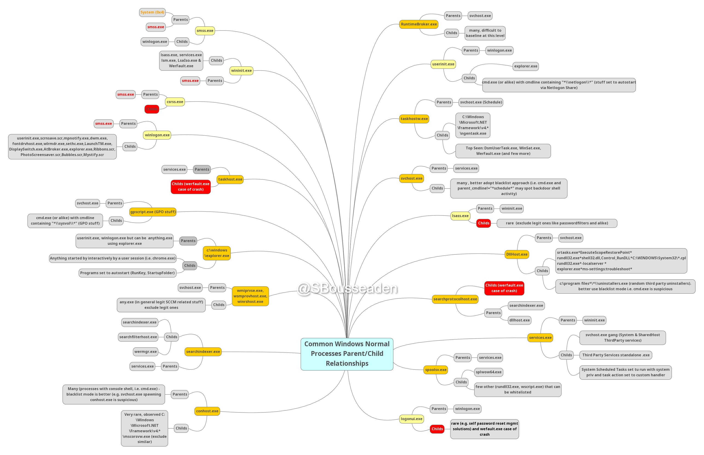

Sous Windows, chaque processus a des parents et des enfants attendus : une calculatrice ou un service d'impression ne lance pas d'invite de commandes. Cette fiche montre comment repérer une filiation anormale dans Process Hacker et dans les événements Sysmon `1`.

Quand le parent affiché est lui-même falsifié : [Démasquer un faux processus parent (PPID spoofing)](demasquer-un-faux-processus-parent-ppid-spoofing.md).

## En bref

| | |
|---|---|
| Technique | Pas une technique à elle seule : un signal commun à beaucoup d'entre elles (exécution de commandes, injection, exploitation d'un service) |
| MITRE ATT&CK | Voir par exemple [T1059 — Command and Scripting Interpreter](https://attack.mitre.org/techniques/T1059/) |
| Journal | `Microsoft-Windows-Sysmon/Operational` (ou Security `4688` si l'audit des créations de processus est actif) |
| Événement | Sysmon `1` — création de processus (champs `Image`, `ParentImage`, `CommandLine`) |
| Indice clé | Un parent qui n'a pas vocation à lancer cet enfant : `calc.exe` → `cmd.exe`, `spoolsv.exe` → `whoami.exe` |

## Comprendre l'attaque

Les processus Windows présentent des relations parent/enfant cohérentes avec leur fonction. Une relation inhabituelle peut révéler une activité malveillante, par exemple :

```
calc.exe
   └── cmd.exe
```


```
spoolsv.exe
   └── whoami.exe
```


Ces relations sont suspectes : une calculatrice ou un service d'impression n'a pas vocation à lancer de telles commandes.


Samir Bousseaden a partagé une carte mentale des relations parent-enfant courantes, consultable [ici](https://twitter.com/SBousseaden/status/1195373669930983424).



*Carte : Samir Bousseaden ([@SBousseaden](https://twitter.com/SBousseaden/status/1195373669930983424)).*

## Les traces

### Process Hacker

Process Hacker affiche les processus actifs sous forme d'arborescence.


À examiner :

- Parent Process : processus parent apparent ;
- Child Process : processus enfant ;
- Process ID (PID) : identifiant du processus ;
- Process Hierarchy : organisation des processus ;
- Command Line : arguments d'exécution, lorsqu'ils sont disponibles.

### Sysmon Event ID 1 — création de processus

Après coup, la filiation se lit dans l'Event ID 1 : `Image` (l'enfant), `ParentImage` (le parent), `CommandLine` et `ParentCommandLine`, `User`.

## Les requêtes

Pas de requête dédiée dans le module : la filiation se lit dans l'arborescence de Process Hacker, ou dans `Microsoft-Windows-Sysmon/Operational` en filtrant l'Event ID `1` (*Filter Current Log…*) puis *Find* sur le parent suspect.

- Dans chaque événement, `ParentImage` donne le parent, `Image` l'enfant et `CommandLine` ce qu'il a exécuté.
- Comparer avec la carte des relations habituelles : `spoolsv.exe` → `conhost.exe` est attendu, `spoolsv.exe` → `whoami.exe` ne l'est pas.

Gabarits et pièges du XML : cheat sheet [Requêtes XML de l'Observateur](/cheatsheets/windows/fondamentaux/logs/requetes-xml/).

## Les indicateurs

- Un service ou une application sans rapport (`spoolsv.exe`, `calc.exe`, un navigateur, une suite bureautique) qui lance `cmd.exe`, `powershell.exe` ou des commandes de reconnaissance (`whoami.exe`, `net.exe`…).
- Une filiation qui sort de la carte des relations habituelles.
- Une ligne de commande inhabituelle pour l'enfant, ou un enfant lancé depuis un dossier utilisateur.

## Les faux positifs

- L'analyse tient compte des comportements habituels de l'environnement : outils d'administration, scripts de déploiement et logiciels métier créent des filiations propres à chaque parc.
- Le parent affiché peut être faux : voir [Démasquer un faux processus parent (PPID spoofing)](demasquer-un-faux-processus-parent-ppid-spoofing.md).

## Pour s'entraîner

- Le module HTB n'a pas de question de lab dédiée.
- Event IDs Sysmon et requêtes SIEM : cheat sheet [Sysmon](/cheatsheets/windows/fondamentaux/logs/sysmon/).

Source des captures : [Hack The Box Academy - Windows Event Logs & Finding Evil](https://academy.hackthebox.com/app/module/216)
