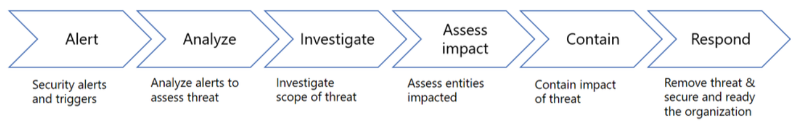

Dans un SOC (Security Operations Center), la réponse aux incidents doit suivre des procédures prédéfinies afin de garantir des investigations cohérentes, reproductibles et efficaces, même en situation de crise.

L'objectif est de détecter, analyser, investiguer, évaluer, contenir et traiter les incidents de sécurité.

Six étapes :

```
Alert → Analysis → Investigation
                      ↓
              Impact Assessment
                      ↓
                 Containment
                      ↓
                   Response
```


## 1. Alert — Génération d'une alerte

Les outils de sécurité collectent et analysent les activités des systèmes et réseaux.

Sources mentionnées :

- EDR : activités suspectes sur les endpoints.
    
- IDS/IPS : détection de tentatives d'attaque réseau.
    
- WAF : activités suspectes ciblant les applications web.
    
- SIEM : centralisation et corrélation des événements.
    

Le SIEM utilise des Correlation Rules pour identifier certaines activités suspectes et générer des alertes.

Security Alert ≠ Confirmed Incident : une alerte nécessite une analyse avant d'être considérée comme un incident réel.

## 2. Analysis — Initial Triage

Dans l'organisation SOC présentée, l'analyste Tier 1 (L1) réalise l'analyse préliminaire des alertes.

Ses responsabilités :

- Examiner l'alerte et son contexte.
    
- Vérifier les événements ayant déclenché la détection.
    
- Identifier les False Positives.
    
- Déterminer si une investigation approfondie est nécessaire.
    

### Exemple — Suspicious URL

Une alerte est déclenchée lorsqu'un utilisateur tente d'accéder à une URL classée malveillante.

Après vérification, l'analyste constate que l'URL n'est pas réellement malveillante : l'alerte constitue un False Positive.

Le triage permet ainsi d'éviter des investigations inutiles et de concentrer les ressources sur les alertes pertinentes.

## 3. Investigation

Lorsqu'une alerte n'est pas écartée pendant le triage, une investigation approfondie est engagée.

Objectifs :

- Identifier l'origine de l'activité suspecte.
    
- Comprendre comment l'attaque a commencé.
    
- Reconstituer la progression de l'attaquant.
    
- Examiner les événements associés à la menace.
    

L'investigation cherche à établir une Attack Timeline permettant de comprendre le déroulement de l'incident.

```
Initial Activity
      ↓
Attacker Actions
      ↓
Attack Progression
      ↓
Current Situation
```


Les résultats servent à déterminer quels systèmes et activités doivent être examinés en priorité.

## 4. Impact Assessment — Évaluation de l'impact

Cette étape consiste à identifier les systèmes affectés et à mesurer les dommages causés par l'attaque.

Points à déterminer :

- Affected Assets : quels systèmes sont concernés ?
    
- Attack Scope : quelle est l'étendue de l'incident ?
    
- Damage Assessment : quels dommages ont déjà été causés ?
    
- Current State : quelle est la situation au moment de l'investigation ?
    

### Exemple — Ransomware

Un ransomware a compromis un serveur, mais tous les fichiers n'ont pas nécessairement été chiffrés.

L'équipe doit identifier précisément :

- les systèmes compromis ;
    
- les données effectivement affectées ;
    
- l'étendue des dommages.
    

Cette évaluation permet d'adapter les actions de réponse à la gravité réelle de la situation.

## 5. Containment — Confinement

Le Containment vise à maîtriser l'incident et à empêcher sa propagation vers d'autres systèmes.

Action principale : Network Isolation.

### Exemple — Ransomware Propagation

Un endpoint compromis par un ransomware pourrait tenter d'atteindre d'autres machines du réseau.

```
Compromised Endpoint
        ↓
Potential Network Propagation
        ↓
Network Isolation
        ↓
Limit Further Spread
```


L'isolation du système limite ses communications avec les autres appareils du réseau.

L'objectif est de stopper ou limiter la progression de la menace avant de poursuivre les opérations de traitement.

## 6. Response — Traitement de l'incident

Après les étapes d'analyse, d'investigation, d'évaluation de l'impact et de confinement, la phase Response regroupe les opérations destinées à résoudre l'incident.

Elles comprennent :

- Root Cause Analysis : identifier la cause racine de la compromission.
    
- Eradication : éliminer les composants et activités malveillants.
    
- Recovery : remettre les systèmes en état de fonctionnement.
    
- Lessons Learned : tirer les enseignements de l'incident afin d'améliorer les procédures et défenses.
    

La phase de Response ne se limite donc pas au blocage de la menace : elle vise également à traiter sa cause et à rétablir les opérations.

## Correspondance avec l'Incident Response Plan

|Procédure SOC|Phase du plan IR|
|---|---|
|Alert / Analysis|Identification|
|Investigation / Impact Assessment|Identification et Scoping|
|Containment|Confinement|
|Response|Éradication, Recovery et Lessons Learned|

La procédure SOC décrit le traitement opérationnel d'une alerte jusqu'à la résolution de l'incident, tandis que le plan de réponse à incident définit le cadre organisationnel et les phases générales.

L'enchaînement central de cette section est : détecter une activité suspecte → éliminer les False Positives → investiguer → mesurer l'impact → contenir la menace → traiter et clôturer l'incident.
