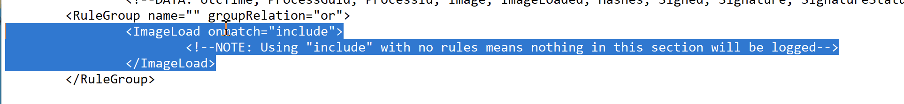

## 1. Les bases de Sysmon

Sysmon (System Monitor) est un outil Microsoft Sysinternals qui surveille les activités Windows et les enregistre dans les journaux d'événements.

Il complète les Windows Event Logs natifs en fournissant une télémétrie plus détaillée.

### Architecture de Sysmon

Sysmon repose sur trois composants :

- Windows Service : assure la surveillance des activités système.
- Device Driver : participe à la collecte des événements.
- Event Log : stocke les événements capturés pour leur analyse.

Le service et son driver restent actifs après un redémarrage lorsque Sysmon est installé et configuré pour fonctionner automatiquement.

### Journaux Windows natifs ou Sysmon

| Événement | Source           | Utilisation                             |
| --------- | ---------------- | --------------------------------------- |
| 4624      | Windows Security | Successful Logon                        |
| 4688      | Windows Security | Process Creation                        |
| 1         | Sysmon           | Process Creation avec contexte détaillé |
| 3         | Sysmon           | Network Connection                      |
| 7         | Sysmon           | Image / DLL Loaded                      |
| 10        | Sysmon           | ProcessAccess                           |

Dans cette section, les détections reposent principalement sur Sysmon Event ID 7 et Sysmon Event ID 10.

### Installation de Sysmon
https://learn.microsoft.com/en-us/sysinternals/downloads/sysmon

Depuis un terminal administrateur :

```
sysmon.exe -i -accepteula -h md5,sha256,imphash -l -n
```


Pour appliquer ensuite un fichier XML de configuration :

```
sysmon.exe -c filename.xml
```


### Configuration XML de Sysmon

Sysmon utilise un fichier XML pour définir quels événements enregistrer ou exclure selon leurs attributs : processus, chemin, adresse IP, type d'événement, etc.

Deux configurations communautaires sont citées :

- [SwiftOnSecurity — Sysmon Config](https://github.com/SwiftOnSecurity/sysmon-config?utm_source=chatgpt.com) : utilisée dans le lab.
- [Sysmon Modular](https://github.com/olafhartong/sysmon-modular?utm_source=chatgpt.com) : approche modulaire.

Précision : Sysmon est un outil de collecte et de surveillance, pas une solution EDR complète avec toutes les fonctionnalités de réponse.

## Configurer la collecte (ImageLoad)

Dans la configuration SwiftOnSecurity, on modifie le comportement de `ImageLoad` pour enregistrer tous les chargements :



```
<ImageLoad onmatch="exclude">
</ImageLoad>
```


Avec aucune condition d'exclusion, ce réglage permet de journaliser tous les événements de cette catégorie.

À l'inverse, `onmatch="include"` sans condition d'inclusion ne sélectionne aucun événement.

Appliquer la configuration :

```
sysmon.exe -c sysmonconfig-export.xml
```


Puis consulter :

`Event Viewer → Applications and Services Logs → Microsoft → Windows → Sysmon → Operational`


Attention : l'Event ID 7 peut générer un volume de logs important. En production, une sélection adaptée des événements est généralement préférable.
