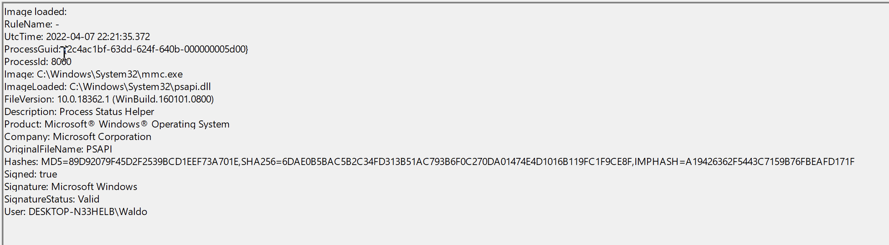
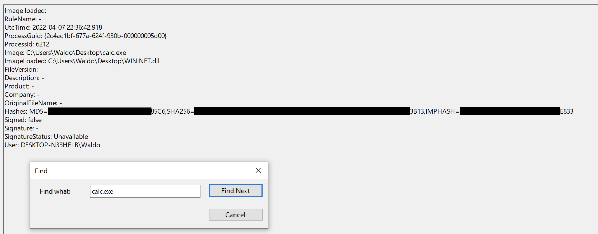

## 2. Détection n° 1 — DLL hijacking

Le DLL Hijacking consiste à exploiter le mécanisme de recherche et de chargement des DLL de Windows pour faire charger une bibliothèque contrôlée par l'attaquant à la place de celle attendue.

### Sysmon Event ID 7 — chargement d'image (Image Loaded)

L'Event ID `7` enregistre les chargements de modules, notamment de DLL.

Les champs utiles comprennent :

| Champ       | Description                                 |
| ----------- | ------------------------------------------- |
| Image       | Chemin du processus qui charge la DLL       |
| ImageLoaded | Chemin de la DLL chargée                    |
| ProcessId   | PID du processus                            |
| Signed      | Indication de signature numérique de la DLL |
| Signature   | Informations sur le signataire              |
| User        | Compte associé au processus                 |

Exemple légitime :

```
Image        : C:\Windows\System32\mmc.exe
ImageLoaded  : C:\Windows\System32\psapi.dll
Signed       : true
```




L'événement indique que `mmc.exe` a chargé `psapi.dll`, signée par Microsoft.

La collecte des Event ID 7 doit être activée dans la configuration Sysmon : voir [Configurer la collecte (ImageLoad)](01-installer-et-configurer-sysmon.md#configurer-la-collecte-imageload).

### Scénario du lab — calc.exe / WININET.dll

Exemple de détournement impliquant :

- `calc.exe`, un exécutable Windows légitime ;
- `WININET.dll`, une bibliothèque normalement fournie par Windows ;
- une DLL de démonstration renommée `WININET.dll`.

Ressources :

- [Sysmon](https://learn.microsoft.com/en-us/sysinternals/downloads/sysmon) (Sysinternals) ;
- [HijackLibs — calc.exe](https://hijacklibs.net/#calc.exe) : les DLL qu'un exécutable peut charger depuis son propre dossier ;
- [ReflectiveDLLInjection](https://github.com/stephenfewer/ReflectiveDLLInjection/tree/master/bin) : la DLL de démonstration du lab.

En suivant les étapes requises, qui impliquent de renommer `reflective_dll.x64.dll` en `WININET.dll`, de déplacer `calc.exe` de `C:\Windows\System32` avec `WININET.dll` vers un répertoire accessible en écriture (comme le dossier `Desktop`), et d'exécuter `calc.exe`, nous réussissons. Au lieu de l'application Calculatrice, une [MessageBox](https://learn.microsoft.com/en-us/windows/win32/api/winuser/nf-winuser-messageboxa) s'affiche.


Dans le lab, `calc.exe` est copié depuis `System32` vers le bureau, avec la DLL de démonstration.

Lors de l'exécution, la DLL contrôlée par le test est chargée et affiche une MessageBox à la place du comportement attendu de la Calculatrice.


La DLL utilisée provient d'un exemple de Reflective DLL, bien que le DLL Hijacking ne nécessite pas de DLL réfléchissante.

### Détection et investigation

L'analyse consiste à filtrer les événements Sysmon sur `Event ID 7`, puis à rechercher `calc.exe`.


| Critère    | Chargement légitime                            | Chargement suspect du lab                   |
| ---------- | ---------------------------------------------- | ------------------------------------------- |
| Executable | `calc.exe` dans un emplacement Windows attendu | `calc.exe` copié dans un dossier modifiable |
| DLL        | `wininet.dll` depuis `System32`                | `WININET.dll` depuis le bureau              |
| Signature  | DLL Microsoft signée                           | DLL non signée                              |

- En faisant un Find, on retrouve notre calc.exe détourné



- En comparaison avec notre calc.exe original, on peut voir des path et des IoC pertinentes à dégager de tout ça.


Trois indicateurs ressortent :

1. Exécutable hors de son emplacement (Unexpected Executable Path) : exécution de `calc.exe` depuis un emplacement utilisateur modifiable. Initialement situé dans System32, il ne devrait pas se trouver dans un répertoire accessible en écriture.
2. DLL hors de son emplacement (Unexpected DLL Location) : chargement de `WININET.dll` depuis un emplacement inhabituel. Initialement située dans System32, elle ne devrait pas être chargée en dehors de System32 par calc.exe. Si `calc.exe` charge « WININET.dll » en dehors de System32, cela indique un détournement de DLL au sein de calc.exe.
3. DLL non signée (Unsigned DLL) : la « WININET.dll » originale est signée par Microsoft, tandis que la DLL de démonstration reste non signée.

```
calc.exe — Unexpected Location
          ↓
Loads WININET.dll — User-Writable Directory
          ↓
Unsigned DLL
          ↓
Potential DLL Hijacking
```


Ces critères peuvent alimenter une règle de détection.

Précisions : `Image` désigne le processus qui charge la DLL, pas nécessairement son processus parent. Une DLL non signée ou située hors de `System32` n'est pas automatiquement malveillante ; les trois indicateurs doivent être interprétés ensemble.

### Retrouver le DLL hijacking avec un filtre XML

*Find* parcourt tout le journal à la recherche d'un mot. Le filtre XML (*Filter Current Log…* → onglet **XML** → *Edit query manually*) vise directement les champs de l'Event ID 7 : `Image`, `ImageLoaded`, `Signed`. Gabarits et pièges : cheat sheet [Requêtes XML de l'Observateur](/cheatsheets/windows/fondamentaux/logs/requetes-xml/).

**1. Partir de la DLL suspecte** : quel processus a chargé la `WININET.dll` du bureau ?

```xml
<QueryList>
  <Query Id="0" Path="Microsoft-Windows-Sysmon/Operational">
    <Select Path="Microsoft-Windows-Sysmon/Operational">
      *[
        System[EventID=7]
        and EventData[
          Data[@Name='ImageLoaded']='C:\Users\Administrator\Desktop\WININET.dll'
        ]
      ]
    </Select>
  </Query>
</QueryList>
```


- `System[EventID=7]` : seulement les chargements d'image.
- `Data[@Name='ImageLoaded']` : la DLL chargée, chemin exact copié depuis la vue XML de l'événement (l'égalité est stricte).
- Dans l'événement obtenu : `Image` = l'exécutable qui l'a chargée (la copie de `calc.exe`) ; `Signed` = `false` ; `Hashes` = l'empreinte `SHA256=…` de la DLL, un IOC à rechercher ensuite sur d'autres machines.

**2. Partir de l'exécutable** : toutes les DLL chargées par la copie de `calc.exe`.

```xml
*[
  System[EventID=7]
  and EventData[
    Data[@Name='Image']='C:\Users\Administrator\Desktop\calc.exe'
  ]
]
```


- Le résultat liste toutes les DLL chargées au démarrage ; celle qui ne vient pas de `C:\Windows\System32\` ressort.
- Même requête avec `Image` = `C:\Windows\System32\calc.exe` : le chargement légitime, pour comparer chemin, signature et hash.

**3. Lister les DLL non signées** : quand on ne sait pas encore quel processus chercher (journaux exportés à trier, par exemple).

```xml
*[
  System[EventID=7]
  and EventData[
    Data[@Name='Signed']='false'
  ]
]
```


- Point de départ du tri : relever les couples `Image` / `ImageLoaded` situés hors de `C:\Windows\` et `C:\Program Files\`.
- Bruit attendu : logiciels tiers et outils internes non signés. Une DLL non signée n'est pas une preuve à elle seule.

**4. « Hors de System32 » : ce que le XML ne sait pas faire.** L'Observateur ne compare que des valeurs exactes ; pour « toute `wininet.dll` chargée ailleurs que dans `C:\Windows\` », passer par PowerShell :

```powershell
Get-WinEvent -LogName 'Microsoft-Windows-Sysmon/Operational' -FilterXPath "*[System[EventID=7]]" |
    ForEach-Object {
        $data = ([xml]$_.ToXml()).Event.EventData.Data
        [PSCustomObject]@{
            Heure       = $_.TimeCreated
            Image       = ($data | Where-Object Name -eq 'Image').'#text'
            ImageLoaded = ($data | Where-Object Name -eq 'ImageLoaded').'#text'
            Signed      = ($data | Where-Object Name -eq 'Signed').'#text'
        }
    } |
    Where-Object { $_.ImageLoaded -like '*\wininet.dll' -and $_.ImageLoaded -notlike 'C:\Windows\*' }
```


- `-FilterXPath` garde les Event ID 7 ; `ForEach-Object` extrait les champs de chaque événement (méthode détaillée dans [Extraire les champs d'un événement avec .ToXml()](../../analyse-des-journaux-d-evenements-windows-event-logs/03-lire-et-filtrer-les-journaux.md#extraire-les-champs-dun-evenement-avec-toxml)) ; `Where-Object` garde les `wininet.dll` chargées hors de `C:\Windows\`.
- `-like` ignore la casse : `WININET.dll` et `wininet.dll` sont trouvées toutes les deux.
- Remplacer `wininet.dll` par une autre DLL listée par HijackLibs pour l'exécutable étudié.
- Journaux exportés : `-Path 'C:\…\fichier.evtx'` à la place de `-LogName '…'`.

Le lab pas à pas : [Question 1 — DLL hijacking : WININET.dll](../04-labs/01-lab-2-analyser-avec-sysmon.md#question-1-dll-hijacking-wininetdll).
