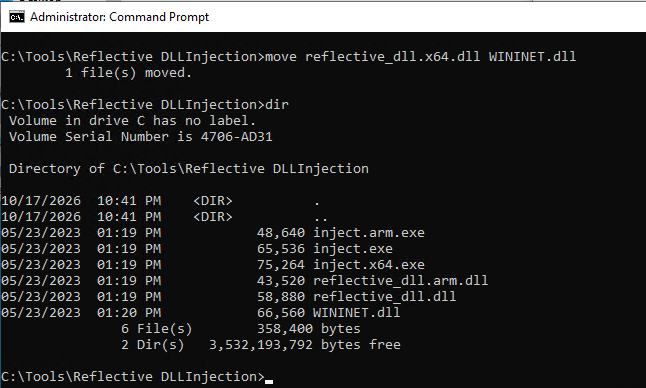
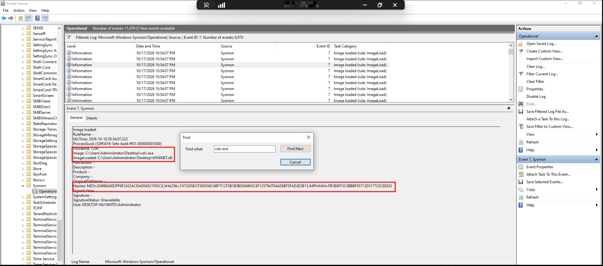
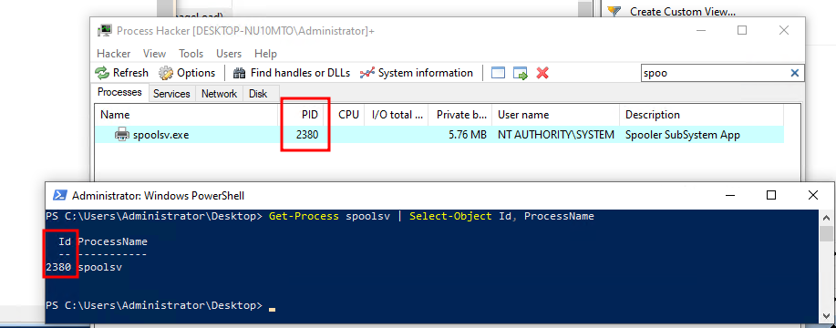
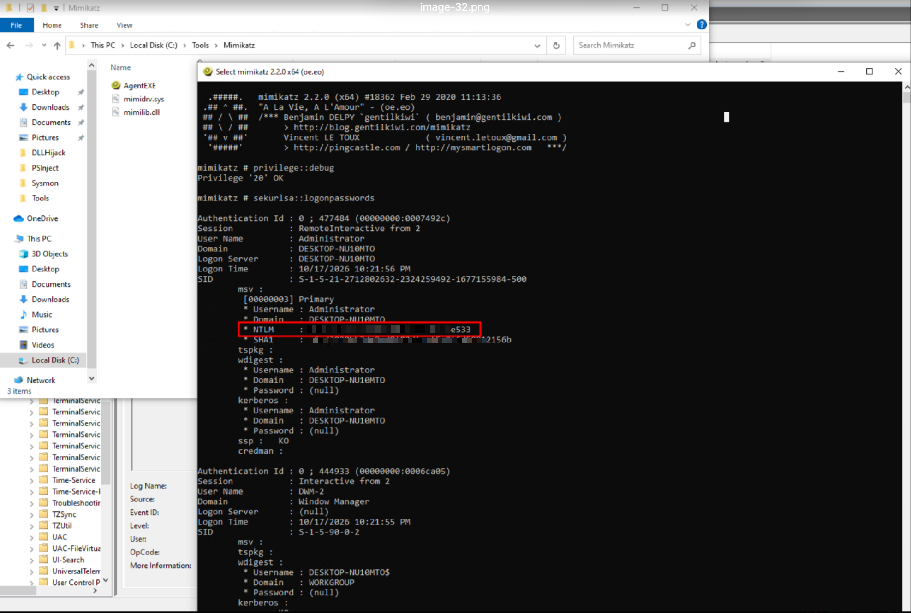

Trois exercices HTB Academy autour des chargements de DLL (Sysmon `7`) et de l'accès à LSASS. Les valeurs demandées sont à relever sur la machine du lab ; aucun hash de réponse n'est publié ici.

## Question 1 — DLL hijacking : WININET.dll

**Énoncé HTB Academy.** Reproduire le détournement de DLL et relever le SHA256 de la `WININET.dll` chargée par `calc.exe`.

Méthode et variantes de recherche : [Repérer un DLL hijacking › Chercher, étape par étape](../../../../../cheatsheets/windows/reperer-une-attaque/reperer-un-dll-hijacking.md#chercher-etape-par-etape).

1. Dans `C:\Tools\Reflective DLLInjection`, renommer `reflective_dll.x64.dll` en `WININET.dll`.

    

2. Copier `calc.exe` depuis `C:\Windows\System32` vers un dossier modifiable, ici le bureau, et y placer aussi `WININET.dll`.

    

3. Exécuter la copie de `calc.exe`. La boîte de dialogue confirme que la DLL de démonstration a été chargée.

    

4. Dans `Microsoft-Windows-Sysmon/Operational`, filtrer l'Event ID `7` puis utiliser **Find** sur `calc.exe`. Dans l'événement retenu, comparer `Image` (l'exécutable du bureau), `ImageLoaded` (la DLL du bureau) et `Hashes` (son SHA256).

    

5. Pour cibler directement ce chargement de DLL, utiliser le filtre XML :

```xml
<QueryList>
  <Query Id="0" Path="Microsoft-Windows-Sysmon/Operational">
    <Select Path="Microsoft-Windows-Sysmon/Operational">
      *[
        System[EventID=7]
        and EventData[
          Data[@Name='ImageLoaded']='C:\Users\Administrator\Desktop\WININET.dll'
        ]
      ]
    </Select>
  </Query>
</QueryList>
```


`System` retient les chargements de modules ; `EventData` limite les résultats à cette DLL. Dans l'événement obtenu, vérifier que `Image` correspond à la copie de `calc.exe`, puis lire la valeur `SHA256=` dans `Hashes`.

## Question 2 — PowerShell non managé : spoolsv.exe

**Énoncé HTB Academy.** Reproduire l'injection avec PSInject et relever le SHA256 de `clrjit.dll` chargée par `spoolsv.exe`.

Méthode et variantes de recherche : [Repérer du PowerShell non managé › Chercher, étape par étape](../../../../../cheatsheets/windows/reperer-une-attaque/reperer-du-powershell-non-manage.md#chercher-etape-par-etape).

1. Relever le PID du Print Spooler dans Process Hacker ou avec PowerShell :

    ```powershell
    Get-Process spoolsv | Select-Object Id, ProcessName
    ```


    

2. Depuis `C:\Tools\PSInject`, exécuter l'essai décrit dans le cours avec `Invoke-PSInject` en ciblant ce PID. Dans Process Hacker, comparer les modules de `spoolsv.exe` avant et après l'essai.

    

3. Dans les événements Sysmon `7`, la requête utilisée pendant le lab cible `spoolsv.exe` et le chargement de `clr.dll` :

```xml
<QueryList>
  <Query Id="0" Path="Microsoft-Windows-Sysmon/Operational">
    <Select Path="Microsoft-Windows-Sysmon/Operational">
      *[
        System[EventID=7]
        and EventData[
          Data[@Name='Image']='C:\Windows\System32\spoolsv.exe'
          and Data[@Name='ImageLoaded']='C:\Windows\Microsoft.NET\Framework64\v4.0.30319\clr.dll'
        ]
      ]
    </Select>
  </Query>
</QueryList>
```


`Image` désigne le processus et `ImageLoaded` la DLL chargée. Ce filtre documente bien l'observation de `clr.dll` ; pour répondre à l'énoncé sur `clrjit.dll`, relever le `SHA256=` dans `Hashes` de l'événement correspondant à **cette** DLL, sans confondre les deux fichiers.


## Question 3 — Credential dumping : LSASS

**Énoncé HTB Academy.** Reproduire l'essai avec les outils de `C:\Tools\Mimikatz` et relever le hash NTLM du compte `Administrator`.

Côté détection : [Repérer un accès à LSASS › Chercher, étape par étape](../../../../../cheatsheets/windows/reperer-une-attaque/reperer-un-acces-a-lsass.md#chercher-etape-par-etape).

1. Ouvrir `AgentEXE` depuis ce dossier, puis examiner la sortie Mimikatz obtenue dans le lab. Repérer la session du compte `Administrator`.
2. Dans la section `msv`, distinguer la ligne `NTLM` de `SHA1` et des champs `Password`. La capture du lab montre où lire la valeur demandée ; les hashes y sont partiellement masqués.

    

3. Pour l'angle détection, consulter les événements Sysmon `10` et vérifier les champs `SourceImage` et `TargetImage` lorsqu'un processus accède à `lsass.exe`. Cet événement atteste un accès entre processus, pas à lui seul une extraction réussie.
