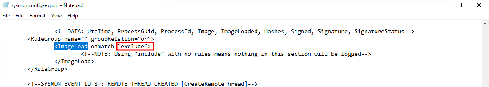
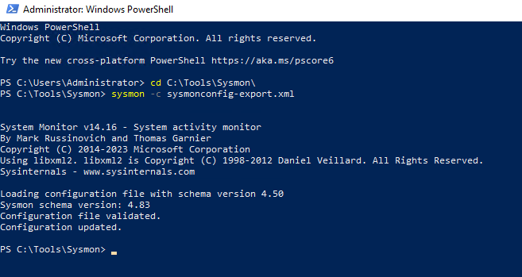
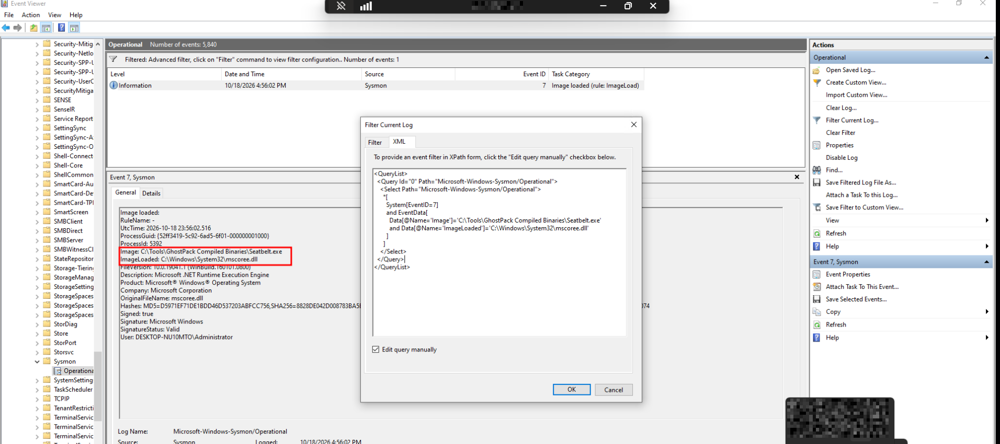
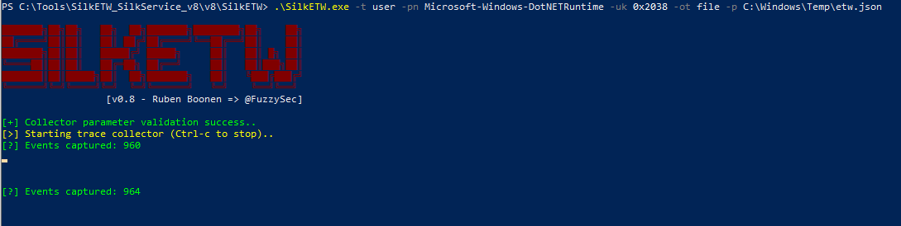
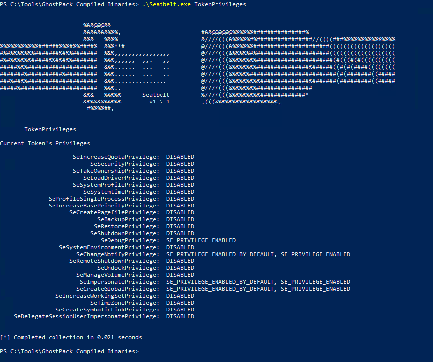
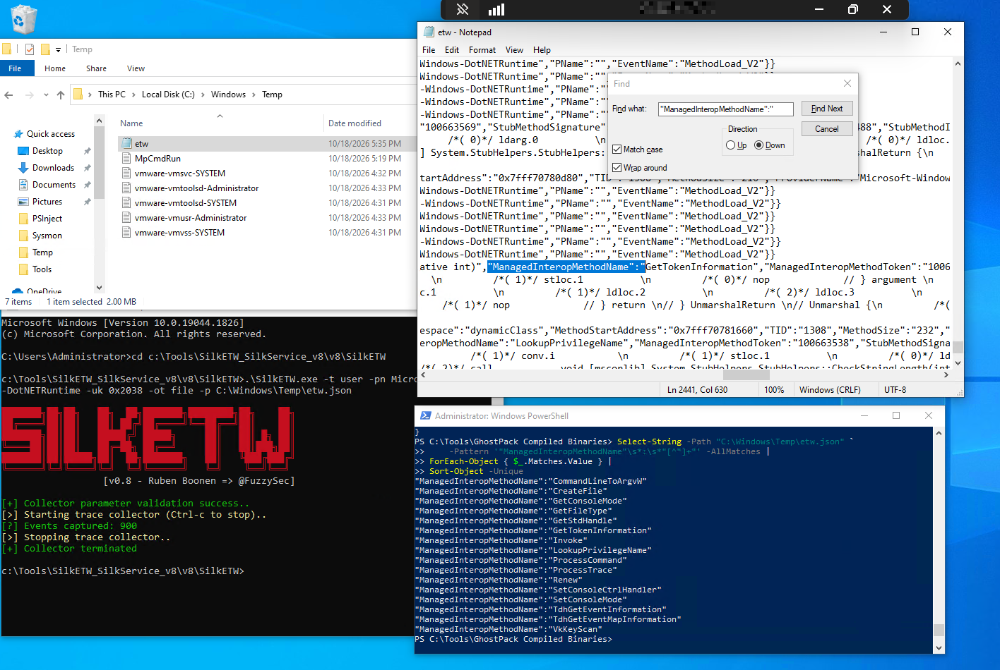

Ce lab reprend le scénario Seatbelt du cours : observer d'abord le chargement de `mscoree.dll` avec Sysmon, puis rechercher des noms de méthodes dans la trace `Microsoft-Windows-DotNETRuntime` collectée avec SilkETW.

## Question 1 — Suivre Seatbelt avec Sysmon et ETW

1. Dans la configuration Sysmon du lab, régler `ImageLoad` sur `onmatch="exclude"` sans règle d'exclusion pour enregistrer les chargements de DLL.

    

2. Appliquer le fichier de configuration depuis `C:\Tools\Sysmon` et vérifier que Sysmon confirme sa mise à jour.

    ```powershell
    sysmon -c sysmonconfig-export.xml
    ```


    

3. Exécuter `Seatbelt.exe TokenPrivileges` depuis `C:\Tools\GhostPack Compiled Binaries`.

    

4. Dans `Microsoft-Windows-Sysmon/Operational`, filtrer l'Event ID `7` pour retrouver le chargement de `mscoree.dll` par `Seatbelt.exe` :

    ```xml
    <QueryList>
      <Query Id="0" Path="Microsoft-Windows-Sysmon/Operational">
        <Select Path="Microsoft-Windows-Sysmon/Operational">
          *[
            System[EventID=7]
            and EventData[
              Data[@Name='Image']='C:\Tools\GhostPack Compiled Binaries\Seatbelt.exe'
              and Data[@Name='ImageLoaded']='C:\Windows\System32\mscoree.dll'
            ]
          ]
        </Select>
      </Query>
    </QueryList>
    ```


    `Image` désigne le processus et `ImageLoaded` la DLL. Cet événement montre l'initialisation .NET, pas encore les méthodes exécutées.

    

5. Lancer SilkETW avec le provider `Microsoft-Windows-DotNETRuntime` et les keywords utilisés dans le cours. La trace est écrite dans `C:\Windows\Temp\etw.json`.

    ```powershell
    .\SilkETW.exe -t user -pn Microsoft-Windows-DotNETRuntime -uk 0x2038 -ot file -p C:\Windows\Temp\etw.json
    ```


    

6. Pendant que SilkETW collecte, relancer `Seatbelt.exe TokenPrivileges`, puis arrêter la collecte.

    

7. Dans le fichier JSON, chercher `ManagedInteropMethodName` avec PowerShell plutôt que de parcourir manuellement la trace :

    ```powershell
    Select-String -Path "C:\Windows\Temp\etw.json" `
        -Pattern '"ManagedInteropMethodName"\s*:\s*"[^"]+"' -AllMatches |
    ForEach-Object { $_.Matches.Value } |
    Sort-Object -Unique
    ```


    

La recherche retourne les noms distincts présents dans toute la trace. Pour attribuer un événement à cette exécution de Seatbelt, il faut le replacer dans son contexte (heure et processus), et ne pas se fonder sur le seul nom d'une méthode.
